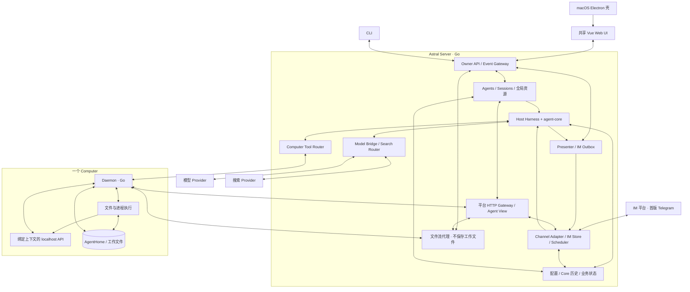
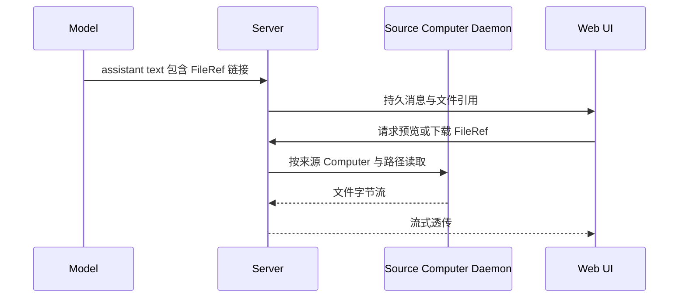

# Astral 系统规格

版本：1.8

日期：2026-10-22，Asia/Singapore

状态：V1 实现规范，尚非功能交付声明

Astral 是一个可自托管、持久运行的个人 Agent 平台。一个 Server 管理多个 Agent、持久 Session、模型、搜索服务、IM 连接和 Computer；Agent 在 Session 中理解消息，通过基础工具操作 Computer，通过本地 HTTP API 使用平台能力。

本规格中的技术对象 Agent，在产品界面中称为 Bot；Computer 的中文名称为“电脑”。产品命名、页面关系、统一设计语言、设置生效方式与反馈以 [UI UX 规范](docs/ui-ux-spec.md)为准；代码类型和 API 字段不因显示名称变化而自动重命名。

本规格汇总 PRD v1.1 与本轮确认的系统决策，并收敛前端工程选型。冲突处采用本规格中的最新行为：首版 IM 仅支持 Telegram、IM 显式发送与可选 LLM Probe、文件保留在 Computer、通过本机快捷入口或目标机器上的接入命令添加 Computer、Daemon 提供按 Agent 绑定视图的 localhost API、Bash 直接执行、通过正常结束保持沉默。Core 的实现依据为本地 `../agent-core`，消息表达参考 `../Cahciua`，前端技术与工程组织参考 `../memoh`。

“必须”表示实现和验收要求。“示例”表示数据结构或接口表达，字段的最终编码由正式接口契约统一。尚未选择的实现细节集中列于第 17 节，不削减已确认的产品范围。

目录：

1. [产品与首版范围](#1-产品与首版范围)
2. [核心决策](#2-核心决策)
3. [对象与作用域](#3-对象与作用域)
4. [系统架构](#4-系统架构)
5. [部署与进程生命周期](#5-部署与进程生命周期)
6. [技术栈与工程组织](#6-技术栈与工程组织)
7. [模型视角与基础工具](#7-模型视角与基础工具)
8. [入站消息与上下文](#8-入站消息与上下文)
9. [Loop 与显式发送](#9-loop-与显式发送)
10. [平台 HTTP Gateway](#10-平台-http-gateway)
11. [文件与媒体](#11-文件与媒体)
12. [模型与搜索资源](#12-模型与搜索资源)
13. [UI 与 Settings](#13-ui-与-settings)
14. [持久化与恢复](#14-持久化与恢复)
15. [输出与接口契约](#15-输出与接口契约)
16. [验收矩阵](#16-验收矩阵)
17. [实现时待细化](#17-实现时待细化)
18. [依据与替代关系](#18-依据与替代关系)

## 1 产品与首版范围

### 产品目标

用户可以创建多个 Agent，为其选择模型、搜索服务、可用 Computer 和 IM Conversation；从 Web 或桌面进入任何 Session，发送任务、观察进度、停止执行、查看结果。Agent 可以读写文件、执行命令、搜索互联网、参与 IM 对话，并在多台 Computer 之间切换。

Session 的历史与工作状态持久保存。关闭窗口、浏览器断线或切换 Computer，不会把它变成一个新的无状态聊天。IM 普通群消息持续提供上下文，需要行动的消息再激活模型；模型正常结束且未显式发送时保持 IM 沉默。

### V1 完整范围

| 领域 | 首版要求 |
| --- | --- |
| 部署 | macOS Desktop、Linux Headless 的完整共享 Web UI、CLI |
| 执行 | Go Server、Go Computer Daemon、接入本地 agent-core |
| Agent | 多 Agent，独立资源选择与 Conversation 绑定 |
| Session | 持久历史、流式生成、运行中输入、Stop、Compaction、Fork |
| Computer | Local macOS/Linux、Container、Remote macOS/Linux；使用本机/本机容器快捷入口、复制命令接入及可选容器模式、AgentHome、运行中由 Agent 切换 |
| 模型 | Provider 配置、可编辑 Model Profile、直接使用、Session 临时选模 |
| 搜索 | 全局搜索 Provider，每个 Agent 单选一个统一 `web_search` 后端 |
| IM | 仅 Telegram，支持群、私聊与 Topic；独立 Conversation Session、静默观察、触发激活、持续上下文、可选主动模式、显式工具/API 发送 |
| 文件 | Computer 本地存储、来源明确的引用、流式预览与下载、IM 文件发送 |
| UI | Sidebar、Transcript、Activity Line、Composer、Settings、按需 Contextual Surface |
| 运行支撑 | 真实状态、错误与不确定效果呈现、连接诊断、历史对账 |

工程可以按依赖顺序分阶段实现；上述能力共同构成首版，不以缩减为单端或单 Computer 的 MVP 替代。IM 首版范围以 Telegram 为准。

IM 架构从首版按多平台设计。后续明确支持 QQ（NapCat 接入、官方接入）、飞书等平台；这些属于后续交付范围，通过新增 Channel Adapter 接入已有的事件、Session、Gateway 与出站处理，不重建一套平台专属 Agent 系统。

### 明确非目标

- Workflow Builder、内置 Subagent 工作流系统、强制 Probe 模型。
- Browser Automation、浏览器接管或截图、完整桌面自动化产品。
- 多搜索引擎聚合、搜索 Provider 自动回退。
- 多个 IM Conversation 合并为同一个共享 Session。
- 首版内交付 QQ（NapCat/官方）、飞书等后续 IM 适配；它们是明确的后续扩展方向，不属于本轮交付范围。
- 多 Host 自动同步、双主复制、内置 NAT 穿透、P2P 或托管 VPN。
- 团队 SaaS、多用户 RBAC、计费门户。
- 自动长期记忆、Embedding 平台、MCP 市场或技能商店。
- Android 专用 Computer、独立 TUI、大型运维 Dashboard。
- Agent Settings 中的独立 System Prompt 编辑器、逐工具开关和复杂权限规则编辑器。

## 2 核心决策

| ID | 决策 |
| --- | --- |
| D01 | Server 和 Daemon 使用 Go；业务编排在 Server，执行端操作在 Daemon。 |
| D02 | Harness 使用本地 `../agent-core`，其 Go module 当前为 `github.com/oines/astral-core`。 |
| D03 | 前端使用 Vue 与 `markstream-vue`，其余技术与工程组织参考 Memoh。 |
| D04 | macOS Desktop 和 Linux 浏览器复用同一 Web 应用及核心产品功能。 |
| D05 | 首版单 Owner、多 Agent、多 Session；全局资源、Agent 选择、Session 当前状态分层。 |
| D06 | 每个接入聊天稳定绑定一个持久 Session；一个 Session 最多绑定一个聊天。Topic 独立识别。 |
| D07 | IM 账号属于 Agent，范围为全部聊天或指定聊天；默认指定且为空，不使用绑定码或群成员权限名单。 |
| D08 | 普通群消息持续 InjectContext 并按预算 compact；私聊、@、回复 Bot 和已绑定 Session 的 Web 输入直接 Steer。 |
| D09 | 模型可见消息沿用 Cahciua 的紧凑 XML，并补充 Astral 的来源与稳定身份信息。 |
| D10 | assistant text 在 Web 正常显示；IM 只由 send_message 或显式 Computer API 调用发送。 |
| D11 | 聊天主动模式默认关闭；开启时 LLM Probe 只返回参与布尔值，Host 中性唤起，主 Agent 独立决定行为。 |
| D12 | 基础文件和命令工具使用 Session 当前 Computer/CWD；Agent 可调用 `switch_computer`。 |
| D13 | 已派发调用、已有进程和文件引用绑定原 Computer，不随之后的切换漂移。 |
| D14 | AgentHome 属于 Agent 与 Computer 的组合，同一 Agent 的多个 Session 可以共享它。 |
| D15 | Bash 命令直接执行，不增加逐命令审批；操作系统与所选 Computer 的实际执行环境决定可执行范围。 |
| D16 | Daemon 将平台 HTTP Gateway 暴露为 Computer 内的 localhost 入口；模型调用时无需 Token。 |
| D17 | 调用身份由 Daemon 与平台绑定和验证；每个 Agent 得到自己的数据与能力视图。 |
| D18 | 工作文件与 Web 附件留在 Computer；IM 接收不创建 Computer 文件，图片在内存处理并冻结到 Core，原附件通过 API 按需流式下载。 |
| D19 | Web FileRef 可预览下载；绑定聊天使用 send_message 发送文字及文件，跨聊天发送通过 Computer API 明确指定。 |
| D20 | 模型与搜索凭据按全局资源配置；一个 Agent 同一时间仅选用一个搜索 Provider。 |
| D21 | Transcript 是产品中心；普通工具过程折叠为 Activity Line，详情按需展开。 |
| D22 | 持久事实、临时流式事件和平台业务状态分别管理，再由 Presenter 合成界面。 |
| D23 | 首版 IM 仅交付 Telegram；QQ（NapCat/官方）、飞书等平台后续支持，不属于首版适配器实现与验收范围。 |
| D24 | 命令接入方式为复制平台生成的一条命令，在目标机器执行后自动注册。勾选“使用容器”时，该命令在目标机器创建容器并运行 Daemon，将容器注册为独立 Computer。 |
| D25 | Add Computer 提供“使用本机”“使用本机容器”快捷入口，Desktop 与 Headless 都支持，由平台自动完成本机接入步骤。“本机”指 Server 部署所在机器，不随访问网页的设备改变。 |
| D26 | IM 从首版采用多平台适配架构，区分平台与接入方式。QQ NapCat 与 QQ 官方使用独立适配器，复用统一的消息、Conversation、Session、Gateway 和发送回执契约。 |

## 3 对象与作用域

```text
Owner
├── 全局资源
│   ├── Model Providers / Model Profiles
│   ├── Web Search Providers
│   └── Computers
└── Agents
    ├── 默认资源与 Allowed Computers
    ├── Channel Connections
    │   └── Conversations
    ├── Web Sessions
    └── Conversation Bindings
        └── 每个 Conversation 的独立 IM Session

Session
├── 当前 Model
├── 当前 Computer / CWD
├── 持久历史 / Pending / Compaction / Fork
└── 一次只有一个活跃 Run
```

| 对象 | 含义与所有权 |
| --- | --- |
| Server / Host | 同一平台服务边界。Server 指部署进程，Host 指其相对于 Core 承担的宿主职责。 |
| Agent | 用户配置的稳定身份、默认资源和可见能力集合；不是一台机器，也不是一次模型调用。 |
| Session | 属于某个 Agent 的持久对话和工作状态；Web 或某个 IM Conversation 的工作入口。 |
| Run | 一次活跃执行，可以包含多次模型调用和工具步骤；完成后 Session 继续存在。 |
| Turn / Attempt | Core 的模型步骤与尝试边界，供执行与诊断使用，不作为日常 UI 的主要名词。 |
| Computer | 可复用的文件、命令、进程执行端点，可以是本机、容器或远程机器。 |
| Daemon | Computer 侧的 Go 服务，承担执行、进程交互、文件流和本地 Gateway 入口。 |
| AgentHome | 同一 Agent 在某个 Computer 上的默认工作目录；不是 Session 专属目录，也不等同于文件沙箱。 |
| Model Profile | 模型身份、限制、能力、价格和兼容性配置；多个 Agent 可引用。 |
| Channel Connection | 属于一个 Agent 的平台账号连接实例，记录所属平台与具体接入方式；同平台、同接入方式均可有多个凭据、权限和聊天相互独立的 Connection。 |
| Conversation | Connection 下的群、私聊或 Topic；平台内 ID 必须与 Connection 一起解释。 |
| Conversation Binding | Conversation 到 Agent 和持久 Session 的入站关联。 |
| FileRef | 指向文件来源 Computer 与路径或源端版本的引用；不是 Server 上的文件副本。 |
| Gateway View | 平台根据绑定的 Agent、Session、Computer 生成的数据与能力视图。 |

必须保持以下关系：

1. `DefaultComputer ∈ AllowedComputers`，允许 Default 为空。
2. 新增全局 Computer 不自动扩张现有 Agent 的 Allowed Computers。
3. 新 Session 继承 Agent 的默认模型与默认 Computer；之后的 Session 临时选择不反写默认值。
4. 一个启用的 Conversation 只能绑定一个 Agent/Session；解绑保留旧历史，重新分配不隐式迁移历史。
5. 切换 Computer 不改变 Agent、Session 或 Rollout 身份。
6. 同一 Agent 的 Session 共享 AgentHome 时，文件操作可以互相影响；独立上下文不意味着独立文件系统。
7. Computer 不可用、资源缺失或权限撤销时明确报错，不自动替换为其他资源。
8. 其他 Session 的消息不会自动进入当前上下文；查询历史通过当前 Agent 的平台视图进行。

## 4 系统架构



### Server 的职责

- 管理 Owner 入口、Agent、Session、全局资源、Conversation 绑定和业务配置。
- 在进程内接入 Core，拥有 Session 的执行调度权，组装 System Prompt、环境说明与输入。
- 提供 Model Bridge、搜索适配、工具目标绑定、Daemon 调用、平台 Gateway。
- 归档 IM 事件，管理按序观察投递、唤醒调度、出站消息与回执。
- 将持久事实和实时事件投影为 Transcript、Activity Line 与 Diagnostics。
- 提供共享 Web 应用、Owner API、事件接口以及不落盘的文件流代理。

### Core 的职责

Core 提供模型循环、工具调用阶段、输入队列、安全边界、持久 Session、历史、Compaction、Fork 和执行事件。产品 Agent 配置、IM 平台、Computer 发现与授权、HTTP Gateway、文件展示、UI 均由 Host 接入。

产品中的 Agent 与 SDK 中的执行器类型不能混为一谈。一个产品 Agent 可以拥有多个 Session；每个 Session 的执行与持久状态必须独立。

### Daemon 的职责

- 为其 Computer 执行文件操作、命令和进程交互，返回真实输出及状态。
- 管理源端文件读取、写入、上传与下载流。
- 为 Agent 执行上下文提供绑定的 localhost HTTP 入口。
- 与 Server 完成内部连接、身份关联、状态报告及请求关联。
- 在工具派发时使用已经确定的 Computer、CWD 和执行身份，不根据后续 UI 选择重新解释调用。

同机部署仍使用同一套 Computer/Daemon 语义。远程与容器接入不能绕过这一边界，直接把远端路径当成 Server 的本地路径。

### 多 IM 适配边界

Server 的 Channel 层负责具体平台协议。核心业务只依赖统一的 Connection、Conversation、规范化事件、附件引用、发送意图和回执，不直接依赖 Telegram SDK 类型、Token 格式、Chat ID 形态或 Topic 必然存在的假设。

平台与接入方式分别记录，示例标识如下，正式编码由接口 Schema 固定：

| 平台 | 接入方式示例 | 交付范围 |
| --- | --- | --- |
| Telegram | `telegram.bot` | 首版 |
| QQ | `qq.napcat` | 后续 |
| QQ | `qq.official` | 后续 |
| 飞书 | `feishu.app` | 后续 |

QQ NapCat 与 QQ 官方是同一平台下的两种接入方式，分别实现凭据、连接、事件映射和能力适配。同一账号或相似的平台 ID 不使两个 Connection 自动合并，Conversation 与消息身份仍按 Connection 作用域解释。

每个 Adapter 承担以下职责：

- 验证连接配置，管理平台连接、凭据、连接状态及诊断。
- 将真实收到的平台事件转换为规范化事件，保留源平台与 Connection 信息。
- 获取或验证 Conversation，将群、私聊、Topic、线程等映射到实际支持的能力。
- 将统一的文本或文件发送意图转换为平台调用，完成格式处理、必要拆分与平台回执关联。
- 声明并暴露实际能力，例如 Conversation 枚举、回复引用、消息编辑、事件撤回通知、文件发送和大小限制。

平台能力不齐时明确表示“不支持”或“平台未提供”。统一事件格式描述可表达的事件集合，不要求所有平台都能提供每类事件；Adapter 不伪造删除通知、消息回显或送达事实。持续观察、直接激活、LLM Probe、显式发送、Session 绑定与 FileRef 来源由统一业务层处理。

首版只注册和展示已实现的 Telegram Adapter。新增 QQ、飞书等适配器时，按实际能力增加对应连接配置和展示，不在首版放置无法使用的连接入口，也不为每个平台复制 Harness、Gateway 或 Session 系统。

## 5 部署与进程生命周期

### macOS Desktop

桌面壳参考 Memoh 的 Electron、electron-vite 和 electron-builder 工程组织，复用共享 Web 页面、路由、状态、SDK 和样式。Astral 的桌面发行包需要启动并管理本地 Go Server 与本机 Daemon，安装后即可注册 Local Mac Computer；这由 Astral 的自托管产品要求决定。

桌面壳负责窗口、菜单、Dock/托盘、登录启动、文件选择与本地服务生命周期。Agent Loop、业务数据和渠道连接属于 Go Server。Web Renderer 通过平台 API 使用能力，原生接口仅承担必要的桌面集成。

关闭窗口是否继续驻留由 General 设置控制。窗口关闭和页面卸载本身不能直接删除 Session 或取消所有任务。

### Linux Headless

`astral serve` 启动常驻 Server，提供构建后的同一 Web UI、API 和事件接口。部署同时提供 Local Linux Computer 对应的 Daemon。用户在浏览器内完成首次配置、聊天、设置、文件查看和后续操作。

Linux Server 的 Local Computer 是 Linux 服务所在机器。访问网页的笔记本不因打开浏览器就成为 Computer；需要操作它时，显式安装或连接 Daemon、注册 Computer 并关联到 Agent。

### 添加 Computer 的入口

用户添加 Computer 的统一入口为 `Settings → Computers → Add Computer`，提供三种方式：

| 入口 | 用户操作 | 平台行为 |
| --- | --- | --- |
| 使用本机 | 点击快捷入口 | 复用当前部署的 Local Computer；尚未初始化时自动准备、连接并注册本机 Daemon |
| 使用本机容器 | 点击快捷入口 | 在当前部署的本机容器运行时中创建容器、启动 Daemon，自动注册为独立 Computer |
| 连接其他机器 | 复制命令，在目标机器执行；可勾选“使用容器” | 目标机器上的 Daemon 连接 Server 后自动注册 |

两个本机快捷入口在 macOS Desktop 与 Linux Headless 的共享 Web UI 中都可用，不要求用户复制命令或切到终端。“本机”始终指 Server 部署所在机器：Desktop 为其本地 Mac，Headless 为运行 Server 的服务器；浏览器所在设备不改变这一目标。

平台显示实际目标的名称和操作系统，帮助用户在远程访问 Headless 时识别执行位置。“使用本机”优先复用已有 Local Computer，重复点击不新增同一执行端的重复记录；“使用本机容器”每次明确新增一台独立容器 Computer，同一次创建请求的重试不能重复创建。

本机快捷方式复用接入命令所使用的安装、容器准备和注册能力。缺少本机执行端能力、容器运行时不可用或创建失败时，界面显示实际原因与处理入口；只有 Daemon 成功连接后才显示在线。

### 通过命令添加 Computer

选择“连接其他机器”后，平台展示“使用容器”选项及一条可复制的接入命令；用户在希望接入的目标机器上执行，Daemon 连接 Server 后自动完成注册。

| 模式 | 命令在目标机器上的行为 | 注册结果 |
| --- | --- | --- |
| 普通模式 | 安装或启动 Daemon，并连接指定的 Astral Server | 直接使用该机器执行环境的 Computer |
| 使用容器 | 使用目标机器已有的容器运行时创建容器，在容器内启动 Daemon 并连接 Server | 一台独立的 Container Computer |

命令在哪台机器执行，执行环境就创建在哪里。主流程不要求在平台选择宿主机、填写远程机器端点或手工处理 Daemon 证书，也不要求先把宿主机注册为 Computer。名称可在接入后修改；容器模式提供可直接使用的默认镜像与持久数据配置，不把镜像、挂载、CPU、内存变成首次接入的必填表单。

例如，用户已经接入一台远程 Mac mini，且该机器安装了 OrbStack。再次 Add Computer、选择“连接其他机器”、勾选“使用容器”、复制命令并在这台 Mac mini 执行后，列表中新增一台 Container Computer。如果这台 Mac mini 本身就是 Server 部署机器，也可以直接点击“使用本机容器”。原 Mac mini Computer 保留；两者拥有独立身份、执行目标和 Agent 关联。它们不自动共享 AgentHome 或工作文件，显式挂载的目录按实际配置解释。

接入命令携带或取得目标 Server 信息及本次注册所需的凭据，自动完成平台连接；凭据交付、有效期和重复执行语义在实现时细化。正常运行的连接仍需内部身份验证，不能把“执行命令后自动添加”实现成任何匿名 Daemon 都能注册。

### Container 与 Remote

容器的创建动作发生在所选接入方式确定的机器上：本机快捷入口由平台调用本机容器运行时；命令接入由用户在目标机器执行命令调用当地运行时。Daemon 运行在容器内；平台维护 Computer 的注册、连接状态和 Agent 关联。首版支持当前部署本机的快捷创建，不要求远程选择宿主机、跨机器调度容器或提供完整的容器编排管理界面。

目标机器需要具备对应容器运行时；缺失或不可用时，本机快捷入口在 UI 中显示具体错误和处理指引，命令接入在终端提供对应信息，不注册一台虚假的在线 Computer。持久工作数据保留在目标机器提供给容器的数据卷中。

Remote Computer 同样通过在目标机器执行接入命令连接 Server，网络由用户自备。V1 不负责自动建立 VPN、NAT 穿透或中继网络。

Server 与 Daemon 的内部传输必须支持请求关联、取消、增量输出、文件流、连接状态与身份验证；跨主机连接使用安全传输。具体采用 gRPC、HTTP 多路流或其他传输不在本规格中提前固定。

### CLI

CLI 复用 Server 的业务入口，支持服务启动、连接与基本资源/Session 操作、诊断。CLI 不拥有另一套 Agent 状态，也不单独实现模型循环。

不同 Server 部署拥有各自的数据域。桌面与 Linux 使用相同前端，不表示两个 Server 自动同步 Session。

## 6 技术栈与工程组织

### 服务端

Server、Daemon 和 CLI 使用 Go modules；Core 作为独立 Go 库接入。开发时允许通过本地 workspace 关联 `../agent-core`，发布构建必须锁定明确的 Core 版本或提交，不能依赖开发者机器上的绝对目录。

本地 Core 当前声明最低 Go 1.23。项目使用 `mise` 锁定实际 Go 工具链，保证其满足 Core 要求。HTTP 框架、业务数据库和迁移工具另行收敛；参考 Memoh 的前端工程并不自动引入其 PostgreSQL、Qdrant、Rust 或其他后端依赖。

### 前端选型

以下版本为参考工作区在 2026-10-20 的依赖基线，安装时以项目统一 lockfile 为准。具体补丁更新不改变选型。

| 分类 | Astral 选型 |
| --- | --- |
| 应用框架 | Vue 3.5，Composition API，`<script setup lang="ts">` |
| 类型系统 | TypeScript 6，strict，`vue-tsc` |
| 构建 | Vite 8，`@vitejs/plugin-vue` |
| 路由 | Vue Router 5；共享业务路由，由 Web/Desktop 入口选择 history |
| 客户端状态 | Pinia 3；仅对合适的界面偏好使用 persisted state |
| 服务端查询缓存 | Pinia Colada |
| 样式 | Tailwind CSS 4，CSS 主题变量，`@tailwindcss/vite` |
| UI 基础 | 参考 Memoh 的 `@felinic/ui`、Reka UI、class-variance-authority 组合，集中维护共享组件和 tokens |
| 表单 | vee-validate 与 Zod；统一兼容版本，避免包间 schema 类型分裂 |
| Markdown | `markstream-vue` 2.0 作为共享渲染入口 |
| 代码与富文本 | Shiki、Mermaid、KaTeX，按能力按需加载 |
| 图标 | lucide-vue-next；平台、品牌图标集中于共享 icons 包 |
| 国际化 | vue-i18n，初始维护中文与英文 |
| 辅助能力 | VueUse；长列表需要时使用 TanStack Vue Virtual，表格需要时使用 TanStack Vue Table |
| 文件与执行详情 | Monaco/stream-monaco 用于代码与 Diff 查看；xterm 用于终端输出表面 |
| 桌面 | Electron、electron-vite、electron-builder |
| SDK | `@hey-api/openapi-ts`、client-fetch、Pinia Colada 生成插件 |
| 测试与检查 | Vitest、ESLint flat config、typescript-eslint、vue-eslint-parser、eslint-plugin-vue |
| 包与任务管理 | pnpm 10 workspace、统一 lockfile、mise |
| 提交与版本工具 | Husky、lint-staged；bumpp 管理需要同步的包版本 |

Markstream、Vue、Pinia 和路由等共享运行依赖由同一 workspace 基线管理。参考仓库当前 Web 使用 Markstream 2.0.0、Desktop 仍声明 1.0.7；Astral 必须统一到共享 Web 使用的同一版本，避免两个客户端渲染行为分裂。Vue 与表单上下文依赖需要 dedupe，不能在共享组件和应用中加载两份互不相认的实例。

Memoh 中用于 Browser/Computer Use、任意停靠工作台或复杂图表的依赖，只在 Astral 的实际功能需要时引入。组件能力不得反向改变本规格的导航、单条 Activity Line 和按需 Contextual Surface。

### 目标目录

```text
astral/
├── SPEC.md
├── go.mod
├── cmd/
│   ├── server/
│   ├── daemon/
│   └── astral/
├── internal/
│   ├── agents/
│   ├── sessions/
│   ├── computers/
│   ├── channels/
│   ├── modelbridge/
│   ├── search/
│   ├── gateway/
│   ├── presenter/
│   ├── filestream/
│   └── persistence/
├── apps/
│   ├── web/
│   └── desktop/
├── packages/
│   ├── ui/
│   ├── sdk/
│   ├── icons/
│   └── config/
├── spec/
│   └── openapi/
├── scripts/
├── docs/
├── pnpm-workspace.yaml
├── pnpm-lock.yaml
└── mise.toml
```

`apps/web` 按 pages、components、composables、stores、lib、i18n 组织。桌面壳引用共享模块，不复制页面和业务 Store。生成的 SDK 独立放在 `packages/sdk`，禁止手工修改生成文件。

### API 与工程流程

1. Go API 契约是前端类型来源；维护 OpenAPI 定义或由后端声明生成 OpenAPI。
2. 从 OpenAPI 生成 TypeScript 类型、fetch SDK、适用的 Pinia Colada 查询与变更封装。
3. SSE、WebSocket 或其他持续事件流由独立 composable 处理，不能当作一次返回 `{ data }` 的普通 mutation。
4. 页面通过 SDK 和集中管理的 client 发请求；Base URL、Owner 认证、错误处理和连接状态集中管理。
5. Web 开发使用 Vite proxy；生产由 Server 提供 Web 资源和 API，桌面复用相同业务契约。
6. 本地可持久化主题、语言、折叠状态和最近选择；Session 历史、文件内容和真实执行状态以 Server/Computer 为准。
7. 资源变更后明确刷新对应 query/cache；实时事件按持久标识对账，不通过刷新整个页面掩盖状态错误。

工程脚本应提供统一的 `dev`、`build`、`lint`、`typecheck`、`test`、`openapi-generate`、`sdk-generate` 和桌面构建入口。Go 使用 gofmt、go test、golangci-lint；前端使用上述 lint/typecheck/test/build。CI 检查生成代码漂移、依赖锁定和对应端构建。

前端 TypeScript 开启 strict、noUncheckedIndexedAccess、noUnusedLocals、noUnusedParameters 等检查；ESLint 使用统一的 Vue/TypeScript flat config，统一单引号和无分号风格，生成 SDK 排除人工格式修订。mise 固定 Go、Node 与 pnpm 工具链，开发机与 CI 使用同一来源。Husky/lint-staged 负责提交前的必要检查，不能替代 CI；pnpm workspace 内部包使用 workspace 依赖。

UI tokens、共享组件和状态文案集中维护。依赖补丁按 pnpm patch 机制记录原因与上游版本，避免复制参考项目中与 Astral 无关的补丁。

## 7 模型视角与基础工具

### 模型可见边界

模型在某个 Agent 的某个 Session 中工作。一次模型请求应包含：

- Agent 的稳定身份与平台行为说明。
- Session 的来源与绑定 Conversation 信息。
- 当前 Computer、操作系统、Shell、CWD、AgentHome，以及可选择的 Computer 信息。
- 当前 Computer 的全局与工作区 Skills 目录，以及当前 CWD 的 `AGENTS.md` 内容和发现状态。
- localhost API 的入口和能力说明。
- 当前 Session 的有效历史、摘要、已应用观察、驱动输入及工具结果。
- 本次允许调用的工具定义和各工具自己的用法。

环境快照由 Host 的同步 `CollectContext` 接口返回为 `RoleUser`、`ContextKind=astral.environment` 的普通 Context。接口接收只读边界信息，Host 负责发现、内容和去重，Core 负责预算与提交；动态内容不放入 System Prompt 或 Developer Role，不改写旧消息。System Prompt 仅包含稳定的解释和使用规则。最近一条完整快照定义当前环境，旧快照仅记录历史环境。

创建 Session 时采集初始快照。平时在激活、完整 Assistant/工具结果批次结束后的安全边界，以及显式 Computer/CWD 切换时扫描；同一 Run 内的工具批次结束不是新一次用户激活。外部文件变化在下一次运行边界发现，不安装文件监视器，也不在每次 Provider 重试前扫描。内容不变不追加，追加本身不启动或延长 Run。

普通模型轮次统一进入 `prepareStep`：冻结分支、模型配置和有限输入选择范围；必要时仅对已提交的旧历史生成一次摘要草稿；摘要完成后同步调用 `CollectContext` 重新扫描。候选顺序为摘要与保留历史、待投递被动上下文、最新环境、驱动输入组。完整候选通过 token 与字节预算检查后，一次提交摘要、上下文、驱动输入和消费记录。新输入不参与旧历史摘要；内容相同也要为新 Compaction 提供一次完整快照。

采集、预算或提交失败时，旧有效上下文保持完整，所选输入保持待投递；未提交摘要可在重试时重算。模型及 Computer I/O 不持有会话锁或数据库事务；提交前重新核对分支和所选输入，后来接收的输入留待后续边界，被清除的输入不得投递。手动 Compaction 复用准备流程，不消费驱动输入，也不自动生成回答。

Host 对确定性内容计算指纹，与候选上下文中最近的快照比较，包含 Compaction ID，不包含采集时间等易变字段。A→B→A 必须保留两次变化；重开、网络重试和重复扫描不重复追加。Fork 继承既有 Computer/CWD，随后追加子 Session 自身的当前快照。历史、View 和上下文检查接口不采集环境、不修改会话配置；UI 所需模型预算预览仅在内存中计算。

Skills 由选中 Computer 的 Daemon 发现：全局根为其操作系统用户 Home 下的 `~/.agents/skills`，工作区根为 `<cwd>/.agents/skills`。支持嵌套分类目录和符号链接并防止循环，找到 `SKILL.md` 的目录视为技能包，不继续扫描包内示例。目录包含 YAML 中的 name、description、scope、绝对路径和文件内容哈希；正文按需读取。同名技能保留全部条目，以 scope 和路径区分。Workspace 指导仅来自准确的 `<cwd>/AGENTS.md`，不向父目录查找。

文件和根目录缺失是正常空状态；不可读、格式错误、扫描限额、Computer 离线、权限收回及旧 Daemon 不支持发现均显式记录，不以 Server 文件系统代替，也不沿用旧 CWD 的发现结果。单文件最多 1 MiB，一次扫描读取最多 16 MiB、目录条目预算 8192、递归深度 32；超限结果标记 partial。发现不可用仍允许纯文本对话，重新连接后的下次运行边界更新快照。

消息来源、执行机器和回复目的地分别确定。例如，在 Web 中打开一个 IM Session 输入 prompt，来源是 Web，执行机器仍由 Current Computer 决定，send_message 的目的地仍由该 Session 的绑定决定，assistant text 只显示在 Web。

### 模型工具

| 工具 | 作用 | 执行归属 |
| --- | --- | --- |
| `read` | 分页读取文本或支持的图片内容 | 当前 Computer 的 Daemon |
| `write` | 写入文件 | 当前 Computer 的 Daemon |
| `edit` | 对文件应用明确的编辑并返回变更信息 | 当前 Computer 的 Daemon |
| `exec_command` | 执行 Shell 命令，返回退出结果或可继续交互的进程句柄 | 当前 Computer 的 Daemon |
| `write_stdin` | 输入、轮询、发送中断等进程交互 | 进程原来所属的 Computer |
| `switch_computer` | 修改当前 Session 后续执行的 Computer/CWD | Host 控制工具 |
| `web_search` | 调用 Agent 当前选中的一个搜索 Provider | Server |
| `send_message` | 向当前绑定聊天发送文本或附件，返回持久回执 | 仅绑定 Session 提供的 Host 工具 |

讨论中的 Bash 能力由 `exec_command` 提供，不需要另注册一套重复的命令工具。基础文件和命令行为优先复用 Core 的 standardtools，Host 提供连接 Daemon 的 Backend。Core 当前标准工具没有现成的远程 Daemon 传输或产品级 Computer 注册能力，这些由 Astral 实现。

跨聊天发送、文件发送、IM 查询、历史查询等平台能力由 localhost API 提供；当前绑定聊天另提供 send_message。模型通过 `exec_command` 运行 curl 或脚本即可使用，无需逐个扩张模型工具列表。

### 执行目标与切换

`switch_computer(computer_id, cwd?)` 的目标必须在 Agent 的 Allowed Computers 中。缺省 CWD 使用该 Agent 在目标 Computer 上的 AgentHome，不继承之前机器的路径。

同一 Agent 创建的普通 Web/IM Session 默认使用该 Agent 在选中 Computer 上共享的 AgentHome，绑定成功后持久保存实际 CWD。对同一个 Computer 调用 `switch_computer` 并指定 cwd，只修改该 Session 的工作目录。单次 `exec_command.workdir` 或 Shell 的 `cd` 不修改 Session CWD，也不改变其他 Session 的默认目录。

切换必须单独成批，形成独立的工具执行边界。切换确认后再绑定后续文件与命令调用；不能提前把整个混合并行批次都绑定到旧 Computer，再期待其中一次切换改变其他调用。

用户仅能在 Session Idle 时从 UI 切换 Computer，后端也必须拒绝运行中的用户切换请求。Agent 可以在执行任务时使用控制工具切换。

每次派发固定以下语义：

```text
Owner / Agent / Session / Run
    + Invocation / Execution identity
    + Computer
    + CWD / Shell
    + 操作参数
```

这些信息由 Host 和 Daemon 绑定。`write_stdin` 根据进程句柄恢复原目标，不能把相同数字句柄在另一台机器上重新解释。访问撤销对新的派发生效；既有进程是否停止必须依据实际状态报告。

### Bash 与文件信任范围

Bash 命令直接执行，不增加逐命令的 Allow/Deny 流程。裸机 Computer 的文件与命令能力按 Daemon 实际运行的操作系统账户执行；AgentHome 是默认目录，不宣称是 chroot、容器或路径沙箱。

Allowed Computers 约束平台的目标路由；需要更窄的实际执行环境时，使用相应 Container Computer。平台资源视图与操作系统文件隔离不能互相替代。

## 8 入站消息与上下文

### 规范化记录

IM Adapter 先产生平台无关的规范化事件，归档后再投递。Host 记录原始平台标识、具体接入方式、投递状态和去重信息；模型看到的是由这些记录渲染出的紧凑内容。接入方式可由 Connection 解析，不要求把内部 Adapter 标识重复写进每条模型正文。

Telegram 的 `/chat_id`（或 `/chat_id@Bot用户名`）是 Host 直接处理的查询命令：在账号可收发的私聊、群聊、话题或频道中回复当前 Chat ID；话题同时返回 Topic ID，回复留在原话题。无需先添加聊天，不依赖模型或 Computer，不创建 Session、不扩大聊天权限、不触发 Probe。命令及其固定回复不进入普通模型观察，使用独立持久回执；同一入站消息至多尝试回复一次，重放或重启不自动重发未知结果。编辑后的命令及机器人发送的命令不执行；其他 Bot 的定向命令、附件说明及正文中夹带的命令不作为该查询执行。

事件的最小语义如下，示例不要求直接作为模型正文发送：

```json
{
  "schema_version": 1,
  "event_id": "evt_103",
  "kind": "message.created",
  "conversation_sequence": "103",
  "received_at": "2026-10-20T16:01:00.120+08:00",
  "source": {
    "kind": "im",
    "platform": "telegram",
    "connection_id": "tg_main",
    "conversation_id": "conv_42",
    "chat_id": "-100123",
    "chat_type": "group",
    "topic_id": null,
    "title": "Astral 开发群"
  },
  "message": {
    "id": "502",
    "sent_at": "2026-10-20T16:01:00+08:00",
    "sender": {
      "id": "456",
      "display_name": "小李",
      "username": null
    },
    "reply_to": {
      "message_id": "501",
      "sender_name": "小王",
      "preview": "明天上午十点发版。"
    },
    "mentions_agent": true,
    "content": [
      { "type": "text", "text": "@Astral 帮我们整理一下检查清单。" }
    ],
    "attachments": [
      {
        "ref": "502:0",
        "type": "document",
        "name": "release.md",
        "mime": "text/markdown"
      }
    ]
  }
}
```

所有平台身份 ID 使用字符串。`event_id` 标识一次事件，平台 `message.id` 标识消息；编辑和撤回产生新的事件，不能用消息 ID 把合法修订一起去重。顺序依据 Host 接收入档顺序与持久序号，显示时间保留平台发送时间及时区。

跨 Connection、跨群、跨 Topic 的标识必须可区分。平台未提供的用户名、引用正文或群标题可以为空，不虚构。

### 模型可见格式

会话说明参考 Cahciua 的 session-level chatroom information：

```text
current-channel: telegram
connection-id: tg_main
conversation-id: conv_42
chat-type: group
chat-title: Astral 开发群
chat-id: -100123
```

消息参考 Cahciua 的 `<message>`、`<in-reply-to>`、`<mention>`、`<attachment>` 表达：

```xml
<message id="501" sender="小王 (@wang)" sender-id="123"
         t="2026-10-20T16:00:00+08:00">
明天上午十点发版。
</message>

<message id="502" sender="小李" sender-id="456"
         t="2026-10-20T16:01:00+08:00">
<in-reply-to id="501" sender="小王 (@wang)">明天上午十点发版。</in-reply-to>
<mention uid="9000">@Astral</mention> 帮我们整理一下检查清单。
<attachment type="document" name="release.md" mime="text/markdown" file-id="502:0"/>
</message>
```

Astral 补充 `sender-id` 等稳定身份信息；Cahciua 当前 `<message>` 的 `sender` 主要是可读名称和用户名。连续消息可以在一个 User Message 中作为多个片段承载，但不能跨过中间的 Assistant/Tool 边界重新聚合。

普通正文和属性由 Renderer 统一转义。富文本使用受支持的内容节点表达，不把用户提交的任意标签当成平台生成的消息元数据。消息所属群和发送者不能只藏在 SDK Metadata 中，必须让模型可见。

编辑和撤回沿用紧凑表达，例如：

```xml
<message id="501" sender="小王 (@wang)" sender-id="123"
         t="2026-10-20T16:00:00+08:00"
         edited="2026-10-20T16:03:00+08:00">
改成明天下午两点发版。
</message>

<message id="502" sender="小李" sender-id="456"
         t="2026-10-20T16:04:00+08:00" deleted="true"/>
```

这些是新的观察记录。IM Store 可以更新消息的当前状态，已经进入 Core 历史的旧观察不原地改写。这里只复用 Cahciua 的渲染表达，不采用每次调用重新构建整段群历史的执行方式。

### 三类投递

| 类型 | 模型内容 | 执行行为 |
| --- | --- | --- |
| IM 普通群消息 | 消息 XML，`RoleUser`，`ContextKind=im.observation` | `InjectContext`，不单独激活模型 |
| IM @、回复 Agent、私聊等触发 | 同样的观察内容与一条引用目标消息的驱动输入 | 观察与触发一次提交为 Steer；空闲 Continue，忙碌在安全边界应用 |
| Web UI prompt | 带 Web 来源的 User Message | 始终是驱动输入；绑定 Session 使用 Steer，没有 Probe 分支 |

静默表示不因该观察单独创建一次模型执行。若 Session 已经运行，观察可能在安全边界进入正在使用的上下文，参与后续推理。

触发输入只需表达本次要处理的消息，例如：

```xml
<im_trigger message-id="502" reason="mention"/>
请处理本次观察中的消息 502。
```

Host 用内部事件和投递组标识精确关联此提示与对应版本的消息。模型正文不重复附上同一请求全文。

Web 输入采用相同消息风格：

```xml
<message id="web_17" source="web" sender="Oines" sender-id="owner"
         t="2026-10-20T16:02:00+08:00">
检查一下项目的构建失败原因，修好后跑一遍测试。
</message>
```

`source="web"` 描述输入来源，不自行更改 Session 的 IM 绑定或 Computer。Web 上传附件使用文件引用，图片要参与视觉理解时由 Bridge 提供真实图片内容，文字标签本身不等于图片像素。

### 接收与应用

本地 Core 的 `InjectContext` 返回接收 ID，不代表模型已经看到内容。Host 必须记录并区分：

```text
平台事件已归档
    → 已持久接收为 Pending
    → 已应用为 EntryContext
    → 被某次模型请求使用
```

实现必须满足：

1. 新触发事件尚未独立投递时，使用 `InputOptions.Contexts` 将观察与驱动输入作为一个关联组提交；Core 在同次应用中保证 Context 在 Prompt 前。
2. 事件已经独立投递时，确认对应 Context 已应用后，再提交只引用它的驱动输入；不得为了赶上唤醒重复注入正文。
3. 独立 Context 可能因为预算或单次处理上限仍留在 Pending，不能把一次成功的 `InjectContext` 当作全部已应用。
4. Host 维护事件到 Core 接收 ID、应用 Entry ID 的映射。调用超时后先核查，不盲目重新注入。
5. Context 按实际安全边界加入；不得插进尚未完整的工具调用与结果批次中。
6. 外部消息使用 User Role。`ContextKind` 只是来源标签，不能自动把群消息提升为 System/Developer 指令。

### 账号范围、激活与主动模式

Connection 增加 `agent_id` 与 `access_mode: all | specified`。默认指定模式且列表为空。在 Agent → IM 账号下配置，指定模式可新建 Session 或选择同 Agent 的未绑定 Session。全部模式中，私聊首条消息、群聊首次 @ 或回复 Bot 才创建 Session；以触发消息为起点，不预填接入前历史。API 访问未激活聊天不创建 Session。

一个聊天绑定一个 Session，Topic 独立。全部与指定互切保留所有已激活绑定和聊天设置；全部模式不能单独移除聊天。换绑先校验同 Agent 且未占用的目标，停止原 Session 和目标 Session，再原子提交。旧历史和已经接受的出站目标不会转投。

`Conversation.proactive_enabled` 默认关闭，属于聊天，平台资料更新、换绑或切换范围均保留。普通群消息持续进入 Core 并正常 compact；开启主动模式后，10 秒安静或首条未处理消息累计 60 秒可运行一次 Probe。每聊天最多一个 Probe，消息先应用再读取快照。自身发送记录只同步上下文，不触发 Probe。

Probe 模型默认跟随 Session 当前模型，Agent 可在默认模型下方单独选择 `probe_model_id`。旁观视图保留摘要、IM 消息及有界工具活动，去除 assistant 正文、reasoning 和 Probe 记录；按 Probe 模型窗口裁剪，支持视觉时携带原生图片。首版只有一次 LLM 判断请求，唯一工具 `decide({participate:boolean})`，按返回顺序取首个有效调用。无工具、错误工具、非法参数或请求失败均覆盖本次快照并等待新消息，不纠错重试，不执行其他工具。

正向结果只提交中性 Host 唤起，不含 reason、分析或行动指令。主 Agent 独立决定后续行为，可保持沉默。直接 @/回复覆盖当时待 Probe 的消息；关闭主动模式或换绑使旧结果失效。新消息留待下一轮，稳定输入 ID 与 Core 回执防止重复唤起。

IMStore 默认无限期保留收到的消息、已接受的发送及平台实际提供的编辑/撤回事实。出站消息与自身平台回显按身份去重，同步一份观察；未收到的平台删除通知不伪造。

## 9 Loop 与显式发送

Session 的 Idle 表示当前没有活跃 Run，不代表没有历史、静默消息或排队输入。一次激活可产生多次模型调用和工具步骤，正常结束、用户 Stop、失败分别保留真实状态。

绑定聊天的 Session 保持完整 Web 功能。assistant 正文正常持久保存和展示，但不会自动发送至 IM。模型可调用 `send_message({text,reply_to?,attachments?})`，Host 自动选择账号、聊天和 Topic；附件是当前 Computer 路径或 FileRef，纯附件允许空文本。工具返回持久出站回执，以执行 ID 幂等并固定目的地和文件来源。跨聊天动作通过 Computer API 明确选择目标。

正常结束而没有显式发送即表示沉默。不补占位文本、不强制发送、不创建空 Assistant 气泡；历史、排队工作与已完成副作用均保留。

### Core 执行契约

Core 只提供一个 Session 执行实现，SQLite 与 Memory 共用。Host 直接创建、打开和关闭 Session，保留业务配置及 Computer、权限和渠道管理；运行、停止、维护和错误状态由 Core 的原子快照提供。没有独立 Agent 执行入口、Manager、SessionDriver 或 Host 等待后重启的协程。

`Prompt` 仅在空闲且协议完整时接收输入并启动，忙时返回 Busy 且不接收；`Steer`、`FollowUp` 只入队。`Continue` 显式处理队列或未完成工作，不添加虚构消息；无工作时不请求模型。`InjectContext` 接收被动上下文，空闲维护及 Run 收尾分批应用积压，可调用现有自动 compact；不启动主 Agent。取消、预算或摘要失败保留尚未提交的输入。读取和 Core 重开不启动执行；Host 恢复已绑定聊天时重新维护 pending Context。

Composer 在输入框上方展示已接受的驱动输入队列，支持逐条引导、编辑文字、删除和拖拽排序。“引导”将选定输入改为 Steer，在下一安全边界应用；其余输入保持 FollowUp。编辑和排序复用原输入身份，并通过 Core 的单次原子提交持久化。已经冻结的附件与关联上下文不重新读取。输入框支持文件选择、剪贴板图片和文件拖入，图片显示缩略图；未绑定 Session 可切换排队偏好，Command/Ctrl+Enter 可直接引导；绑定 Session 的 Web 输入使用 Steer。

输入框默认保持紧凑单行，随正文和附件按需增高；Computer、Agent、模型和上下文选项位于输入框下方。

Composer 右下角统一显示当前主操作：有草稿时发送，执行中且草稿为空时停止，空闲且 Core 判定可继续时继续。可继续由未完成执行或尚未消费的驱动输入决定，不通过错误标签或队列长度单独推断。退出重开只恢复现场，不自动执行；工作完成且队列为空时不提供继续操作。

普通工具保持 `ToolCall → ToolResult` 配对。Core 通用 EndRun 能力保留，但 Host 不再提供业务专用静默结束工具。正常结束、取消和失败保持不同语义；重开、Compaction、Fork 和队列边界沿用 Core 契约。

普通回答与摘要共用 Core 模型调用入口，默认最多三次总尝试（包含首次），单次超时四分钟；指数退避从一秒开始，上限五秒，合法的较长 Retry-After 优先，等待可取消。永久错误和用户取消直接停止。协议回放修复最多一次，占用同一总尝试预算，仅修改请求副本并重新检查完整预算。

同一逻辑请求保持 Run/Turn 身份，每次尝试有独立 Attempt ID。网络重试复用冻结请求，不重新消费输入、采集环境、压缩或执行工具。失败响应与重试过程仅进入执行记录；只有完整且验证通过的回复进入后续普通或摘要请求。Host 和 UI 不叠加模型重试；UI 从事件和快照展示用途、次数、下一次重试时间与安全错误摘要，浏览器断线只重连事件流。

## 10 平台 HTTP Gateway

### localhost 入口

Daemon 在 Computer 内提供 localhost HTTP 入口，将请求关联到平台内置 Gateway。入口绑定至少包含 Agent、Session 和 Computer；不同 Agent 在同一 Computer 上使用不同的 loopback 端口与各自视图。实际地址由 Harness 写入最新环境上下文的 `local_api`（`base_url`、`capabilities_url`、`openapi_url`）；system prompt 提供稳定的使用说明，命令无需 Token。

```text
Agent 的 Bash / 脚本
    → localhost API，无需模型携带 Token
    → Daemon 绑定的调用上下文
    → Server 验证内部身份并生成 Agent View
    → 查询或执行平台能力
```

多个 Agent 共用同一 Computer 时，Daemon 必须提供能够区分执行上下文的入口绑定，例如不同的本地监听入口。平台使用绑定信息确定身份，不采信模型在请求体中自行声明的 `agent_id` 作为身份来源。

“localhost 无需鉴权”适用于模型调用这一侧。Owner 访问 Server、Server 与 Daemon 的内部连接仍由平台处理认证。此机制描述平台能力视图，不能声称它单独提供裸机上不同 OS 进程之间的强隔离。

切换 Computer 后，新执行环境取得新 Daemon 的本地入口，平台视图仍属于同一个 Agent。旧进程中的入口维持其原绑定，不能因为 Current Computer 改变而重新解释旧请求的文件路径。

### 能力面

以下为 v1 接口形态草案，正式字段由 OpenAPI 固定：

| 能力 | 示例接口 | 行为 |
| --- | --- | --- |
| 当前上下文 | `GET /v1/context` | 当前 Agent、Session、调用来源 Computer、默认 Conversation 与可用能力 |
| 账号发现 | `GET /v1/accounts` | 当前 Agent 所属账号和范围，不返回凭据 |
| 聊天解析 | `POST /v1/accounts/{id}/conversations/resolve` | 解析允许范围内聊天，不激活 Session |
| 可见会话 | `GET /v1/conversations` | 当前 Agent 可见的 Conversation |
| IM 查询 | `GET /v1/conversations/{id}/messages` | 先按 q 过滤，再按 after/limit 分页，保留消息与附件元数据 |
| 历史查询 | `GET /v1/sessions/{id}/history` | 查询当前视图内的 Session 历史 |
| 可用 Computer | `GET /v1/computers` | 当前 Agent 的允许集合和状态 |
| 主动发文本 | `POST /v1/im/messages` | 向指定的可用 Conversation 发送文本 |
| 发文件 | `POST /v1/im/files` | 从来源 Computer 读取并上传文件，可带说明文字 |
| 消息 ID | `GET /v1/conversations/{id}/messages/{message_id}` | 最新归档版本 |
| 原始附件 | `GET /v1/conversations/{id}/messages/{message_id}/attachments/{ref}/content` | 文件字节响应，沿现有 Daemon 分块通道流式传输 |
| Telegram 目录 | `GET /v1/accounts/{id}/telegram/operations` | 聊天相关具名操作及官方参数说明 |
| Telegram 操作 | `POST /v1/accounts/{id}/telegram/{operation}` | 分别验证目标、来源和嵌套聊天引用；不提供任意 HTTP 代理 |
| 附件下载 | `POST /v1/attachments/download` | 将平台附件下载到调用方明确指定的 Computer 路径 |
| 文件引用 | `POST /v1/files/reference` | 将当前 Computer 路径转为来源固定的 FileRef/可引用链接 |
| API 说明 | `GET /v1/capabilities` | 当前视图支持的能力与文档入口 |

查询只返回当前 Agent 的可见对象；发送等操作在同一个视图内解释目标。省略目的地时，仅在当前 Session 有明确 IM 绑定且该接口支持默认目标的情况下使用绑定 Conversation；Web Session 没有隐式的外部发送目标。

模型不需要持有 Channel、模型或搜索 Provider 的凭据。业务接口不能因采用 curl 调用而变成 Owner 管理接口。

### 外部动作与回执

send_message 和显式文本/文件 API 共享出站回执处理。每次发送保留意图标识、目标、内容引用、平台消息 ID 和真实终态。调用重试需要识别同一发送意图，不能用新的请求标识重复发出同一动作。

HTTP 接收成功、平台接收上传、最终送达是不同事实。断线或超时不能直接解释为没有发送；回执不明时保留不确定状态并提供核查，不能盲目重发。

`switch_computer` 仍是 Harness 控制工具。其执行边界由 Harness 管理，不通过一次普通 HTTP 请求假装完成 Core 的状态转换。

## 11 文件与媒体

### 存储原则

工作文件、输入附件的本地副本、生成的图像或文档、需要历史一致性的文件版本保留在来源 Computer。Server 保存引用与元数据，按需以有界内存缓冲透传内容，不建立工作文件资产库，不将下载或 IM 上传的中间文件落到 Server 磁盘。

平台配置、消息文本、工具输出和 Core Rollout 属于业务数据。Rollout 保存模型当时实际收到的多模态内容，例如图片 base64；经过缩放或裁剪时保存处理后实际输入的版本，同时保留来源 URI。内容一经提交不随原文件变化，历史展示、恢复和重放不依赖附件目录或来源 Computer 在线。这是执行记录，不作为 Server 工作文件资产库或原附件下载的替代来源。

FileRef 的必要语义为：

```json
{
  "computer_id": "computer_linux",
  "path": "/home/astral/reports/release.md",
  "display_name": "release.md",
  "media_type": "text/markdown",
  "version": null
}
```

路径必须在产生引用时归属明确。普通文件链接指向来源路径；需要重放相同媒体内容时，源 Computer 保留可校验的版本，并在引用中记录版本或指纹。源文件已删除、版本改变或 Computer 离线时显示真实不可用状态，不用 Server 副本掩盖。

### Web 文件引用

模型在 assistant text 中使用文件链接，Renderer 解析为文件预览、下载或 Contextual Surface 入口。链接必须能解析到完整 FileRef；具体 URI 编码由统一的引用协议确定，不能只在点击时用“当前 Computer + 路径”临时拼接。

模型可以通过 Gateway 获得可直接引用的链接；文件工具结果也可提供同一格式的引用。UI 的 Markstream 链接处理器识别文件引用，交给平台文件打开器，普通互联网链接则按普通链接处理。



### IM 文件发送

Agent 通过 send_message 或 localhost API 发送文件。Daemon 从源 Computer 读取文件，目标 Connection 对应的适配器把字节流提交给平台，并将最终回执关联到发送意图；首版实现为 Telegram 适配器。模型与文件工具不承担平台协议转换。

适配器需要支持流式输入。若某平台库要求可持续读取的本地文件，应在来源 Daemon/Computer 一侧满足该生命周期，不能为了 SDK 便利把文件搬到 Server。上传期间源端文件需要保持可读，完成或失败由真实平台回执判定。

assistant text 不触发 IM 发送。文本中的路径或 FileRef 不等于附件已交付；需要显式调用发送工具或 API。

### 入站附件与模型媒体

- IM 附件以 Conversation、平台消息 ID 和附件 ref 共同定位。图片在内存中读取原件，其他附件仅提供名称、类型、大小与下载地址；接收不创建 Computer 文件或 FileRef，也不预提取普通文件内容。
- Core 的共享图片入口供 Web、IM 和工具首次形成载荷时调用：方向校正、等比缩放、最长边 2048、32px patch 不超过 2500、base64 不超过 4.5 MiB，保留透明度及原始/显示尺寸。
- Core 历史冻结模型实际看到的载荷，重放不重新下载或压缩。原文件仍可通过当前 Computer API 的原始内容 GET 按需下载；身份不包含某个旧 Computer 的 localhost 根地址。
- Web 上传附件仍存于上传时选定的 Computer，FileRef 与已派发调用保留原来源。Server 流式透传，不建工作区缓存。
- 原件不可用时，新的下载如实失败；历史已冻结的模型图片仍可读取、重放和 Fork。


### Model Provider 与 Profile

Provider 是全局连接，包含名称、Base URL、协议、凭据和测试状态。Profile 包含模型 ID、显示名、Context Window、Max Output Tokens、Reasoning 能力与档位、多模态能力、协议兼容参数以及可选价格。

已知值使用目录或 Provider 推荐值预填。推荐值与用户 override 分开保存，刷新目录和重新导入不得覆盖显式 override；字段可恢复推荐默认值。自定义 OpenAI-compatible 接口支持手工增加模型和真实连接测试。

Agent 请求包含工具定义。保存模型后可直接选择和使用，不要求预先验证 Tool Calling 或工具结果回放，也不自动发送验证请求；连接或能力问题由实际模型请求返回错误。Tool Call Streaming 是可选能力：缺失时等待完整参数后执行，UI 不展示虚假的参数流式进度。修改 Profile 只修改配置，不会让 Provider 获得未实现的能力。

Host 实现真实 Model Bridge、请求转换、TokenEstimator 和对应兼容性检查。Core 提供协议中立接口，不承担外部 Provider SDK 的全部适配。多模态与 Provider 特有块需要按真实能力处理，不静默丢弃内容。

Agent 选择 Default Model；Session 临时选模不改变 Agent 默认值，也不修改已经开始的 Attempt。全局凭据由 Server 管理，不注入 Computer 的命令环境。

### Web Search

Settings 维护全局搜索实例，支持 Tavily、Exa、DeepSeek Search、Brave、Google Custom Search、Sogou／腾讯云、Serper、SearXNG、Jina、Bocha、DuckDuckGo 和 Yandex。Bing 不提供入口。配置字段由后端适配器目录定义；API Key、腾讯云 SecretId / SecretKey 均存入加密凭据库，普通配置文档只保存凭据引用与已配置的字段名。旧版 Tavily / Exa 单密钥记录继续有效。

每个 Agent 同时只选择一个搜索 Provider，模型只看到统一的 `web_search(query, domains?, recency?, limit?)`。只有 `query` 必填；`domains` 为域名数组，`recency` 为过去天数，`limit` 为请求结果数量。可选参数未提供时不向上游补默认值；提供时映射到该服务的原生参数或明确支持的查询语法，不静默丢弃、不调整数值。服务不支持某一参数或时间范围时明确返回错误。一次调用只路由该 Provider；没有配置或服务失败时明确返回对应错误，不聚合其他引擎，不自动回退。

基本结果包含标题、摘要、URL 及可用的来源信息。Astral 不对有效来源的结果条数、单条摘要字符数、总输出 Token 数或响应正文大小添加截断；上游服务自身的数量、查询长度、计费和内容范围规则仍然适用。搜索保留请求取消与 40 秒超时，不自动翻页或另行抓取全文。具体连接字段、参数映射与服务限制见 [搜索契约](docs/search.md)。搜索能力不意味着提供浏览器接管、动态页面操作或截图。

## 13 UI 与 Settings

本节保留界面与业务行为的对应关系。完整的页面结构、命名、视觉和交互要求见 [UI UX 规范](docs/ui-ux-spec.md)；旧版截图与设计验收记录不覆盖该规范。

### 主界面

Transcript 是主工作区。Sidebar 包含 New Session、Search、NOW、PINNED、RECENT 和 Settings；Agent 作为 Session 的身份或筛选信息，不默认展开为 Agent → Session 的多层后台导航。

Sidebar 可以完全折叠，不保留固定 icon rail。主界面没有额外产品级 Top Bar、永久第三栏或常驻 Inspector。点击文件或附件时，才开启可调整大小、可关闭的 Contextual Surface。执行详情、命令输出、Diff 和搜索来源在 Transcript 原地展开，不挤出常驻侧栏。会话标题和分支信息不作为占用纵向空间的 Transcript banner。

未命名的新 Session 在首条非空用户输入成功接收后，先保存去除 Markdown 的首行摘录，再使用接收时选中的当前模型异步生成一次短标题。标题请求不携带工具、环境或完整历史，不进入 Core Rollout；失败、超时或无有效结果时保留摘录，后续消息和重启均不重试。显式命名、手动改名和 Fork 标题优先，异步结果不能覆盖手动选择。

模型标题到达后，Sidebar 按完整文字单元逐字显示，支持中文、组合字符和 emoji；同一标题的状态刷新不重播，初次加载历史标题直接显示。遵循系统的减少动态效果设置，读屏始终获得完整标题。

macOS 与 Linux 使用共享 Web 应用中的同一页面、组件和状态文案。平台专属功能通过薄适配层处理，不复制一套 Headless 管理台。窄屏优先保证读消息、发消息、Stop 和处理需要关注的状态。

### Transcript 与执行呈现

普通运行过程聚合为可点击的 Activity Line，实时以纵向滚动切换最新思考或工具动作，并在聚合行内用转圈表示仍在工作，不另起“处理中”行。每次出现 Assistant 正文就结束前一聚合的条目追加，后续条目归入正文下方的新聚合；旧聚合内原有工具的状态、增量输出和最终结果继续更新，其中仍有命令运行时保留转圈。完成后聚合显示动作概览。Assistant 正文使用 Markstream 渲染，用户消息使用轻量右对齐样式，不为每个工具事件插入大型卡片。

消息的模型 Role 不决定聊天可见性。环境快照、静默 IM 观察、压缩摘要等 Context，以及内部 IM 触发提示不显示为聊天消息，即使其 Role 为 User；这些内容仍完整保留在历史和模型上下文中。初次加载、实时事件、重连和加载更早历史使用同一规则，不按正文关键字识别内部消息。

展开后的 execution trace 在 Activity Line 下方内联呈现，依据真实事件显示工具步骤、命令输出、搜索结果、文件变更及结果。分组与单步可独立折叠；展开状态由用户控制，消息与事件刷新不自动收起。过程和详情不用灰色方块或嵌套卡片包裹，使用缩进、字体层次与留白区分。重复读取等高频动作按语义聚合，详细调用仍可追溯。生成中的工具参数与实际执行必须有不同文案：

| 阶段 | 呈现要求 |
| --- | --- |
| 模型生成文本 | 流式预览，完成持久提交后成为历史 |
| 模型生成工具参数 | 可显示正在准备的动作及估算 `~tokens`，不能称文件已写入或命令已执行 |
| 工具执行中 | 使用真实开始时间、增量输出及执行状态 |
| 工具完成 | 使用已持久化的结果、退出码、文件变更或发送回执 |
| Attempt 失败或重试 | 撤去未提交的临时内容，不能在最终历史留下“幽灵”回复 |
| 阻塞或效果不明 | 突出原因和处理入口，不隐藏在普通 Working 行内 |

不制造百分比、步骤、输出、测试成功或 Reasoning。模型没有返回可展示的推理内容时，不用自编的思考过程补位。

Contextual Surface 承载文件及附件预览。执行过程、完整 Diff、Terminal 输出、搜索来源和对应 Diagnostics 在 Transcript 内展开；Computer 详情属于 Settings。它是按需查看的第二工作区，不扩张为默认常开的 IDE 或任意停靠工作台。

Settings 采用中性配色、统一的轻量分组和共享控件。名称与必要说明在左，操作控件在右；通过间距、对齐和分组表达关系，组内默认不使用分割线。侧栏、表单、弹层与 Composer 共用字体、间距、圆角和颜色 token；设置页的外框不机械套到 Transcript 和执行详情上。

设置默认自动保存：独立选择和短文本编辑不要求额外保存；多字段共同构成的连接配置，或需要区分草稿与生效内容的编辑，在局部区域整体提交。创建、删除、授权、更换绑定等业务操作使用明确的动作名称，按实际后果决定是否确认。确认后直接执行，不由全局保存按钮兜底；统一设计语言不要求所有设置采用同一种提交方式。

提交范围必须可辨认。“保存连接”只负责对应连接参数，不负责同页名称、启停、权限或聊天设置。提交不得携带其他区域的陈旧值，也不得覆盖其他区域已生效或正在编辑的新值。反馈显示真实的提交中、短暂成功、持续失败或结果不确定状态；文本失败保留输入，选择控件失败恢复已确认状态，结果不确定时核对实际状态。迟到响应不能覆盖更新的编辑，草稿保存不能被表现为配置已生效，详细契约见 UI UX 规范。

### Composer

| Session 状态 | 用户可见操作 |
| --- | --- |
| Idle | 输入、附件、Current Computer、模型与 Reasoning、Context 使用量、发送 |
| Running | 继续输入；右下角按钮在空草稿时停止、有草稿时发送；隐藏或禁用用户 Computer 切换 |
| Stopping | 显示停止中，等待 Core 和执行端的真实确认 |
| 等待实际授权 | Composer Takeover 显示需要用户决定的具体操作 |

运行中发送消息时，用“应用到当前工作”“等当前工作完成”等产品文案表达行为，Host 映射到 Steer / FollowUp；不在 Composer 常驻 SDK 术语。尚未应用的输入显示真实的 Waiting / Applying 状态，接收成功不等于已经被当前模型步骤消费。

Stop 按真实终态结算，不在点击瞬间宣告所有操作完成，也不默默清除已持久接收的 Pending 输入。停止 Run 与终止 Computer 上的某个进程是不同操作，界面必须按实际结果表达。

模型和 Reasoning 的临时选择作用于 Session 的后续模型请求，不修改已经开始的 Attempt。Context Ring 表示当前模型请求投影的上下文占用；Compact 改变后续请求使用的上下文，不删除原始历史。

### 条件授权与需要关注的状态

默认 Bash 直接执行。若某项实际 Host 能力在具体流程中产生授权请求，使用 Composer Takeover 显示对象、动作和 Allow / Deny；决策完成后恢复输入面板，历史事实保留在 trace。此 UI 契约不引入逐命令审批，也不要求增加复杂 Tool Policy 设置页。

`OutcomeUnknown`、阻塞错误、资源不可用或其他需要用户处理的事实必须可见，并提供对应的核查或处理入口。普通命令退出码非零不能一概表现为“外部效果未知”。

### Settings 结构

Settings 使用独立视图、紧凑左侧导航和稳定的单列内容，不叠加聊天 Sidebar 与永久 Inspector。全局资源和 Bot 使用列表进入详情。Bot 入口保留在全局设置中；进入某个 Bot 后，用它自己的导航替换全局设置导航，返回“所有 Bot”时恢复列表。

| 页面 | 内容与边界 |
| --- | --- |
| General | 当前环境可用的登录启动、关闭窗口后驻留、运行中新消息默认处理方式等实际偏好；浏览器不堆放不可用的桌面专属开关 |
| Appearance | System / Light / Dark、语言及必要显示偏好 |
| Models | 全局 Provider、Profile、能力与限制、推荐值和 override、连接测试 |
| Web Search | 全局搜索实例、凭据、服务配置与测试 |
| Computers，中文为“电脑” | 使用本机/本机容器快捷入口、复制接入命令及可选“使用容器”、接入进度、名称、连接状态和必要诊断；使用情况链接到 Bot 权限页，不重复提供授权表单 |
| Bot | Bot 列表进入独立设置，管理身份、资源选择、电脑权限及平台；平台下先选账号，再管理该账号的配置、聊天访问权限与聊天列表 |
| Data & Storage | 各数据域的存储位置、用量与实际支持的数据维护操作 |
| Security & Access | Owner 访问 Server 的认证与入口配置；不承担 Agent 的 Computer 选择 |
| Advanced | 诊断、版本、连接与执行问题信息；不暴露无产品意义的 Core 内部旋钮 |

数据维护必须说明对象范围；删除一类业务记录不能被表现为同时删除 Computer 工作文件。没有实现的数据管理能力不显示虚假操作入口。

### Bot Settings

具体 Bot 使用独立设置布局，入口仍在全局设置中，不增加主界面一级功能区。导航包含基本设置、电脑权限以及已接入平台；“聊天平台”只是分组标题。平台下必须保留账号列表，即使只有一个账号也不自动跳过。每个账号的配置和聊天在同一详情页中按任务分组。

| 字段 | 约束 |
| --- | --- |
| Name / Avatar | Bot 自身身份信息，直接编辑并自动保存，不通过资料弹窗 |
| Default Model | 从全局 Model Profiles 单选，选择后自动保存 |
| Web Search | 从全局配置实例单选并自动保存，可未配置 |
| Allowed Computers | Bot 电脑权限页中的机器列表，独立授权或撤销并展示真实状态，按实际后果决定是否确认，不等待页面保存 |
| Default Computer | 同页独立设置块，选择后自动保存，只能选择 Allowed Computers 中的目标，可为空；影响新建 Session 的初始选择 |
| Probe Model | 基本设置中直接选择并自动保存，默认跟随 Session 当前模型，可单独覆盖 |
| 平台与账号 | 每个平台下选择账号；账号独立拥有凭据、启停、全部/指定访问权限、聊天列表、主动模式和 Session 更换 |

模型与搜索的 API Key、Endpoint、模型限制在全局资源维护，不复制到每个 Bot；平台账号的凭据属于具体账号。Bot 页面不增加独立 Instructions 编辑器、逐工具开关、Workspace 管理台、调度器或复杂触发策略编辑器。

资源选择器展示真实且有用的连接或缺失状态。撤销默认电脑的使用权限时，同时取消授权并清空默认，不能提交非法组合。全局电脑页负责连接管理，授权在 Bot 电脑权限页完成。删除全局资源前展示受影响的 Bot 与当前 Session；Session 页面始终显示正在使用的当前资源。

在具体账号中添加聊天，再选择新建或同 Bot 的已有未绑定 Session。平台不支持枚举时提供可验证的手工 ID 路径，不要求用户理解内部 `conversation_key` 或 `session_id`。回复方式在聊天行直接修改；全部模式不能单独移除聊天，不能通过移除操作隐式切换整个账号的权限模式。

账号配置位于所属 Bot 的平台分类下，由实际 Adapter 提供字段。账号信息、连接配置、聊天访问权限和聊天列表按提交范围分组：名称、启停和群聊回复方式自动保存，Token 与 Endpoint 等关联参数在连接配置块内显式整体提交，接入方式在必要确认后原子提交，添加、移除与换绑使用独立动作。局部连接保存不覆盖其他分组。

后续 QQ NapCat、QQ 官方、飞书使用各自适用的配置字段，不能沿用 Telegram 专属表单来假装兼容其他平台。不常驻展示无操作意义的固定协议能力清单；真实错误和影响当前操作的限制在相应位置反馈。

### Add Computer

添加面板先提供“使用本机”“使用本机容器”“连接其他机器”。两个快捷入口显示当前 Server 本机的名称与系统，点击后直接进入本机准备与连接流程；“连接其他机器”才进入复制命令面板，并提供“使用容器”选项。

本机快捷入口按真实阶段显示准备、创建或连接状态；复用已有 Local Computer 时直接展示该资源。复制命令后，面板显示“等待电脑接入”。Daemon 成功连接并完成注册后，展示电脑的名称与真实在线状态，提供进入 Bot 电脑权限页的入口，在该页完成授权。点击、生成或复制命令不等于已经接入，也不自动扩张任何 Agent 的 Allowed Computers。

本机容器拉取、创建和启动的实际进度直接呈现在 UI；命令接入的相应过程首先在目标机器终端显示，平台收到实际状态后同步展示。失败时根据具体原因重试或处理环境问题，不生成虚假成功状态。

### 首次使用与主要流程

- **macOS**：安装应用 → 启动本地 Server 与 Daemon、注册 Local Mac → 使用已创建的 Astral Bot 完成“模型 → 电脑”两步引导 → 新 Session → 发任务、执行、查看成果。模型步骤保存服务连接并选定模型；电脑步骤选择在线电脑并明确授权。首启不要求先配置 IM、搜索、容器或远程设备。
- **Linux**：运行 `astral serve` 及本地 Daemon → 浏览器进入共享 Web UI → 使用预置 Astral Bot 配置模型、选择并授权在线电脑 → 新 Session。日常操作不依赖 macOS 应用；浏览器所在机器不自动成为可用电脑。
- **使用本机**：Settings → Computers → Add Computer → 使用本机 → 复用或自动接入 Server 本机的 Computer → 分配给 Agent → 可选设为默认；Desktop 与 Headless 均支持。
- **使用本机容器**：同一添加入口 → 使用本机容器 → 平台自动在 Server 本机创建容器并接入 Daemon → 分配给 Agent；Desktop 与 Headless 均支持。
- **连接其他机器**：Settings → Computers → Add Computer → 连接其他机器 → 复制接入命令 → 在目标机器执行 → Daemon 自动连接并注册 → 分配给 Agent → 可选设为默认。
- **连接其他机器上的容器**：连接其他机器时勾选“使用容器” → 复制接入命令 → 在已安装容器运行时的目标机器执行 → 容器内 Daemon 自动连接并注册为另一台 Computer → 分配给 Agent。
- **Telegram**：设置 → Bot 列表 → 具体 Bot → Telegram → 账号列表 → 配置具体账号 → 选择全部或指定聊天 → 自动激活或手动选择 Session → 持续上下文与直接/可选 Probe 唤起 → 显式发送。

预置 Bot 使用普通 Agent 记录及独立 ID，可以改名；仅在尚未初始化且没有 Agent 的部署创建一次。首次引导是部署级持久状态，不根据 Bot 名称或前端缓存推断。已有 Agent 的部署保留原有配置；改名、重启和主动删除不会再创建预置 Bot。

Owner 的完成引导操作同时选择默认模型、授权所选 Computer 并设置默认 Computer，服务端在同一事务中保存 Agent 和完成状态。模型及其 Provider 必须启用，Computer 必须在线且未撤销。请求不接受任意 Agent ID；只作用于本部署初始化的 Bot。同一选择可安全重试，不覆盖已经完成后的其他配置。接入本机或其他 Computer 本身不完成引导，也不授予 Agent 权限。

## 14 持久化与恢复

### 数据域

| 数据域 | 保存内容 | 所在边界 |
| --- | --- | --- |
| 资源与业务配置 | Agent、Provider、Profile、Computer、Connection、Binding、偏好及关联 | Server |
| Session 运行元数据 | 当前模型、Current Computer/CWD、选择变更及与 Core 历史的关联 | Server |
| IM Store | 规范化事件、平台消息当前状态、去重标识、接收顺序 | Server |
| 输入回执 | 稳定 Input ID、内容摘要、首次接收时间、冻结载荷、投递状态与应用 Entry ID | Core 的索引化持久存储 |
| 渠道路由记录 | 事件、Session 与观察或触发路由关系；投递状态只读查询 Core | Server |
| Core 持久历史 | Rollout、Pending、已应用输入、模型与工具事实、Summary、Fork、结束决策 | Core 的持久存储，由 Server 接入 |
| 出站记录 | 显式工具及 API 发送意图、来源事实、平台回执、未知状态 | Server |
| 工作文件与媒体 | AgentHome、工作产物、入站附件副本、需保留的媒体版本 | 来源 Computer |
| 进程状态 | Computer 上实际运行的进程、交互通道及 Daemon 管理信息 | 来源 Computer / Daemon |

这些是逻辑所有权，不要求每一行都使用独立数据库。选型不得破坏 Core 的存储契约，也不能把 Computer 文件混入 Server 的业务备份中假装实现工作文件同步。

### 持久事实与临时事件

Rollout 是追加的事实历史。编辑 IM 消息、更新 UI、Compaction、切换 Computer 均不得原地改写已经发生的模型与工具事实。IM Store 的“当前消息状态”可以更新，但不能用它覆盖模型当时见到的观察。

实时 Event 用于及时反馈，持久 Entry 用于恢复和对账。订阅序号不是历史游标，客户端不能靠记住最后一个临时事件序号推断断线期间所有事实。

重连需要先建立事件订阅并暂存增量，再读取持久历史和当前状态，按 Entry 等稳定标识合并，之后继续消费增量；等价实现必须消除读取历史与建立订阅之间的空窗。重复事件不得重复添加消息、工具结果或发送意图。

模型流式 delta 在 Attempt 内暂存。只有已提交 Assistant 事实进入永久 Transcript；IM 发送另由显式工具或 API 触发；失败 Attempt 的未提交文字和参数不得被当作已完成回复、已执行动作或待发送内容。

### Core 与业务状态对账

Host 不能假设业务数据库写入、Core 接收输入和平台外部发送处于同一个事务。归档、投递、应用、发送各阶段需要稳定关联标识和可对账状态，允许在中断后确认已经完成的步骤。

调用方为所有输入（包括首条消息）提供稳定 Input ID，Core 原子保存内容摘要、首次接收时间、冻结载荷及投递状态。同 ID 同内容返回原回执，内容不同返回冲突。重复投递先查索引化回执，不重建时间戳、不重读附件、不启动新 Run；Host 不保存输入状态镜像，也不扫描历史补回执。渠道事件确定稳定输入身份，出站继续以 Assistant Entry 等稳定来源去重。

输入及其附带上下文是不可拆分的投递组，保持 FIFO、Steer 优先和 FollowUp 在当前任务自然结束时投递。Astral 按用户选择入队，默认 FollowUp，接收后显式调用 Continue；运行中的 Busy 不视为接收失败。停止或失败后不自动重启。

工具结果中 `Outcome`、`IsError` 和进程退出码各自保留。执行失败、命令返回非零、没有执行、已执行但效果未知不是同一个状态。未知的外部效果需要先核查，不以重放整条命令或重复发送消息解决。

### 重开与进程生命周期

重启后必须能够重新打开 Session，恢复已持久化的历史、Pending、摘要、分支和已知执行事实。网页断线不取消 Server 上的工作；Desktop 窗口关闭不直接决定 Run 生命周期。

重新打开只恢复已提交事实，不自动继续，不恢复半截流或退避计时。需要执行时显式 Continue；提交前中断重新准备，提交后按持久事实恢复，效果未知的工具仍要求先核查。

当前只接受 Host schema 2 与 Core format 9。使用全新数据目录初始化和验收；旧格式直接报告不支持，不提供旧接口、兼容读取或迁移。持久运行使用 SQLite，临时会话可使用 Memory；JSONL 仅用于历史导出。

Daemon 重启、网络断线和进程退出分别处理。当前 Core standardtools 的进程管理句柄包含内存状态，不能直接声称跨 Daemon 重启仍可使用。Astral 需要自己的句柄关联与存活核查；句柄失效时明确报告，不把旧数字句柄绑定到新进程或新 Computer。

撤销 Computer 访问权限应影响新的工具派发和进程交互。已经派发的命令是否实际停止由执行端确认，不能因权限记录变化就虚报停止。长进程回收和紧急终止的具体策略在实现时细化。

### Compaction、Fork 与共享文件

Compaction 只改变模型的有效请求投影，保留原始 Rollout。摘要需要维持 Agent 身份、当前来源、Computer、文件引用以及控制结束状态的可解释性；必要环境信息由 Host 重新提供。

Fork 保留明确的父分支与分叉位置，不把不同分支历史混为同一个顺序。为保持 Conversation 唯一入站绑定，普通 Fork 创建独立 Web Session，不复制一份同时生效的 IM Binding；需要改变绑定时必须经过显式绑定操作。

Fork 和新 Session 不复制 AgentHome，不对工作文件提供自动快照。同一 Agent 在同一 Computer 的多个 Session 可以并发修改共享文件；产品必须展示真实路径和变更，不能宣称各自拥有隔离的工作副本。需要文件版本时由源 Computer 保存。

### 配置变化

Agent 默认模型和默认 Computer 的变化影响新 Session，不强制迁移既有 Session。既有 Session 的当前选择、已绑定调用、旧进程和 FileRef 继续按各自身份解释。

Allowed Computers 的收紧在新派发前重新检查。资源失效或被删除时，引用它的 Session 明确显示缺失或不可用，不静默换模型、换 Computer、换搜索服务或换发送目标。

Provider 配置、Model Profile 和 Agent 选择的更新应具有可追溯版本或快照。运行中的 Attempt 使用已经确定的配置，后续请求使用生效后的配置；UI 展示更新生效范围。

## 15 输出与接口契约

### 普通 Assistant 文本与显式发送

所有 Session 在 Web 正常展示 assistant 文本、推理和工具活动。绑定聊天额外提供 send_message；assistant 正文、工具之间的说明和流式预览都不会自动进入 IM Outbox。

send_message 与文本/文件 API 固定目的地、来源和幂等身份，按平台限制拆分文本并保持顺序。只有明确发送的内容建立出站意图。已接受的发送以平台消息身份写入 IMStore，自身回显去重后只补一份观察，不触发 Probe。

正常结束而没有发送就是沉默。绑定停用或更换后，未完成意图继续保留原账号、聊天和绑定；失效的原绑定阻止发送，不重定向新目标。文件仍从被接受时固定的 Computer/FileRef 读取。

### 三类接口边界

| 接口 | 调用方 | 契约 |
| --- | --- | --- |
| Owner API / Event Gateway | Web、Desktop、CLI | 资源与 Session 管理、用户驱动输入、Stop、状态、历史、文件访问 |
| Server ↔ Daemon | 平台内部 | 绑定的文件与命令执行、进程交互、取消、文件流、状态与内部身份 |
| Computer localhost API | Agent 的命令或脚本 | 当前 Agent 视图内的查询、主动消息、文件发送等平台能力，无需模型携带 Token |

三者可以共享内部服务，但不能共用一套不区分调用身份的外部入口。模型侧请求中的对象 ID 是目标参数，不是身份凭据。

API 需区分输入错误、对象不可见、资源离线、运行状态冲突、能力不支持、平台拒绝、操作失败和效果未知。HTTP 状态与业务状态一致；成功返回接收凭据的异步操作仍需提供查询终态的关联标识。

请求与事件携带稳定关联标识，便于从 Transcript 追到 Core 事实、Daemon 调用或平台回执。用户日常界面使用有意义的名称和状态；内部 ID 与底层错误细节放入按需 Diagnostics。

## 16 验收矩阵

以下是实现验收场景，不表示功能已经实现。测试应围绕真实行为与边界，避免仅对文档措辞或实现细节编写镜像测试。

| ID | 场景 | 通过标准 |
| --- | --- | --- |
| A01 | macOS 首次安装 | 应用管理本地 Go Server/Daemon；配置模型和 Agent 后可读写文件、执行命令并看到结果 |
| A02 | Linux 首次使用 | 浏览器使用共享完整 Web UI 完成配置、Session 工作与 Settings；Local 指向 Linux 服务机器 |
| A03 | 多 Agent 资源 | 共用全局连接而无需复制凭据；各自选择默认模型、搜索及 Allowed Computers |
| A04 | 新 Computer 注册 | 先进入全局资源；现有 Agent 的 Allowed Computers 不自动扩张 |
| A05 | Local / Container / Remote | 三类 Computer 都通过 Daemon 执行，使用真实文件、命令输出和连接状态 |
| A06 | 默认值与 Session 选择 | 新 Session 继承默认；临时修改不反写 Agent，不改变已开始的 Attempt |
| A07 | 运行中用户切换 | UI 禁用且后端返回明确冲突；不能通过并发请求绕过 |
| A08 | Agent 切换 Computer | 后续调用使用新目标，Session/Rollout 不变，CWD 不沿用旧机器路径 |
| A09 | 原端点绑定 | 切换后 write_stdin 仍连接原进程；旧 FileRef 仍读取原 Computer |
| A10 | AgentHome 共享 | 同 Agent、同 Computer 的 Session 使用真实共享文件；不宣称 Session 或 Fork 自动隔离 |
| A11 | 直接 Bash | 正常命令无需逐条审批；结果、退出码与未知效果分别呈现 |
| A12 | localhost Gateway | 命令从环境上下文的 local_api 地址调用，无需 Token；不同 Agent 得到各自视图，请求体伪造身份无效 |
| A13 | 并发 Gateway 绑定 | 同一 Computer 上多个 Agent/Session 并行运行，来源、文件路径与目标不串用 |
| A14 | Telegram Conversation 唯一性 | 同一启用 Conversation 仅一个 Binding；不同群/私聊/Topic 的 Session 和历史独立 |
| A15 | 账号范围与触发 | 账号归属 Agent；全部模式首个直接触发激活，指定模式手动选择 Session；任何群成员都可请求 |
| A16 | 持续被动上下文 | Idle 持续应用并在需要时 compact，不启动主 Agent；超过一个内部批次的积压持续处理 |
| A17 | 触发输入完整性 | 新事件的观察与 Prompt 关联提交，正文只出现一次且观察先于驱动输入 |
| A18 | 已接收但未应用 | Pending Context 未应用时不把接收成功当作模型已读；引用式触发等待应用确认 |
| A19 | 消息表达 | 模型能识别平台、群、发送者稳定身份、时间、回复和附件；用户正文正确转义，Role 为 User |
| A20 | 编辑、撤回与重试 | 平台实际提供的编辑、撤回等新事件追加观察，旧 Core 历史不改写；相同事件重试不重复投递，合法编辑不被误去重，不伪造未提供的事件 |
| A21 | Web prompt | 每个 prompt 都是驱动输入，无静默分支；在 IM Session 输入不暗改该 Session 绑定 |
| A22 | 显式 IM 回复 | assistant text 正常显示在 Web 且不外发；send_message 自动采用绑定目标并返回回执 |
| A23 | 主动发送与回显 | Gateway 可向视图内目标发送；保留回执，超时不盲重发，自身回显不再次激活或重复上下文 |
| A24 | 正常沉默 | 正常结束无显式发送，不生成 IM 占位消息或强制回复 |
| A25 | 主动模式 | 默认关闭；10 秒安静/60 秒窗口，Bot 自身消息不触发 Probe |
| A26 | Probe 决策 | 首个合法 decide 布尔值；无工具、错误工具、非法参数及请求失败覆盖快照，不循环重试 |
| A27 | Probe 竞争 | @/回复、关闭主动模式、换绑使旧结果失效；后到新消息保留，不传理由或指令 |
| A28 | Web 文件交付 | assistant text 的 FileRef 可预览或下载；来源固定，文件字节不落 Server 磁盘 |
| A29 | IM 文件交付 | Agent 显式调用 API，从来源 Computer 流式上传并获得回执；普通文件链接不冒充附件已发送 |
| A30 | 图片与原始附件 | IM 接收不写 Computer；共享压缩保留透明度、方向与尺寸，载荷持久可重放，原件通过 Gateway 字节流按需获取 |
| A31 | 文件异常与流取消 | 源端离线、删除、版本改变、读取失败和取消如实反馈，无隐藏 Server 副本回退 |
| A32 | 模型配置 | 推荐值可覆盖且目录刷新不覆盖 override；保存后无需验证即可使用，实际请求反馈上游错误，非流式工具参数可正常执行 |
| A33 | 单搜索后端 | 只调用 Agent 当前一个 Provider；无配置或失败明确报错，不聚合或隐式回退 |
| A34 | 默认执行 UI | 工具过程聚合为 Activity Line；展开才显示细节，参数生成不误报文件已经写入 |
| A35 | Stop 与排队输入 | 点击 Stop 后等真实终态；已持久接收输入不丢失，Waiting/Applied 与 Core 事实一致 |
| A36 | 需要关注的状态 | 实际授权使用 Composer Takeover；阻塞或未知效果突破折叠呈现，默认 Bash 仍直接执行 |
| A37 | 历史与重连 | 以持久标识对账，无订阅空窗、重复事实或失败 Attempt 幽灵文字 |
| A38 | 恢复与未知效果 | 重启可重开持久 Session；不盲目重放未知命令或发送，不把失效进程句柄绑定新进程 |
| A39 | Compaction 与 Fork | 原始历史保留、分支清楚；普通 Fork 不复制 IM 入站绑定或工作文件 |
| A40 | 解绑与重分配 | 保留历史、不隐式迁移 Rollout；未完成出站意图不被重定向到新绑定 |
| A41 | 配置生效与撤销 | 新派发使用有效选择与允许集合；既有进程和已开始 Attempt 状态不被配置变化虚构 |
| A42 | 前端工程 | Web/Desktop 共用 Vue 与 Markstream 基线、SDK 和组件；OpenAPI 生成可重现，lint/typecheck/build 通过 |
| A43 | 首版 IM 范围 | Telegram 群、私聊和 Topic 可配置并完成收发；Agent 的 IM 账号页只展示已支持的 Telegram 接入，其他 IM 平台不作为首版交付条件 |
| A44 | 命令接入 Computer | 平台生成可复制的接入命令；在目标机器执行后自动注册，界面从等待接入变为真实在线状态，不要求填写远端端点 |
| A45 | 容器模式接入 | 勾选“使用容器”后，在装有 OrbStack 等受支持运行时的目标机器执行命令，创建容器并注册为独立 Computer，无需在平台选择宿主机 |
| A46 | 宿主机与容器并存 | 已接入 Mac mini 后可再接入其中的容器；保留两个 Computer 身份、独立执行目标和 Agent 关联，不替换原 Computer |
| A47 | 接入失败与分配 | 运行时缺失、创建失败或尚未连接时不虚报在线；成功接入后仍需明确分配给 Agent |
| A48 | 使用本机快捷入口 | Desktop 与 Headless 都能直接接入或复用 Server 本机的 Computer，无需复制命令；重复点击不创建重复 Local Computer |
| A49 | 使用本机容器快捷入口 | Desktop 与 Headless 都能在 Server 本机创建并接入容器，展示真实进度；缺少运行时时提示处理，同次请求重试不重复创建 |
| A50 | 本机目标识别 | 快捷入口显示 Server 本机的名称与系统；从其他设备访问 Headless 时，目标仍为服务器，不误指浏览器设备 |
| A51 | 多 IM 架构 | Connection Schema 区分平台和接入方式，能表达 QQ NapCat/官方、飞书等后续适配；核心 Session/Gateway/Outbox 不依赖 Telegram 专属类型，首版无需交付后续适配器 |
| A52 | Adapter 能力差异 | 配置、Conversation 类型、事件与发送能力按实际 Adapter 表达；不支持的能力明确反馈，不在 UI 或回执中伪造支持 |

## 17 实现时待细化

下列项目不改变已确认的对象关系、完整 V1 范围和用户可见语义，也不作为重新讨论默认 Bash、群成员范围或文件落点的理由。

| 项目 | 需要收敛的内容 | 已固定的约束 |
| --- | --- | --- |
| Go 服务工程 | HTTP 框架、配置加载、业务数据库、迁移工具、发行与更新方案 | Go Server/Daemon；Core 独立接入；不因参考 Memoh 前端而复制其后端 |
| Daemon 内部协议 | 传输、连接方向、握手、内部身份、流控、取消、进程句柄存活协议 | 支持本地/容器/远程；调用绑定原目标；网络由用户自备 |
| Computer 接入 | 本机快捷入口与命令接入共用的准备流程、安装分发、注册凭据、重复执行、默认容器镜像与数据卷、运行时检测、升级和本地卸载方式 | Desktop/Headless 都支持使用本机及本机容器；其他机器复制命令接入；不要求跨机器宿主机调度或容器编排 |
| localhost 绑定 | 端口或入口分配、生命周期、并发绑定、接口说明发现 | Agent 无需 Token；平台确定身份和视图；旧进程绑定不漂移 |
| 被动维护与图片入口 | Core 分批应用、自动摘要、共享图片处理 | 复用已有预算/取消/原子提交，不启动主 Agent |
| API Schema | Owner、Daemon、Gateway 与事件字段、错误码、幂等关联 | 分离调用身份；接收、应用、执行、送达分别表达 |
| FileRef 编码 | URI、源端版本/指纹、路径规则、预览范围、媒体引用解析 | 必须含来源 Computer；工作文件与持久媒体不进入 Server 资产库 |
| Provider 适配 | 首批模型、Profile 字段、真实 Streaming/多模态/TokenEstimator 行为 | 不设置前置能力验证；能力按目录和配置表达，以实际请求结果为准 |
| 搜索适配 | 候选服务的真实 API、返回映射、错误处理、测试凭据 | 一个 Agent 同时一个后端，无隐式聚合或回退 |
| IM 适配契约 | 平台/接入方式 Schema、能力声明、统一事件与发送契约；首版 Telegram 的 Conversation、Topic、私聊发现、手工绑定、格式拆分及附件流实现 | 首版仅交付 Telegram；后续 QQ NapCat/官方、飞书等通过适配器扩展；独立 Session、真实事件与回执保留 |
| 高流量调度 | 合并窗口、积压保护、上下文预算、投递诊断 | 观察有序且不重复；引用式触发不可越过尚未应用的依赖 |
| 重启调度 | 无人值守自动续跑的具体策略、待授权项恢复、显式继续入口 | 先恢复已知事实；未知副作用不能盲重放；该自动策略尚未决定 |
| 长进程与撤销 | 回收、进程保活、Daemon 重启核查、权限撤销后的处理 | 不把断线或撤销等同进程已停止；新派发使用当前允许集合 |
| 数据维护 | 保留期、删除/导出粒度、业务备份与源端文件备份的说明 | 数据域分离；删除历史不默认删除工作文件；不承诺跨 Host 同步 |
| 发布验证 | 实际锁定的工具链版本、平台构建、首次配置和端到端测试夹具 | 同一 Web 应用；Go 与前端检查可重复；使用真实适配契约 |

## 18 依据与替代关系

### 参考基线

本规格基于以下已读取的本地资料与源代码。提交号记录 2026-10-20 编写时的参考状态；实现时可以升级依赖，但需要重新验证受影响契约。

| 资料 | 位置与参考状态 | 采用内容 |
| --- | --- | --- |
| UI UX 规范 | [docs/ui-ux-spec.md](docs/ui-ux-spec.md)，2026-10-22 | 产品命名、Bot 设置层级、统一设计语言、设置生效与局部提交、反馈及界面验收 |
| 产品 PRD v1.1 | [Astral_完整产品设计_PRD_v1.1.md](/Users/oines/Downloads/Astral_完整产品设计_PRD_v1.1.md) | 产品范围、对象、UI/Settings、部署与验收基线 |
| 本地 Core | [agent-core](/Users/oines/project/agent-core)，`f48c8320dcac32eb1ed160598a0802e30e063408` | 真实输入、执行、持久化、工具和控制契约 |
| Cahciua | [Cahciua](/Users/oines/project/Cahciua)，`1fc8aa2a849606488d315d69186047ae9c4356e7` | 模型可见消息 XML、会话来源说明与附件表达 |
| Memoh | [memoh](/Users/oines/project/memoh)，`18a101e93ac6c8b0657d23865c196eac1a2ab716` | Vue/Markstream 前端依赖、共享组件、桌面工程、OpenAPI SDK、检查与任务组织 |

关键源文件：

- Core：[session.go](https://github.com/oines/astral-core/blob/a0cb8b3525af04d2e1bef32c82a0d1c2c05cdab3/session.go)、[input.go](https://github.com/oines/astral-core/blob/a0cb8b3525af04d2e1bef32c82a0d1c2c05cdab3/input.go)、[prepare.go](https://github.com/oines/astral-core/blob/a0cb8b3525af04d2e1bef32c82a0d1c2c05cdab3/prepare.go)、[generation.go](https://github.com/oines/astral-core/blob/a0cb8b3525af04d2e1bef32c82a0d1c2c05cdab3/generation.go)、[run.go](https://github.com/oines/astral-core/blob/a0cb8b3525af04d2e1bef32c82a0d1c2c05cdab3/run.go)、[tool_execution.go](https://github.com/oines/astral-core/blob/a0cb8b3525af04d2e1bef32c82a0d1c2c05cdab3/tool_execution.go)、[context.go](https://github.com/oines/astral-core/blob/a0cb8b3525af04d2e1bef32c82a0d1c2c05cdab3/context.go)、[contracts.md](https://github.com/oines/astral-core/blob/a0cb8b3525af04d2e1bef32c82a0d1c2c05cdab3/docs/contracts.md)。
- Cahciua：[rendering/index.ts](/Users/oines/project/Cahciua/src/rendering/index.ts)、[driver/merge.ts](/Users/oines/project/Cahciua/src/driver/merge.ts)、[system.velin.md](/Users/oines/project/Cahciua/prompts/system.velin.md)。
- Memoh：[Web package.json](/Users/oines/project/memoh/apps/web/package.json)、[Desktop package.json](/Users/oines/project/memoh/apps/desktop/package.json)、[UI package.json](/Users/oines/project/memoh/packages/ui/package.json)、[vite.config.ts](/Users/oines/project/memoh/apps/web/vite.config.ts)、[openapi-ts.config.ts](/Users/oines/project/memoh/openapi-ts.config.ts)、[eslint.config.mjs](/Users/oines/project/memoh/eslint.config.mjs)、[vitest.config.ts](/Users/oines/project/memoh/vitest.config.ts)、[mise.toml](/Users/oines/project/memoh/mise.toml)。

PRD 提到但本轮未取得的技术架构 v0.3、v0.2 和 UIUX v0.4 不作为已核验的独立依据；它们已体现在 PRD 中的产品要求按本规格收敛。

### 已替代的旧规则

| 旧表述或参考项目行为 | 本规格采用的规则 |
| --- | --- |
| PRD 首版同时支持 Telegram 与 QQ/NapCat | 首版 IM 仅交付 Telegram；架构支持多平台，后续接入 QQ（NapCat/官方）、飞书等 |
| 手工填写远端端点添加 Computer，或在平台选择远端宿主机创建容器 | 其他机器复制命令接入，可选“使用容器”；Server 本机提供“使用本机”“使用本机容器”快捷入口，两种部署都可使用 |
| 自动转发 IM Session 的 assistant text | 绑定聊天通过 send_message 显式发送，跨聊天通过 Computer API |
| PRD 11.4 包含 Host Assets | 工作文件、附件与需要保留的媒体版本都在来源 Computer；Server 保存引用并透传 |
| 泛化的命令审批示例 | 默认 Bash 直接执行；Composer 授权界面只处理确实存在的授权请求 |
| 额外的群成员指挥白名单 | 已接入群聊内任何成员都可请求 Agent |
| 业务专用静默结束工具 | 正常结束且未显式发送即保持沉默；Core 通用结束能力保留 |
| 每轮重建全部群历史 | Astral 持续注入并 compact；Probe 只读取旁观快照，不改写主 Session 历史 |
| Memoh 的全部后端与产品界面 | 参考前端技术和工程组织；Astral 按自己的 Go/Computer 架构与 Transcript UI 实现 |
| 新增独立 Instructions、定时任务或复杂规则后台的讨论建议 | 未采纳为当前需求，不因此扩张本规格范围 |

本规格与 UI UX 规范共同构成 Astral 当前实现与验收的基线：本文负责业务和执行契约，UI UX 规范负责界面组织与交互。后续更改应同步更新相关决策、接口行为与验收场景，避免留下互相冲突的规则。
