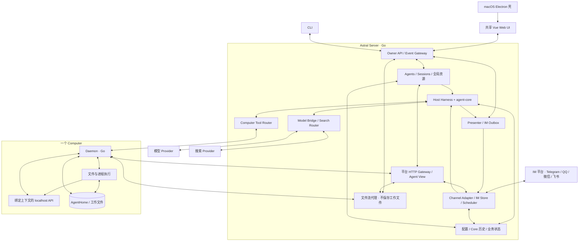
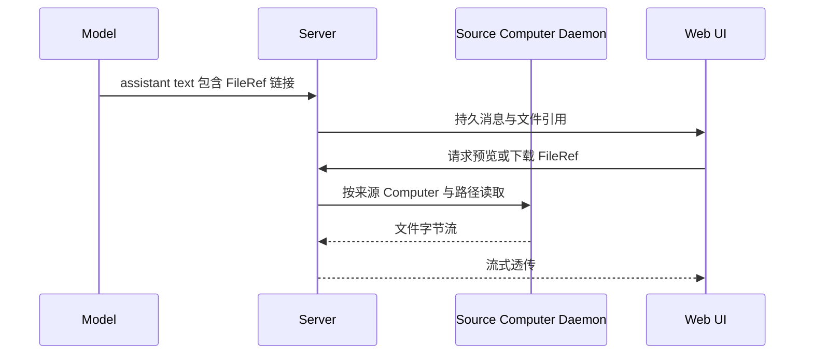

# Astral 系统规格

版本：1.19

日期：2026-10-28，Asia/Singapore

状态：V1 实现规范，尚非功能交付声明

Astral 是一个可自托管、持久运行的个人 Agent 平台。一个 Server 管理多个 Agent、持久 Session、模型、搜索服务、IM 连接和 Computer；Agent 在 Session 中理解消息，通过基础工具操作 Computer，通过本地 HTTP API 使用平台能力。

本规格中的技术对象 Agent，在产品界面中称为 Bot；Computer 的中文名称为“电脑”。产品命名、页面关系、统一设计语言、设置生效方式与反馈以 [UI UX 规范](docs/ui-ux-spec.md)为准；代码类型和 API 字段不因显示名称变化而自动重命名。

本规格汇总 PRD v1.1 与本轮确认的系统决策，并收敛前端工程选型。冲突处采用本规格中的最新行为：IM 支持 Telegram、QQ 官方 Bot、QQ NapCat、微信 ClawBot / iLink 和飞书 Bot，采用显式发送与可选 LLM Probe；文件保留在 Computer、通过本机快捷入口或目标机器上的接入命令添加 Computer、Daemon 提供按 Agent 绑定视图的 localhost API、Bash 直接执行、通过正常结束保持沉默。Core 的实现依据为本地 `../agent-core`，消息表达参考 `../Cahciua`，前端技术与工程组织参考 `../memoh`。

“必须”表示实现和验收要求。“示例”表示数据结构或接口表达，字段的最终编码由正式接口契约统一。尚未选择的实现细节集中列于第 17 节，不削减已确认的产品范围。

目录：

1. [产品与首版范围](#1-产品与首版范围)
2. [核心决策](#2-核心决策)
3. [对象与作用域](#3-对象与作用域)
4. [系统架构](#4-系统架构)
5. [部署与进程生命周期](#5-部署与进程生命周期)
6. [技术栈与工程组织](#6-技术栈与工程组织)
7. [模型视角与基础工具](#7-模型视角与基础工具)
8. [入站消息与上下文](#8-入站消息与上下文)
9. [Loop 与显式发送](#9-loop-与显式发送)
10. [平台 HTTP Gateway](#10-平台-http-gateway)
11. [文件与媒体](#11-文件与媒体)
12. [模型与搜索资源](#12-模型与搜索资源)
13. [UI 与 Settings](#13-ui-与-settings)
14. [持久化与恢复](#14-持久化与恢复)
15. [输出与接口契约](#15-输出与接口契约)
16. [验收矩阵](#16-验收矩阵)
17. [实现时待细化](#17-实现时待细化)
18. [依据与替代关系](#18-依据与替代关系)

## 1 产品与首版范围

### 产品目标

用户可以创建多个 Agent，为其选择模型、搜索服务、可用 Computer 和 IM Conversation；从 Web 或桌面进入任何 Session，发送任务、观察进度、停止执行、查看结果。Agent 可以读写文件、执行命令、搜索互联网、参与 IM 对话，并在多台 Computer 之间切换。

Session 的历史与工作状态持久保存。关闭窗口、浏览器断线或切换 Computer，不会把它变成一个新的无状态聊天。IM 普通群消息持续提供上下文，需要行动的消息再激活模型；模型正常结束且未显式发送时保持 IM 沉默。

### V1 完整范围

| 领域 | 首版要求 |
| --- | --- |
| 部署 | macOS Desktop、Linux Headless 的完整共享 Web UI、CLI |
| 执行 | Go Server、Go Computer Daemon、接入本地 agent-core |
| Agent | 多 Agent，独立资源选择与 Conversation 绑定 |
| Session | 持久历史、流式生成、运行中输入、Stop、Compaction、Fork |
| Computer | Local macOS/Linux、Container、Remote macOS/Linux；使用本机/本机容器快捷入口、复制命令接入及可选容器模式、AgentHome、运行中由 Agent 切换 |
| 模型 | Provider 配置、可编辑 Model Profile、直接使用、Session 临时选模 |
| 搜索 | 全局搜索 Provider，每个 Agent 单选一个统一 `web_search` 后端 |
| IM | Telegram、QQ 官方、QQ NapCat、微信 iLink、飞书；按实际能力接入私聊、群聊和 Topic，复用独立 Conversation Session、静默观察、持续上下文、Probe 和显式工具/API 发送 |
| 文件 | Computer 本地存储、来源明确的引用、流式预览与下载、IM 文件发送 |
| UI | Sidebar、Transcript、Activity Line、Composer、Settings、按需 Contextual Surface |
| 运行支撑 | 真实状态、错误与不确定效果呈现、连接诊断、历史对账 |

工程可以按依赖顺序分阶段实现；上述能力共同构成首版，不以缩减为单端或单 Computer 的 MVP 替代。初版以 Telegram 为基线；本轮扩展的实际范围见下方多平台约定。

IM 复用同一套 IMStore、Conversation、Session 绑定、持续上下文、Probe、Gateway 与出站回执。当前实现 Telegram、QQ 官方 Bot、QQ NapCat、微信 ClawBot / iLink、飞书自建应用 Bot；不增加 send_message 之外的 IM 模型工具，不改动 Core 通用执行语义。配置方法、平台能力差异和协议依据见 [平台接入指南](docs/im-platforms.md)。

### 明确非目标

- Workflow Builder、内置 Subagent 工作流系统、强制 Probe 模型。
- Browser Automation、浏览器接管或截图、完整桌面自动化产品。
- 多搜索引擎聚合、搜索 Provider 自动回退。
- 多个 IM Conversation 合并为同一个共享 Session。
- 各平台尚未实现的能力（例如微信联系人枚举、群聊、出站引用与送达确认）不通过虚构能力或通用代理接口冒充支持。
- 多 Host 自动同步、双主复制、内置 NAT 穿透、P2P 或托管 VPN。
- 团队 SaaS、多用户 RBAC、计费门户。
- 自动长期记忆、Embedding 平台、MCP 市场或技能商店。
- Android 专用 Computer、独立 TUI、大型运维 Dashboard。
- Host 固定运行提示词编辑器、逐工具开关和复杂权限规则编辑器。Bot 可配置独立的可选人格文本。

## 2 核心决策

| ID | 决策 |
| --- | --- |
| D01 | Server 和 Daemon 使用 Go；业务编排在 Server，执行端操作在 Daemon。 |
| D02 | Harness 使用本地 `../agent-core`，其 Go module 当前为 `github.com/oines/astral-core`。 |
| D03 | 前端使用 Vue 与 `markstream-vue`，其余技术与工程组织参考 Memoh。 |
| D04 | macOS Desktop 和 Linux 浏览器复用同一 Web 应用及核心产品功能。 |
| D05 | 首版单 Owner、多 Agent、多 Session；全局资源、Agent 选择、Session 当前状态分层。 |
| D06 | 每个接入聊天稳定绑定一个持久 Session；一个 Session 最多绑定一个聊天。Topic 独立识别。 |
| D07 | IM 账号属于 Agent，范围为全部聊天或指定聊天；默认指定且为空，不使用绑定码或群成员权限名单。 |
| D08 | 工作中的主 Agent 通过持续观察接收群聊和私聊新消息，不额外 Probe 或 IM Steer；空闲时私聊、@、回复 Bot、戳 Bot 直接唤醒，普通群消息按主动模式判断。绑定 Session 的 Web 输入仍使用 Steer。 |
| D09 | 模型可见消息沿用 Cahciua 的紧凑 XML，并补充 Astral 的来源与稳定身份信息。 |
| D10 | assistant text 在 Web 正常显示；IM 只由 send_message 或显式 Computer API 调用发送。 |
| D11 | 聊天主动模式默认关闭；开启时 LLM Probe 只为普通群消息判断是否唤醒空闲的主 Agent，只返回参与布尔值；Host 中性唤起，主 Agent 独立决定行为。 |
| D12 | 基础文件和命令工具使用 Session 当前 Computer/CWD；Agent 可调用 `switch_computer`。 |
| D13 | 已派发调用、已有进程和文件引用绑定原 Computer，不随之后的切换漂移。 |
| D14 | AgentHome 属于 Agent 与 Computer 的组合，同一 Agent 的多个 Session 可以共享它。 |
| D15 | Bash 命令直接执行，不增加逐命令审批；操作系统与所选 Computer 的实际执行环境决定可执行范围。 |
| D16 | Daemon 将平台 HTTP Gateway 暴露为 Computer 内的 localhost 入口；每条命令使用 Server 签发并注入环境的临时 Bearer 凭据。 |
| D17 | 调用身份由 Daemon 与平台绑定和验证；每个 Agent 得到自己的数据与能力视图。 |
| D18 | 工作文件与 Web 附件留在 Computer；IM 接收不创建 Computer 文件，图片在内存处理并冻结到 Core，原附件通过 API 按需流式下载。 |
| D19 | Web FileRef 可预览下载；绑定聊天使用 send_message 发送文字及文件，跨聊天发送通过 Computer API 明确指定。 |
| D20 | 模型与搜索凭据按全局资源配置；一个 Agent 同一时间仅选用一个搜索 Provider。 |
| D21 | Transcript 是产品中心；普通工具过程折叠为 Activity Line，详情按需展开。 |
| D22 | 持久事实、临时流式事件和平台业务状态分别管理，再由 Presenter 合成界面。 |
| D23 | 当前 IM 适配器为 Telegram、QQ 官方 Bot、QQ NapCat、微信 ClawBot / iLink、飞书 Bot。各平台按真实协议声明能力，权限和 Session 语义一致。 |
| D24 | 命令接入方式为复制平台生成的一条命令，在目标机器执行后自动注册。勾选“使用容器”时，该命令在目标机器创建容器并运行 Daemon，将容器注册为独立 Computer。 |
| D25 | Add Computer 提供“使用本机”“使用本机容器”快捷入口，Desktop 与 Headless 都支持，由平台自动完成本机接入步骤。“本机”指 Server 部署所在机器，不随访问网页的设备改变。 |
| D26 | IM 从首版采用多平台适配架构，区分平台与接入方式。QQ NapCat 与 QQ 官方使用独立适配器，复用统一的消息、Conversation、Session、Gateway 和发送回执契约。 |

## 3 对象与作用域

```text
Owner
├── 全局资源
│   ├── Model Providers / Model Profiles
│   ├── Web Search Providers
│   └── Computers
└── Agents
    ├── 默认资源与 Allowed Computers
    ├── Channel Connections
    │   └── Conversations
    ├── Web Sessions
    └── Conversation Bindings
        └── 每个 Conversation 的独立 IM Session

Session
├── 当前 Model
├── 当前 Computer / CWD
├── 持久历史 / Pending / Compaction / Fork
└── 一次只有一个活跃 Run
```

| 对象 | 含义与所有权 |
| --- | --- |
| Server / Host | 同一平台服务边界。Server 指部署进程，Host 指其相对于 Core 承担的宿主职责。 |
| Agent | 用户配置的稳定身份、默认资源和可见能力集合；不是一台机器，也不是一次模型调用。 |
| Session | 属于某个 Agent 的持久对话和工作状态；Web 或某个 IM Conversation 的工作入口。 |
| Run | 一次活跃执行，可以包含多次模型调用和工具步骤；完成后 Session 继续存在。 |
| Turn / Attempt | Core 的模型步骤与尝试边界，供执行与诊断使用，不作为日常 UI 的主要名词。 |
| Computer | 可复用的文件、命令、进程执行端点，可以是本机、容器或远程机器。 |
| Daemon | Computer 侧的 Go 服务，承担执行、进程交互、文件流和本地 Gateway 入口。 |
| AgentHome | 同一 Agent 在某个 Computer 上的默认工作目录；不是 Session 专属目录，也不等同于文件沙箱。 |
| Model Profile | 模型身份、限制、能力、价格和兼容性配置；多个 Agent 可引用。 |
| Channel Connection | 属于一个 Agent 的平台账号连接实例，记录所属平台与具体接入方式；同平台、同接入方式均可有多个凭据、权限和聊天相互独立的 Connection。 |
| Conversation | Connection 下的群、私聊或 Topic；平台内 ID 必须与 Connection 一起解释。 |
| Conversation Binding | Conversation 到 Agent 和持久 Session 的入站关联。 |
| FileRef | 指向文件来源 Computer 与路径或源端版本的引用；不是 Server 上的文件副本。 |
| Gateway View | 平台根据绑定的 Agent、Session、Computer 生成的数据与能力视图。 |

必须保持以下关系：

1. `DefaultComputer ∈ AllowedComputers`，允许 Default 为空。
2. 新增全局 Computer 不自动扩张现有 Agent 的 Allowed Computers。
3. 新 Session 继承 Agent 的默认模型、默认推理级别与默认 Computer；之后的 Session 临时选择不反写默认值。
4. 一个启用的 Conversation 只能绑定一个 Agent/Session；解绑保留旧历史，重新分配不隐式迁移历史。
5. 切换 Computer 不改变 Agent、Session 或 Rollout 身份。
6. 同一 Agent 的 Session 共享 AgentHome 时，文件操作可以互相影响；独立上下文不意味着独立文件系统。
7. Computer 不可用、资源缺失或权限撤销时明确报错，不自动替换为其他资源。
8. 其他 Session 的消息不会自动进入当前上下文；查询历史通过当前 Agent 的平台视图进行。

## 4 系统架构



### Server 的职责

- 管理 Owner 入口、Agent、Session、全局资源、Conversation 绑定和业务配置。
- 在进程内接入 Core，拥有 Session 的执行调度权，组装 System Prompt、环境说明与输入。
- 提供 Model Bridge、搜索适配、工具目标绑定、Daemon 调用、平台 Gateway。
- 归档 IM 事件，管理按序观察投递、唤醒调度、出站消息与回执。
- 将持久事实和实时事件投影为 Transcript、Activity Line 与 Diagnostics。
- 提供共享 Web 应用、Owner API、事件接口以及不落盘的文件流代理。

### Core 的职责

Core 提供模型循环、工具调用阶段、输入队列、安全边界、持久 Session、历史、Compaction、Fork 和执行事件。产品 Agent 配置、IM 平台、Computer 发现与授权、HTTP Gateway、文件展示、UI 均由 Host 接入。

产品中的 Agent 与 SDK 中的执行器类型不能混为一谈。一个产品 Agent 可以拥有多个 Session；每个 Session 的执行与持久状态必须独立。

### Daemon 的职责

- 为其 Computer 执行文件操作、命令和进程交互，返回真实输出及状态。
- 管理源端文件读取、写入、上传与下载流。
- 为 Agent 执行上下文提供绑定的 localhost HTTP 入口。
- 与 Server 完成内部连接、身份关联、状态报告及请求关联。
- 在工具派发时使用已经确定的 Computer、CWD 和执行身份，不根据后续 UI 选择重新解释调用。

同机部署仍使用同一套 Computer/Daemon 语义。远程与容器接入不能绕过这一边界，直接把远端路径当成 Server 的本地路径。

### 多 IM 适配边界

Server 的 Channel 层负责具体平台协议。核心业务只依赖统一的 Connection、Conversation、规范化事件、附件引用、发送意图和回执，不直接依赖 Telegram SDK 类型、Token 格式、Chat ID 形态或 Topic 必然存在的假设。

平台与接入方式分别记录，示例标识如下，正式编码由接口 Schema 固定：

| 平台 | 接入方式示例 | 交付范围 |
| --- | --- | --- |
| Telegram | `telegram.bot` | Bot API 长轮询，私聊、群、论坛 Topic 与频道 |
| QQ | `qq.napcat` | HTTP API + 正向 WebSocket，私聊与群聊 |
| QQ | `qq.bot` | 官方 QQ Bot v2 API + Gateway，单聊与群聊 |
| 微信 | `weixin.ilink` | 腾讯 ClawBot / iLink 扫码授权 + 长轮询，仅私聊 |
| 飞书 | `feishu.bot` | 自建应用 Bot + 官方 SDK 长连接，私聊与群聊 |

QQ NapCat 与 QQ 官方是同一平台下的两种接入方式，分别实现凭据、连接、事件映射和能力适配。同一账号或相似的平台 ID 不使两个 Connection 自动合并，Conversation 与消息身份仍按 Connection 作用域解释。

每个 Adapter 承担以下职责：

- 验证连接配置，管理平台连接、凭据、连接状态及诊断。
- 将真实收到的平台事件转换为规范化事件，保留源平台与 Connection 信息。
- 获取或验证 Conversation，将群、私聊、Topic、线程等映射到实际支持的能力。
- 将统一的文本或文件发送意图转换为平台调用，完成格式处理、必要拆分与平台回执关联。
- 声明并暴露实际能力，例如 Conversation 枚举、回复引用、消息格式及平台参数、消息编辑、事件撤回通知和文件发送。原始文件传输不设 Astral 大小上限，平台限制由实际响应反馈。

平台能力不齐时明确表示“不支持”或“平台未提供”。统一事件格式描述可表达的事件集合，不要求所有平台都能提供每类事件；Adapter 不伪造删除通知、消息回显或送达事实。持续观察、直接激活、LLM Probe、显式发送、Session 绑定与 FileRef 来源由统一业务层处理。

平台选择器只展示上述已实现的适配器。QQ 官方与 NapCat 位于同一个 QQ 平台下，创建账号时选择接入方式；接入方式不能原地更换。微信使用独立的 Owner 扫码授权流程，凭据不返回浏览器，不允许用普通账号保存 API 伪造扫码身份。其余账号按各自的凭据和连接参数配置，不复制 Harness、Gateway 或 Session 系统。

## 5 部署与进程生命周期

### macOS Desktop

桌面壳参考 Memoh 的 Electron、electron-vite 和 electron-builder 工程组织，复用共享 Web 页面、路由、状态、SDK 和样式。Astral 的桌面发行包需要启动并管理本地 Go Server 与本机 Daemon，安装后即可注册 Local Mac Computer；这由 Astral 的自托管产品要求决定。

桌面壳负责窗口、菜单、Dock/托盘、登录启动、文件选择与本地服务生命周期。Agent Loop、业务数据和渠道连接属于 Go Server。Web Renderer 通过平台 API 使用能力，原生接口仅承担必要的桌面集成。

关闭窗口是否继续驻留由 General 设置控制。窗口关闭和页面卸载本身不能直接删除 Session 或取消所有任务。

### Linux Headless

`astral serve` 启动常驻 Server，提供构建后的同一 Web UI、API 和事件接口。部署同时提供 Local Linux Computer 对应的 Daemon。用户在浏览器内完成首次配置、聊天、设置、文件查看和后续操作。

Linux Server 的 Local Computer 是 Linux 服务所在机器。访问网页的笔记本不因打开浏览器就成为 Computer；需要操作它时，显式安装或连接 Daemon、注册 Computer 并关联到 Agent。

### 添加 Computer 的入口

用户添加 Computer 的统一入口为 `Settings → Computers → Add Computer`，提供三种方式：

| 入口 | 用户操作 | 平台行为 |
| --- | --- | --- |
| 使用本机 | 点击快捷入口 | 复用当前部署的 Local Computer；尚未初始化时自动准备、连接并注册本机 Daemon |
| 使用本机容器 | 点击快捷入口 | 在当前部署的本机容器运行时中创建容器、启动 Daemon，自动注册为独立 Computer |
| 连接其他机器 | 复制命令，在目标机器执行；可勾选“使用容器” | 目标机器上的 Daemon 连接 Server 后自动注册 |

两个本机快捷入口在 macOS、Windows、Linux Desktop 与 Headless 的共享 Web UI 中都可用，不要求用户复制命令或切到终端。“本机”始终指 Server 部署所在机器：Desktop 为其本地电脑，Headless 为运行 Server 的服务器；浏览器所在设备不改变这一目标。

平台显示实际目标的名称和操作系统，帮助用户在远程访问 Headless 时识别执行位置。“使用本机”优先复用已有 Local Computer，重复点击不新增同一执行端的重复记录；“使用本机容器”每次明确新增一台独立容器 Computer，同一次创建请求的重试不能重复创建。

本机快捷方式复用接入命令所使用的安装、容器准备和注册能力。缺少本机执行端能力、容器运行时不可用或创建失败时，界面显示实际原因与处理入口；只有 Daemon 成功连接后才显示在线。

### 通过命令添加 Computer

选择“连接其他机器”后，平台展示“使用容器”选项及一条可复制的接入命令；用户在希望接入的目标机器上执行，Daemon 连接 Server 后自动完成注册。

| 模式 | 命令在目标机器上的行为 | 注册结果 |
| --- | --- | --- |
| 普通模式 | 安装或启动 Daemon，并连接指定的 Astral Server | 直接使用该机器执行环境的 Computer |
| 使用容器 | 使用目标机器已有的容器运行时创建容器，在容器内启动 Daemon 并连接 Server | 一台独立的 Container Computer |

命令在哪台机器执行，执行环境就创建在哪里。主流程不要求在平台选择宿主机、填写远程机器端点或手工处理 Daemon 证书，也不要求先把宿主机注册为 Computer。名称可在接入后修改；容器模式提供可直接使用的默认镜像与持久数据配置，不把镜像、挂载、CPU、内存变成首次接入的必填表单。

例如，用户已经接入一台远程 Mac mini，且该机器安装了 OrbStack。再次 Add Computer、选择“连接其他机器”、勾选“使用容器”、复制命令并在这台 Mac mini 执行后，列表中新增一台 Container Computer。如果这台 Mac mini 本身就是 Server 部署机器，也可以直接点击“使用本机容器”。原 Mac mini Computer 保留；两者拥有独立身份、执行目标和 Agent 关联。它们不自动共享 AgentHome 或工作文件，显式挂载的目录按实际配置解释。

接入命令包含目标 Server URL、SPKI SHA-256 公钥指纹和临时注册 Token。脚本与程序从官方 GitHub HTTPS release 资产下载并校验，不通过用户可能使用 HTTP 的 Server 下载可执行代码。Daemon 先验证内层 TLS 的 Server 身份，再发送注册凭据；注册成功只下发一次独立电脑凭据并消费临时 Token。普通注册有效期 15 分钟，容器准备可延长到创建注册记录后的固定 90 分钟；不能通过重试不断延长。完整命令在使用或过期前仍是敏感信息，不能因传输加密而宣称泄漏无害。重复运行成功命令只能复用目标机器已保存的凭据，不能再次从已消费 Token 领取长期凭据。

### 跨平台、后台运行与更新

macOS、Windows、Linux 共用统一可执行程序，包含 Server、嵌入 Web UI、CLI 和 Daemon。Windows 的桌面、Server 与裸机 Daemon 原生运行，不要求 WSL。Windows 接入提供 PowerShell 命令，使用现代 Windows 内置 `curl.exe` 从官方 HTTPS 下载 bootstrap 并检查成功后才执行；macOS/Linux 提供 shell 命令，选择依据目标电脑的平台。

Desktop 三个平台均隐藏独立系统标题栏，使用 44px 的应用顶部区域。macOS 保留左侧红绿灯和现有侧栏开关位置；Windows、Linux 使用右侧原生最小化、最大化／还原、关闭按钮，侧栏开关靠左，不保留红绿灯空位。顶部空白区域通过原生拖动区域支持移动窗口及双击最大化／还原，交互控件排除在拖动区域外；保留系统缩放、窗口贴靠及原有关闭后驻留行为。窗口按钮随应用实际浅色／深色主题变化，页面内容避让窗口按钮；普通浏览器不增加桌面标题栏。

裸机接入自动注册当前用户的 Astral Daemon：macOS LaunchAgent 在系统设置“登录项与扩展”可见，Windows 在任务计划程序中注册当前用户登录任务（InteractiveToken、LeastPrivilege、可见），Linux 使用 systemd 用户服务。不得提权或默认注册 Astral 系统级服务。Linux 裸机后台接入在配对前核验用户服务环境；当前账户为 root（UID 0）时，明确输出准备动作，幂等执行 `loginctl enable-linger 0` 与 `systemctl start user@0.service`，并有界等待用户管理器可用，失败则在配对前停止。服务启动、状态检查与更新使用当前 UID 的运行目录，不沿用其他账户遗留的会话环境。普通账户不自动提权或启用 linger，`--foreground` 与容器接入不执行这项准备。root linger 是账户级设置，卸载单个 Daemon 不自动撤销 linger 或停止整个用户管理器；以 root 接入后，Agent 命令拥有 root 账户权限。普通原生接入使用一个 Daemon；同机连接多个 Server 等需求可通过不同 `--root` 数据目录运行多个实例，容器各自独立。服务提供状态、日志、启动、停止、重启、卸载命令。服务运行状态与 Server 在线状态分别确认。Desktop 内本机 Daemon 由 Server 生命周期管理，容器内 Daemon 由 Docker 管理。

电脑详情提供管理员“更新 Daemon”动作，通过现有已认证的内层 TLS 隧道发送独立管理 RPC，不属于 Agent 的 Computer API 或执行能力。Server 从固定官方 GitHub latest release 解析不可变版本、平台架构资产和 SHA-256；Daemon 再校验目标平台与下载字节，不接受用户或 Agent 提供的程序 URL。每次请求检查最新发行版，不受当前 Server 版本限制；目标不高于 Daemon 时不替换，不自动降级。Daemon 比 Server 新时提醒更新 Server，但不阻止继续更新 Daemon。下载阶段因断链取消，完成交接后的更新独立于旧连接：裸机通过原生服务管理器启动可见、当前用户权限的一次性更新任务，切换用户服务的程序并重启，任务结束清理注册；新容器由同一 Go 二进制的 supervisor 替换数据目录之外的 Daemon 程序并重启子 Daemon，不退出或重建容器。Server 观察同一电脑以新 Boot ID 和预期版本重连才确认成功；失败尝试恢复旧程序。保留电脑身份、凭据、Agent 文件、容器 ID、可写层与卷；重启会中断任务，界面和命令须说明后果。本机 Daemon 随 Server 更新，不独立替换。复制命令后在目标电脑或容器宿主机执行的更新方式保留；宿主机命令只替换原容器程序并重启同一容器，不迁移 Agent 环境。更新命令不接受 `--server` 或替换 pin，不预检 Server 当前首选地址；使用目标电脑既有 credentials 中的 URL/pin 查询状态并重连，支持通过第二个访问地址配对的电脑。`computer update` 只选择现有 `--root` 或 `--container`，网络地址的手动修改与更新分开。

新建容器使用 Ubuntu 24.04 和完整开发、数据、文档、媒体、OCR、中文字体、浏览器测试环境。纯环境镜像由独立 CI 构建并发布 Linux amd64/arm64 多架构产物，仅 Dockerfile 或其他构建输入变化时生成新镜像；应用版本绑定不可变镜像摘要，不随每次应用发版重建环境。客户端只拉取固定摘要、创建数据卷与容器，再通过 Docker copy 将对应架构的统一 Astral 程序放到容器可写层的 `/usr/local/bin/astral`，之后启动已有 supervisor 协议。程序不放在 AgentHome 数据中，不新增宿主机程序目录挂载，保留数据卷与只读配对配置挂载。创建阶段分别反映拉取镜像、创建工作目录、创建容器、安装 Daemon、启动和等待连接；已缓存镜像可直接复用，失败和重试不虚报在线。

更新应用或 Daemon 不重建已有容器，不替换其镜像、可写层、已安装软件或数据卷。环境镜像选择只作用于新容器；原有容器继续使用其原环境和监督协议。目标兼容范围包括 macOS 的 Docker Desktop、OrbStack、Colima、Docker 后端的 Rancher Desktop，Linux Docker Engine（含 rootless）与 Docker Desktop，以及 Windows Docker Desktop Linux 容器；实际验收须记录运行时、版本、系统和架构，不以兼容目标清单代替逐项实测。Windows 使用原生 Astral 和 PowerShell，不要求用户进入 WSL 或额外开启 host networking。同机 Docker Desktop 容器使用 `http://host.docker.internal:4545`（实际端口随监听配置）等经确认可达的主端口路径，不额外创建 TLS 桥接端口或证书。

### Server 监听、管理访问与接入地址

Server 仅对外提供 HTTP，默认监听 `0.0.0.0:4545`。Desktop 使用本机 loopback 地址加载界面；管理访问和 Daemon 加密隧道共享主端口。HTTPS 由用户的反向代理或 Tailscale Serve 提供。用户名密码及 TOTP 登录同时允许 HTTP、HTTPS，不增加“不安全登录”开关；Passkey 仅允许当前实际通过 HTTPS 打开的网页使用。Daemon 连接在两种外层协议下均有内层 TLS，不以用户使用 VPN 为安全前提。

默认关闭“允许远程管理”。loopback 可到达完整管理入口，但仍必须验证 Desktop 身份或网页登录会话；普通浏览器不能因 localhost 而免认证。直接远程连接仅能访问明确列出的健康检查与 Computer tunnel，Web UI、登录、OpenAPI 及全部管理 API 在关闭时不可达。开启只改变路由可达性，不改变认证或 Bot/Computer 授权。来源依据实际 TCP 对端，不采信 Host、Origin、X-Forwarded-For 来冒充本机。用户主动配置的 loopback 反代、SSH 转发或 Tailscale Serve 能暴露本地管理入口；关闭远程管理不撤销这些转发，但转发也不能绕过网页登录。

“访问地址”支持多个完整 HTTP/HTTPS origin，首项用于默认生成接入命令，添加电脑时可选其他发现或自定义地址。列表与监听及远程管理独立，不自动开启管理访问。每个字段的优先级为显式 CLI 参数、环境变量、持久 App 设置、自动发现、默认值；地址列表整体取高优先级来源，不跨来源合并。高优先级覆盖不改写低优先级设置，界面显示来源并禁用受控项。访问地址及远程管理立即生效，监听变更重启生效。

CLI 的 `--public-url` 可以重复；环境变量 `ASTRAL_PUBLIC_URLS` 使用 JSON 字符串数组。`--public-url ''` 或 `ASTRAL_PUBLIC_URLS=[]` 明确使用自动发现。监听和管理开关分别对应 `--listen` / `ASTRAL_SERVER_LISTEN` 与 `--allow-remote-management[=false]` / `ASTRAL_ALLOW_REMOTE_MANAGEMENT`，明确 false 必须覆盖低优先级 true。

自动发现依次考虑实际代理到本 Server 的 Tailscale Serve HTTPS 地址、完整 MagicDNS、Tailscale IP、局域网 IP 和 loopback，不虚构 HTTPS 或使用不可达短主机名。所选地址仅决定 Server 目标，安装脚本与程序下载始终来自官方 HTTPS release。已注册 Daemon 保留其存储的地址，设置改变不会静默改写；同一个 Server 身份不因域名/IP 改变而改变。

管理入口默认执行 Host 白名单及 Origin/跨站请求检查，名单由本机 loopback、真实网卡地址、可靠发现结果和明确配置的访问地址推导。`0.0.0.0` / `::` 是监听通配地址，不是允许的访问主机名；不接受陌生请求自动加入名单，也不采用 `*.ts.net` 等宽泛通配。仅明确可信代理可以报告外层 HTTPS：默认信任 loopback，`--trusted-proxy` 可重复配置 IP/CIDR，`ASTRAL_TRUSTED_PROXIES` 是 JSON 数组，明确空值关闭信任。代理须保留外部 Host；转发 Host 和客户端地址头不授予信任。Computer tunnel 使用独立的 TLS/电脑身份边界，不受管理网页域名选择限制。

### Desktop 与网页登录认证

认证分为 Desktop 本机身份、Web 管理员会话和 Computer 凭据，三者分别管理。当前没有用户数据兼容负担，旧 Owner Token 登录、Bearer 管理认证、旧 Cookie 及旧 HTTP Computer 注册/状态/连接协议直接删除，不做凭据兑换或运行时兼容。旧网络/TLS 桥接转换脚本不属于本实现。

Desktop 打开后直接使用自己管理的本机 Server，不要求创建 Web 账户或输入密码。Electron 主进程生成运行期随机凭据，通过 Go 子进程的私有 stdin 交付，仅向该 Server 的受信任界面请求附加认证；凭据不放在 URL、进程参数、日志、浏览器 Cookie 或 Renderer JavaScript 中。Server 验证专用凭据及真实 loopback 来源，不能只凭 localhost 信任。主进程退出或私有输入管道断开后结束托管 Server；重启建立新身份。网页无权撤销 Desktop 身份。

Web 管理维护一个管理员账户，用户名和密码可修改，不增加公开注册、多人组织或角色体系。密码使用随机 salt 的 Argon2id 校验值，登录、验证码和 Passkey 尝试有次数及资源限制。没有账户时网页只提示尚未初始化，不允许第一个公网访问者认领管理员。Desktop 从安全设置创建或恢复；Headless 使用 `astral auth setup/reset --data DIRECTORY --username USER`，终端隐藏输入密码并确认。CLI 在 Server 运行时使用数据目录权限和运行期密钥保护的本机控制通道，停止时持有排他锁配置账户。reset 清除因素与 Web 会话，保留业务数据、Computer 和 Desktop。

无人值守首次启动可使用 `ASTRAL_ADMIN_USERNAME` 配合 `ASTRAL_ADMIN_PASSWORD` 或 `ASTRAL_ADMIN_PASSWORD_FILE`，后两者不能同时设置；CLI 对应 `--initial-admin-username` 和 `--initial-admin-password-file`。仅在账户不存在时初始化，重启不得重置已有密码、2FA 或会话。数据等运行参数对应 `ASTRAL_SERVER_DATA_DIR`、`ASTRAL_COMPUTER_DATA_DIR`、`ASTRAL_WEB_DIR`、`ASTRAL_DISTRIBUTION_DIR`、`ASTRAL_NO_LOCAL`，显式 CLI 参数优先。浏览器会话期限可通过 `--web-session-ttl` / `ASTRAL_WEB_SESSION_TTL` 配置正 Go duration，默认 `720h`。

Linux 官方安装根对应 `--installation-root` / `ASTRAL_INSTALLATION_ROOT`，显式 CLI 优先，安装器自动传入该参数。它只标识既有安装根，不绕过更新前的当前 UID、目录归属、官方用户服务定义、运行 PID、启动参数和数据目录验证；仅设置环境变量不能为手动或自定义部署开启网页更新。

登录成功签发每个浏览器独立的随机会话 Token，Server 持久化摘要、登录时间、最近活动和过期时间。Cookie 使用 HttpOnly、SameSite Strict，HTTPS 下加 Secure；过期由 Server 强制执行。默认有效期 30 天，重启不延长或清除已持久的有效会话。退出撤销当前会话，设备列表删除立即撤销指定凭据并结束其绑定的 SSE 等请求，离线客户端下次请求拒绝。改密码、重置账户和退出所有设备撤销 Web 会话，不影响 Desktop 或 Daemon。设备列表包含未过期浏览器/CLI 会话并标记当前设备，不是在线连接列表或物理硬件指纹；Desktop 不进入该存储，也不提供网页撤销入口。删除登录会话不删除 Passkey。

公开认证请求体上限 128 KiB、读取期限 10 秒；同一实际 TCP 来源最多同时读取 8 个认证请求，全局最多 64 个，凭据尝试另行限频。提前拒绝、超限或超时的未读请求体关闭连接，不在处理结束后无限制排空。这些限制不作用于普通文件流或长任务。完整重新验证后轮换当前会话 Token；旧凭据不能发起新请求或继承新的近期认证权限。保留会话 ID、已有流和原绝对到期时间；未完成第二步或持久化失败不提升权限。

成功确认添加 TOTP 或 Passkey 任一方式后自动开启第二步，没有独立 2FA 开关。用户名密码登录须再完成 TOTP、HTTPS 下可用的 Passkey 或一次性恢复码中的一种；同时配置 TOTP 和 Passkey 时任选一种。未确认配置不生效。最后一个有效因素被删除后自动关闭 2FA 并清理恢复码，需要明确确认和近期完整认证。

“允许 Passkey 免密登录”是独立开关，默认关闭且至少有一个 Passkey 才能开启。开启后可直接通过 Passkey 登录，跳过用户名、密码和 TOTP；改选密码登录仍按第二步规则验证。删除最后一个 Passkey 同时关闭免密；若还保留 TOTP，2FA 不关闭。服务端强制区分密码后的第二步与直接免密挑战，不允许前端隐藏按钮充当权限判断。

Passkey 添加和使用都要求实际 HTTPS 页面及浏览器 WebAuthn 支持，localhost 的浏览器开发例外也不放行。Desktop 中的配置操作引导到 HTTPS 网页。使用可发现凭据支持不输入用户名的登录，认证必须包含指纹、面容或设备 PIN 等用户验证；服务端验证挑战有效期/一次性、签名、RP ID、Origin 和 UV。RP ID 绑定对应 HTTPS 主机名，不承诺一个 Passkey 跨所有 IP/域名通用。HTTP 不能静默绕过仅 Passkey 的第二步；可以改用 HTTPS、已保存的恢复码，或通过本机可信入口配置 TOTP/恢复账户。添加、解绑、恢复认证方式及修改安全设置必须具备近期完整验证；Desktop 的专用本机身份作为可信入口。

HTTP 与 HTTPS 使用独立 Cookie 名称，分别为 `astral_session`、`__Host-astral_session`；根据可信实际访问协议只读取对应名称，不回退读取另一种。HTTPS Cookie 固定 Secure、Path `/` 且没有 Domain。两种协议在同一主机名下可分别登录、退出，不因浏览器的 Secure Cookie 覆盖保护形成登录循环。

### Computer 加密协议

Server/Daemon 通信的唯一网络入口是 `GET /internal/computer-tunnel`。Daemon 主动连接外层 WS 或具有正常 CA/主机名验证的 WSS，内部固定建立 TLS 1.3，再执行注册、容器准备、电脑状态查询或长期连接认证；两层 TLS 是正常支持的部署方式。不在外层 Authorization、Hello 请求头或 query 中传电脑凭据，不提供明文降级或旧协议端点。

每个 Server 首次启动生成独立 Ed25519 私钥和 100 年自签证书，随数据持久化，不做自动续签。Daemon 固定信任配对命令提供的 SPKI SHA-256 公钥指纹；TLS 证明对应私钥持有者身份后才能发送临时或长期 Token。公钥不匹配则拒绝，不自动接受新身份；证书、域名或 IP 不作为静默改 pin 的理由。备份和搬迁必须保留此私钥；重新生成等同改变信任身份。

首次注册成功后为每台 Computer 下发独立长期 Token，成功消费临时 Token，后续不可重领凭据。长期凭据与 Server pin 存入电脑私有数据目录；撤销拒绝后续认证并关闭当前连接。认证不替代 Agent 的允许电脑集合、Session 归属和执行 Boot/Grant 绑定校验。

传输使用有界长度帧与增量流：认证消息 16 KiB、RPC 帧 128 KiB、数据块 32 KiB、每流窗口 8、连接并发调用 128；TLS 握手 10 秒、初始认证 15 秒，并限制待认证连接数量和来源频率。限额控制单帧和资源占用，不把大文件总量、聊天长度或长任务时长偷偷截断。WebSocket 到 net.Conn 的转换后仍限制外层消息大小，不能因关闭默认 read limit 形成无界内存入口。更新只使用已保存的 pin，不能从更新响应自动替换信任。

### Container 与 Remote

容器的创建动作发生在所选接入方式确定的机器上：本机快捷入口由平台调用本机容器运行时；命令接入由用户在目标机器执行命令调用当地运行时。Daemon 运行在容器内；平台维护 Computer 的注册、连接状态和 Agent 关联。首版支持当前部署本机的快捷创建，不要求远程选择宿主机、跨机器调度容器或提供完整的容器编排管理界面。

目标机器需要具备对应容器运行时；缺失或不可用时，本机快捷入口在 UI 中显示具体错误和处理指引，命令接入在终端提供对应信息，不注册一台虚假的在线 Computer。持久工作数据保留在目标机器提供给容器的数据卷中。

创建程序将实际容器名、创建所在电脑的主机名、镜像、数据卷及挂载路径作为只读元信息传给容器内 Daemon。Daemon 连同自身数据根目录一并上报，Server 持久保存并在已认证的电脑信息接口返回；重连更新元信息而不覆盖用户设置的电脑名称，旧版 Daemon 未上报的可选字段不清除已有值。该信息传递不挂载 Docker socket，不增加宿主机常驻管理服务或容器生命周期控制能力。旧本机容器可从持久创建记录补齐可确定的名称与数据卷；其他未上报字段保持未知，不将容器内主机名当作容器名或宿主机名。

Remote Computer 同样通过在目标机器执行接入命令连接 Server，网络由用户自备。V1 不负责自动建立 VPN、NAT 穿透或中继网络。

Server 与 Daemon 的内部传输支持请求关联、取消、增量输出、文件流、连接状态与身份验证；用户提供实际可达网络，可选择局域网、Tailscale、直接公网或 HTTPS 反代。无论 HTTP/WS 还是 HTTPS/WSS，内层固定使用带 Server 公钥 pin 的 TLS 1.3；外层 HTTPS 仍不得跳过正常证书验证。

本轮不交付官方 Docker Server 镜像或 Compose 文件。Server 容器应持久化完整数据/身份、配置宿主机可达地址、显式开启远程管理并初始化管理员；容器内自动发现不能推断宿主机发布端口或公网地址。其本机 Computer 指容器内部，不是 Docker 宿主机，`--no-local` 可只使用独立 Daemon。Ubuntu Computer 镜像与 Server 部署镜像是不同对象，不因可以运行同一 Go 二进制就宣称已交付 Server Docker 安装流程。

### CLI

CLI 复用 Server 的业务入口，支持服务启动、连接与基本资源/Session 操作、诊断。CLI 不拥有另一套 Agent 状态，也不单独实现模型循环。`astral connect --server URL --username USER` 使用 Web 管理员密码与 TOTP/恢复码登录，私有 `client.session` 保存凭据，`client.json` 指向选中的 Server 和会话文件；受同样的过期与设备撤销约束。CLI 不执行交互式 Passkey 仪式，不使用 Owner Token 或 Desktop 专用身份。`astral computer status --root DIRECTORY` 从已保存的 Computer 凭据及 pin 查询加密通道状态，`computer service status` 单独查询本机进程管理器。

不同 Server 部署拥有各自的数据域。桌面与 Linux 使用相同前端，不表示两个 Server 自动同步 Session。

## 6 技术栈与工程组织

### 服务端

Server、Daemon 和 CLI 使用 Go modules；Core 作为独立 Go 库接入。开发时允许通过本地 workspace 关联 `../agent-core`，发布构建必须锁定明确的 Core 版本或提交，不能依赖开发者机器上的绝对目录。

本地 Core 当前声明最低 Go 1.23。项目使用 `mise` 锁定实际 Go 工具链，保证其满足 Core 要求。HTTP 框架、业务数据库和迁移工具另行收敛；参考 Memoh 的前端工程并不自动引入其 PostgreSQL、Qdrant、Rust 或其他后端依赖。

### 前端选型

以下版本为参考工作区在 2026-10-20 的依赖基线，安装时以项目统一 lockfile 为准。具体补丁更新不改变选型。

| 分类 | Astral 选型 |
| --- | --- |
| 应用框架 | Vue 3.5，Composition API，`<script setup lang="ts">` |
| 类型系统 | TypeScript 6，strict，`vue-tsc` |
| 构建 | Vite 8，`@vitejs/plugin-vue` |
| 路由 | Vue Router 5；共享业务路由，由 Web/Desktop 入口选择 history |
| 客户端状态 | Pinia 3；仅对合适的界面偏好使用 persisted state |
| 服务端查询缓存 | Pinia Colada |
| 样式 | Tailwind CSS 4，CSS 主题变量，`@tailwindcss/vite` |
| UI 基础 | 参考 Memoh 的 `@felinic/ui`、Reka UI、class-variance-authority 组合，集中维护共享组件和 tokens |
| 表单 | vee-validate 与 Zod；统一兼容版本，避免包间 schema 类型分裂 |
| Markdown | `markstream-vue` 2.0 作为共享渲染入口 |
| 代码与富文本 | Shiki、Mermaid、KaTeX，按能力按需加载 |
| 图标 | lucide-vue-next；平台、品牌图标集中于共享 icons 包 |
| 国际化 | vue-i18n，初始维护中文与英文 |
| 辅助能力 | VueUse；长列表需要时使用 TanStack Vue Virtual，表格需要时使用 TanStack Vue Table |
| 文件与执行详情 | Monaco/stream-monaco 用于代码与 Diff 查看；xterm 用于终端输出表面 |
| 桌面 | Electron、electron-vite、electron-builder |
| SDK | `@hey-api/openapi-ts`、client-fetch、Pinia Colada 生成插件 |
| 测试与检查 | Vitest、ESLint flat config、typescript-eslint、vue-eslint-parser、eslint-plugin-vue |
| 包与任务管理 | pnpm 10 workspace、统一 lockfile、mise |
| 提交与版本工具 | Husky、lint-staged；bumpp 管理需要同步的包版本 |

Markstream、Vue、Pinia 和路由等共享运行依赖由同一 workspace 基线管理。参考仓库当前 Web 使用 Markstream 2.0.0、Desktop 仍声明 1.0.7；Astral 必须统一到共享 Web 使用的同一版本，避免两个客户端渲染行为分裂。Vue 与表单上下文依赖需要 dedupe，不能在共享组件和应用中加载两份互不相认的实例。

Memoh 中用于 Browser/Computer Use、任意停靠工作台或复杂图表的依赖，只在 Astral 的实际功能需要时引入。组件能力不得反向改变本规格的导航、单条 Activity Line 和按需 Contextual Surface。

### 目标目录

```text
astral/
├── SPEC.md
├── go.mod
├── cmd/
│   ├── server/
│   ├── daemon/
│   └── astral/
├── internal/
│   ├── agents/
│   ├── sessions/
│   ├── computers/
│   ├── channels/
│   ├── modelbridge/
│   ├── search/
│   ├── gateway/
│   ├── presenter/
│   ├── filestream/
│   └── persistence/
├── apps/
│   ├── web/
│   └── desktop/
├── packages/
│   ├── ui/
│   ├── sdk/
│   ├── icons/
│   └── config/
├── spec/
│   └── openapi/
├── scripts/
├── docs/
├── pnpm-workspace.yaml
├── pnpm-lock.yaml
└── mise.toml
```

`apps/web` 按 pages、components、composables、stores、lib、i18n 组织。桌面壳引用共享模块，不复制页面和业务 Store。生成的 SDK 独立放在 `packages/sdk`，禁止手工修改生成文件。

### API 与工程流程

1. Go API 契约是前端类型来源；维护 OpenAPI 定义或由后端声明生成 OpenAPI。
2. 从 OpenAPI 生成 TypeScript 类型、fetch SDK、适用的 Pinia Colada 查询与变更封装。
3. SSE、WebSocket 或其他持续事件流由独立 composable 处理，不能当作一次返回 `{ data }` 的普通 mutation。
4. 页面通过 SDK 和集中管理的 client 发请求；Base URL、Owner 认证、错误处理和连接状态集中管理。
5. Web 开发使用 Vite proxy；生产由 Server 提供 Web 资源和 API，桌面复用相同业务契约。
6. 本地可持久化主题、语言、折叠状态和最近选择；Session 历史、文件内容和真实执行状态以 Server/Computer 为准。
7. 资源变更后明确刷新对应 query/cache；实时事件按持久标识对账，不通过刷新整个页面掩盖状态错误。

工程脚本应提供统一的 `dev`、`build`、`lint`、`typecheck`、`test`、`openapi-generate`、`sdk-generate` 和桌面构建入口。Go 使用 gofmt、go test、golangci-lint；前端使用上述 lint/typecheck/test/build。CI 检查生成代码漂移、依赖锁定和对应端构建。

前端 TypeScript 开启 strict、noUncheckedIndexedAccess、noUnusedLocals、noUnusedParameters 等检查；ESLint 使用统一的 Vue/TypeScript flat config，统一单引号和无分号风格，生成 SDK 排除人工格式修订。mise 固定 Go、Node 与 pnpm 工具链，开发机与 CI 使用同一来源。Husky/lint-staged 负责提交前的必要检查，不能替代 CI；pnpm workspace 内部包使用 workspace 依赖。

UI tokens、共享组件和状态文案集中维护。依赖补丁按 pnpm patch 机制记录原因与上游版本，避免复制参考项目中与 Astral 无关的补丁。

## 7 模型视角与基础工具

### 模型可见边界

模型在某个 Agent 的某个 Session 中工作。一次模型请求应包含：

- Host 必要运行约定，以及用户为当前 Bot 配置的可选人格文本。
- Session 的来源与绑定 Conversation 信息。
- 当前 Computer、操作系统、Shell、CWD、AgentHome，以及可选择的 Computer 信息。
- 当前实际模型的名称、模型 ID、上下文窗口 token 上限，以及视觉输入能力（支持／不支持／未知）。
- 当前 Computer 的全局与工作区 Skills 目录，以及当前 CWD 的 `AGENTS.md` 内容和发现状态。
- localhost API 的统一发现入口；具体能力说明按需从入口获取。
- 当前 Session 的有效历史、摘要、已应用观察、驱动输入及工具结果。
- 本次允许调用的工具定义和各工具自己的用法。

Host 在现有请求准备路径（预算检查与冻结之前）向 System Prompt 注入 `Current Astral identity:`，包含 `agent.id/name` 和 `session.id/source`；绑定 IM 时的 `session.conversation_id` 与本次已选择的聊天及工具保持一致。Bot 名称在下一次新请求准备时更新，Fork 使用子 Session 自身 ID。新环境快照不再包含 agent/session 身份；既有环境、历史及冻结请求不改写，复制历史中的身份不能覆盖当前 System 身份。此注入仅用于主 Agent，不替换 Probe 或压缩的独立提示词。

Host 内置 System Prompt 由共同运行约定与当前绑定状态对应的输出规则组成。共同部分包括环境状态的解释、执行来源与工作目录、技能与工作区指导，以及平台能力发现入口；直接使用实际快照标题 `Current Astral environment snapshot:` 指代环境，不另造名称。未绑定 IM 的 Session 说明通过 Web assistant 文本回复，不包含 `send_message` 或 IM 触发规则；绑定 IM 的 Session 才包含绑定聊天的发送、观察和触发语义。选择依据为当前 Binding，与 `send_message` 的暴露保持一致，不依赖 Session 最初的 Web／IM 来源或用户当前使用的入口。绑定、解绑、换绑和重开同步相应提示词，Fork 按子 Session 的实际绑定选择。

当前绑定 IM 时，System Prompt 统一包含 `Current IM chat:` 元数据段：`platform`、`connection-id`、`conversation-id`、`chat-type`、`chat-title`、`chat-id`，以及存在时的 `topic-id`。字段值使用 JSON 双引号字符串编码。同一绑定的信息不变时，这一段的内容和字段顺序保持稳定；名称等平台资料变化在下一次新请求准备时更新。该段明确属于聊天元数据，外部名称不作为运行指令解释。解绑或换绑更新当前段，未绑定的 Web Session 与 Fork 不包含该段；历史观察中的来源标识仍保留。每次新请求读取当前绑定与资料，已冻结请求、网络重试和恢复不改写，旧历史也不重新渲染或迁移。

Host 不声明“你是 Agent／Bot／AI”等身份，不规定人格、说话方式或默认人设。内置提示词不提 Probe 或假定主动模式开启，也不向主模型解释唤醒机制；调度细节由 Host 管理。接口路径、参数、幂等规则、分页与文件操作细节由工具描述和 API 文档提供。

Bot 的 `persona` 是一个可选文本字段。普通模型请求的 `system_prompt` 由与本次工具定义同时选定的 Host 文本与当前 Bot 人格直接拼接；空白人格完全省略，不补默认内容。每次新请求在预算计算与冻结前读取当前人格，保存成功后该 Bot 的所有 Session（包括运行中的 Web 与 IM Session）从各自下一个请求立刻生效。不复制人格为 Session 配置，不注入人格变更消息，不重建上下文，不重开或中断 Session。已冻结的请求、网络重试及恢复继续使用原提示词，Attempt 可重建当时实际发送的内容。人格不替换摘要提示词；Probe 将其作为理解被评估 Bot 的参考资料，不作为 Probe 自身的人格或执行指令。

环境快照由 Host 的同步 `CollectContext` 接口返回为 `RoleUser`、`ContextKind=astral.environment` 的普通 Context。接口接收只读边界信息，Host 负责发现、内容和去重，Core 负责预算与提交；动态环境不放入 System Prompt 或 Developer Role，不改写旧消息。当前状态由最近完整快照及其后的局部状态通知共同确定；通知只覆盖明确涉及的字段，旧状态仅作为历史。

模型正文使用独立展示投影，不直接序列化内部扫描结果。当前 Agent、Session 和绑定 Conversation 的身份由 System 提供；环境保留当前及可选 Computer 的 ID，以及 API base URL 和发现入口，便于定位对象与调用接口。当前电脑保留操作系统、架构、Shell、CWD、AgentHome 和可用状态；可选电脑列表省略重复的类型及架构细节。Skill／`AGENTS.md` 的 SHA256、Daemon boot ID、重复的 discovery Computer/CWD 和搜索服务内部 ID 不进入正文；搜索仅说明是否已配置。成功扫描的根目录和重复成功状态省略，缺失、失败、不完整及其必要路径仍明确说明。完整原始数据继续用于 Host 的绑定校验与去重，API／RPC 数据结构保持不变。Skill 正文变化通过具体路径及重新读取提示表达，电脑重启通过状态说明表达，不要求模型比较哈希或启动标识。

初始完整快照含 `current_model`：`name`、`id`、`context_window` 和 `vision`。信息来自请求实际采用的版本化 Model Profile 及生效 override，不能按名字猜测能力；缺失视觉声明使用 `unknown`，窗口大小不是剩余 token 数。模型状态独立于电脑环境指纹。单独切换模型或修改其有效窗口／视觉能力时，只追加 `ContextKind=astral.model` 的简短 Host 通知，说明前后模型及当前能力，不重复电脑、技能、工作区指导和 API 地址。

空闲选模用 `InjectContext` 持久化通知，不唤醒主模型；运行中的选模在新模型首次请求的 `CollectContext` 安全边界加入同类通知，避免独立排队与请求准备竞争造成重复或过期通知。相同状态不追加，失败的选择不宣布成功。重开根据已有完整快照及通知去重；compact 后重建完整环境时包含当前实际模型，不依赖摘要保留变更通知。

创建 Session 时采集初始快照。平时在激活、完整 Assistant/工具结果批次结束后的安全边界，以及显式 Computer/CWD 切换时扫描；同一 Run 内的工具批次结束不是新一次用户激活。外部文件变化在下一次运行边界发现，不安装文件监视器，也不在每次 Provider 重试前扫描。内容不变不追加，追加本身不启动或延长 Run。

普通模型轮次统一进入 `prepareStep`：冻结分支、模型配置和有限输入选择范围；先调用 `CollectContext` 把最新环境纳入完整候选，再判断是否压缩；必要时仅对已提交的旧历史生成一次摘要草稿；摘要完成后同步调用 `CollectContext` 重新扫描。候选顺序为摘要与保留历史、待投递被动上下文、最新环境、驱动输入组。完整候选通过 token 与字节预算检查后，一次提交摘要、上下文、驱动输入和消费记录。新输入不参与旧历史摘要；内容相同也要为新 Compaction 提供一次完整快照。

内部预算采用最近有效普通生成的实报 `InputTokens + OutputTokens` 加后续新增内容估算；缓存输入已包含，不重复相加。只有输入、输出计数均明确返回时，实报才可作为预算基线；缺少任一计数时保留部分用量记录，继续查找更早的完整有效基线，或回退到内容估算，不以 `0` 补造缺失值。成功 assistant 关联其实际成功 Attempt 与冻结请求；配置、模型、压缩或覆盖前缀变化后回退到内容估算，摘要用量不能替代普通生成基线。旧记录缺少关联信息时安全回退，下一次成功生成后恢复增量估算。

摘要使用相同模型规格与目标快照时，从实际选中的历史范围内寻找普通生成的真实用量基线，按普通请求的准备结果验证覆盖前缀，再累计基线之后全部选中消息及完整摘要提示词、选项和指令的估算。静默积累的旁观消息、图片和工具结果全部计入增量；已校准的原生推理内容不重新按密文长度粗估。基线包含的旧提示词与工具定义额度保守保留，不做粗估减法，也不引用保留尾段中的较新回复。模型、配置、准备后的内容或缩短后的覆盖前缀不匹配时回退到完整内容估算。摘要完成后旧基线失效，仍检查摘要、保留历史及本次待加入输入的完整候选；后来收到的消息留待下一边界，不漏算也不提前消费。

默认压缩触发条件为输入超过模型窗口减 16,384 token，按完整消息和工具批次保留最近约 20,000 token；摘要输出上限为预留量的 80%（默认 13,107），受摘要模型最大输出限制。普通输出动态限制为模型/用户期望上限与“窗口减输入再减 4,096”中的较小值；4,096 不叠加到压缩阈值。独立输入上限和 64 MiB 请求字节上限继续检查。内容回退估算覆盖文本、工具参数/schema、system 与图片，不再按 HTTP JSON 字节数计 token；图片默认约 1,200 token，可被模型配置覆盖。

摘要请求按原有对话顺序保留选中对话的原生消息、多模态内容和工具调用关系，同批工具结果按调用声明顺序紧随 assistant 调用，不额外附加内部记录 ID 或执行状态清单。默认摘要按目标、约束与偏好、进展（已完成／进行中／阻塞）、关键决策、下一步和关键上下文组织；后续压缩将已有摘要置于首条源消息，与新增待压缩对话合并，保留仍有效的目标与约束，并更新进展。工具结果能完整放入摘要请求时完整保留，只有超预算才缩短副本；原始历史保持不变。

当前绑定 IM 的 Session 由 Host 覆盖摘要系统提示词，使用 [Session 连续性保留提示词](internal/harness/prompts/im-compaction.md)，同时保留任务、共同经历、互动方式、话题与时间变化，以及历史内容的信任边界；输出采用连贯自然语言，不强制任务检查点模板。未绑定 IM 的 Session 不设置该覆盖，沿用 Core 默认提示词。绑定、解绑、换绑和重开均按当前绑定状态选择；Fork 不继承 IM 绑定，因此使用默认提示词。此差异不改变 Core 的摘要请求顺序、工具记录保留和预算机制。

提供商明确报告上下文溢出时，在完整边界最多压缩并重新生成一次；第二次溢出停止。此次恢复不消费新队列输入、不重跑已经完成的工具。普通网络重试仍复用冻结请求。被动上下文维护可以跳过普通环境采集，发生压缩后仍补采完整环境，且不启动普通生成。

采集、预算或提交失败时，旧有效上下文保持完整，所选输入保持待投递；未提交摘要可在重试时重算。模型及 Computer I/O 不持有会话锁或数据库事务；提交前重新核对分支和所选输入，后来接收的输入留待后续边界，被清除的输入不得投递。手动 Compaction 复用准备流程，不消费驱动输入，也不自动生成回答。

Host 对确定性电脑环境计算指纹，与候选上下文中最近的快照比较，包含 Compaction ID，不包含模型状态、采集时间等易变字段。A→B→A 必须保留两次变化；重开、网络重试和重复扫描不重复追加。Fork 继承既有 Computer/CWD，随后追加子 Session 自身的当前快照。历史、View 和上下文检查接口不采集环境、不修改会话配置；上下文检查在内存中拼接当前人格，UI 所需模型预算预览也仅在内存中计算。

Skills 由选中 Computer 的 Daemon 发现：全局根为其操作系统用户 Home 下的 `~/.agents/skills`，工作区根为 `<cwd>/.agents/skills`。支持嵌套分类目录和符号链接并防止循环，找到 `SKILL.md` 的目录视为技能包，不继续扫描包内示例。模型可见目录包含 YAML 中的 name、description、scope 和绝对路径；文件内容哈希仅供 Host 内部变化检测，正文按需读取。同名技能保留全部条目，以 scope 和路径区分。Workspace 指导仅来自准确的 `<cwd>/AGENTS.md`，不向父目录查找。读取成功时，全文通过快照的 `discovery.agents_md.content` 提供给模型；共同提示词明确要求在当前目录工作时遵守这些工作区约定。切换 CWD 后以新目录的 `AGENTS.md` 为准，旧目录约定只作为历史。

文件和根目录缺失是正常空状态；不可读、格式错误、扫描限额、Computer 离线、权限收回及旧 Daemon 不支持发现均显式记录，不以 Server 文件系统代替，也不沿用旧 CWD 的发现结果。单文件最多 1 MiB，一次扫描读取最多 16 MiB、目录条目预算 8192、递归深度 32；超限结果标记 partial。发现不可用仍允许纯文本对话，重新连接后的下次运行边界更新快照。

消息来源、执行机器和回复目的地分别确定。例如，在 Web 中打开一个 IM Session 输入 prompt，来源是 Web，执行机器仍由 Current Computer 决定，send_message 的目的地仍由该 Session 的绑定决定，assistant text 只显示在 Web。

### 模型工具

| 工具 | 作用 | 执行归属 |
| --- | --- | --- |
| `read` | 分页读取文本或支持的图片内容 | 当前 Computer 的 Daemon |
| `write` | 写入文件 | 当前 Computer 的 Daemon |
| `edit` | 对文件应用明确的编辑并返回变更信息 | 当前 Computer 的 Daemon |
| `exec_command` | 执行 Shell 命令，返回退出结果或可继续交互的进程句柄 | 当前 Computer 的 Daemon |
| `write_stdin` | 输入、轮询、发送中断等进程交互 | 进程原来所属的 Computer |
| `switch_computer` | 修改当前 Session 后续执行的 Computer/CWD | Host 控制工具 |
| `web_search` | 调用 Agent 当前选中的一个搜索 Provider | Server |
| `send_message` | 向当前绑定聊天发送文本或附件，返回本次发送结果 | 仅绑定 Session 提供的 Host 工具 |

讨论中的 Bash 能力由 `exec_command` 提供，不需要另注册一套重复的命令工具。基础文件和命令行为优先复用 Core 的 standardtools，Host 提供连接 Daemon 的 Backend。Core 当前标准工具没有现成的远程 Daemon 传输或产品级 Computer 注册能力，这些由 Astral 实现。

Computer Backend 对 `read` 和 `edit` 读取的原文件设置 32 MiB 上限。`read.offset/limit` 在读入文件后选取文本行，不绕过此上限；更大的文件由 Agent 使用 `exec_command` 按范围读取。该限制是保留的资源边界，与文本返回的 2000 行 / 50 KiB 截断上限分别生效。

跨聊天发送、文件发送、IM 查询、历史查询等平台能力由 localhost API 提供；当前绑定聊天另提供 send_message。模型通过 `exec_command` 运行 curl 或脚本即可使用，无需逐个扩张模型工具列表。

### 执行目标与切换

`switch_computer(computer_id, cwd?)` 的目标必须在 Agent 的 Allowed Computers 中。缺省 CWD 使用该 Agent 在目标 Computer 上的 AgentHome，不继承之前机器的路径。

同一 Agent 创建的普通 Web/IM Session 默认使用该 Agent 在选中 Computer 上共享的 AgentHome，绑定成功后持久保存实际 CWD。对同一个 Computer 调用 `switch_computer` 并指定 cwd，只修改该 Session 的工作目录。单次 `exec_command.workdir` 或 Shell 的 `cd` 不修改 Session CWD，也不改变其他 Session 的默认目录。

切换必须单独成批，形成独立的工具执行边界。切换确认后再绑定后续文件与命令调用；不能提前把整个混合并行批次都绑定到旧 Computer，再期待其中一次切换改变其他调用。

用户仅能在 Session Idle 时从 UI 切换 Computer，后端也必须拒绝运行中的用户切换请求。Agent 可以在执行任务时使用控制工具切换。

每次派发固定以下语义：

```text
Owner / Agent / Session / Run
    + Invocation / Execution identity
    + Computer
    + CWD / Shell
    + 操作参数
```

这些信息由 Host 和 Daemon 绑定。`write_stdin` 根据进程句柄恢复原目标，不能把相同数字句柄在另一台机器上重新解释。访问撤销对新的派发生效；既有进程是否停止必须依据实际状态报告。

### Bash 与文件信任范围

Bash 命令直接执行，不增加逐命令的 Allow/Deny 流程。裸机 Computer 的文件与命令能力按 Daemon 实际运行的操作系统账户执行；AgentHome 是默认目录，不宣称是 chroot、容器或路径沙箱。

Allowed Computers 约束平台的目标路由；需要更窄的实际执行环境时，使用相应 Container Computer。平台资源视图与操作系统文件隔离不能互相替代。

## 8 入站消息与上下文

### 规范化记录

IM Adapter 先产生平台无关的规范化事件，归档后再投递。Host 记录原始平台标识、具体接入方式、投递状态和去重信息；模型看到的是由这些记录渲染出的紧凑内容。接入方式可由 Connection 解析，不要求把内部 Adapter 标识重复写进每条模型正文。

Telegram 的 `/chat_id`（或 `/chat_id@Bot用户名`）是 Host 直接处理的查询命令：在账号可收发的私聊、群聊、话题或频道中回复当前 Chat ID；话题同时返回 Topic ID，回复留在原话题。无需先添加聊天，不依赖模型或 Computer，不创建 Session、不扩大聊天权限、不触发 Probe。命令及其固定回复不进入普通模型观察，使用独立持久回执；同一入站消息至多尝试回复一次，重放或重启不自动重发未知结果。编辑后的命令及机器人发送的命令不执行；其他 Bot 的定向命令、附件说明及正文中夹带的命令不作为该查询执行。

事件的最小语义如下，示例不要求直接作为模型正文发送：

```json
{
  "schema_version": 1,
  "event_id": "evt_103",
  "kind": "message.created",
  "conversation_sequence": "103",
  "received_at": "2026-10-20T16:01:00.120+08:00",
  "source": {
    "kind": "im",
    "platform": "telegram",
    "connection_id": "tg_main",
    "conversation_id": "conv_42",
    "chat_id": "-100123",
    "chat_type": "group",
    "topic_id": null,
    "title": "Astral 开发群"
  },
  "message": {
    "id": "502",
    "sent_at": "2026-10-20T16:01:00+08:00",
    "sender": {
      "id": "456",
      "display_name": "小李",
      "username": null
    },
    "reply_to": {
      "message_id": "501",
      "sender_name": "小王",
      "preview": "明天上午十点发版。"
    },
    "mentions_agent": true,
    "content": [
      { "type": "text", "text": "@Astral 帮我们整理一下检查清单。" }
    ],
    "attachments": [
      {
        "ref": "502:0",
        "type": "document",
        "name": "release.md",
        "mime": "text/markdown"
      }
    ]
  }
}
```

所有平台身份 ID 使用字符串。`event_id` 标识一次事件，平台 `message.id` 标识消息；编辑和撤回产生新的事件，不能用消息 ID 把合法修订一起去重。顺序依据 Host 接收入档顺序与持久序号，IMStore 保留平台发送与编辑的原始时刻。仅在新模型观察构造时，将时间转换到 Astral 全局时区后渲染；不修改原事件，也不重写此前的观察、环境快照、摘要或冻结请求。

跨 Connection、跨群、跨 Topic 的标识必须可区分。平台未提供的用户名、引用正文或群标题可以为空，不虚构。

### 多平台接收与发送边界

QQ 官方与飞书的普通群消息推送取决于平台授予的权限；未收到的消息不能补成上下文。NapCat 正向 WebSocket 不提供离线历史重放；飞书 SDK 的事件成功 ACK 发生在对应归档 cursor 持久化之后。保存 cursor 失败不能向适配器确认新位置。

微信 iLink 的扫码凭据、每个聊天的 context_token、媒体密钥和 CDN 下载能力按账号持久保存在 Server 的加密凭据存储中，不进入 Core、公开账号 config 或模型可见消息。发送适配器重建后继续使用该聊天的有效上下文。扫码二维码和登录状态仅向 Owner 提供；API 访问与扫码均不创建 Session。

出站平台接受与最终送达分开。iLink 成功响应允许省略 `ret` 和服务端消息 ID；省略消息 ID 时记录 `client:<实际 client_id>`，表示已接受的请求身份。结构化平台错误也可能表示提交后超时，例如 NapCat 的通用执行异常；此时内部记录 unknown，本次工具/API 调用返回错误。

### 模型可见格式

会话说明参考 Cahciua 的 session-level chatroom information，仅在当前绑定 IM 的主模型 System 中集中说明，不在每条观察前重复：

```text
Current IM chat:
platform: "telegram"
connection-id: "tg_main"
conversation-id: "conv_42"
chat-type: "group"
chat-title: "Astral 开发群"
chat-id: "-100123"
```

Topic 绑定额外包含 `topic-id`。普通 Web Session 沿用原有提示词、输入和环境快照。共享聊天信息不取代电脑、技能、`AGENTS.md` 与本地 API 的独立环境快照。

消息参考 Cahciua 的 `<message>`、`<in-reply-to>`、`<attachment>` 表达：

```xml
<message conversation-id="conv_42" id="501" event-id="evt_501" source="im"
         sender="小王 (@wang)" sender-id="123"
         t="2026-10-20T16:00:00+08:00">
明天上午十点发版。
</message>

<message conversation-id="conv_42" id="502" event-id="evt_502" source="im"
         sender="小李" sender-id="456"
         t="2026-10-20T16:01:00+08:00">
<in-reply-to id="501" sender="小王 (@wang)">明天上午十点发版。</in-reply-to>
@Astral 帮我们整理一下检查清单。
<attachment type="document" name="release.md" mime="text/markdown" file-id="502:0"/>
</message>
```

Astral 保留 `conversation-id`、事件与消息 ID、`source`、发送者、时间等每条观察的来源和身份信息；`conversation-id` 使解绑、换绑或 Fork 保留的旧历史与当前绑定可区分，不改变 `send_message` 由 Host 选择的发送目的地。当前仍是一条观察对应一条 `RoleUser` Context，不在 Host 中合并相邻观察；提供商适配层可按协议合并相邻 User，但不能跨过中间的 Assistant/Tool 边界重新聚合。

普通正文和属性由 Renderer 统一转义，正文中的任意标签不作为平台生成的消息元数据。消息所属聊天和发送者不能只藏在 SDK Metadata 中，必须让模型可见。引用、选定片段、附件、编辑和通知保留原有表达；聊天信息去重仅改变新观察的渲染及新请求的 System，不改变存储结构，不新增迁移，不改写旧历史或冻结请求。

Telegram 普通群回复中的 `message_thread_id` 不构成独立 Topic；只有 `is_topic_message=true` 且 thread ID 非零才按 Topic 路由，同样适用于 Bot 私聊 Topic 入站消息，不额外依赖 `chat.is_forum`。普通回复和正文 @ 继续进入原群绑定的 Session，真正 Topic 的授权与绑定继续独立。已有错误归档不原地修正或重播。

Telegram `reply_to_message` 的原消息 ID、发送者和最多 500 个 Unicode 字符的预览继续使用 `<in-reply-to>`；正文缺失时可从 Rich Message 展开原文作为预览。用户选中的 `quote` 独立存入可选 `Observation.reply_quote`，包含 `text`、`position` 和 `manual`，并以转义的 `<quote position-utf16="…" manual="…">…</quote>` 传给模型；合法 1,024 字符片段不按预览的 500 字限制截断。位置只是发送方提供的近似 UTF-16 偏移，片段文本为准，不据此重新裁切原文。无本群 ReplyID 的外部引用仍可呈现片段，不将外部消息 ID 伪造成本群回复、不扩大跨群权限。片段内的 @ 不作为当前消息的 mention 触发。

引用图片、文件等附件的基础元信息独立存入 `Observation.reply_attachments`，在 `<in-reply-to>` 内标出原消息 ID、附件标识、类型、名称与下载路径，不混入本消息 `attachments`；仅有这些元信息时不自动下载或生成预览。Telegram 仅使用同聊天 `reply_to_message` 自带的原媒体信息，可在原消息未单独归档时提供经当前聊天授权的下载，但不伪造原消息事件；外部引用不扩大权限。NapCat 只查当前聊天已有归档，缺失时明确不可用，不自动 `get_msg`。

编辑和撤回均追加新的观察，例如：

```xml
<message conversation-id="conv_42" id="501" event-id="evt_501_edit" source="im"
         sender="小王 (@wang)" sender-id="123"
         t="2026-10-20T16:00:00+08:00"
         edited="2026-10-20T16:03:00+08:00">
改成明天下午两点发版。
</message>

<event conversation-id="conv_42" id="recall-event" kind="message.deleted" source="im"
       sender="小李" sender-id="456" message-id="502"
       t="2026-10-20T16:04:00+08:00">QQ user 789 recalled message 502 originally sent by QQ user 456.</event>

<event conversation-id="conv_42" id="poke-event" kind="notice.poke" source="im"
       sender-id="456" t="2026-10-20T16:05:00+08:00">QQ user 456 拍了拍 QQ user 9000 的尾巴</event>
```

这些是新的观察记录。IM Store 保留追加事件，消息查询可返回最新状态；已经进入 Core 历史的旧观察与投递回执不原地改写。NapCat 戳一戳保留 `raw_info` 提供的可读动作、自定义后缀及参与者身份，不把图片或跳转 URL、内部 UID 塞入模型；平台没有可读内容时才用普通动作描述。私聊 `sender_id` 是操作者、`user_id` 是会话对方。仅其他人戳当前 Bot 产生 `poke` 触发，仍受原聊天权限和绑定约束；戳其他人和自身动作被动追加。没有原生 `event_id` 的通知按实际收到的每帧分配本地事件 ID，pending 批次重试沿用，不承诺跨断线回放的精确去重。这里只复用 Cahciua 的消息表达，不采用每次调用重新构建整段群历史的执行方式。

### QQ 卡片与嵌套合并转发

NapCat 的新观察通过可选 `Observation.parts` 保留文本、卡片、附件和合并转发的原始顺序；回复从同聊天归档复制 `reply_parts`。转发子消息保存发送者、平台提供的时间及有序子段，可继续包含图片、视频、文件、卡片或转发。子消息是根消息中的引用内容，不单独生成实时 Observation，其 @、回复与子聊天 ID 不参与触发、路由或授权。

JSON 卡片输出可读的来源、标题、描述与链接，平台名和实际内容标题分别保留；原始 JSON 仅供显式资源读取，不直接塞入初始观察预览。只识别 `app=com.tencent.multimsg` 且具有明确 `meta.detail.resid` 的 ARK 转发，不能从未知卡片任意搜索 resid 或 URL 并发起请求。`news[]` 只作为卡片摘要，不伪装成原始转发子消息。

inline 内容在本地做有预算的树解析；仅提供平台 handle 时，在新观察准备阶段允许有限自动解析。整次观察共享总计 6 秒、2 层转发与 12 条子消息预算，不在 NapCat Poll 中无限递归或逐层等待 45 秒。超过预算、未展开和不可用的内容明确标记，并提供受控 `read-url`。Agent 可通过 Gateway 的消息 `/parts` 索引与单个 part 地址按需分页（`offset`、`limit`，默认 20、上限 50）；树中 Host ref 如 `p0.m1.p2` 只表示已归档根消息内的路径，不是可任意调用的平台资源 ID。

转发预览选中的图片复用现有内存处理，形成最多 75,000 总像素的 native image 输入并随本次历史冻结，保留原图 `download-url`；不另存原图、文件或创建 FileRef。视频和普通文件仅携带名称、类型、大小与原件下载地址。Agent 需要实际文件或图片细节时显式下载；可选解析或图片预览失败保留根消息文字、引用、附件信息和触发，不阻塞后续收信。

读取、展开、原始卡片读取和附件下载均检查当前 Bot 对根账号、聊天与消息的权限，不使用转发子节点的 chat ID 作为授权，也不接受客户端任意裸 resid。所有链接保留根消息归属。新结构与预览只影响新构造上下文，不修改旧观察、摘要或冻结请求；显式读取旧消息可在证明根聊天归属后查询 NapCat，但不回写旧 IMStore 或 Core 历史。

### 消息表情回应与 NapCat 动作

表情回应以新的观察事件追加，不更新原消息或重写历史。`message.reaction.added`、`message.reaction.removed` 表示平台提供的添加和移除；Telegram 匿名汇总使用 `message.reaction.counts_updated`。Telegram `setMessageReaction` 成功后仅记录 `message.reaction.set`，表示 Bot 本次已接受的选择，不推测此前选择或伪造移除事件。按消息 ID 查询原消息时忽略这些指向它的 reaction 事件，继续返回原消息及实际编辑/撤回状态。

可选 `Observation.reaction` 包含 `actor_type: user | chat | app | unknown` 与 `reactions` 列表。每项 `Reaction` 包含 `type: emoji | custom_emoji | paid | qq | feishu`、可选 `emoji` 或平台 `id`；`count` 仅表示绝对总数，目前来自 Telegram 匿名汇总；NapCat 原始数值另存 `reported_count`，不解释为总数。缺失的操作者和数量不补造，原消息作者不等于回应操作者。模型收到 `<event>`，根属性保留 `conversation-id`、`message-id`、`actor-type` 与实际发送者；未知时标记 `actor-known="false"` 且不伪造 sender，自身动作标记 `self="true"`。结构化子节点为 `<reactions><reaction type="…" emoji="…" id="…" count="…" reported-count="…"/></reactions>`，仅输出实际存在的属性。

Telegram 显式订阅 `message_reaction`、`message_reaction_count`，接收需要 Bot 为聊天管理员；不保证私聊通知，Bot 自行设置的回应不会被平台回显，匿名汇总可能延迟且没有操作者。更新不含 Topic ID，按已归档原消息的 Conversation 归属路由；未知目标不广播到 Topic。飞书长连接订阅 `im.message.reaction.created_v1`、`im.message.reaction.deleted_v1`，接收与查询需要 `im:message.reactions:read`，修改自身回应需要 `im:message.reactions:write_only`。优先用归档确认原聊天；未知来源可由受控平台查询确认归属，不导入原正文；原消息已永久消失时 ACK 忽略，不伪造原消息，不堵塞后续事件。

NapCat `group_msg_emoji_like` 仅提供部分群回应通知，主要针对登录账号自己发出的消息；保留 QQ emoji ID，未知操作者和数量如实缺省。QQ 官方当前群聊/C2C 接入不支持 reaction，不从频道能力推导支持；微信暂未接入 reaction。所有动作仍受账号、聊天和 Topic 授权约束。已知自身动作不触发 Probe；`ActorType=unknown`、操作者 ID 缺失的回应及匿名数量更新也只追加旁观，不单独成为 Probe 候选，不为避重而伪标 `Self`。这些事件仍完整投递给工作中的 Agent 并保留在后续上下文。操作者已知且属于外部参与者的群回应沿用普通群消息的可选空闲 Probe，私聊回应不增加直接触发。

NapCat 通过既有 Computer API 操作目录增加 `set_reaction` 与 `poke`，不增加模型工具、不修改 `send_message`。`set_reaction` 接受字符串 `message_id`、字符串 QQ `emoji_id` 和可选布尔 `set`（默认 `true`，`false` 取消）；消息既须已归档在当前聊天，也须由 NapCat 当前消息映射再次证明归属。`poke` 群聊必须指定 `user_id` 并核对群成员，私聊可省略，指定时也只能是当前聊天对方。沿用 `ASTRAL_API_TOKEN` 的命令级鉴权与单次调用规则。私聊窗口抖动与戳一戳分开：收到 `shake` 消息段时以 `[QQ private window shake]` 可读文字进入上下文，当前 NapCat 没有可用的发送接口，不伪造发送支持。这些可选事件字段不需要数据库迁移，不修改 Core 或原触发机制。

### 按运行状态投递

| 类型 | 模型内容 | 执行行为 |
| --- | --- | --- |
| 工作中的 IM 消息，含私聊、@、回复 Bot、戳 Bot 和普通群消息 | 消息 XML，`RoleUser`，`ContextKind=im.observation` | `InjectContext`，在后续主模型请求的安全边界读取；不另启动 Probe，不追加独立 IM Steer |
| 空闲时的普通群消息 | 同样的观察内容 | 不单独激活主模型；开启该聊天主动模式时，经防抖由 Probe 判断是否唤醒 |
| 空闲时的 @、回复 Bot、私聊、戳 Bot 等直接触发 | 同样的观察内容与一条引用目标事件的驱动输入 | 沿用现有直接触发流程，提交关联观察与 Steer，再 Continue |
| Web UI prompt | 带 Web 来源的 User Message | 始终是驱动输入；绑定 Session 使用 Steer，没有 Probe 分支 |

静默表示不因该观察单独创建一次模型执行。若 Session 已经运行，观察在安全边界进入后续主模型请求，由主 Agent 结合当前工作处理。群聊和私聊共用此机制；不同之处在空闲时是否需要直接唤醒或判断参与。记录已进入历史、主模型确实已经读取、模型选择回复是三种不同事实。

触发输入关联本次要处理的消息，并提醒主 Agent 的 IM 发送规则，例如：

```xml
<im_trigger message-id="502" reason="mention"/>
请处理本次观察中的消息 502。
Direct assistant text is not sent to IM. To reply to this chat, you must call send_message.
```

Host 用内部事件和投递组标识精确关联此提示与对应版本的消息。每次空闲直接 IM 唤醒与 Probe 正向唤起都带上这条发送提醒；工作期间接收的观察和其他普通旁观观察不重复添加。System 中继续保留 IM 输出规则，不把调度状态交给模型决定。提醒只说明普通 assistant 文本不会发送到 IM、回复当前聊天必须调用 `send_message`，不要求必须回复，也不改变工具目的地或投递语义。模型正文不重复附上同一请求全文。

Web 输入采用相同消息风格：

```xml
<message id="web_17" source="web" sender="Oines" sender-id="owner"
         t="2026-10-20T16:02:00+08:00">
检查一下项目的构建失败原因，修好后跑一遍测试。
</message>
```

`source="web"` 描述输入来源，不自行更改 Session 的 IM 绑定或 Computer。Web 上传附件使用文件引用，图片要参与视觉理解时由 Bridge 提供真实图片内容，文字标签本身不等于图片像素。

### 接收与应用

本地 Core 的 `InjectContext` 返回接收 ID，不代表模型已经看到内容。Host 必须记录并区分：

```text
平台事件已归档
    → 已持久接收为 Pending
    → 已应用为 EntryContext
    → 被某次模型请求使用
```

实现必须满足：

1. 工作中接收 IM 观察，保留来源与明确触发原因，不为同一事件额外提交驱动输入。空闲时新直接触发沿用现有关联投递：观察与引用它的驱动输入一起接收，正文只出现一次。
2. 工作期间已经独立投递的事件，若主运行正常结束前未被后续请求采用，Host 按空闲规则交接。需要唤醒时，确认已有 Context 已应用，再提交只引用它的驱动输入；不得重复注入正文。已经进入主请求的事件不再独立触发。
3. 独立 Context 可能因为预算或单次处理上限仍留在 Pending，不能把一次成功的 `InjectContext` 当作全部已应用。
4. Host 维护事件到 Core 接收 ID、应用 Entry ID 的映射。调用超时后先核查，不盲目重新注入。
5. Context 按实际安全边界加入；不得插进尚未完整的工具调用与结果批次中。
6. 外部消息使用 User Role。`ContextKind` 只是来源标签，不能自动把群消息提升为 System/Developer 指令。
7. 边界判断留在 Host：使用已有 Snapshot、Run 记录、输入回执与冻结请求审计，核对观察是否已进入普通主请求，不以单个 `Running` 快照或 `InputApplied` 代替此事实。单独旁观应用或摘要请求不代表主请求已经采用消息。主运行正常结束后的未读直接触发不得因旧运行状态而丢失，普通群消息按原主动模式规则交接。
8. Probe 仅在主 Agent 空闲时启动和应用正向结果。Host 在准备判断、提交结果及运行交接时重新核对已有运行与请求边界；已经由主运行接管的快照不再补 wakeup，后来的消息不被旧结果覆盖。用户 Stop 和执行失败沿用既有不自动重启契约。

本轮只重构 Host 调度，使用现有 Core 接口与请求审计，不修改 Core、不新增数据格式或迁移，也不改写旧 IM 上下文、既有投递身份或历史记录。

### 账号范围、激活与主动模式

Connection 增加 `agent_id` 与 `access_mode: all | specified`。默认指定模式且列表为空。在 Agent → IM 账号下配置，指定模式可新建 Session 或选择同 Agent 的未绑定 Session。全部模式中，私聊首条消息、群聊首次 @ 或回复 Bot 才创建 Session；以触发消息为起点，不预填接入前历史。API 访问未激活聊天不创建 Session。

一个聊天绑定一个 Session，Topic 独立。全部与指定互切保留所有已激活绑定和聊天设置；全部模式不能单独移除聊天。换绑先校验同 Agent 且未占用的目标，停止原 Session 和目标 Session，再原子提交。旧历史和已经接受的出站目标不会转投。

`Conversation.proactive_enabled` 默认关闭，属于聊天，平台资料更新、换绑或切换范围均保留。IM 消息持续进入 Core 并正常 compact；主 Agent 工作中直接通过后续请求读取新观察，不启动 Probe，也不为直接触发补独立 IM Steer。仅当主 Agent 空闲且群聊开启主动模式时，普通群消息在 10 秒安静或首条未处理消息累计 60 秒后可运行一次 Probe。每聊天最多一个 Probe，消息先应用再读取快照。私聊与 @、回复 Bot、戳 Bot 等直接触发在空闲时直接唤醒，不等待 Probe。自身发送记录只同步上下文，不触发 Probe。

Probe 模型默认跟随 Session 当前模型，Agent 可在默认模型下方单独选择 `probe_model_id`，并设置该模型的 `probe_reasoning`；跟随 Session 时同时使用 Session 的推理设置。Agent 的 `default_reasoning` 与默认模型一起保存，新建 Web 与 IM Session 时复制为 Session 自己的推理设置，之后修改 Agent 默认值不改变既有 Session。空推理配置使用对应 Model Profile 的默认值；切换模型时清除旧模型的推理覆盖值。旁观视图保留摘要、IM 消息及有界工具活动，去除 assistant 正文、reasoning 和 Probe 记录；按 Probe 模型窗口裁剪，支持视觉时携带原生图片。首版只有一次 LLM 判断请求，工具选择为 `auto`，只提供 `decide({participate:boolean})`。按返回顺序只采纳首个合法 `decide` 布尔值；没有合法决定（包括只返回文本、错误工具或非法参数）或请求失败时，覆盖本次快照并等待新消息，不纠错、不重试本次 Probe，也不执行其他工具。

每次新 Probe 独立读取当前绑定 Bot 的最新人格，用于判断该 Bot 是否适合参与。`system_prompt` 先放固定判断指令，其中一句说明 `The Bot persona below describes the Bot you are evaluating, not you.`；非空白人格以 `\n\nBot persona:\n` 加原始人格文本追加，空白人格省略整段。Probe 的独立 System 还使用与主模型相同的聊天元数据渲染，在 `Current IM chat:` 中统一说明本次被评估的聊天，观察不重复聊天前缀。动态观察仍在 Messages，当前时间和 Bot 名称留在最后一条 User Message。不复制主 Agent 的 Host 指令、环境快照或工具；Probe 仍只提供 `decide`，工具选择保持 `auto`。人格与聊天资料从下次新 Probe 生效，已经准备好的请求不改写。固定规则、可选人格与聊天元数据位于动态内容之前，不因旁观历史裁剪而被丢弃。

正向结果仅在主 Agent 仍空闲、对应快照仍未被主运行接管时，提交中性 Host 唤起，不含 reason、分析或任务行动指令，并附上与直接 IM 唤醒相同的 `send_message` 发送提醒。主 Agent 独立决定后续行为，可保持沉默。直接唤醒覆盖当时待 Probe 的消息；主运行接管快照、关闭主动模式或换绑使旧结果失效。主运行正常结束时尚未进入主模型请求的事件返回空闲分流，不因之前忙碌而漏掉。后到新消息保留，Host 结合稳定输入 ID、既有 Core 回执、Run 记录与请求审计防止重复唤起。

IMStore 默认无限期保留收到的消息、已接受的发送及平台实际提供的编辑/撤回事实。出站消息与自身平台回显按身份去重，同步一份观察；未收到的平台删除通知不伪造。

## 9 Loop 与显式发送

### 有序 IM 发送与私密访问

`send_message` 与 Gateway `POST /v1/im/messages` 支持有序 `parts`：`text`、`mention`、`image`、`file`。整条请求的 `format` 控制文字格式，文字中的空格与换行保留，邻接文字与提及不自动插入分隔符。`mention` 使用平台原生用户 ID；媒体使用 Computer 路径或 FileRef。`parts` 与文字/附件便利输入互斥，两者统一归一后由 Outbox 准备；所有媒体先固定快照，全部验证成功后才一次性登记发送组。显式 `file` 保持文档语义，便利附件保留按 MIME 自动选择图片的行为。

Telegram 以原生 Rich Message 顺序混排文字、数字 ID 提及、图片和文档，文件通过 multipart 流式上传。NapCat 群聊使用原生 at，按每条最多一个媒体分片；飞书使用 post，图片独占段落，Markdown 使用同一 md 节点的原生提及与图片引用，普通文件另发。QQ 官方与微信按实际能力顺序拆成文字/媒体消息，不支持的原生提及在发送前明确拒绝。平台要求的媒体段落边界由适配器生成。每个实际消息片段独立持久记录回执，失败停止后续片段，未知结果不自动重发；自身归档保留内容顺序。

Host `Session.private` 由 Owner 在侧栏菜单切换，Owner 始终可见，Fork 继承来源私密状态。Gateway 使用已验证的命令绑定确定调用 Session；私密会话仅对自身开放，对同 Bot 的其他会话也隐藏。目录、搜索、历史、修改、旧游标和已知 ID 每次重新鉴权，拒绝以不存在返回。绑定 IM 的聊天随当前绑定私密化，`all` 不绕过；消息、附件、转发、发送、回应、平台操作与回执沿统一授权链检查。解绑/换绑按当前关系重新判断，不增加独立聊天隐私状态。

固定目标的计划任务随目标 Session 权限隐藏。Gateway 创建的每次新建模式计划记录可信来源 Session，生成会话继承来源在执行时的私密状态；来源可持续管理自己的计划，但不因此获得私密子会话历史的访问权。Owner 管理所有计划。此隔离不清洗已复制的历史，不改变 Computer 文件的共享权限。Host format 5 通过 Goose 将旧 Session 初始化为非私密并追加业务 revision；既有历史版本和 Core 不改写。

Session 的 Idle 表示当前没有活跃 Run，不代表没有历史、静默消息或排队输入。一次激活可产生多次模型调用和工具步骤，正常结束、用户 Stop、失败分别保留真实状态。

绑定聊天的 Session 保持完整 Web 功能。assistant 正文正常持久保存和展示，但不会自动发送至 IM。模型可调用 `send_message`，Host 自动选择账号、聊天和 Topic；附件是当前 Computer 路径或 FileRef，纯附件允许空文本。工具的说明与参数按当前平台能力提供：Telegram 支持普通文本、Markdown、HTML、静默发送和图片作为文档；飞书提供 Markdown post 及标题；QQ 官方提供原生 Markdown 和模板；微信提供部分 Markdown；NapCat 仅将正文原样发送为普通文本，保留普通图片、文件和引用。未指定格式默认普通文本。跨聊天动作通过 Computer API 明确选择目标，也可查询目标聊天的 message-tool schema。

工具等到平台接受或报错后返回 `sent`、可选的 `message_ids` 和失败时的 `error`。`sent` 为 `true` 表示平台接受，为 `false` 表示明确未成功，为 `null` 表示结果无法确认；本次工具调用随即结束，模型继续运行。参数与接受规则由各平台适配器定义。Server 以执行 ID 幂等并固定目的地、呈现格式、分片和文件来源，保留内部出站记录。

正常结束而没有显式发送即表示沉默。不补占位文本、不强制发送、不创建空 Assistant 气泡；历史、排队工作与已完成副作用均保留。

### Core 执行契约

Core 只提供一个 Session 执行实现，SQLite 与 Memory 共用。Host 直接创建、打开和关闭 Session，保留业务配置及 Computer、权限和渠道管理；运行、停止、维护和错误状态由 Core 的原子快照提供。没有独立 Agent 执行入口、Manager、SessionDriver 或 Host 等待后重启的协程。

`Prompt` 仅在空闲且协议完整时接收输入并启动，忙时返回 Busy 且不接收；`Steer`、`FollowUp` 只入队。`Continue` 显式处理队列或未完成工作，不添加虚构消息；无工作时不请求模型。`InjectContext` 接收被动上下文，空闲维护及 Run 收尾分批应用积压，可调用现有自动 compact；不启动主 Agent。取消、预算或摘要失败保留尚未提交的输入。读取和 Core 重开不启动执行；Host 恢复已绑定聊天时重新维护 pending Context。

Composer 在输入框上方展示已接受的驱动输入队列，支持逐条引导、编辑文字、删除和拖拽排序。“引导”将选定输入改为 Steer，在下一安全边界应用；其余输入保持 FollowUp。编辑和排序复用原输入身份，并通过 Core 的单次原子提交持久化。已经冻结的附件与关联上下文不重新读取。输入框支持文件选择、剪贴板图片和文件拖入，图片显示缩略图；未绑定 Session 可切换排队偏好，Command/Ctrl+Enter 可直接引导；绑定 Session 的 Web 输入使用 Steer。

输入框默认保持紧凑单行，随正文和附件按需增高；Computer、Agent、模型和上下文选项位于输入框下方。

Composer 右下角统一显示当前主操作：有草稿时发送，执行中且草稿为空时停止，空闲且 Core 判定可继续时继续。可继续由未完成执行或尚未消费的驱动输入决定，不通过错误标签或队列长度单独推断。退出重开只恢复现场，不自动执行；工作完成且队列为空时不提供继续操作。

普通工具保持 `ToolCall → ToolResult` 配对。Core 通用 EndRun 能力保留，但 Host 不再提供业务专用静默结束工具。正常结束、取消和失败保持不同语义；重开、Compaction、Fork 和队列边界沿用 Core 契约。

普通回答与摘要共用 Core 模型调用入口，默认最多三次总尝试（包含首次），单次超时四分钟；指数退避从一秒开始，上限五秒，合法的较长 Retry-After 优先，等待可取消。永久错误和用户取消直接停止。协议回放修复最多一次，占用同一总尝试预算，仅修改请求副本并重新检查完整预算。

同一逻辑请求保持 Run/Turn 身份，每次尝试有独立 Attempt ID。网络重试复用冻结请求，不重新消费输入、采集环境、压缩或执行工具。失败响应与重试过程仅进入执行记录；只有完整且验证通过的回复进入后续普通或摘要请求。Host 和 UI 不叠加模型重试；UI 从事件和快照展示用途、次数、下一次重试时间与安全错误摘要，浏览器断线只重连事件流。

ModelAttempt 独立归属于 Session，不作为对话树节点保存。输入引用固定 Rollout 的祖先路径边界、配置、模型规格与必要的输入差异；历史消息、图片和 reasoning 不在每轮请求中重复落盘。成功正文仅存于被采用的消息节点，Attempt 指向结果；失败和未采用输出只留在 Attempt。Owner API 分别提供 `/sessions/{id}/attempts`、单个 Attempt 和按需重建 `/attempts/{attempt}/request`，普通历史、事件快照和回忆索引不混入尝试正文。JSONL 导出格式 2 分别输出历史 Record 与 ModelAttempt。

## 10 平台 HTTP Gateway

### localhost 入口

Daemon 在 Computer 内提供 localhost HTTP 入口，将请求关联到平台内置 Gateway。入口绑定至少包含 Agent、Session 和 Computer；不同 Agent 在同一 Computer 上使用不同的 loopback 端口与各自视图。实际地址继续由 Harness 写入最新环境上下文的 `local_api`（`base_url`、`capabilities_url`），不新增地址环境变量。固定提示词概括额外能力、指向 `capabilities_url`，并告知模型用当前命令环境中的 `ASTRAL_API_TOKEN` 设置 `Authorization: Bearer …` 请求头。包括能力发现和 OpenAPI 在内的所有本地 API 均拒绝匿名请求。

Server 在派发每条 `exec_command` 前生成独立的高熵随机凭据，仅在内存中保存其哈希、执行 ID、原始连接及完整执行绑定，经已有加密通道交给 Daemon 注入该命令环境。模型的 Host 说明只包含变量名称；平台不将凭据值写入环境快照、执行绑定、模型请求、配置、数据库、URL 或普通日志。脚本从环境读取凭据，不打印、落盘或将展开后的凭据放入其他程序的命令行参数。Daemon 本地检查凭据属于存活进程，并将其交给 Server；最终身份和授权来自 Server 的内存记录，不能由 Daemon 或请求体自行选择。

凭据跟随真实进程，而非一次工具调用：返回异步 `session_id` 后继续有效，`write_stdin` 发送输入或读取输出不另签发。启动失败、进程退出、主动终止、原连接失效或 Server 重启后失效，退出时不等待输出读取完才撤销。每次请求仍检查当前 Bot、Session 和电脑授权；权限撤销立即阻止调用。撤销同时取消该凭据尚在执行的请求，但不能回滚已经接受的发送或其他已发生的副作用。

`GET /v1/capabilities` 是统一发现入口，返回调用与身份范围说明、按用途组织的能力及其 `read_url`，并链接完整 OpenAPI。`GET /v1/capabilities/{id}` 按需提供历史、会话管理、计划任务、聊天、文件或环境能力的用途、作用范围、行为与错误规则、请求示例及该能力的 OpenAPI 子集。子集直接取实际注册的路由、请求／响应 schema 及其传递引用，不能另维护一份参数定义；完整契约与每个能力子集均声明独立的 command Bearer 安全方案，并包含其定义。平台能力按账号继续发现，不将某个平台的能力泛化到所有账号。

发送规则明确区分直接工具和 HTTP：绑定聊天优先使用当前 `send_message` schema 支持的文字与附件；其执行标识由 Host 提供。`Idempotency-Key` 仅是 HTTP 发送接口的必需请求头，在发现文档及 OpenAPI 中声明。文件文档同时说明 Web 文件引用、IM 原件下载及图片预览省略的区别。

```text
Agent 的 Bash / 脚本
    → 从当前命令环境读取 ASTRAL_API_TOKEN
    → localhost API，Authorization: Bearer …
    → Daemon 检查存活命令并经加密通道转发
    → Server 验证命令凭据、原始连接及当前权限，生成 Agent View
    → 查询或执行平台能力
```

多个 Agent 共用同一 Computer 时，Daemon 必须提供能够区分执行上下文的入口绑定，例如不同的本地监听入口。Server 从命令凭据恢复唯一绑定，核对调用连接和 Daemon 入口；把 A 的凭据传给 B 的监听地址也不能获得 B 的视图。平台不采信模型在请求体中自行声明的 `agent_id` 作为身份来源。

命令凭据与 Owner 网页登录、Desktop 私有身份及 Daemon 长期连接凭据互不替代。它防止其他本机程序无凭据调用 Computer API；Daemon 和该命令本身仍能接触凭据，不能声称它提供针对已被控制 Daemon 或同一 OS 身份恶意进程的强隔离。

切换 Computer 后，新执行环境取得新 Daemon 的本地入口，平台视图仍属于同一个 Agent。旧进程中的入口维持其原绑定，不能因为 Current Computer 改变而重新解释旧请求的文件路径。

### 能力面

Telegram 贴纸的接收与 `sendSticker` 回执均保留原件的文件引用、格式、emoji、贴纸包名称和尺寸。IMStore 只归档元数据及平台引用，不在 Server 或 Computer 创建独立的附件文件，不创建 FileRef；需要文件时由 Agent 主动调用现有下载 API，并提供目标路径。静态 WebP 沿用 IM 图片最多 75,000 总像素的内存预览处理，TGS/WebM 只使用关联的独立缩略图作为模型图片输入并遵循同一限制，明确区分预览与原件。预览缺失或不可用不阻止贴纸消息交付；预览 payload 按现有 Core 历史机制持久化和重放，小静态图片的预览可能保留原始字节，但不额外保存独立附件文件。发送使用账号的具名 `sendSticker` API，可复用同一 Telegram Bot 账号内的原件 `file_id` 或显式上传文件；本功能不更改 `send_message` 工具的 schema 或行为。

`getStickerSet` 与 `getCustomEmojiStickers` 是目录中明确标记 `account_scoped: true` 的 Telegram 账号资源只读操作；查询指定贴纸包的完整列表或最多 200 个已知自定义 emoji 的贴纸元数据，不要求 Session 绑定聊天，也不扩大其他操作的聊天或 Topic 权限。账号必须属于当前 Bot 且处于启用状态；显式传入聊天时仍校验其账号与访问权限。查询返回原始平台 JSON，不创建 IM Observation、Session、Computer 文件或 FileRef，不自动下载整包。Agent 从 `t.me/addstickers/<name>` 或 `t.me/addemoji/<name>` 提取名称查询，再按需读取图片。

资源内容接口以 `file_id` 和恰好一个 `set_name | custom_emoji_id` 定位，每次重新查询官方资源，确认文件是该资源中的原件、单张缩略图或整包缩略图后才调用内部 `getFile` 流式读取；不接受任意文件代理，不向 Agent 返回包含 Bot 凭据的下载 URL。GET 只传输字节且禁用缓存，POST 下载必须明确目标路径，沿当前命令原 Computer 写入，写入成功后才创建 FileRef；切换电脑不改变该来源。预览与原件在使用上仍明确区分，发送原件可直接复用同账号的原件 `file_id`。

以下为 v1 接口形态草案，正式字段由 OpenAPI 固定：

| 能力 | 示例接口 | 行为 |
| --- | --- | --- |
| 当前上下文 | `GET /v1/context` | 当前 Agent、Session、调用来源 Computer、默认 Conversation 与可用能力 |
| 账号发现 | `GET /v1/accounts` | 当前 Agent 所属账号和范围，不返回凭据 |
| 聊天解析 | `POST /v1/accounts/{id}/conversations/resolve` | 解析允许范围内聊天，不激活 Session |
| 可见会话 | `GET /v1/conversations` | 当前 Agent 可见的 Conversation |
| IM 查询 | `GET /v1/conversations/{id}/messages` | 先按 q 过滤，再按 after/limit 分页，保留消息与附件元数据 |
| Session 目录 | `GET /v1/sessions` | 当前 Agent 的全部 Session，按最近活动排序，可过滤并完整分页 |
| Session 管理 | `PATCH /v1/sessions/{id}` | 同 Bot 的会话重命名、归档或恢复；绑定 IM 的会话拒绝改名和归档变更 |
| 计划任务 | `GET/POST /v1/schedules`、`GET/PATCH/DELETE /v1/schedules/{id}` | 同 Bot 的持久计划任务，与 Owner UI 共用数据和业务校验 |
| 历史搜索 | `POST /v1/sessions/search` | 跨 Session 或限定 Session 的关键词命中片段，每个命中可直接展开 |
| 历史读取 | `GET /v1/sessions/{id}/history` | 分页读取文本，或围绕搜索位置展开前后文与长文本范围 |
| 可用 Computer | `GET /v1/computers` | 当前 Agent 的允许集合和状态 |
| 主动发文本 | `POST /v1/im/messages` | 向指定的可用 Conversation 发送文本 |
| 发文件 | `POST /v1/im/files` | 从来源 Computer 读取并上传文件，可带说明文字 |
| 消息 ID | `GET /v1/conversations/{id}/messages/{message_id}` | 最新归档版本 |
| 原始附件 | `GET /v1/conversations/{id}/messages/{message_id}/attachments/{ref}/content` | 文件字节响应，沿现有 Daemon 分块通道流式传输 |
| 平台操作目录 | `GET /v1/accounts/{id}/operations` | 按账号发现已实现的具名操作，不暴露凭据或任意路径代理 |
| 平台操作 | `POST /v1/accounts/{id}/operations/{operation}` | 按目录区分账号资源读取与聊天操作；验证账号及适用的聊天/消息权限，不创建 Session |
| Telegram 目录 | `GET /v1/accounts/{id}/telegram/operations` | 具名操作、账号资源/聊天作用域及官方参数说明 |
| Telegram 操作 | `POST /v1/accounts/{id}/telegram/{operation}` | 分别验证目标、来源和嵌套聊天引用；不提供任意 HTTP 代理 |
| 贴纸资源内容 | `GET /v1/accounts/{id}/telegram/stickers/content` | 验证所选贴纸包或自定义 emoji 内的原件/缩略图，流式返回字节，不保存文件 |
| 贴纸资源下载 | `POST /v1/accounts/{id}/telegram/stickers/download` | 验证同一资源来源，显式写到调用方原 Computer 路径并返回 FileRef |
| 附件下载 | `POST /v1/attachments/download` | 将平台附件下载到调用方明确指定的 Computer 路径 |
| 文件引用 | `POST /v1/files/reference` | 将当前 Computer 路径转为来源固定的 FileRef/可引用链接 |
| API 说明 | `GET /v1/capabilities` | 当前视图支持的能力与文档入口 |
| 能力文档 | `GET /v1/capabilities/{id}` | 按需读取用途、规则、示例和实际接口 schema |

查询只返回当前 Agent 的可见对象；发送等操作在同一个视图内解释目标。省略目的地时，仅在当前 Session 有明确 IM 绑定且该接口支持默认目标的情况下使用绑定 Conversation；Web Session 没有隐式的外部发送目标。

模型不需要持有 Channel、模型或搜索 Provider 的凭据。业务接口不能因采用 curl 调用而变成 Owner 管理接口。

### Session 历史召回与 CodeAct

历史召回直接读取 Core 持久记录，不打开 Session 运行时、不解析模型、不采集环境、不触发执行。旧模型已移除或不可用时，仍能查找和读取已有历史。权限范围来自调用入口绑定的 Agent，覆盖它在不同 Computer 上的 Session，默认包含当前及已归档 Session。

脚本负责分页、分组、排序、选择要展开的结果，以及最终打印给模型的内容。HTTP 响应大小与模型上下文大小是不同作用域；服务端不按 Session 分配命中配额、不设置模型总字符预算，也不把命中改写成摘要。

| 接口 | 主要参数与返回 |
| --- | --- |
| `GET /v1/sessions` | `source`、`conversation_id`、`archived`、标题子串 `title`；`limit` 默认 50、最大 200；返回 `items` 与 `next_cursor`。元数据包含标题、来源、归档状态、创建时间、最近活动时间和当前 `head_id`。 |
| `POST /v1/sessions/search` | JSON 中传 `query`，可限定 `session_ids`、来源、聊天、归档状态、`roles`、`kinds` 和原记录时间 `after`（包含）/`before`（不包含）；返回扁平 `hits` 与 `next_cursor`。`limit` 默认 50、最大 200，单位是片段。 |
| `GET /v1/sessions/{id}/history` | 默认返回最近 20 个文本部分；`limit` 最大 200。`around=<ref>` 精确定位，并用 `before`/`after` 指定前后各多少个文本部分（默认各 2、最大各 100）。返回按时间顺序的 `items`、`older_cursor`、`newer_cursor`。 |

目录按最后一条实际消息或工具结果的时间倒序；纯重命名、配置更新和环境快照不改变活动时间。没有消息的新会话以创建时间为准。目录只读取必要的末尾记录，不为列出会话建立全文索引。

搜索使用字面子串匹配，默认不区分大小写。`match=all`（默认）要求所有以 Unicode 空白分隔的关键词命中同一文本部分；`any` 命中任意关键词，`phrase` 将整个查询作为连续字面文本。关键词不必在同一个返回片段内，不能把整段 Session 中分散的词当成同一条匹配。单字、两个字的中文、路径、标点和代码标识符均可查询，不暴露底层 FTS 表达式。查询最多 512 个 Unicode 字符、16 个关键词；`phrase` 不拆词。

`context_chars` 指定命中附近片段的目标宽度，默认 600，范围 32–4096；关键词本身更长时保留完整关键词。相邻命中合并为片段，分散命中分别返回，同一 Session 可以占多条结果；密集命中也可继续分页。排序由 `order=newest|oldest` 指定，默认按原记录时间从新到旧，同一文本部分内按偏移顺序。分页能枚举全部匹配，不存在隐藏的每会话上限。

文本投影收录用户消息、assistant 回复、已应用的 IM 观察、工具调用参数、工具结果和附件的名称/类型/引用。默认搜索排除压缩摘要；用 `kinds=["summary"]` 显式检索摘要。压缩前的原始历史仍可搜索和读取。冻结模型请求、重试过程、环境快照、内部触发提示、reasoning 与图片编码不进入文本索引。附件正文不隐式下载、OCR 或全文索引。

每个命中包含可读取的 `session_id`、原写入者 `source_session_id`、`entry_id`、`part`、`kind`、`role`、工具名、原时间、`text`、`start`、`end`、`total_chars`、`match_count`、`ref` 和 `read_url`。`source_session_id` 在独立副本中仍可指向原写入者；读取使用命中的 `session_id`/`read_url`，不跳回原会话。不同独立 Rollout 的副本是各自的结果；已有共享 Rollout 的同一祖先记录只返回一次，限定 Session 时仍包含其祖先，不包含其他分支后续内容。

偏移均为文本部分内从零开始的 Unicode code point，区间为 `[start,end)`。`length` 控制每个返回文本部分的字符数，默认 4000、最大 16384。围绕命中读取时，默认在引用位置附近展开；用 `offset` 指定该部分的精确位置，结合 `before=0&after=0` 可连续读取很长的工具输出。`before`/`after` 计数的是文本部分，不是消息、turn 或 Core 事件。一个消息可以含正文、工具参数、附件等多个部分。

目录与搜索的首个请求冻结所选 Session 的元数据和持久 head。后续只传 `cursor` 和可选 `limit`；新增消息、重命名和归档不改变已有分页。游标有效期 24 小时，过期、索引重建后不可恢复或不属于当前 Agent 时返回 `410 cursor_expired`，由脚本发起新查询。历史前后翻页也固定初始 head。来源 `ref` 不依赖索引行号或搜索快照，在服务重启、索引重建后仍可用，但每次读取都重新校验 Session 权限及实际历史路径。

Server 在数据目录的 `recall.db` 中维护可重建文本索引，Core Rollout 始终是事实来源。首次搜索会将所选 Session 的索引补齐到冻结 head，之后只补新增记录；索引、源读取失败或取消返回错误，不能把尚未索引的历史伪装成零命中。该数据库可在停止 Server 后删除并重建，不改变原始执行状态。

CodeAct 可直接用标准库组合搜索与读取，以下 `base_url` 取自最新环境快照的 `local_api.base_url`：

```python
import json
import os
import urllib.request
from concurrent.futures import ThreadPoolExecutor

def api(path, body=None):
    data = None if body is None else json.dumps(body).encode()
    request = urllib.request.Request(
        base_url.rstrip("/") + path, data=data,
        headers={"Content-Type": "application/json",
                 "Authorization": "Bearer " + os.environ["ASTRAL_API_TOKEN"]})
    with urllib.request.urlopen(request) as response:
        return json.load(response)

hits = []
query = {"query": "电脑 权限", "limit": 100, "context_chars": 500}
while True:
    page = api("/v1/sessions/search", query)
    hits.extend(page["hits"])
    if not page.get("next_cursor"):
        break
    query = {"cursor": page["next_cursor"], "limit": 100}

# 在脚本内选择和分组，按需要决定展开哪些片段。
selected = hits[:5]
with ThreadPoolExecutor(max_workers=4) as pool:
    contexts = list(pool.map(
        lambda hit: api(hit["read_url"] + "&before=1&after=1&length=2000"),
        selected))
for context in contexts:
    print(json.dumps(context, ensure_ascii=False))
```

此重构将 Computer API 的 `/v1/sessions/{id}/history` 从 Core 原始事件改为上述文本部分契约，旧脚本需要改用 `items` 与新的前后游标；`trace`/`media` 不属于这个接口。Owner API `/api/v1/sessions/{id}/history` 继续返回原始 Core 记录，Rollout 导出保持原契约。

### 外部动作与回执

send_message 和显式文本/文件 API 共享出站回执处理。每次发送保留意图标识、目标、内容引用、平台消息 ID 和真实终态。调用重试需要识别同一发送意图，不能用新的请求标识重复发出同一动作。

HTTP 接收成功、平台接收上传、最终送达是不同事实。send_message 与 Computer 文本/文件发送接口等待平台结果，在当前调用中返回成功或错误。内部出站记录区分已接受、拒绝与传输中断，用于保留事实和防止重复发送。失败只停止同次发送组的后续分片，后来的独立发送照常执行。

`switch_computer` 仍是 Harness 控制工具。其执行边界由 Harness 管理，不通过一次普通 HTTP 请求假装完成 Core 的状态转换。

## 11 文件与媒体

### 存储原则

工作文件、输入附件的本地副本、生成的图像或文档、需要历史一致性的文件版本保留在来源 Computer。Server 保存引用与元数据，按需以有界内存缓冲透传内容，不建立工作文件资产库，不将下载或 IM 上传的中间文件落到 Server 磁盘。

平台配置、消息文本、工具输出和 Core Rollout 属于业务数据。Rollout 保存模型当时实际收到的多模态内容，例如图片 base64；经过缩放或裁剪时保存处理后实际输入的版本，同时保留来源 URI。内容一经提交不随原文件变化，历史展示、恢复和重放不依赖附件目录或来源 Computer 在线。这是执行记录，不作为 Server 工作文件资产库或原附件下载的替代来源。

FileRef 的必要语义为：

```json
{
  "computer_id": "computer_linux",
  "path": "/home/astral/reports/release.md",
  "display_name": "release.md",
  "media_type": "text/markdown",
  "version": null
}
```

路径必须在产生引用时归属明确。普通文件链接指向来源路径；需要重放相同媒体内容时，源 Computer 保留可校验的版本，并在引用中记录版本或指纹。源文件已删除、版本改变或 Computer 离线时显示真实不可用状态，不用 Server 副本掩盖。

### Web 文件引用

模型在 assistant text 中使用文件链接，Renderer 解析为文件预览、下载或 Contextual Surface 入口。链接必须能解析到完整 FileRef；具体 URI 编码由统一的引用协议确定，不能只在点击时用“当前 Computer + 路径”临时拼接。

模型可以通过 Gateway 获得可直接引用的链接；文件工具结果也可提供同一格式的引用。UI 的 Markstream 链接处理器识别文件引用，交给平台文件打开器，普通互联网链接则按普通链接处理。



### IM 文件发送

Agent 通过 send_message 或 localhost API 发送文件。Daemon 从源 Computer 读取文件，目标 Connection 对应的适配器把字节流提交给平台，并将最终回执关联到发送意图；各适配器分别处理真实上传协议。飞书和微信的文件与说明文字拆成独立消息及独立回执，避免一次回执隐藏多个副作用。模型与文件工具不承担平台协议转换。

适配器需要支持流式输入。若某平台库要求可持续读取的本地文件，应在来源 Daemon/Computer 一侧满足该生命周期，不能为了 SDK 便利把文件搬到 Server。上传期间源端文件需要保持可读，完成或失败由真实平台回执判定。

所有 IM 适配器的原始文件上传与下载均不设 Astral 大小上限。QQ/NapCat 的 Base64 编解码、微信的摘要与加解密均流式处理；微信按协议计算摘要后重新打开同一冻结 Computer 文件版本进行上传。平台返回的文件限制或传输失败如实传给调用方，不将整个文件读进 Server 内存，也不在 Server 磁盘暂存。

assistant text 不触发 IM 发送。文本中的路径或 FileRef 不等于附件已交付；需要显式调用发送工具或 API。

### 入站附件与模型媒体

- IM 附件以 Conversation、平台消息 ID 和附件 ref 共同定位。图片在内存中读取原件，其他附件仅提供名称、类型、大小与下载地址；接收不创建 Computer 文件或 FileRef，也不预提取普通文件内容。
- Core 的共享图片入口供 Web、IM 和工具首次形成载荷时调用：方向校正、等比缩放、最长边 2048、32px patch 不超过 2500、base64 不超过 4.5 MiB，保留透明度及原始/显示尺寸。
- 新的 IM 图片在进入旁观 Observation 上下文前，使用该入口生成最多 75,000 总像素的等比预览，明确标注“图片已压缩；如需辨认文字或细节，请下载原图查看”，保留原始附件引用和下载路径。Probe、主模型和后续 compact 共用已冻结预览；不在请求构建时再次处理，不改变 `read` 工具，不迁移或补处理已有历史。
- NapCat 合并转发树中选中展示的图片沿用同一 native 预览与历史持久化路径，原图链接仍指向根聊天、根消息和嵌套 part。文件、视频不自动读取内容；接收与预览不等于另存原图或创建工作文件资产。
- Core 历史冻结模型实际看到的载荷，重放不重新下载或压缩。原文件仍可通过当前 Computer API 的原始内容 GET 按需下载；身份不包含某个旧 Computer 的 localhost 根地址。
- Web 上传附件仍存于上传时选定的 Computer，FileRef 与已派发调用保留原来源。Server 流式透传，不建工作区缓存。
- 原件不可用时，新的下载如实失败；历史已冻结的模型图片仍可读取、重放和 Fork。


### Model Provider 与 Profile

Provider 是全局连接，包含名称、Base URL、协议、凭据和测试状态。Profile 包含模型 ID、显示名、Context Window、Max Output Tokens、Reasoning 能力与档位、多模态能力、协议兼容参数以及可选价格。

已知值使用目录或 Provider 推荐值预填。推荐值与用户 override 分开保存，字段可恢复已保存的推荐默认值。手工创建或保存模型由 Server 标记 `user_modified`，客户端不能清除此标记；目录导入和刷新新增的模型默认未修改。自定义 OpenAI-compatible 接口支持手工增加模型和真实连接测试。

Provider 与所属 Profile 的创建、保存、导入、刷新、启停和删除由统一模型资源服务管理。删除 Provider 在一次事务中移除连接及其全部当前 Profile，历史版本与请求冻结引用保留；Bot 与 Session 原有选择不清空、不改绑。同名新连接有独立身份，不接管已有引用。后端派生 `available`、`provider_name` 与 `unavailable_reason`，各入口使用相同状态，区分连接缺失、连接停用、模型缺失、模型停用与配置无效；可用状态不等于实际调用已验证。

“刷新模型目录”只在 Provider 级执行。成功获取并校验完整当前目录后，按 Provider 身份与完整模型 ID 原子同步库存：新增模型加入，已存在且未被用户修改的模型原位更新目录资料；用户修改过的模型只要仍列出，整份配置原样保留；未列出的模型一律移除，包括手工添加和修改过的模型。成功空目录清空库存；拉取、解析或分页失败不覆盖上次有效库存。用户删除模型不留抑制记录，只要下次目录仍列出便重新加入；已有模型的停用状态保留。无变化不产生新配置版本。单模型编辑不联网刷新，只提供字段恢复已保存推荐值。

读取历史与重新选模不依赖旧模型配置可执行。旧连接或模型不可用时，Session 仍能打开和换选。Core 保存唯一的当前模型选择，Host 不保存另一份可写镜像。新请求由 Models 读取当前连接与模型配置并解析；冻结后的逻辑请求及网络重试使用相同目标、参数与输入。已冻结请求运行期间可选择后续模型，后续模型步骤采用新选择；准备至冻结和 compact 期间返回 Busy。Bot 默认选择只影响新 Session；已存在 Session 保留自己的选择。

模型库存来自当前连接；公开的 models.dev 目录在运行时获取并缓存，只为实际返回或用户明确输入的模型 ID 补充推荐资料，不作为账号可用库存。模型能力按当前连接明确资料、公开推荐的顺序逐字段合并；用户明确覆盖独立保存，保留明确的 false、空集合和 null。完整模型 ID 用于请求与持久身份，保持原值；公共资料先按最后一个 `/` 后的完整 slug 精确匹配，未命中才忽略字母大小写补查，不改变日期、版本或后缀。两种查找均可匹配多个来源，继续按既定来源优先级逐字段合并，同一优先级冲突保留未知，不做其他模糊匹配。公开缓存更新失败保留最近有效数据，用户覆盖始终独立。

API 协议允许用户选择，预置服务商提供已经核对的默认值及支持列表；只有官方地址与已知路径按所选协议转换，自定义中转地址不猜测原厂路径。推理请求格式独立于整套 Dialect，由模型显式配置、连接显式配置、预置接口规则依次决定。自定义服务可选择内置格式或有限 JSON 参数映射；映射只能写声明拥有的推理字段，不能替换模型、消息、工具、认证等请求契约。API 适配代码不包含具体型号字符串驱动的能力、协议或流式例外；模型资料来自当前连接、models.dev 和用户配置。具体格式与分层见[服务商推理契约](docs/provider-reasoning.md)。

后端与 SDK 共用同一份可执行推理控制定义，前端直接展示开关、原生 effort 和预算，不自行补出档位或将 effort 近似转换为预算。未设置推理覆盖值表示继承 Profile 默认；显式空对象 `{}` 表示接口默认，跳过 Profile 的主动推理参数；关闭表示发送该接口明确支持的关闭指令。这三种选择分别持久保存。保存配置不触发付费探测，非法组合在实际请求前报错。原生签名、加密推理和工具回放保持各自协议语义，选择 Responses 不等同于该服务一定提供加密推理。

OpenAI Codex 与 GitHub Copilot 使用各自账号设备授权，凭据由 Server 加密保存；账号库存与推理共用授权身份。二者与其他 Provider 共用上述库存刷新和删除规则，区别仅在授权和账号目录获取方式。重新授权创建新的凭据与回放作用域，旧冻结引用不被改绑；凭据刷新不改变账号身份。Floway、LiteLLM、Magpie 作为自托管服务预置，使用用户自己的地址和授权，支持其公开的客户端协议与连接返回的模型资料。

Agent 请求包含工具定义。保存模型后可直接选择和使用，不要求预先验证 Tool Calling 或工具结果回放，也不自动发送验证请求；连接或能力问题由实际模型请求返回错误。Tool Call Streaming 是可选能力：缺失时等待完整参数后执行，UI 不展示虚假的参数流式进度。修改 Profile 只修改配置，不会让 Provider 获得未实现的能力。

Astral Core monorepo 使用一个 Go module，Core 根包管理通用会话，Models 包管理 Provider API/OAuth、目录与 models.dev、配置解析、推理和多模态协议、估算及兼容准备。Models 依赖 Core 公共契约，Core 不依赖具体服务商；Host 仅保存业务配置、凭据、权限和库存事务。Models 支持不创建 Session/Store 的直接模型调用。签名和密文随原消息完整持久化，目标适配器只对当前请求副本去除不兼容包装及纯私有内容，保留通用文本与工具调用/结果；新回复继续正常积累。

Agent 选择 Default Model；Session 临时选模不改变 Agent 默认值，也不修改已经开始的 Attempt。全局凭据由 Server 管理，不注入 Computer 的命令环境。

### 全局时区

`Preferences.timezone` 是当前 Astral 部署共享的 IANA 时区；空值表示使用这台安装主机的系统环境时区，包括进程显式设置的 `TZ`，不是浏览器设备或所选 Computer 的时区。系统探测保留真实时区与完整夏令时规则，时区资料随程序提供。通用设置直接选择并自动保存，网页、Desktop、模型新消息和计划调度共享这一个设置，不提供每个任务独立的时区字段。

消息与回复的界面日期、今天／昨天分界及完整时间按全局时区显示；修改设置只重新呈现绝对时刻，不改变原始记录。新 Web 输入、IM 观察、计划输入与 Probe 当前时间按新设置构造；历史模型上下文、环境快照、摘要与已冻结请求保持原字节，网络重试复用原冻结载荷。环境快照只包含稳定的当前时区名称，不增加每轮变化的当前时间。

### 计划任务

计划任务属于一个 Bot，可向指定 Session 投递 prompt，或选择每次新建独立会话。`session_mode=existing`（默认）使用同 Bot 的 `session_id`；Gateway 创建时省略 ID 使用当前 Session。`session_mode=new` 不传 `session_id`，每次到点按稳定 occurrence 身份幂等创建一个新 Session，使用 Bot 当时默认模型及电脑，不复制旧历史、Fork 来源或 IM 绑定；`last_session_id` 指向最近一次实际创建的会话。Gateway 的 Bot 身份只来自执行绑定；Owner UI 与 Gateway 管理同一份任务，双方都能创建、查询、修改、暂停、恢复和删除。任务配置包括标题、执行方式、目标、prompt、启用状态及 timing；`once` 使用含偏移或 `Z` 的绝对 RFC3339 时间，UI 的日期时间输入按全局时区解释后转换为绝对时刻；`cron` 使用五字段表达式，始终按全局时区计算，没有 `timing.timezone`。更改全局时区后，重复任务重新计算下一个未来时刻；已经保存的一次性任务保留原绝对执行时刻，仅显示方式随时区改变。

调度器随 Server 运行，Desktop 完全退出后也停止。Server 启动时跳过全部已经错过的时刻：一次性任务标记已错过并结束；重复任务计算下一个未来时刻，不补投、不积压。暂停清空下一次时间，恢复时重新计算；过期的一次任务需要先改为未来时间。普通会话归档不隐式暂停计划；永久删除会话或 Bot 时清理所属任务，Fork 不复制计划。

到点后使用现有 Core Steer 接口，空闲时启动，忙碌时在下一个可处理边界接收补充。每次投递冻结名称、正文、计划时间与目标，使用稳定 occurrence/input 身份；先持久化领取，再投递，重启后仅核对持久回执，不重发未确认接受的旧时刻。`delivered` 只表示会话已持久接收，不表示 Agent 已完成工作或向 IM 发信。停用或删除阻止后续投递，不撤回已接受输入。临时 Gateway Token 不保存在任务中，执行沿用目标会话当前模型、电脑与权限。

计划输入保留 `source=schedule`、任务 ID、标题、计划时间与实际接收时间，正文是 prompt；IM 绑定目标附显式发送提醒。UI 在右侧显示来源标记和任务标题；普通 Owner 消息保持原呈现。调度使用 Host `documents` 的新 kind，不改变既有 Host/Core 格式，不改写历史，也无需数据转换。

### Web Search

Settings 维护全局搜索实例，支持 Tavily、Exa、DeepSeek Search、Brave、Google Custom Search、Sogou／腾讯云、Serper、SearXNG、Jina、Bocha、DuckDuckGo 和 Yandex。Bing 不提供入口。配置字段由后端适配器目录定义；API Key、腾讯云 SecretId / SecretKey 均存入加密凭据库，普通配置文档只保存凭据引用与已配置的字段名。旧版 Tavily / Exa 单密钥记录继续有效。

每个 Agent 同时只选择一个搜索 Provider，模型只看到统一的 `web_search(query, domains?, recency?, limit?)`。只有 `query` 必填；`domains` 为域名数组，`recency` 为过去天数，`limit` 为请求结果数量。可选参数未提供时不向上游补默认值；提供时映射到该服务的原生参数或明确支持的查询语法，不静默丢弃、不调整数值。服务不支持某一参数或时间范围时明确返回错误。一次调用只路由该 Provider；没有配置或服务失败时明确返回对应错误，不聚合其他引擎，不自动回退。

基本结果包含标题、摘要、URL 及可用的来源信息。Astral 不对有效来源的结果条数、单条摘要字符数、总输出 Token 数或响应正文大小添加截断；上游服务自身的数量、查询长度、计费和内容范围规则仍然适用。搜索保留请求取消与 40 秒超时，不自动翻页或另行抓取全文。具体连接字段、参数映射与服务限制见 [搜索契约](docs/search.md)。搜索能力不意味着提供浏览器接管、动态页面操作或截图。

所有搜索适配器统一返回字符串 `provider_id`、`query` 和数组 `results`；合法无结果是空数组，不是 null。每条结果固定包含字符串 `title`、`url`、`summary`，日期和作者有资料时以可选字符串提供。摘要来自上游的片段、描述或已返回正文，不由 Astral 另行生成；来源无内容时留空，空白字段不能遮住后续有效片段。Exa 显式请求 `contents.highlights: true`，不额外启用全文或 AI 摘要；Bocha 显式请求 `summary: true`，获取上游提供的长片段。业务错误和响应结构错误必须报告失败，不能伪装成成功的零结果；同时接受各服务官方允许的空结果和字段省略。每种适配都需有基于官方响应形状的归一化契约测试。

## 13 UI 与 Settings

本节保留界面与业务行为的对应关系。完整的页面结构、命名、视觉和交互要求见 [UI UX 规范](docs/ui-ux-spec.md)；旧版截图与设计验收记录不覆盖该规范。

### 主界面

Transcript 是主工作区。Sidebar 包含新会话、计划任务、搜索和设置。会话按“正在进行 → 已计划 → Telegram → QQ → 微信 → 飞书 → 固定 → 最近”优先级只出现一次；只按当前 IM 绑定分平台，QQ 官方与 NapCat 同组。空组不显示，切换 Bot 与搜索使用过滤后的可见结果。有启用且下一次时间存在、使用固定 Session 的任务才计入已计划；每次新建模式在任务页管理，新建的会话按运行状态进入正在进行或最近。所有任务及其暂停、结束和错误状态仍可在独立计划任务页面管理。Agent 作为 Session 的身份或筛选信息，不默认展开为 Agent → Session 的多层后台导航。

Sidebar 可以完全折叠，不保留固定 icon rail。主界面没有额外产品级 Top Bar、永久第三栏或常驻 Inspector。点击文件或附件时，才开启可调整大小、可关闭的 Contextual Surface。执行详情、命令输出、Diff 和搜索来源在 Transcript 原地展开，不挤出常驻侧栏。会话标题和分支信息不作为占用纵向空间的 Transcript banner。

未命名的新 Session 在首条非空用户输入成功接收后，先保存去除 Markdown 的首行摘录，再使用接收时选中的当前模型异步生成一次短标题。标题请求不携带工具、环境或完整历史，不进入 Core Rollout；失败、超时或无有效结果时保留摘录，后续消息和重启均不重试。显式命名、手动改名和 Fork 标题优先，异步结果不能覆盖手动选择。

模型标题到达后，Sidebar 按完整文字单元逐字显示，支持中文、组合字符和 emoji；同一标题的状态刷新不重播，初次加载历史标题直接显示。遵循系统的减少动态效果设置，读屏始终获得完整标题。

macOS 与 Linux 使用共享 Web 应用中的同一页面、组件和状态文案。平台专属功能通过薄适配层处理，不复制一套 Headless 管理台。窄屏优先保证读消息、发消息、Stop 和处理需要关注的状态。

### Transcript 与执行呈现

普通运行过程聚合为可点击的 Activity Line，实时以纵向滚动切换最新思考或工具动作，并在聚合行内用转圈表示仍在工作，不另起“处理中”行。每次出现 Assistant 正文就结束前一聚合的条目追加，后续条目归入正文下方的新聚合；旧聚合内原有工具的状态、增量输出和最终结果继续更新，其中仍有命令运行时保留转圈。完成后聚合显示动作概览。Assistant 正文使用 Markstream 渲染，用户消息使用轻量右对齐样式，不为每个工具事件插入大型卡片。

消息的模型 Role 不决定聊天可见性。环境快照、静默 IM 观察、压缩摘要等 Context，以及内部 IM 触发提示不显示为聊天消息，即使其 Role 为 User；这些内容仍完整保留在历史和模型上下文中。初次加载、实时事件、重连和加载更早历史使用同一规则，不按正文关键字识别内部消息。

展开后的 execution trace 在 Activity Line 下方内联呈现，依据真实事件显示工具步骤、命令输出、搜索结果、文件变更及结果。分组与单步可独立折叠；展开状态由用户控制，消息与事件刷新不自动收起。过程和详情不用灰色方块或嵌套卡片包裹，使用缩进、字体层次与留白区分。重复读取等高频动作按语义聚合，详细调用仍可追溯。生成中的工具参数与实际执行必须有不同文案：

| 阶段 | 呈现要求 |
| --- | --- |
| 模型生成文本 | 流式预览，完成持久提交后成为历史 |
| 模型生成工具参数 | 可显示正在准备的动作及估算 `~tokens`，不能称文件已写入或命令已执行 |
| 工具执行中 | 使用真实开始时间、增量输出及执行状态 |
| 工具完成 | 使用已持久化的结果、退出码、文件变更或发送回执 |
| Attempt 失败或重试 | 撤去未提交的临时内容，不能在最终历史留下“幽灵”回复 |
| 工具错误或效果不明 | 在工具结果中保留实际输出与不确定性，交回 Agent 处理 |

不制造百分比、步骤、输出、测试成功或 Reasoning。模型没有返回可展示的推理内容时，不用自编的思考过程补位。

Contextual Surface 承载文件及附件预览。执行过程、完整 Diff、Terminal 输出、搜索来源和对应 Diagnostics 在 Transcript 内展开；Computer 详情属于 Settings。它是按需查看的第二工作区，不扩张为默认常开的 IDE 或任意停靠工作台。

Settings 采用中性配色、统一的轻量分组和共享控件。名称与必要说明在左，操作控件在右；同组独立设置项和资源行之间使用与外框接近、沿内容边缘内缩的细线，分组之间通过标题和留白区分。侧栏、表单、弹层与 Composer 共用字体、间距、圆角和颜色 token；设置页的外框不机械套到 Transcript 和执行详情上。

设置默认自动保存：独立选择和短文本编辑不要求额外保存；多字段共同构成的连接配置，或需要区分草稿与生效内容的编辑，在局部区域整体提交。创建、删除、授权、更换绑定等业务操作使用明确的动作名称，按实际后果决定是否确认。确认后直接执行，不由全局保存按钮兜底；统一设计语言不要求所有设置采用同一种提交方式。

提交范围必须可辨认。“保存连接”只负责对应连接参数，不负责同页名称、启停、权限或聊天设置。提交不得携带其他区域的陈旧值，也不得覆盖其他区域已生效或正在编辑的新值。快速提交成功保持安静，不显示“已保存”；等待超过 300ms 才显示转圈，完成后消失，聊天首次加载的骨架共用这一延迟规则。失败或结果不确定状态持续显示；文本失败保留输入，选择控件失败恢复已确认状态，结果不确定时核对实际状态。迟到响应不能覆盖更新的编辑，草稿保存不能被表现为配置已生效，详细契约见 UI UX 规范。

### Composer

| Session 状态 | 用户可见操作 |
| --- | --- |
| Idle | 输入、附件、Current Computer、模型与 Reasoning、Context 使用量、发送 |
| Running | 继续输入；右下角按钮在空草稿时停止、有草稿时发送；隐藏或禁用用户 Computer 切换 |
| Stopping | 显示停止中，等待 Core 和执行端的真实确认 |
| 等待实际授权 | Composer Takeover 显示需要用户决定的具体操作 |

运行中发送消息时，用“应用到当前工作”“等当前工作完成”等产品文案表达行为，Host 映射到 Steer / FollowUp；不在 Composer 常驻 SDK 术语。尚未应用的输入显示真实的 Waiting / Applying 状态，接收成功不等于已经被当前模型步骤消费。

Stop 按真实终态结算，不在点击瞬间宣告所有操作完成，也不默默清除已持久接收的 Pending 输入。停止 Run 与终止 Computer 上的某个进程是不同操作，界面必须按实际结果表达。

模型和 Reasoning 的临时选择作用于 Session 的后续模型请求，不修改已经开始的 Attempt。Context Ring 使用当前分支最近一次成功生成的模型实报 `input_tokens`，包含缓存输入，分母为产生该实报的冻结模型窗口；不累计历次请求。通过 Core 提交事件与会话快照更新，新用量尚未返回或响应缺少输入计数时保留上次实报；首次尚无输入实报时显示未统计。输入计数明确为 `0` 时仍显示 `0`；输入计数存在但输出计数缺失时，仍可更新 Context Ring，不将该部分报告用作 Core 的完整预算基线。刷新、重连、重开和 Fork 从对应分支的持久记录恢复，不受 UI 历史分页限制。压缩请求用量不覆盖正常生成用量，切换模型不修改已有实报。UI 不轮询 `/context` 估算接口；该接口与 Core 预算前估算保留为内部检查能力。Compact 改变后续请求使用的上下文，不删除原始历史。

### 条件授权与执行结果

默认 Bash 直接执行。若某项实际 Host 能力在具体流程中产生授权请求，使用 Composer Takeover 显示对象、动作和 Allow / Deny；决策完成后恢复输入面板，历史事实保留在 trace。此 UI 契约不引入逐命令审批，也不要求增加复杂 Tool Policy 设置页。

Host 将命令与工具的执行结果交回 Agent，调用结束后继续运行。结果不确定时保留原始错误和已知输出，由 Agent 决定后续步骤。重开会话时结束中断的调用，保留已有执行事实。界面在展开详情中呈现输出、退出码和错误，完成的调用采用中性样式；模型服务或连接故障导致工作无法继续时，在当前操作附近显示具体原因。

### Settings 结构

Settings 使用独立视图、紧凑左侧导航和稳定的单列内容，不叠加聊天 Sidebar 与永久 Inspector。全局资源和 Bot 使用列表进入详情。Bot 入口保留在全局设置中；进入某个 Bot 后，用它自己的导航替换全局设置导航，返回“所有 Bot”时恢复列表。

| 页面 | 内容与边界 |
| --- | --- |
| General | 当前环境可用的登录启动、关闭窗口后驻留、运行中新消息默认处理方式等实际偏好；浏览器不堆放不可用的桌面专属开关 |
| Appearance | System / Light / Dark、语言及必要显示偏好 |
| Models | 全局 Provider、Profile、能力与限制、推荐值和 override、连接测试 |
| Web Search | 全局搜索实例、凭据、服务配置与测试 |
| Computers，中文为“电脑” | 使用本机/本机容器快捷入口、复制接入命令及可选“使用容器”、接入进度、名称、连接状态和必要诊断；使用情况链接到 Bot 权限页，不重复提供授权表单 |
| Bot | Bot 列表进入独立设置，管理身份、资源选择、电脑权限及平台；平台下先选账号，再管理该账号的配置、聊天访问权限与聊天列表 |
| Data & Storage | 仅列出已归档会话，提供搜索、恢复和永久删除；展示存储用量及位置 |
| Security & Access | 网络入口与访问地址、单管理员账户、TOTP/Passkey/免密和已登录 Web/CLI 设备；Desktop 身份不进入可撤销设备列表，不承担 Agent 的 Computer 选择 |
| Advanced | 诊断、版本、连接与执行问题信息；不暴露无产品意义的 Core 内部旋钮 |

数据维护必须说明对象范围；删除一类业务记录不能被表现为同时删除 Computer 工作文件。没有实现的数据管理能力不显示虚假操作入口。

恢复会话取消归档，直接生效。永久删除只接受已归档、已解除平台聊天绑定的会话，并校验确认时的元数据版本。确认气泡说明对象、不可恢复的后果和保留的电脑工作文件及平台聊天消息。Host 先持久化删除意图，再停止并关闭运行时、删除 Core 私有 Rollout（包含历史、Attempt、输入与回执）、清理回忆索引及相关查询快照，最后移除 Host 会话及其版本；重试和启动恢复继续同一删除意图，不重新打开或创建会话。独立 Fork 保留自己的历史，共享 Rollout 不允许单独删除。

简单动作确认使用锚定触发控件的共享气泡，不遮盖整页；包含表单、对象选择、授权二维码或资源依赖列表的任务使用 Modal。可撤销的归档与恢复不追加确认。

删除 Bot 是整体永久删除操作，不受单独删除会话的归档和解绑前提限制。确认使用 Modal，仅提示删除此 Bot 及其所有会话、不可撤销，不展示依赖清单。Server 校验确认时的 Bot 版本并先持久化删除意图，阻止该 Bot 创建新会话、绑定及接收新的 IM 工作，停止并等待所属平台任务，然后永久删除全部会话的 Core 历史、Recall 索引和查询快照，以及所属 IM store、账号连接、凭据、聊天绑定和文件引用记录，最后删除 Bot。中断后重试或启动恢复继续同一意图，不能重新创建 Bot 或会话；其他 Bot、全局资源、电脑工作文件及外部平台上的账号和消息保留。

### Bot Settings

具体 Bot 使用独立设置布局，入口仍在全局设置中，不增加主界面一级功能区。导航包含基本设置、电脑权限以及已接入平台；“聊天平台”只是分组标题。平台下必须保留账号列表，即使只有一个账号也不自动跳过。每个账号的配置和聊天在同一详情页中按任务分组。

| 字段 | 约束 |
| --- | --- |
| Name / Avatar | Bot 自身身份信息，直接编辑并自动保存，不通过资料弹窗 |
| Persona | 基本设置直接提供可选多行文本；局部“应用人格”只保存该字段；所有 Session 的下一个模型请求使用最新值，清空后省略人格段落 |
| Default Model | 从全局 Model Profiles 单选，选择后自动保存 |
| Web Search | 从全局配置实例单选并自动保存，可未配置 |
| Allowed Computers | Bot 电脑权限页中的机器列表，独立授权或撤销并展示真实状态，按实际后果决定是否确认，不等待页面保存 |
| Default Computer | 同页独立设置块，选择后自动保存，只能选择 Allowed Computers 中的目标，可为空；影响新建 Session 的初始选择 |
| Probe Model | 基本设置中直接选择并自动保存，默认跟随 Session 当前模型，可单独覆盖 |
| 平台与账号 | 每个平台下选择账号；账号独立拥有凭据、启停、全部/指定访问权限、聊天列表、主动模式和 Session 更换 |

模型与搜索的 API Key、Endpoint、模型限制在全局资源维护，不复制到每个 Bot；平台账号的凭据属于具体账号。Bot 页面不增加独立 Instructions 编辑器、逐工具开关、Workspace 管理台、调度器或复杂触发策略编辑器。

资源选择器展示真实且有用的连接或缺失状态。撤销默认电脑的使用权限时，同时取消授权并清空默认，不能提交非法组合。全局电脑页负责连接管理，授权在 Bot 电脑权限页完成。删除全局资源前展示受影响的 Bot 与当前 Session；Session 页面始终显示正在使用的当前资源。

电脑登记只能在已撤销连接后删除，并校验确认时的版本。删除登记和接入凭据时，原子清理 Bot 的允许列表及默认电脑选择；保留 Session 与 FileRef 的原电脑身份，已有会话明确显示电脑缺失或不可用，不静默换电脑。该操作不卸载目标 Daemon，不删除工作文件、容器或数据卷；删除本机登记后，自动启动不恢复连接，只有明确使用本机才创建新身份且不继承旧授权。

在具体账号中添加聊天，再选择新建或同 Bot 的已有未绑定 Session。平台不支持枚举时提供可验证的手工 ID 路径，不要求用户理解内部 `conversation_key` 或 `session_id`。回复方式在聊天行直接修改；全部模式不能单独移除聊天，不能通过移除操作隐式切换整个账号的权限模式。

账号配置位于所属 Bot 的平台分类下，由实际 Adapter 提供字段。账号信息、连接配置、聊天访问权限和聊天列表按提交范围分组：名称、启停和群聊回复方式自动保存，Token 与 Endpoint 等关联参数在连接配置块内显式整体提交，接入方式在必要确认后原子提交，添加、移除与换绑使用独立动作。局部连接保存不覆盖其他分组。

QQ NapCat、QQ 官方、微信和飞书使用各自适用的配置字段，不能沿用 Telegram 专属表单来假装兼容其他平台。不常驻展示无操作意义的固定协议能力清单；真实错误和影响当前操作的限制在相应位置反馈。

### Add Computer

添加面板先提供“使用本机”“使用本机容器”“连接其他机器”。两个快捷入口显示当前 Server 本机的名称与系统，点击后直接进入本机准备与连接流程；“连接其他机器”才进入复制命令面板，并提供“使用容器”选项。

本机快捷入口按真实阶段显示准备、创建或连接状态；复用已有 Local Computer 时直接展示该资源。复制命令后，面板显示“等待电脑接入”。Daemon 成功连接并完成注册后，展示电脑的名称与真实在线状态，提供进入 Bot 电脑权限页的入口，在该页完成授权。点击、生成或复制命令不等于已经接入，也不自动扩张任何 Agent 的 Allowed Computers。

本机容器拉取、创建和启动的实际进度直接呈现在 UI；命令接入的相应过程首先在目标机器终端显示，平台收到实际状态后同步展示。失败时根据具体原因重试或处理环境问题，不生成虚假成功状态。

### 首次使用与主要流程

- **macOS**：安装应用 → 启动本地 Server 与 Daemon、注册 Local Mac → 使用已创建的 Astral Bot 完成“模型 → 电脑”两步引导 → 新 Session → 发任务、执行、查看成果。模型步骤保存服务连接并选定模型；电脑步骤选择在线电脑并明确授权。首启不要求先配置 IM、搜索、容器或远程设备。
- **Linux**：运行 `astral serve` 及本地 Daemon → 浏览器进入共享 Web UI → 使用预置 Astral Bot 配置模型、选择并授权在线电脑 → 新 Session。日常操作不依赖 macOS 应用；浏览器所在机器不自动成为可用电脑。
- **使用本机**：Settings → Computers → Add Computer → 使用本机 → 复用或自动接入 Server 本机的 Computer → 分配给 Agent → 可选设为默认；Desktop 与 Headless 均支持。
- **使用本机容器**：同一添加入口 → 使用本机容器 → 平台自动在 Server 本机创建容器并接入 Daemon → 分配给 Agent；Desktop 与 Headless 均支持。
- **连接其他机器**：Settings → Computers → Add Computer → 连接其他机器 → 复制接入命令 → 在目标机器执行 → Daemon 自动连接并注册 → 分配给 Agent → 可选设为默认。
- **连接其他机器上的容器**：连接其他机器时勾选“使用容器” → 复制接入命令 → 在已安装容器运行时的目标机器执行 → 容器内 Daemon 自动连接并注册为另一台 Computer → 分配给 Agent。
- **Telegram**：设置 → Bot 列表 → 具体 Bot → Telegram → 账号列表 → 配置具体账号 → 选择全部或指定聊天 → 自动激活或手动选择 Session → 持续上下文与直接/可选 Probe 唤起 → 显式发送。

预置 Bot 使用普通 Agent 记录及独立 ID，可以改名；仅在尚未初始化且没有 Agent 的部署创建一次。首次引导是部署级持久状态，不根据 Bot 名称或前端缓存推断。已有 Agent 的部署保留原有配置；改名、重启和主动删除不会再创建预置 Bot。

Owner 的完成引导操作同时选择默认模型、授权所选 Computer 并设置默认 Computer，服务端在同一事务中保存 Agent 和完成状态。模型及其 Provider 必须启用，Computer 必须在线且未撤销。请求不接受任意 Agent ID；只作用于本部署初始化的 Bot。同一选择可安全重试，不覆盖已经完成后的其他配置。接入本机或其他 Computer 本身不完成引导，也不授予 Agent 权限。

## 14 持久化与恢复

### 数据域

| 数据域 | 保存内容 | 所在边界 |
| --- | --- | --- |
| 资源与业务配置 | Agent、Provider、Profile、Computer、Connection、Binding、偏好及关联 | Server |
| Session 运行元数据 | 当前模型、Current Computer/CWD、选择变更及与 Core 历史的关联 | Server |
| IM Store | 规范化事件、平台消息当前状态、去重标识、接收顺序 | Server |
| 输入回执 | 稳定 Input ID、内容摘要、首次接收时间、冻结载荷、投递状态与应用 Entry ID | Core 的索引化持久存储 |
| 渠道路由记录 | 事件、Session 与观察或触发路由关系；投递状态只读查询 Core | Server |
| Core 持久历史 | Rollout、Pending、已应用输入、模型与工具事实、Summary、Fork、结束决策 | Core 的持久存储，由 Server 接入 |
| 出站记录 | 显式工具及 API 发送意图、来源事实、平台回执、未知状态 | Server |
| 工作文件与媒体 | AgentHome、工作产物、入站附件副本、需保留的媒体版本 | 来源 Computer |
| 进程状态 | Computer 上实际运行的进程、交互通道及 Daemon 管理信息 | 来源 Computer / Daemon |

这些是逻辑所有权，不要求每一行都使用独立数据库。选型不得破坏 Core 的存储契约，也不能把 Computer 文件混入 Server 的业务备份中假装实现工作文件同步。

### 持久事实与临时事件

Rollout 是追加的事实历史。编辑 IM 消息、更新 UI、Compaction、切换 Computer 均不得原地改写已经发生的模型与工具事实。IM Store 的“当前消息状态”可以更新，但不能用它覆盖模型当时见到的观察。

实时 Event 用于及时反馈，持久 Entry 用于恢复和对账。订阅序号不是历史游标，客户端不能靠记住最后一个临时事件序号推断断线期间所有事实。

重连需要先建立事件订阅并暂存增量，再读取持久历史和当前状态，按 Entry 等稳定标识合并，之后继续消费增量；等价实现必须消除读取历史与建立订阅之间的空窗。重复事件不得重复添加消息、工具结果或发送意图。

模型流式 delta 在 Attempt 内暂存。只有已提交 Assistant 事实进入永久 Transcript；IM 发送另由显式工具或 API 触发；失败 Attempt 的未提交文字和参数不得被当作已完成回复、已执行动作或待发送内容。

### Core 与业务状态对账

Host 不能假设业务数据库写入、Core 接收输入和平台外部发送处于同一个事务。归档、投递、应用、发送各阶段需要稳定关联标识和可对账状态，允许在中断后确认已经完成的步骤。

调用方为所有输入（包括首条消息）提供稳定 Input ID，Core 原子保存内容摘要、首次接收时间、冻结载荷及投递状态。同 ID 同内容返回原回执，内容不同返回冲突。重复投递先查索引化回执，不重建时间戳、不重读附件、不启动新 Run；Host 不保存输入状态镜像，也不扫描历史补回执。渠道事件确定稳定输入身份，出站继续以 Assistant Entry 等稳定来源去重。

输入及其附带上下文是不可拆分的投递组，保持 FIFO、Steer 优先和 FollowUp 在当前任务自然结束时投递。Astral 按用户选择入队，默认 FollowUp，接收后显式调用 Continue；运行中的 Busy 不视为接收失败。停止或失败后不自动重启。

工具结果中 `Outcome`、`IsError` 和进程退出码各自保留。执行失败、命令返回非零、没有执行、已执行但效果未知不是同一个状态。未知的外部效果需要先核查，不以重放整条命令或重复发送消息解决。

### 重开与进程生命周期

软件更新行只有一个动作按钮：未发现新版时“检查更新”，有新版时“更新并重启”，失败后按原意图“重试检查”或“重试更新”。Desktop 自动及手动检查只获取官方固定更新源的版本信息，不下载程序包；可用版本仍允许后续检查，不锁定第一次发现的目标。用户明确点击更新后重新解析官方最新版，下载并校验匹配平台和架构的完整程序包，确认下载完成后才停止托管 Server、等待进程与管道退出，再安装重启。下载期间继续提供当前服务，普通退出不隐式安装。重试检查不得下载或安装，重试更新须重新检查最新版。

软件更新同时通过认证 Owner API 提供状态、空请求体的检查及更新意图，不向 Agent Gateway 提供，也不接受浏览器指定程序 URL、路径或安装参数。Desktop 托管的 Server 经私有父子通道将 Owner 操作转交 Electron 主进程，复用原生更新器；每次进程的回环地址和随机密钥只经私有 stdin 传递，不进入网页、环境变量或持久配置，Go Server 不直接替换 App。

官方 Linux `systemd --user` 安装通过元数据、UID、安装根、官方服务及当前进程归属验证后，才支持网页触发更新。Server 创建安装根 `updates/` 下的持久操作记录，由独立可见的一次性用户服务运行更新 helper，不作为将被停止 Server 的普通子进程。每次用户更新重新解析官方 Latest，再固定目标 Tag 与校验和；独立任务下载并校验该 Tag 的官方安装器和完整发行文件后才停止原服务，复用既有安装器的互斥锁、程序切换、新 Server 启动迁移、激活验证及失败恢复。操作记录位于 Server 迁移快照范围外，安装器及回退流程全部结束后才写入终态。手动 `serve`、自定义服务及 Docker 部署保留手动更新方式，不自动安装。

网页重启期间断线属于待确认，不直接认定失败或重发动作；重连后核对同一 `operation_id`、`operation_version`、实际 `current_version` 与 `operation_state`，匹配的成功终态才表示完成，回退原版本不能报成功。Desktop 的操作记录同样由主进程在 Server 数据快照范围外持有。远程 Daemon 维护仍是独立操作，不因 Server 或 Desktop 更新而自动更新。

重启后必须能够重新打开 Session，恢复已持久化的历史、Pending、摘要、分支和已知执行事实。网页断线不取消 Server 上的工作；Desktop 窗口关闭不直接决定 Run 生命周期。

重新打开只恢复已提交事实，不自动继续，不恢复半截流或退避计时。需要执行时显式 Continue。输入、环境、队列消费和首个 Attempt 输入引用在同一事务提交；提交前中断重新准备，提交后而回复未确认时用新 Attempt 重建原冻结输入，新到达的输入继续排队。成功消息与 Attempt 完成原子提交，已经确认的回复不会重新请求。模型远端结果未知时不承诺恰好一次；效果未知的工具仍要求先核查。

当前基线为 Host schema 3 / Core format 11，目标为 Host schema 4 / Core format 11。Host 4 为旧版仍绑定 IM 但已归档的会话追加解除归档版本，保留全部历史版本与聊天上下文；普通归档会话不变。绑定已有会话时同事务解除归档，避免再产生不可见的绑定会话。本次模型与会话重构不提供 Core format 10 或更早格式的转换与兼容读取；用户历史不批量清洗或删除。Host 与 Core 分别维护 Goose 顺序迁移链；最新统一 Go 二进制携带全部已发布 SQL 与冻结 Go 转换，按数据库账本顺序补齐缺失步骤，不下载或安装中间应用版本。已发布迁移不可修改、删除或乱序，早于基线的未公开格式与未知未来格式直接拒绝；正常业务读取只处理当前格式，不保留历史兼容分支。

Desktop 管理的 Server 与独立 Server 在启动业务前取得数据目录独占锁，恢复中断的升级并检查两个数据库；需要迁移时先一致备份 Server 数据库、密钥和必要配置，再写恢复日志并转换。单步数据、格式标记及账本在同一事务提交；跨库和文件的整体恢复由统一升级入口协调。数据库打开和持久状态准备成功后，在任何本地控制、IM 或 HTTP 开始接受工作之前确认升级并移除恢复日志。确认前失败先关闭数据库使用者并恢复整套备份，确认前进程崩溃由下次启动根据日志恢复；确认后不再通过旧恢复日志覆盖可能已经接受的新工作。Linux 安装脚本的后续激活检查失败时，只根据本次新增升级记录恢复对应快照，不恢复无关历史备份，也不宣称 Desktop 任意失败都会自动回退程序。新建数据库直接创建当前结构与完整账本，不重放历史转换；持久运行使用 SQLite，临时会话可使用 Memory，JSONL 仅用于历史导出。迁移与恢复的维护命令见[迁移契约](docs/migrations.md)。

命令归属于派发它的 Daemon–Server 连接。传输层使用心跳确认连接存活；确认断线后，Daemon 在本地终止该连接启动的所有进程组或进程树，撤销这些命令的本地 API 凭据并清理进程记录，Server 同时撤销该连接的命令凭据。Daemon 完成清理后才重新连接；无法确认清理完成时停止接收新任务。重连只接受新命令，不恢复旧进程或补传旧输出，也不自动重跑可能已经产生效果的操作。未收到可靠退出状态时，Server 明确报告结果未知，不能把发起清理当作命令从未执行的证明。

Server 重启、更新或承载 Server 的 Desktop App 退出，同样结束原连接和它启动的命令，包括异步后台任务。网页断线不会结束 Daemon 连接。`switch_computer` 只改变当前 Session 后续执行目标，原电脑连接仍存活时，旧进程及凭据继续归属于原电脑；`write_stdin` 使用原 `session_id` 发送输入、读取新增输出或中断进程，不需要先切回原电脑。旧数字句柄不能绑定到新进程或新 Computer。

撤销 Computer 访问权限应立即阻止新的工具派发和进程交互，并撤销对应命令的 API 凭据、中止其正在进行的 API 请求。清理进程仍可通过原连接发送终止请求；已经派发的命令是否实际停止由执行端确认，不能因权限记录变化或发起终止请求就虚报停止。

### Compaction、Fork 与共享文件

Compaction 只改变模型的有效请求投影，保留原始 Rollout。摘要需要维持 Agent 身份、当前来源、Computer、文件引用以及控制结束状态的可解释性；必要环境信息由 Host 重新提供。

产品中的 Fork 从选定位置（含该位置）复制出独立 Web Session 和独立 Rollout；原会话与副本后续的写入互不进入对方历史。父 Session ID 与复制位置仅记录来源，不表示两者属于共享分支树。创建与恢复路径均显式使用 Core 的 detached 模式；副本继承选中节点的 Core 模型选择，创建不立即初始化环境或解析模型，首次 Continue 才准备；共享树能力留给未来 sub-agent，已有共享历史仍按实际父链读取。为保持 Conversation 唯一入站绑定，Fork 不复制一份同时生效的 IM Binding；需要改变绑定时必须经过显式绑定操作。

Fork 和新 Session 不复制 AgentHome，不对工作文件提供自动快照。同一 Agent 在同一 Computer 的多个 Session 可以并发修改共享文件；产品必须展示真实路径和变更，不能宣称各自拥有隔离的工作副本。需要文件版本时由源 Computer 保存。

### 配置变化

Agent 默认模型、默认推理级别和默认 Computer 的变化影响新 Session，不强制迁移既有 Session。既有 Session 的当前选择、已绑定调用、旧进程和 FileRef 继续按各自身份解释。

Allowed Computers 的收紧在新派发前重新检查。资源失效或被删除时，引用它的 Session 明确显示缺失或不可用，不静默换模型、换 Computer、换搜索服务或换发送目标。

Provider 配置、Model Profile 和 Agent 选择的更新应具有可追溯版本或快照。请求冻结实际解析出的无密钥模型目标与最终参数，恢复不重新套用最新目录、预置或默认值。运行中的 Attempt 使用已经确定的配置，后续请求使用生效后的配置；UI 展示更新生效范围。

## 15 输出与接口契约

### 普通 Assistant 文本与显式发送

所有 Session 在 Web 正常展示 assistant 文本、推理和工具活动。绑定聊天额外提供 send_message；assistant 正文、工具之间的说明和流式预览都不会自动进入 IM Outbox。

send_message 与文本/文件 API 固定目的地、来源和幂等身份，按平台限制拆分文本并保持顺序。只有明确发送的内容建立出站意图。已接受的发送以平台消息身份写入 IMStore，自身回显去重后只补一份观察，不触发 Probe。

正常结束而没有发送就是沉默。绑定停用或更换后，未完成意图继续保留原账号、聊天和绑定；失效的原绑定阻止发送，不重定向新目标。文件仍从被接受时固定的 Computer/FileRef 读取。

### 三类接口边界

| 接口 | 调用方 | 契约 |
| --- | --- | --- |
| Owner API / Event Gateway | Web、Desktop、CLI | 资源与 Session 管理、用户驱动输入、Stop、状态、历史、文件访问 |
| Server ↔ Daemon | 平台内部 | 绑定的文件与命令执行、进程交互、取消、文件流、状态与内部身份 |
| Computer localhost API | Agent 的命令或脚本 | 当前 Agent 视图内的查询、主动消息、文件发送等平台能力；从环境上下文读取地址，以当前命令环境中的 `ASTRAL_API_TOKEN` 进行 Bearer 鉴权 |

三者可以共享内部服务，但不能共用一套不区分调用身份的外部入口。模型侧请求中的对象 ID 是目标参数，不是身份凭据。

API 需区分输入错误、对象不可见、资源离线、运行状态冲突、能力不支持、平台拒绝、操作失败和效果未知。HTTP 状态与业务状态一致；成功返回接收凭据的异步操作仍需提供查询终态的关联标识。

请求与事件携带稳定关联标识，便于从 Transcript 追到 Core 事实、Daemon 调用或平台回执。用户日常界面使用有意义的名称和状态；内部 ID 与底层错误细节放入按需 Diagnostics。

## 16 验收矩阵

以下是实现验收场景，不表示功能已经实现。测试应围绕真实行为与边界，避免仅对文档措辞或实现细节编写镜像测试。

| ID | 场景 | 通过标准 |
| --- | --- | --- |
| A01 | macOS 首次安装 | 应用管理本地 Go Server/Daemon；配置模型和 Agent 后可读写文件、执行命令并看到结果 |
| A02 | Linux 首次使用 | 浏览器使用共享完整 Web UI 完成配置、Session 工作与 Settings；Local 指向 Linux 服务机器 |
| A03 | 多 Agent 资源 | 共用全局连接而无需复制凭据；各自选择默认模型、搜索及 Allowed Computers |
| A04 | 新 Computer 注册 | 先进入全局资源；现有 Agent 的 Allowed Computers 不自动扩张 |
| A05 | Local / Container / Remote | 三类 Computer 都通过 Daemon 执行，使用真实文件、命令输出和连接状态 |
| A06 | 默认值与 Session 选择 | 新 Session 继承默认；临时修改不反写 Agent，不改变已开始的 Attempt |
| A07 | 运行中用户切换 | UI 禁用且后端返回明确冲突；不能通过并发请求绕过 |
| A08 | Agent 切换 Computer | 后续调用使用新目标，Session/Rollout 不变，CWD 不沿用旧机器路径 |
| A09 | 原端点绑定 | 切换后 write_stdin 仍连接原进程；旧 FileRef 仍读取原 Computer |
| A10 | AgentHome 共享 | 同 Agent、同 Computer 的 Session 使用真实共享文件；不宣称 Session 或 Fork 自动隔离 |
| A11 | 直接 Bash | 正常命令无需逐条审批；结果、退出码与未知效果分别呈现 |
| A12 | localhost Gateway | 地址来自环境上下文 local_api；每条命令用环境 ASTRAL_API_TOKEN 设置 Bearer，包括发现接口也拒绝匿名；异步存活、退出撤销、断线清理、跨入口凭据和请求体伪造身份均验证 |
| A13 | 并发 Gateway 绑定 | 同一 Computer 上多个 Agent/Session 并行运行，来源、文件路径与目标不串用 |
| A14 | Telegram Conversation 唯一性 | 同一启用 Conversation 仅一个 Binding；不同群/私聊/Topic 的 Session 和历史独立 |
| A15 | 账号范围与触发 | 账号归属 Agent；全部模式首个直接触发激活，指定模式手动选择 Session；任何群成员都可请求 |
| A16 | 持续被动上下文 | Idle 持续应用并在需要时 compact，不启动主 Agent；超过一个内部批次的积压持续处理 |
| A17 | 触发输入完整性 | 正文只出现一次，空闲直接触发沿用观察与驱动的关联投递；工作期间只交观察，不追加同事件的独立 IM Steer |
| A18 | 请求边界与结束交接 | Host 用已有 Snapshot、Run 记录、回执与请求审计区分应用和主请求采用；正常结束后未读消息按空闲规则交接，已采用事件不再次唤醒；不新增 Core API 或迁移 |
| A19 | 消息表达 | 模型能识别平台、群、发送者稳定身份、时间、回复和附件；用户正文正确转义，Role 为 User |
| A20 | 编辑、撤回与重试 | 平台实际提供的编辑、撤回等新事件追加观察，旧 Core 历史不改写；相同事件重试不重复投递，合法编辑不被误去重，不伪造未提供的事件 |
| A21 | Web prompt | 每个 prompt 都是驱动输入，无静默分支；在 IM Session 输入不暗改该 Session 绑定 |
| A22 | 显式 IM 回复 | assistant text 正常显示在 Web 且不外发；send_message 自动采用绑定目标并返回回执 |
| A23 | 主动发送与回显 | Gateway 可向视图内目标发送；保留回执，超时不盲重发，自身回显不再次激活或重复上下文 |
| A24 | 正常沉默 | 正常结束无显式发送，不生成 IM 占位消息或强制回复 |
| A25 | 主动模式 | 默认关闭；只在主 Agent 空闲时对普通群消息按 10 秒安静/60 秒窗口 Probe，工作中与 Bot 自身消息不触发 Probe |
| A26 | Probe 决策 | `auto` 且只提供 `decide`，按返回顺序采纳首个合法布尔决定；没有合法决定（纯文本、错误工具、非法参数）或请求失败时覆盖快照，不纠错、不重试本次 Probe、不执行其他工具 |
| A27 | Probe 竞争 | 直接唤醒、主运行接管快照、关闭主动模式、换绑使旧结果失效；工作期间不能被晚到结果追加唤醒；后到新消息保留，不传理由或指令 |
| A28 | Web 文件交付 | assistant text 的 FileRef 可预览或下载；来源固定，文件字节不落 Server 磁盘 |
| A29 | IM 文件交付 | Agent 显式调用 API，从来源 Computer 流式上传并获得回执；普通文件链接不冒充附件已发送 |
| A30 | 图片与原始附件 | IM 接收不写 Computer；共享压缩保留透明度、方向与尺寸，载荷持久可重放，原件通过 Gateway 字节流按需获取 |
| A31 | 文件异常与流取消 | 源端离线、删除、版本改变、读取失败和取消如实反馈，无隐藏 Server 副本回退 |
| A32 | 模型配置 | 推荐值可覆盖且目录刷新不覆盖 override；保存后无需验证即可使用，实际请求反馈上游错误，非流式工具参数可正常执行 |
| A33 | 单搜索后端 | 只调用 Agent 当前一个 Provider；无配置或失败明确报错，不聚合或隐式回退 |
| A34 | 默认执行 UI | 工具过程聚合为 Activity Line；展开才显示细节，参数生成不误报文件已经写入 |
| A35 | Stop 与排队输入 | 点击 Stop 后等真实终态；已持久接收输入不丢失，Waiting/Applied 与 Core 事实一致 |
| A36 | 执行结果与授权 | 输出、退出码和工具错误在执行详情中查看；实际授权使用 Composer Takeover，默认 Bash 直接执行 |
| A37 | 历史与重连 | 以持久标识对账，无订阅空窗、重复事实或失败 Attempt 幽灵文字 |
| A38 | 恢复与未知效果 | 重启可重开持久 Session；不盲目重放未知命令或发送，不把失效进程句柄绑定新进程 |
| A39 | Compaction 与 Fork | 原始历史保留；Fork 在选定位置复制为独立 Session 与 Rollout，后续历史互不影响，不复制 IM 入站绑定或工作文件 |
| A40 | 解绑与重分配 | 保留历史、不隐式迁移 Rollout；未完成出站意图不被重定向到新绑定 |
| A41 | 配置生效与撤销 | 新派发使用有效选择与允许集合；既有进程和已开始 Attempt 状态不被配置变化虚构 |
| A42 | 前端工程 | Web/Desktop 共用 Vue 与 Markstream 基线、SDK 和组件；OpenAPI 生成可重现，lint/typecheck/build 通过 |
| A43 | IM 平台范围 | Telegram 群、私聊与 Topic；QQ 官方、NapCat 和飞书的单聊/群聊；微信 iLink 私聊。只展示实现的能力，区分协议夹具测试与真实账号验收 |
| A44 | 命令接入 Computer | 平台生成可复制的接入命令；在目标机器执行后自动注册，界面从等待接入变为真实在线状态，不要求填写远端端点 |
| A45 | 容器模式接入 | 勾选“使用容器”后，在装有 OrbStack 等受支持运行时的目标机器执行命令，创建容器并注册为独立 Computer，无需在平台选择宿主机 |
| A46 | 宿主机与容器并存 | 已接入 Mac mini 后可再接入其中的容器；保留两个 Computer 身份、独立执行目标和 Agent 关联，不替换原 Computer |
| A47 | 接入失败与分配 | 运行时缺失、创建失败或尚未连接时不虚报在线；成功接入后仍需明确分配给 Agent |
| A48 | 使用本机快捷入口 | Desktop 与 Headless 都能直接接入或复用 Server 本机的 Computer，无需复制命令；重复点击不创建重复 Local Computer |
| A49 | 使用本机容器快捷入口 | Desktop 与 Headless 都能在 Server 本机创建并接入容器，展示真实进度；缺少运行时时提示处理，同次请求重试不重复创建 |
| A50 | 本机目标识别 | 快捷入口显示 Server 本机的名称与系统；从其他设备访问 Headless 时，目标仍为服务器，不误指浏览器设备 |
| A51 | 多 IM 架构 | QQ NapCat/官方、微信、飞书复用 IMStore、Session、Probe 与 Outbox。全部聊天操作受账号 all/specified 限制；API 访问不建 Session；Core 通用执行语义不变 |
| A52 | Adapter 能力差异 | 配置、Conversation 类型、事件与发送能力按实际 Adapter 表达；不支持的能力明确反馈，不在 UI 或回执中伪造支持 |
| A53 | Desktop 身份 | 私有启动通道自动认证，凭据不进入 Cookie/Renderer；本机浏览器不能冒充，Web 撤销不影响 Desktop |
| A54 | Web 账户与会话 | 无公开认领入口；密码登录独立会话，Server 执行过期和立即撤销，离线设备同样列出，绑定 SSE 撤销后结束 |
| A55 | 自动 2FA 与免密 | 确认 TOTP/Passkey 任一后自动第二步，无总开关；免密默认关闭，开启后 Passkey 可跳过用户名/密码/TOTP |
| A56 | Passkey 与 HTTP | HTTP 允许密码/TOTP/恢复码但禁止 Passkey；HTTPS 验证 RP/Origin/UV 和一次挑战，不静默跳过第二步 |
| A57 | Computer 加密配对 | 错 pin 与旧明文协议拒绝；注册 Token 并发只消费一次，WS/WSS 内始终 TLS 1.3，外层 HTTPS 校验保持 |
| A58 | 管理入口与配置 | Host/跨站检查默认启用；代理信任明确，CLI > 环境 > 设置 > 自动发现；多地址与远程管理独立 |

## 17 实现时待细化

下列项目不改变已确认的对象关系、完整 V1 范围和用户可见语义，也不作为重新讨论默认 Bash、群成员范围或文件落点的理由。

| 项目 | 需要收敛的内容 | 已固定的约束 |
| --- | --- | --- |
| Go 服务工程 | HTTP 框架、配置加载、业务数据库、迁移工具、发行与更新方案 | Go Server/Daemon；Core 独立接入；不因参考 Memoh 前端而复制其后端 |
| Daemon 内部协议 | 持续验证流控、取消、进程句柄和更新行为 | 主动连接；WS/WSS 内固定 TLS 1.3、公钥 pin 和一次注册；本地/容器/远程共用绑定语义 |
| Computer 接入 | 本机快捷入口与命令接入共用的准备流程、安装分发、注册凭据、重复执行、默认容器镜像与数据卷、运行时检测、升级和本地卸载方式 | Desktop/Headless 都支持使用本机及本机容器；其他机器复制命令接入；不要求跨机器宿主机调度或容器编排 |
| localhost 绑定 | 端口或入口分配、生命周期、并发绑定、接口说明发现 | 命令环境携带临时凭据；Server 确定身份和视图；旧进程绑定不漂移 |
| 被动维护与图片入口 | Core 分批应用、自动摘要、共享图片处理 | 复用已有预算/取消/原子提交，不启动主 Agent |
| API Schema | Owner、Daemon、Gateway 与事件字段、错误码、幂等关联 | 分离调用身份；接收、应用、执行、送达分别表达 |
| FileRef 编码 | URI、源端版本/指纹、路径规则、预览范围、媒体引用解析 | 必须含来源 Computer；工作文件与持久媒体不进入 Server 资产库 |
| Provider 适配 | 首批模型、Profile 字段、真实 Streaming/多模态/TokenEstimator 行为 | 不设置前置能力验证；能力按目录和配置表达，以实际请求结果为准 |
| 搜索适配 | 候选服务的真实 API、返回映射、错误处理、测试凭据 | 一个 Agent 同时一个后端，无隐式聚合或回退 |
| IM 适配契约 | 平台/接入方式 Schema、能力声明、统一事件与发送契约；首版 Telegram 的 Conversation、Topic、私聊发现、手工绑定、格式拆分及附件流实现 | Telegram、QQ NapCat/官方、微信 iLink、飞书通过适配器接入；独立 Session、真实事件与回执保留 |
| 高流量调度 | 合并窗口、积压保护、上下文预算、投递诊断 | 观察有序且不重复；引用式触发不可越过尚未应用的依赖 |
| 重启调度 | 无人值守自动续跑的具体策略、待授权项恢复、显式继续入口 | 先恢复已知事实；未知副作用不能盲重放；该自动策略尚未决定 |
| 长进程与撤销 | 清理、心跳、连接代际、权限撤销后的处理 | 断线主动终止原连接进程，未确认退出仍报告结果未知；重连不恢复旧命令，新派发使用当前允许集合 |
| 数据维护 | 保留期、删除/导出粒度、业务备份与源端文件备份的说明 | 数据域分离；删除历史不默认删除工作文件；不承诺跨 Host 同步 |
| 发布验证 | 实际锁定的工具链版本、平台构建、首次配置和端到端测试夹具 | 同一 Web 应用；Go 与前端检查可重复；使用真实适配契约 |

## 18 依据与替代关系

### 参考基线

本规格基于产品需求与以下源代码参考。提交号记录编写时的参考状态，实际依赖以 go.mod 和锁文件为准；升级依赖时需要重新验证受影响契约。

| 资料 | 位置与参考状态 | 采用内容 |
| --- | --- | --- |
| UI UX 规范 | [docs/ui-ux-spec.md](docs/ui-ux-spec.md)，2026-10-22 | 产品命名、Bot 设置层级、统一设计语言、设置生效与局部提交、反馈及界面验收 |
| 本地 Core | [astral-core](https://github.com/oines/astral-core)，`f48c8320dcac32eb1ed160598a0802e30e063408` | 真实输入、执行、持久化、工具和控制契约 |
| Memoh | [Memoh](https://github.com/felinics/Memoh)，`18a101e93ac6c8b0657d23865c196eac1a2ab716` | Vue/Markstream 前端依赖、共享组件、桌面工程、OpenAPI SDK、检查与任务组织 |

关键源文件：

- Core：[session.go](https://github.com/oines/astral-core/blob/a0cb8b3525af04d2e1bef32c82a0d1c2c05cdab3/session.go)、[input.go](https://github.com/oines/astral-core/blob/a0cb8b3525af04d2e1bef32c82a0d1c2c05cdab3/input.go)、[prepare.go](https://github.com/oines/astral-core/blob/a0cb8b3525af04d2e1bef32c82a0d1c2c05cdab3/prepare.go)、[generation.go](https://github.com/oines/astral-core/blob/a0cb8b3525af04d2e1bef32c82a0d1c2c05cdab3/generation.go)、[run.go](https://github.com/oines/astral-core/blob/a0cb8b3525af04d2e1bef32c82a0d1c2c05cdab3/run.go)、[tool_execution.go](https://github.com/oines/astral-core/blob/a0cb8b3525af04d2e1bef32c82a0d1c2c05cdab3/tool_execution.go)、[context.go](https://github.com/oines/astral-core/blob/a0cb8b3525af04d2e1bef32c82a0d1c2c05cdab3/context.go)、[contracts.md](https://github.com/oines/astral-core/blob/a0cb8b3525af04d2e1bef32c82a0d1c2c05cdab3/docs/contracts.md)。

未公开的早期产品草稿不作为外部构建或使用的前置资料；当前行为以本规格与 UI UX 规范为准。

### 已替代的旧规则

| 旧表述或参考项目行为 | 本规格采用的规则 |
| --- | --- |
| PRD 首版同时支持 Telegram 与 QQ/NapCat | 初版 IM 为 Telegram；本轮在原架构上扩展 QQ（NapCat/官方）、微信和飞书 |
| 手工填写远端端点添加 Computer，或在平台选择远端宿主机创建容器 | 其他机器复制命令接入，可选“使用容器”；Server 本机提供“使用本机”“使用本机容器”快捷入口，两种部署都可使用 |
| 自动转发 IM Session 的 assistant text | 绑定聊天通过 send_message 显式发送，跨聊天通过 Computer API |
| PRD 11.4 包含 Host Assets | 工作文件、附件与需要保留的媒体版本都在来源 Computer；Server 保存引用并透传 |
| 泛化的命令审批示例 | 默认 Bash 直接执行；Composer 授权界面只处理确实存在的授权请求 |
| 额外的群成员指挥白名单 | 已接入群聊内任何成员都可请求 Agent |
| 业务专用静默结束工具 | 正常结束且未显式发送即保持沉默；Core 通用结束能力保留 |
| 每轮重建全部群历史 | Astral 持续注入并 compact；Probe 只读取旁观快照，不改写主 Session 历史 |
| Memoh 的全部后端与产品界面 | 参考前端技术和工程组织；Astral 按自己的 Go/Computer 架构与 Transcript UI 实现 |
| 新增独立 Instructions 或复杂规则后台的讨论建议 | 未采纳为当前需求，不因此扩张本规格范围；计划任务按第 10 节单独实现 |

本规格与 UI UX 规范共同构成 Astral 当前实现与验收的基线：本文负责业务和执行契约，UI UX 规范负责界面组织与交互。后续更改应同步更新相关决策、接口行为与验收场景，避免留下互相冲突的规则。
