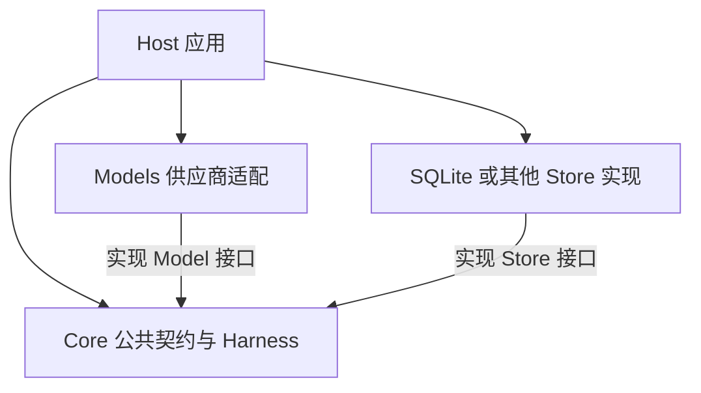
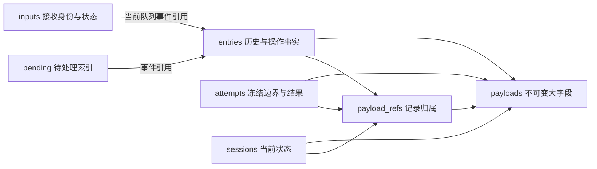
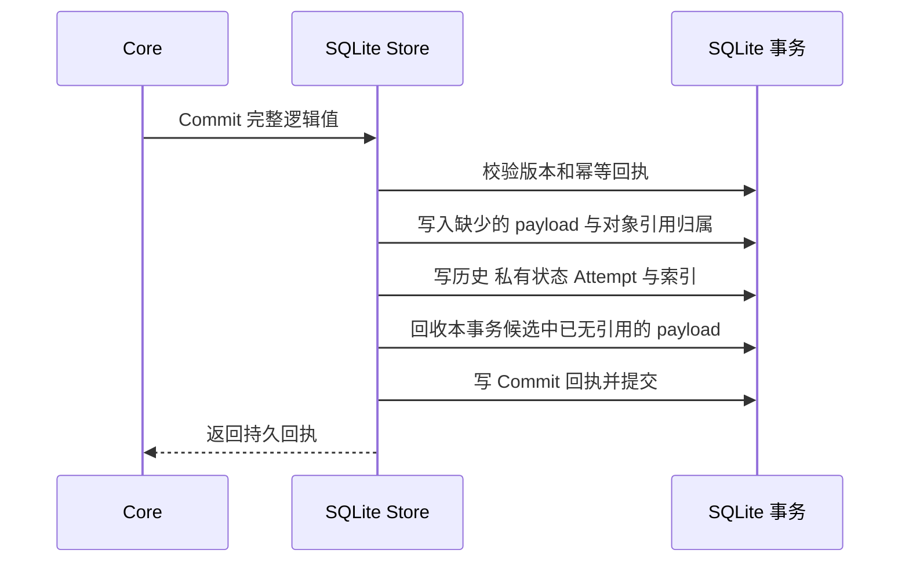

# Harness 持久化重构方案

状态：已按用户确认实施，待合并；本次不发布 release。日期：2026-10-30。

实现基线：Astral 当前锁定的 `astral-core` 提交 `79316a328810549ed84f043a409ae3057d33a181`，Host schema 6，Core 逻辑格式 11。以下保留设计依据与约束；落地结果及验证范围见文末，不替代现行系统规格。

## 1 目标与主决策

本次解决同一内容在输入、队列、会话历史和恢复状态中重复持久化的问题。目标是减少长期存储及重复读取，同时保持输入幂等、工具执行恢复、冻结请求、历史分支和有界上下文加载。

主方案保留 Core 的执行模型及公共 `Store`、`Entry`、`Message`、`Request`、`InputReceipt` 契约，在官方 SQLite 后端实现以下变化：

1. `inputs` 和 `pending` 保存事件引用，取消完整输入和事件的载荷副本。
2. 对 Core 已定义的通用可变长字段采用私有存储编码：小值内联，大值共享不可变字节。
3. 正文写入、引用归属、历史、状态和回执在同一事务提交。
4. SQLite 物理 schema 版本与 Core 逻辑格式版本分开。
5. 离线迁移保留逻辑历史；按还原后的大小控制读取；独立处理数据库压缩和备份占用。

这里的“一份内容”指可复用的大载荷字节，不要求把每个短字符串都变成独立数据库对象。相同内容出现两次仍然有两个消息身份、两个历史位置。去重不能变成消息合并。

现有执行事实不会在本次被删除。取消操作历史、修改审计保留策略、重做 Agent loop 或加入新的 IM 状态，都不属于这次存储问题的必要解法。

## 2 Host Core Models 的边界

下图箭头表示源码依赖，不表示运行时调用顺序。



运行时由 Host 创建并注入 Model、Store、工具及其他依赖；Core 通过接口调用这些对象。Models 可以被 Host 直接用于单次生成，不要求创建 Session、Store 或 rollout。

| 部分 | 本次职责 | 不应承担的职责 |
| --- | --- | --- |
| Core 根包 | 定义消息、输入、执行边界及存储行为；维持工具、Compact、Fork、恢复语义 | IM 平台、图片预览策略、附件下载、产品权限、SQLite 表结构 |
| Models | 按现有契约编码供应商请求、解析响应、处理原生载荷和估算 | 队列持久化、数据库布局、IM 语义、Host 文件管理 |
| SQLite Store | 内容编码、原子提交、引用归属、有界查询、物理迁移 | 解码图片、判断预览用途、解析供应商私有 JSON |
| Host | 注入依赖；停服、备份、迁移协调、权限、业务数据、发布更新接入 | 直接改写 Core 表、把 IM 状态加入通用 Core 类型 |

SQLite 的内容引用不会进入公开 `Content`，也不会成为 Host 必须理解的新 URI。Models 收到的仍是完整逻辑消息。

当前根包中的 `ProcessImage` 是媒体辅助能力，Host 的 IM 像素限制策略在 `internal/channels/im_images.go`。其包归属可以另做清理，但不作为本次迁移前置，也不修改已经冻结的媒体载荷。本方案不会新增 Core 图片处理、媒体获取或预览服务。

## 3 当前问题与可以沿用的部分

一次部署样本中，`core.db` 约为 1.27 GB。三个主要载荷来源分别是 `input_queued` 约 376.5 MB、应用后的 `context` 约 360.4 MB、`inputs.payload` 约 374.1 MB。统计为不同语义位置保存的内容，不能把它解释成模型收到三遍消息。

输入等待处理时通常存在 `entries`、`inputs`、`pending` 三处完整载荷；消费后 `pending` 被删除，但应用后的上下文又持有相同正文。队列修订、工具阶段和运行状态还可能保存部分相同字段。

| 已有机制 | 处理决定 |
| --- | --- |
| 后端无关的 `Store` 接口与内存后端 | 保留；其他后端不被强制采用相同表结构 |
| `RequestInput` 的历史边界、Selection、Changes、Digest | 保留；它已经避免重复保存正常的整份上下文 |
| 成功 Attempt 引用历史 Entry，采纳摘要后清除临时 Reply | 保留，不重新增加完整请求或结果快照 |
| 当前窗口加载和分页历史 | 保留，并防止私有引用绕过逻辑字节预算 |
| RuntimeState 与 Projection | 保留逻辑形状；大字段复用同一编码，无需新造恢复状态机 |
| Commit ID、ExpectedVersion、回执 | 保留，摘要继续基于完整逻辑提交 |
| 工具阶段事实、配置版本、usage 来源、历史父链 | 保留，不作为“重复数据”直接删除 |

当前的主要问题是物理正文归属，而不是缺少另一套 Session 架构。减少物理副本与删减历史能力是两项不同决策。

## 4 SQLite 目标数据模型



### 4.1 索引引用

`pending.payload` 替换为指向实际事件的 `(rollout_id, entry_id)`。保留种类、排序、owner 等检索字段。队列索引的种类可以是 `input_queued`，但引用的真实事件可能是 `input_requeued`；读取必须返回真实事件及其身份。

`inputs.payload` 替换为 `current_queue_entry_id`，保留首次接受时间、原始接受 Digest、当前 kind/state 和已应用的 Entry ID。编辑或重排时更新当前队列事件引用，不能固定指向最初接受事件。

`LookupInput`、`Pending` 在 Store 内部读取引用并还原现有返回值。清除后仍保留接受回执，防止旧请求重试时被重新接纳。

### 4.2 通用大字段编码

新增两张 SQLite 私有表，具体 SQL 在实现时补齐外键和索引：

```text
payloads
  hash                 主键，内容字节的 SHA-256
  byte_length          原始字节数
  bytes                不可变 BLOB

payload_refs
  rollout_id
  owner_kind           entry / state / attempt
  owner_key            所在表完整主键的无歧义编码
  hash
  主键 (owner_kind, owner_key, hash)
  索引 hash 和 rollout_id
```

编码器只处理 Core 类型中明确声明的可变长载荷字段，例如：

- `Content.Text / URL / Data / Metadata`、`Message.Metadata`。
- `ToolCall.Arguments / Metadata`、`Invocation.Binding`、`ToolResult.Details`。
- Compact 的摘要和指令、`RequestChange.Value`、模型 Snapshot。
- 其他可能携带长文本的已知字段，在字段覆盖表中逐项声明，不以内容来源或媒体类型判断。

相同规则复用于 Entry、Projection、RuntimeState 和 Attempt 中的这些字段。拟以 4 KiB 为初始内联阈值，在夹具基准中确认；它是后端内部常量，不新增产品设置。

字符串按 UTF-8 内容保存；`json.RawMessage` 按编码器接收到的字节保存，不解析成 `map[string]any` 后重新编码。这里保持的是持久化边界上的逻辑值与不透明载荷，不承诺恢复 Core 已有规范化之前的原始 JSON 空白格式。

私有 DTO 明确区分内联值和内容引用，不在用户文本、URL 或供应商 JSON 中塞特殊占位符。SQLite schema 决定 DTO 布局，不另引入一套独立的业务内容版本。

同 hash 的内容必须一致；已有内容与新字节不一致、引用缺失、长度或校验不符，均视为存储损坏，不能返回空内容掩盖问题。

### 4.3 为什么选择字段级共享

整 Message 去重会因一小段 Metadata 变化而重新保存整个大载荷。字段级共享可以让不同消息中的相同 `Content.Data`、工具参数或长文本复用字节。

首版不递归拆解任意供应商 JSON，不实现通用对象图、内容定义分块或压缩字典。如果一个不透明字段把变化元数据和大载荷包在一起，则接受这个字段不能进一步共享的限制。Base64 作为普通字段字节保留，不因猜测它是图片而解码或转码。

### 4.4 身份与所有权

`EntryID` 表示历史中的一次出现；`InputID` 表示一次提交；接受 Digest 表示原始提交的幂等身份；payload hash 仅表示一段物理字节。四者不能混用。

尤其是 `UpdateQueuedInput` 会保留 Input ID、接受 Digest 和首次接受时间，同时改变待处理 Message。正文内容键必须独立计算，不能使用 Input ID 或接受 Digest。

`payload_refs` 记录顶层持久对象实际引用的 hash 集合，不维护可漂移的整数引用计数。owner 只有 Entry（含 Projection）、Session State 和 Attempt 三种；owner_key 包含所在表完整主键，不能假定 Attempt ID 跨 Session 全局唯一。输入与 pending 通过 Entry 取正文，不再建立第二份内容归属。

hash 可由外键关联 `payloads`；多态 owner 不用一个外键假装关联三张表。owner 存在、所属 rollout 和引用集一致性，由集中写入函数在同一事务内保证，并纳入完整性检查，不再增加通用 owner 注册表。

每次新增或替换对象，在同一事务内登记该对象当前完整的 hash 集合，移除旧集合中已经不用的关联。完成本事务全部对象更新后，对失去引用的候选 hash 执行带索引的 `NOT EXISTS` 检查，删除没有任何 owner 的 payload。只检查本次候选，不逐次扫描全库；重复提交也不重复累加计数。

这是一层对象到字节的归属关系，不递归遍历任意 JSON 对象图。它让被替换的状态、已采纳的临时结果释放不再使用的字节，避免长寿命会话积累不可访问载荷。历史 Entry 仍存在时，其正文按历史保留语义继续保留。

尚在 building 的 Fork 同样为已写入的目标 Entry 登记归属。删除 rollout 时移除其全部 owner 关联，再回收无其他 owner 的候选 payload。未发布 Fork 的取消及启动清理必须走同样的流程。临时结果转入历史时，先完成新旧对象的全部引用变更，再回收，不能在事务中途误删仍将使用的字节。

整段历史删除时，候选 hash 可能很多，使用数据库侧集合或有界批次处理，不能先把整个 rollout 的 hash 集合读入 Go 内存。

共享物理字节不改变私密会话权限。Host 仍先校验 Session、Rollout 和历史位置，再调用 Store；不提供按 hash 任意读取载荷的 Gateway API。

## 5 写入与读取协议

### 5.1 原子写入

沿用现有 Commit 的 CAS、稳定 ID 和回执确认机制：



Commit Digest 仍由逻辑 Commit 计算，不能改成私有 DTO、hash 集合或压缩后的大小。落盘后确认丢失，仍通过原 Commit ID 查询回执；去重写入不能提前成为一个独立事务。

模型、工具和 Computer I/O 继续位于数据库事务之外。大字段编码可以准备不可变数据，但版本校验、引用登记和可见性必须由最终事务保证。

### 5.2 有界读取

Entry、Projection、Attempt 等私有记录保存或可直接计算其还原后的逻辑大小。`Scan`、`Pending`、`ScanAttempts` 先按条数和逻辑字节选择页面，再批量读取该页所需的不同 payload。

记录和 payload 在同一个一致性读事务内取得，避免并发删除造成中间缺口；关闭初始 rows 后再补查内容，避免逐条、逐字段查询。事务仅覆盖本页读取，不跨 UI 等待或流式网络发送。

返回值继续与 Store 内部缓存隔离，修改一个返回对象不能污染其他会话。任何缓存都按字节设限，不按 rollout 总历史建立常驻内容映射。

内存目标是随当前上下文窗口、读取页面及单条记录大小变化，而不随归档历史总长度增长。当前 Fork 对超过普通页预算的单条记录存在单独读取路径，方案必须如实保留这个上界：有界分页不等于无论单条内容多大都只占固定几 MB。

历史浏览、导出、迁移、Fork 不先加载完整 rollout 再分页。冷打开仍只恢复有效上下文窗口和必要引用；这部分已有机制不另写一套。

## 6 必须保持的执行语义

| 约束 | 不允许的简化 |
| --- | --- |
| 输入整体接受、Contexts 与驱动 Message 整体应用 | 因去重拆成几个独立投递，改变排序或预算失败行为 |
| 队列编辑与重排具有新的不可变事件身份 | 用原接受 Digest 判断准备中的内容未变化，或原地覆盖历史事件 |
| applied 只表示进入历史与上下文 | 把 applied 当成已进入主模型请求、已经回答或已经发往 IM |
| RequestPreparer 的选择和变换冻结到 RequestInput | 恢复时读取最新人格、环境或重新拼入后来到达的输入 |
| Started 是工具可能已产生副作用的界线 | 只有最终结果，没有阶段事实；崩溃后直接重跑未知操作 |
| Completed 可先于最终结果交付 | 因最终结果缺失而丢掉已经执行成功的事实 |
| Compact 保留 ThroughID、来源和历史 | 把摘要当作准确执行状态，或因不在当前窗口就删原历史 |
| usage 基线绑定请求与回复的有效前缀 | 只保留一个最新 token 数，忽略之后新增的旁观上下文 |
| Detached Fork 独立于源会话的执行账本 | 通过源 queued Entry 或源 Attempt 读取子分支必需内容 |

当前 `IMInspector.Handled` 检查实际冻结的 generation 请求及其摘要覆盖范围。它表示 Host 已将输入纳入某次持久化请求边界，并不证明远程模型已经成功读取或回复。本次保持这项 Host 调度定义，不增加 Core 的 `IMHandled` 字段。

工具 prepared、authorized、started、completed、result 以及未知效果和审批事实，保留原语义与查询能力；可以共享其中的参数和结果载荷。数据库无法为任意外部副作用提供自动 exactly-once，未知效果继续交给现有 Host 核对机制。

## 7 Fork 删除与导出

Shared Fork 继续共享原 rollout，已有共享删除限制保持。Detached Fork 继续分页构建目标历史，保留源节点身份、父链、配置和 usage 来源，但不复制父会话的队列、输入账本和 Attempts。

目标 rollout 为每页新建的 Entry 登记独立的 payload 归属，完成后沿用现有原子发布。目标历史不能依赖源 rollout 的 queued Entry。首版可以按现有接口读取有界页并重编码，内部直接复制私有引用仅作为后续性能优化。

删除源会话后，Detached Fork 的历史、Recall、上下文、usage 基线和后续执行必须可用。取消 building Fork 后不能残留其归属；清理不能回收其他 rollout 仍使用的内容。

Rollout JSONL v2 继续导出完整逻辑记录和 Attempt，导出文件自包含，不出现 SQLite hash、私有 DTO 或内容表引用。已公开的历史接口和模型请求重建形状保持不变。

## 8 版本与迁移

### 8.1 拆分逻辑格式和物理版本

拟议首个目标为 Core 逻辑格式 11、SQLite schema 12；最终编号以实施时尚未发布的下一迁移编号为准。

| 标记 | 含义 |
| --- | --- |
| `core.FormatVersion`、历史与 RuntimeState 中的格式字段 | Core 逻辑数据契约，保持 11 |
| `format.version` | 库内逻辑格式，保持 11 |
| SQLite `SchemaVersion` 与 `PRAGMA user_version` | 私有表及编码布局，推进至 12 |
| Goose ledger | SQLite 物理迁移序列，续接既有 `0, 11, 12` |

已发布的 baseline 11 不修改。schema-only 迁移只推进物理标记；以后真正改变逻辑格式，由该迁移明确声明格式转换，不能让 Goose 编号隐式决定 Core 格式。

`Open` 校验逻辑格式、物理 schema 和 ledger 的一致性；旧库必须离线迁移，未来或半完成版本必须拒绝。旧二进制会因 `format=11` 与 `user_version=12` 不一致而拒绝打开，不能回退到旧解码器尝试读取。

新库直接原子初始化最新表、逻辑格式与完整 ledger，不先建立旧表再转换。旧 DTO 和读取规则仅存在于冻结迁移代码中，正常运行不携带旧格式分支。

### 8.2 沿用单事务迁移

主路径继续使用现有 Host 快照与恢复协议，以及 Core 的一个 Goose `RunTx`。所谓分批是分批读取和解码，不是每批提交：

1. 持有 Server 的现有独占锁，处理上次未完成升级日志。
2. 对可能复制 DB/WAL 的检查阶段先做文件级空间预检，再核对格式、ledger 与备份前提。
3. 按实际数据卷、备份卷、临时卷检查转换峰值和恢复余量。
4. 创建并验证完整 Server 快照，写入既有升级恢复日志。
5. Core 事务内创建新结构，以稳定主键游标和字节上限分批转换。每批关闭读游标后写入，避免读写游标相互影响。
6. 用冻结的旧结构恢复索引和载荷引用；不得调用未来版本的 Session 执行流程重放历史。`inputs` 要定位最新有效队列修订，不是最初入队记录；`pending` 按实际排序及修订事件匹配，出现歧义或缺失就失败，不猜测。
7. 验证还原后的逻辑记录、回执和引用完整性，替换旧表结构，最后与 ledger 一起提交物理版本。
8. 执行现有 Server 持久初始化，在接受 HTTP、IM 或本地工作之前提交升级。失败按既有日志恢复本次快照。

历史正文、媒体载荷、供应商原生数据、时间、顺序、ID、Commit Digest 和冻结请求结果保持一致。迁移不重新下载附件、不重新压缩图片、不重做 Compact。

不在首版增加在线双写、后台转换、批次进度格式或候选库切换协议。单事务的代价是迁移期间 WAL/日志可能较大，必须纳入空间预算和中断测试。

### 8.3 空间与实际回收

迁移峰值至少分别考虑完整快照、主库额外增长、事务 WAL/回滚日志、临时文件和恢复余量。批次内存有上限，不代表整个事务日志有同样上限；空间估计不能直接使用最终去重率。

现有检查遇到非空 WAL 时可能先把 DB 和 WAL 复制到系统临时目录，这一步也必须纳入预检。空间不足时在变更前停止，告知所需卷及空间；不得为继续升级而自动删除已完成备份。

去重后产生空闲页，不一定立即缩小 `core.db`。数据库压缩作为独立的离线维护步骤：同一独占锁、关闭其他使用者、空间检查、`wal_checkpoint(TRUNCATE)`、事务外 `VACUUM`、再次 `wal_checkpoint(TRUNCATE)`、校验并关闭维护连接，然后统计主库和侧车文件。前后 checkpoint 都要检查 busy 等返回状态，不能仅凭 SQL 未报错认定成功。普通 VACUUM 最坏可能需要约数据库大小两倍的额外空闲空间，不能作为磁盘已满时的无成本修复。[SQLite VACUUM 文档](https://www.sqlite.org/lang_vacuum.html)

同盘保留旧快照时，即使主库从 D 缩为 N，磁盘上仍保留约 D 的快照与 N 的新库。必须分别报告主库、WAL、备份及临时占用，不能把主库缩小宣称为本盘净空间释放。需要其他卷备份时可在现有快照路径配置上扩展维护入口，不新增一套备份或交换文件协议。

GB 级转换不能依赖当前 Desktop 最多 20 分钟的启动上限。拟调整现有等待策略：确认 `startup-maintenance.json` 属于当前启动进程、进程仍存活且正在准备数据时，Desktop 和安装器继续等待维护结束，不以普通服务健康检查超时杀掉迁移。标记移除后重新进入有时限的正常启动检查。标记失配、进程退出或明确失败立即结束等待；维护阶段持续展示状态并允许用户取消，不把存活标记解释为一定有进展。

正常启动计时只在退出维护阶段时开始一次，不能每次轮询都重置。维护标记不是服务就绪或升级提交成功的证据。

这是 Host 启动管理的明确改动，不增加迁移进度协议或“此目标禁止重试”的持久状态。取消与崩溃沿用现有快照、journal 和恢复机制；普通启动仍可恢复上次中断。恢复不能因固定两分钟上限而反复被截断，应与维护阶段一起允许完成或由用户中断。超大数据也可使用现有离线入口，它仍持有独占锁，不受普通启动等待限制。

恢复再次被中断时，保留有效 journal 与快照。提交后已经接受的新工作仍不得被普通启动自动还原；此次调整只改变等待与取消，不改变这个提交边界。

同时覆盖恢复日志写入遇到 ENOSPC、恢复所需预留空间、未完成备份目录残留和再次中断。只清理本次可确认未完成的临时产物，不自动删除已完成快照。

### 8.4 发布元数据

逻辑格式与物理 schema 拆分必须贯通 `MigrationStatus`、`astral version`、release manifest、候选验证和安装脚本。

保留现有逻辑格式字段的含义：`data_formats` 仍只有 `host` 和 `core`，`migration_targets.core` 仍表示逻辑格式 11，`version --data-formats` 仍输出两个整数。新增独立的顶层 `core_schema`，以及与既有对象分开的 `storage_migrations.core_sqlite = {baseline: 11, target: 12}`；CLI JSON 和 release manifest 使用同样的命名规则。

`sqlite.MigrationStatus` 保留逻辑 Current/Target 的含义，并明确提供 SchemaCurrent/SchemaTarget；NeedsMigration 同时反映物理 schema 及 ledger 的状态。新版实际升级判断采用这些状态，不能因为逻辑格式仍为 11 就跳过迁移。

不能把 `core_format` 偷改成 12，也不能把第三个整数加进旧输出。字段布局保持已有含义，并不等于已经验证旧 updater；上一正式版 updater/installer 的真实升级夹具仍是发布门槛。

新版等待策略也不能修改一个已经运行的旧版 installer。需分别验证新版入口和上一正式版入口；旧入口仍有硬时限时，应明确其超长迁移限制及现有离线迁移路径，不能宣称所有既有启动器都已获得新行为。

Host 业务 schema 不因 Core SQLite 私有变化而递增。升级只下载最新二进制，按顺序执行缺失的嵌入迁移；不下载中间版本。

## 9 接口影响与明确不做的事项

| 接口或能力 | 主线处理 |
| --- | --- |
| `Store` 必选方法、Config.Store 注入 | 不变 |
| `Message / Content / Request / Reply / Entry / InputReceipt` | 不变，返回完整逻辑值 |
| Models 的协议编码与业务行为 | 不变 |
| 内存及第三方 Store 实现 | 不要求迁移；共同契约测试照常适用 |
| SQLite Open、InspectMigration、Migrate 的物理版本报告 | 调整，独立表达 schema 与逻辑格式 |
| Owner 历史接口、Gateway 召回、JSONL v2 | 逻辑形状不变，读取需经过新 codec |
| SQLite 直接调试查询 | 随私有表结构变化，更新工程说明 |

以下内容独立评审，不与去重捆绑实施：

- 不含正文的通用输入回执查询：可减少幂等检查时读取大载荷，但不能替代 IM 的实际请求覆盖判断。若采用，应优先可选能力，避免扩张所有 Store 的必选接口。
- 操作历史保留期限、Attempt 清理；本次只回收已经没有任何顶层对象引用的物理载荷，不提前删除仍可查询的逻辑历史。
- `ProcessImage` 等媒体辅助函数的包归属与 Host 新预览策略。
- 对象存储、跨数据库 payload 服务、JSONL 运行后端、新的缓存体系。
- 模型调用流程、Probe 策略、消息格式和公开工具能力变更。

## 10 实施顺序与交付范围

| 阶段 | 交付 | 完成条件 |
| --- | --- | --- |
| A 契约与夹具 | 新旧逻辑等价夹具、身份与引用规则、codec 字段覆盖表 | 明确哪些字段共享、哪些身份不变、哪些能力不调整 |
| B SQLite 存储 | 私有 codec、两张内容表、inputs/pending 引用、读写与 Fork/删除支持 | 公共 Store 契约和完整恢复测试通过 |
| C 物理迁移 | schema 独立版本、fresh 初始化、单事务迁移、离线检查与空间维护 | 旧数据等价、失败恢复、重复迁移、磁盘故障验证通过 |
| D Host 接入 | 锁定新 Core、迁移状态和发布元数据、必要的空间/恢复加固 | 历史、Recall、IM、计划输入与客户端升级回归通过 |
| E 实际验证 | 部署数据副本的等价、体积、I/O 与内存报告 | 无来源重下载、无历史变化、达到预设性能门槛后再安排发布 |

Core 的主要文件范围为 `store/sqlite/sqlite.go`、`attempts.go`、`delete.go`、`migration.go`、新增私有 codec 和迁移测试；共同 Store 契约测试覆盖内存与 SQLite。`store/internal/historypage` 原有语义保留，只在确有调用调整时改动。根包执行文件及 Models 不因本次存储布局变更而重写。

Host 的主要范围为 `internal/datamigrate`、`internal/cli/version.go`、版本/发布/安装脚本和对应测试；`internal/platform` 及 Desktop 服务管理仅做迁移接入所需改动。`internal/harness/im_schedule.go`、Recall 和导出作为回归入口，不先改业务判断。

实施时同步更新两仓库的迁移/契约说明、Astral `SPEC.md` 中的持久化描述，以及涉及用户升级或维护操作的中英文公开文档。当前方案文件不把这些拟议行为提前写成已实现功能。

## 11 验收标准

### 数据与行为

- 对旧库按主键或稳定游标流式读取，比较迁移后每个逻辑 Entry、Projection、State、InputReceipt、Attempt 和 Commit Receipt；不把全库载入内存计算摘要。
- 冻结 Request 重建及其 Digest 一致；长文本、Unicode、未知 JSON 字段、原生签名和加密推理载荷完整保留。
- 相同正文不同消息身份、相同大字段不同 Metadata、不同角色相同文字都正确。
- 队列编辑/重排与准备并发、clear 后重试、响应丢失后的幂等均保持。
- started 未完成、completed 未交付结果、授权中断、取消与控制工具完成后的恢复均保持。
- Compact、旁观尾段估算、usage 基线与历史 Fork 保持；没有把摘要请求当成主请求覆盖。
- 删除父会话后 Detached Fork 可读可运行；building Fork 清理、共享删除冲突和重复删除正确。
- 同一事务内临时结果转入历史不误回收；State/Attempt 替换后独有的旧载荷释放；重复 Commit 不增加归属，其他对象引用的载荷继续保留。
- 私密会话过滤、Gateway 召回、历史分页与导出不泄漏私有 payload 地址。

### 存储与性能

- 同一大字段重复写入 N 次时，`payloads` 的对应字节仅一份；事件和归属元数据可以随 N 增长。
- 新 `inputs`、`pending` 不保存完整正文副本。
- 包含多种内容和同图不同消息元数据的夹具能验证共享；不使用“只重复完全相同 Message”这一种容易通过的样本。
- Scan、Pending、ScanAttempts 按还原后的大小限流；读取不得出现按字段逐次 SQL 查询。
- 归档历史分别扩大到基线的 10 倍与 100 倍、活动窗口保持一致时，冷打开及单页读取的载荷读取量不随总历史线性增长；RSS 单独记录运行时和数据库缓存噪声。
- Fork、迁移、导出的峰值内存按页或最大单条记录增长。首轮记录基线后设定回归门槛，再做前后对照，不能用总耗时缩短掩盖单次内存暴涨。
- 部署副本报告去重后的载荷总量、索引成本、主库实际大小、WAL 和备份占用；不预先承诺固定压缩比例。

### 故障与升级

- 合法 baseline 11、无 ledger、仅 ledger 0、fresh 最新库、缺号/重复 ledger、未来 schema、标记不符均有明确结果。
- 在内容插入、归属登记、引用写入、提交前后、Fork 发布、迁移中间和恢复中再次中断，验证不会出现部分可见记录或错误清理。
- 模拟备份卷、数据卷、临时卷和日志写入 ENOSPC；空间不足不会破坏可恢复的旧库。
- 验证最新程序正常打开迁移结果、旧程序明确拒绝、上一个正式版客户端能取得并安装新发布。
- Goose 版本步骤保持不可变；整个转换仅在离线升级中运行，正常业务路径不保留旧存储兼容分支。

## 12 决策依据与评审结论

选用 SQLite 内部引用而保持逻辑事件，是因为当前 Host 与 SDK 已通过操作历史判断取消、恢复和请求覆盖；删除这些事实会扩大行为变化，却不是减少载荷副本的必要条件。

选择通用字段级共享，而非图片专用表、整 Message 或递归 JSON 对象图，是为了覆盖主要重复来源，并控制编解码、所有权和迁移复杂度。

选择现有 Goose 单事务路径，而非候选库替换，是为了复用当前已经明确的跨库快照与恢复边界。其 WAL 和备份空间代价明确保留，通过前置检查及独立维护处理，不承诺低空间无代价升级。

评审应确认的主方案是：公共 SDK 执行契约不变，SQLite 改变物理归属和私有编码，Host 接入迁移与发布元数据，Models 无须参与。减少操作历史和新增输入查询能力作为独立决策，不以“存储优化”的名义默认加入。

代码依据：Core `store.go`、`state.go`、`input.go`、`request_input.go`、`attempt.go`、`store/sqlite/`、`store/internal/historypage/page.go`；Host [迁移契约](migrations.md)、[IM 调度](../internal/harness/im_schedule.go)、[历史导出](../internal/httpapi/streams.go)、[模型注入](../internal/harness/service.go)、[媒体业务处理](../internal/channels/im_images.go)。

## 13 实施与验证记录

已实现 SQLite schema 12、逻辑格式 11：输入/队列事件引用、声明字段共享编码、对象引用归属、事务末尾回收、按逻辑字节分页和读快照、Detached Fork 与删除、冻结 Goose 转换、离线 VACUUM。Core 执行文件、Models 与公共 Store 必选方法未修改。编号 `00012_*.go` 包含冻结迁移依赖，Host 的已发布迁移检查同时覆盖它们。

Host 已接入物理 schema 元数据、按文件系统合并的空间预检、升级等待、恢复取消、启动维护窗口及中英文使用文档。维护标记保持到升级提交或恢复完成，未把数据初始化返回等同于升级提交。现有两个逻辑版本整数输出保留。未新增 PostgreSQL 后端。

2026-10-30 的本地验证：

- Core 的执行/恢复集成测试与 SQLite 测试启用 race 检测；新增队列修订、共享正文、Detached Fork 删除、Attempt 采纳与回收、事务回滚、损坏引用、实际旧布局迁移及冻结字段覆盖检查。
- 本机真实数据库通过只读 backup 取得临时副本，逐表比较迁移前后逻辑摘要：4 个 Session、237 个 Entry、32 个 Attempt、15 个输入回执、230 个提交回执，全部一致。VACUUM 后再次比较一致；主库 1,970,176 → 1,515,520 字节。验证没有替换实际部署数据。
- Apple M2 上固定保留 19 个上下文节点，5 次操作的读取基准如下。这里是分配量而非常驻 RSS；不宣称代表大型生产库的迁移耗时。

| 归档节点 | 重开读取行数 | 每次分配 | 每次耗时 |
| --- | --- | --- | --- |
| 100 | 20 | 148,905 B | 0.454 ms |
| 1,000 | 20 | 150,088 B | 0.551 ms |
| 10,000 | 20 | 149,091 B | 0.450 ms |

- 从官方 v0.1.7 下载并验证校验和的 macOS 原生程序，在隔离空目录初始化后交给开发版启动：升级完成、电脑身份保留、逻辑格式 11/schema 12，旧程序明确拒绝升级后的数据库。此验证覆盖 Server 启动迁移，不代表已经发布并验证完整签名 Desktop 自动安装。
- Host Go 测试、Go vet、发布元数据与安装器测试、Desktop 类型和界面单测、网站检查均纳入本次验证。Windows/Linux 的迁移测试程序在本机交叉编译；实际原生运行仍由跨平台 CI 验证。
- macOS 本地渲染了隔离的启动维护窗口；它不连接实际 Server，未替换用户客户端。

本次只推送代码和评审分支，不修改应用版本号、不创建发行 tag、不发布 release。Mac mini 的 GB 级库尚未执行迁移；正式发布前应另行验证该规模的峰值空间与耗时。
