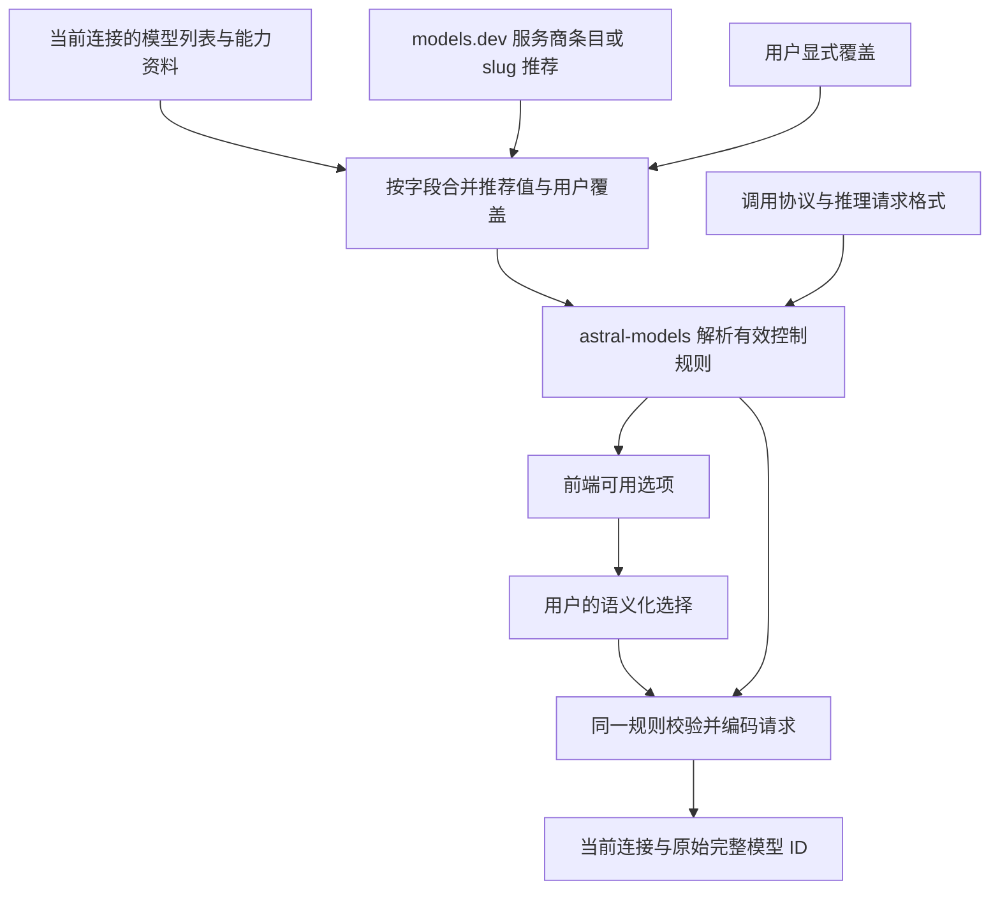

# 模型资料与推理控制方案

- 状态：待实施方案，不代表下述能力已经交付。
- 更新日期：2026-10-23。
- 适用范围：Astral 的模型导入、资料预填、推理设置，以及 `astral-models` 的请求适配与推理回传。
- 现有业务与交互约束继续遵循 [系统规格](../SPEC.md) 和 [UI UX 规范](ui-ux-spec.md)。实施时同步更新对应规范，避免本方案长期成为另一套行为标准。

## 1. 结论

采用“**当前连接的能力资料优先、models.dev 补充推荐值、内置常见推理请求格式、特殊接口允许有限参数覆盖**”的方案。

模型名称可以帮助查找资料，但不能决定当前接口接受什么请求字段。同一个模型经过不同中转，可能使用 `reasoning_effort`、`reasoning.effort`、`thinking` 或 `enable_thinking`，也可能获得与原厂不同的推理控制方式。因此，必须把“模型支持哪些控制”和“这些控制怎样发给当前连接”分开保存，再由同一套后端规则组合解析。

普通用户使用预置服务商或标准协议即可；使用已知网关的用户选择一次兼容格式；真正特殊的接口可以保存一次推理参数映射。无需为每个模型手写请求，也不承诺从模型名字推导未知接口的行为。

## 2. 问题与概念边界

### 2.1 当前需要解决的问题

1. `/models` 通常能列出可用模型，但不一定提供上下文长度、多模态能力和推理控制等完整资料。
2. models.dev 可以补充资料，却不能完整描述任意中转的请求参数。
3. 推理控制没有统一形态：有的接口只有开关，有的接受 effort，有的接受 Token 预算，有的同时支持多种控制。
4. 网关可能转换控制语义。例如，对原厂只有预算的模型，网关仍可能向客户端提供 effort 选项。
5. 如果前端、目录导入与请求编码分别推断能力，就会出现菜单可选、实际请求却不支持的问题。

### 2.2 必须区分的对象

| 对象 | 含义 | 不能据此推断的内容 |
| --- | --- | --- |
| Provider 连接 | 实际访问的地址、协议、凭据及兼容设置 | 模型原厂不等于当前连接的运营方 |
| 远端模型 ID | 当前连接要求在请求中发送的完整 `model` 值 | 不应为了目录匹配而改写 |
| 模型资料 | 名称、上下文、输出限制、多模态和推理能力等推荐信息 | 目录中的能力不等于该账号已获授权 |
| 推理能力 | 当前模型路由允许的开关、effort、预算及默认行为 | 支持推理不代表支持任意控制参数 |
| 推理请求格式 | 将用户选择编码成当前接口参数的规则 | 改变该格式不应顺带改变整个协议兼容行为 |
| 推理回传与重放 | 解析响应中的推理块，并在后续工具往返中正确保留 | 请求字段与响应字段不一定同名 |

最终生效的控制规则属于 **Provider 连接＋调用协议＋远端模型 ID**。不能只用模型 slug 作为缓存或能力配置的唯一标识。

## 3. 模型发现与资料预填

### 3.1 模型列表和模型资料分别处理

- 当前连接的 `/models` 或对应发现接口用于列出该连接提供的模型；列表结果也不等于每个模型已经通过真实调用验证。
- models.dev 用于补充模型资料，不直接把整个目录变成当前连接的可用模型列表。
- 接口不提供列表、列表不完整或模型尚未收录时，保留手工添加完整模型 ID 的路径。
- 推荐值与用户覆盖值分开保存；每个推荐字段记录来源和更新时间，允许恢复推荐值。

### 3.2 资料的优先级

按字段解析，而不是让一份不完整资料整体覆盖另一份：

```text
用户显式覆盖
    ↓
当前连接返回的、我们能够正确解析的能力资料
    ↓
models.dev 中对应服务商的模型条目
    ↓
按末段 slug 匹配的原厂推荐资料
    ↓
未知
```

优先级较低的来源只补充未确定的字段，不能覆盖明确的“不支持”、空档位集合或当前连接的专属能力。用户覆盖也必须通过所选请求格式的可编码性校验；手工填入一个值不会让接口自动获得该能力。

对于网关，应使用网关提供的控制方式。例如网关提供 effort 并负责转换为上游预算，就应展示网关允许的 effort，而不是用原厂的“仅支持预算”把这些选项过滤掉。[OpenRouter 的推理能力发现与转换说明](https://openrouter.ai/docs/guides/best-practices/reasoning-tokens)

### 3.3 slug 匹配规则

已知服务商优先按服务商身份和完整模型 ID 精确匹配；未命中时再按 slug 查找。自定义服务商可以直接按末段 slug 预填，无需先识别其原厂或注册服务商身份。

匹配时，对远端模型 ID 和目录条目的模型 ID 都取最后一个 `/` 后的完整部分，再做精确匹配：

| 远端模型 ID | 用于匹配的 slug |
| --- | --- |
| `xxx/xiaomi/mimo-v2.6-pro` | `mimo-v2.6-pro` |
| `xxx/mimo-v2.6-pro` | `mimo-v2.6-pro` |
| `mimo-v2.6-pro` | `mimo-v2.6-pro` |

保留版本号和后缀，不进行模糊匹配或擅自删除日期、`pro` 等部分。多个目录条目具有相同 slug 时，优先选择可识别的原厂条目；仍有歧义则使用固定的候选排序并记录来源。存在实质冲突的字段保持未知，不能随机合并不同接口的能力。

**匹配只影响推荐资料。** 实际请求继续发送原始完整模型 ID，连接地址、协议、推理请求格式及回传规则都不因 slug 自动改变。原厂默认值也只是推荐信息，不代表已经验证当前中转的默认行为。

### 3.4 models.dev 的加载方式

运行时获取目录并缓存最近一次成功结果，避免随应用维护一份完整模型快照。刷新失败继续使用已有缓存并保留更新时间；没有缓存时仍允许手工配置，缺失资料保持未知。

下载结果通过格式校验后再原子替换缓存，串行化同一目录的刷新，并更新内存中的推荐结果。目录缓存与连接的模型发现缓存分开：前者是公共资料，后者随连接配置版本变化。

目录刷新不得覆盖用户显式设置，也不得启动模型调用。具体缓存时长、刷新调度和目录版本解析在实施时确定，不影响上述行为。

## 4. 推理请求格式

### 4.1 独立配置，服务商默认、模型可覆盖

新增独立的“推理请求格式”配置，不借用整个 `Dialect` 来承载。现有 `Dialect` 还可能影响消息、错误处理和其他兼容行为，仅更换推理参数不应改变这些行为。

格式选择顺序为：

1. 模型显式覆盖。
2. Provider 显式配置，包括用户选定的已知网关格式。
3. 预置服务商绑定的、经过核对的规则。
4. 用户选择的调用协议对应的标准格式。

例如选择 OpenAI Responses 协议后，可以默认使用其标准 `reasoning.effort`，不要求用户再选一次相同格式。这表示遵循已选协议，不表示远端已经验证通过。对于协议没有定义的扩展字段，必须有已知规则或显式配置，不能由模型 slug 猜测。

### 4.2 维护有限的请求格式，而非逐厂商复制实现

下表说明需要覆盖的格式族；具体模型允许的字段和值仍由该路由的能力决定，不意味着同一厂商的所有接口都支持整行内容。

| 格式族 | 典型请求表达 | 需要保留的区别 |
| --- | --- | --- |
| OpenAI Chat effort | `reasoning_effort` | 接受哪些原生值、是否有明确关闭值 |
| OpenAI Responses effort | `reasoning.effort` | 与 Chat 的字段位置不同 |
| `thinking.type` | `thinking: {type: "enabled"/"disabled"}` | 仅开关与同时支持 effort 的接口分别声明 |
| Qwen 类开关与预算 | `enable_thinking`、`thinking_budget` | 某些服务要求放入 `chat_template_kwargs`，不能混为同一格式 |
| Anthropic 预算 | `thinking.type`、`thinking.budget_tokens` | 开启状态、预算和输出限制的关系 |
| Anthropic adaptive | `thinking.type: "adaptive"`、`output_config.effort` | 不能把旧预算模式和 adaptive 模式同时发送 |
| Gemini | `generationConfig.thinkingConfig` 中的 `thinkingLevel` 或 `thinkingBudget` | 根据具体模型选择支持的控制方式 |
| OpenRouter | `reasoning.enabled`、`reasoning.effort` 或 `reasoning.max_tokens` | 使用网关能力；effort 和预算不同时发送 |

每种格式集中定义可编码的控制、参数约束和冲突规则。已知服务商可以复用同一格式并声明必要差异，避免为每个服务商维护重复编码器。

### 4.3 三种常见使用路径

| 使用场景 | 配置行为 | 结果 |
| --- | --- | --- |
| 预置服务商直连 | 自动使用已维护的请求规则，导入资料 | 常规情况下无需额外配置推理格式 |
| 自定义标准接口或已知网关 | 标准接口沿用协议默认；已知网关选择一次对应格式 | 以当前连接的能力和格式生成控制 |
| 非标准中转 | 选择其他内置格式，或保存高级参数映射 | Provider 下模型继承，例外模型单独覆盖 |

例如，两个连接都暴露 `mimo-v2.6-pro`：原厂连接可以按已知规则发送 `thinking.type`；一个标准 Responses 中转可以发送 `reasoning.effort`。两者可以共享部分目录推荐资料，但不能共享未经核对的请求格式。

## 5. 推理选择的统一语义

后端保留统一的选择意图，具体结构在实施时确定：

| 用户意图 | 语义 |
| --- | --- |
| 默认／继承 | 沿用既有选择作用域；没有推理覆盖时使用对应 Model Profile 的默认配置 |
| 接口默认 | 显式跳过 Profile 默认推理配置，不主动覆盖接口的推理行为 |
| 开启 | 明确启用推理；只有能够表达这一操作时才提供 |
| 关闭 | 明确禁用推理；必须有真实关闭方式 |
| effort | 使用当前路由支持的原生档位值 |
| 预算 | 使用当前路由支持的 Token 预算及边界 |

先解析 Bot／Session／Probe 的选择作用域，再处理对应 Model Profile 的默认值，最后编码请求。既有空推理配置继续表示使用 Profile 默认值；新增的显式“接口默认”需要独立表示，不能与空值合并。Profile 没有配置默认控制，或用户明确选择接口默认时，请求才省略主动推理控制参数。

界面必须区分“默认（当前 Profile 默认值）”与“接口默认”，不能悄悄改变现有“默认”选项的含义。目录报告的接口默认行为是说明性资料，也不自动变成用户主动配置的 Profile 默认控制。

执行规则：

- `none` 如果是某接口的关闭值，只在编码时使用，不作为跨接口通用档位。
- 不把 `max` 改名为 `xhigh`，不把 `high` 简化成 `true`，也不擅自把 effort 换算成预算。已知网关自身提供的明确转换规则可以采用。
- 未知档位不自动补成 `low / medium / high`；明确只支持开关的接口只展示开关相关选择。
- 区分缺失、空集合、显式 `false`、`0` 和 `null`。来源专属的 `null` 或特殊预算值由对应解析器解释，不能用统一的真假值判断吞掉差异。
- 同时支持多种控制不意味着可以任意组合；互斥与依赖关系由格式规则校验。
- 不支持显式关闭或必须推理的模型不提供“关闭”。不发送参数不能冒充关闭，响应中没有思考文本也不能证明关闭成功。
- 是否推理、是否请求返回思考内容、界面是否展示思考内容，以及协议要求的回传保留是不同控制。隐藏思考内容不能被解释为关闭推理，也不能删除工具往返必须携带的内容或签名；本方案不因此要求新增展示开关。
- 能力不足以确定某项扩展控制且没有已配置默认值时，可以按接口默认使用；已保存但无法编码的显式选择或 Profile 默认控制返回具体错误，不静默降级为接口默认。

## 6. 特殊接口的有限参数映射

高级设置允许为“开启、关闭、某个 effort”指定固定 JSON 请求片段。以下仅说明概念，不是已确定的配置文件 Schema。

连接 A：

```json
{
  "on": {"thinking": true},
  "off": {"thinking": false}
}
```

连接 B：

```json
{
  "on": {"thinking": {"type": "enabled"}},
  "off": {"thinking": {"type": "disabled"}},
  "efforts": {
    "high": {"thinking": {"type": "enabled"}, "reasoning_effort": "high"}
  }
}
```

这些片段只在当前接口明确接受时配置，不作为任何模型的自动推荐。Provider 保存一次后供模型继承，单个模型可以整体替换推理映射。

参数映射必须满足以下边界：

1. 只处理推理请求参数，不开放脚本、模板表达式或任意代码执行。
2. 格式或映射显式登记其管理的推理字段路径。切换格式时先移除旧格式生成的推理字段，再应用当前选择的片段；不能先生成两套参数，再靠 JSON 合并碰运气。
3. 字段移除仅限登记的推理字段；不得覆盖 `model`、消息、工具、鉴权、流式设置等公共请求数据。删除嵌套字段时保留同一对象中的其他参数。
4. 当前映射、其他扩展参数和所选控制发生冲突时，返回可定位到字段的配置错误，不以“最后写入者获胜”处理。
5. “接口默认”不套用开启片段，也不残留上一次选择生成的字段；“默认／继承”先解析 Profile 配置再套用对应片段。每次请求都从当前有效配置重新生成。
6. 映射只提供自身能够明确表达的选项；缺少关闭映射不能展示关闭。动态预算首先使用内置格式，若未来增加自定义预算绑定，应使用受约束的数值字段绑定，不引入表达式引擎。

此出口只解决请求参数差异。非标准响应结构、推理签名或工具回传要求仍需要对应兼容实现，不能宣称一段 JSON 可以完成整个协议适配。

## 7. 职责与处理流程

| 层 | 负责内容 |
| --- | --- |
| Astral | 管理连接、凭据、目录网络访问与缓存；匹配模型；保存推荐值、用户覆盖和 Bot／Session／Probe 选择；向 SDK 提供当前路由配置 |
| `astral-models` | 定义并解析已支持接口的能力元数据；解析可执行控制；校验用户选择；编码请求；解析推理响应与处理工具往返中的回传要求 |
| 前端 | 展示后端返回的选项和来源提示，提交语义化选择；不根据模型名或服务商类型猜字段 |
| Core | 承载协议中立的模型请求、内容与执行历史，不维护厂商参数表 |

Astral 负责何时、向哪里获取资料；`astral-models` 负责如何理解已支持接口的能力字段。models.dev 的匹配与推荐合并留在 Astral，不把应用目录同步职责放进 SDK。

SDK 内部明确分为“控制意图、目标格式、编码结果”三部分：

- 控制意图保留模式、原生 effort、精确预算、字段是否明确设置以及配置来源。预算不先压缩成 effort 再反向换算；显式 `false` 和 `0` 不因序列化而消失。
- 目标格式负责将该意图编码为具体字段，并校验组合约束。来源中有特殊含义的 `null` 先由对应解析器解释，不能仅靠指针类型就认为已经区分所有状态。
- 编码结果包含实际生成的推理字段和可定位的诊断。自定义映射与正常格式走同一条最终校验路径，诊断必须对应最终请求，不能继续显示覆盖前的字段或档位。配置错误在发送前返回，不靠自动换字段或改档位重试掩盖。

这层意图表示是 SDK 内部数据，不直接序列化到上游请求。Astral 自己产生语义化请求，因此无需为本方案引入一个接受任意客户端协议的网关转换系统。



可选项生成和实际编码必须使用同一份有效规则。请求执行时重新校验当前配置，不能仅依赖前端曾经展示过某个选项。连接地址、协议、凭据绑定、租户／项目、区域或模型发现地址变化后，失效该连接的旧模型发现结果与兼容性验证；格式或能力变化后重新解析控制规则。缓存绑定连接配置版本，不以密钥明文作为缓存标识。已有历史不改写，后续请求按新路由检查回放兼容性。

## 8. 用户操作与保存范围

- 服务商详情继续承载连接配置与模型列表，不新增一级“推理管理”页面。
- 普通预置服务商自动带入格式；自定义连接在现有连接配置区域选择格式。格式与连接参数作为一个完整配置局部提交。
- 模型详情允许覆盖继承格式和推荐能力。独立、完整的选择可以自动保存；格式与自定义映射需要共同修改时，在该局部区域整体提交。
- 常见操作使用普通控件，高级 JSON 只用于特殊接口；沿用共享分组、间距与保存反馈。
- 聊天、Bot 默认模型和 Probe 模型继续复用同一个模型与推理选择控件。前端展示后端给出的有效控制，预算范围和当前选择也由后端定义。
- 切换模型清除旧模型的推理覆盖；模型和推理选择属于同一次保存范围。Session 变更只影响后续模型请求，Bot 默认选择只影响新建会话。
- Probe 选择跟随会话时同时继承模型与推理选择；显式指定 Probe 模型后才使用独立推理设置。
- 保存、刷新目录和测试连接保持各自明确的作用范围。保存配置不自动发送模型验证请求，独立测试不隐式保存草稿。

## 9. 实施顺序

### 阶段一：盘点已有预置接口

核对所有当前预置服务商的协议、推理请求字段、档位与预算、关闭方式、响应字段及工具回传要求。为它们建立明确的格式绑定表，区分已核对、仅有目录推荐和未知的能力。

当前的目录入口位于 [catalog.go](../internal/modelbridge/catalog.go)，服务商预置位于 [presets.go](../internal/modelbridge/presets.go)；前端推理选项构建逻辑位于 [model-reasoning.ts](../apps/web/src/lib/model-reasoning.ts)。这些是需要调整的现有入口，不表示方案已经实现。

### 阶段二：先收敛 SDK 的控制规则

在 `astral-models` 增加独立请求格式和统一控制解析，复用现有兼容实现，补齐缺失格式。先解决能力声明与编码器不一致的问题，包括 Qwen 等接口的 effort／开关／预算差异，再让后端输出可执行选项。

### 阶段三：接入运行时目录与当前连接能力

接入 models.dev 缓存、服务商精确匹配和末段 slug 预填；完善已知网关的能力解析，落实按字段来源与用户覆盖保护。逐步替换完整内置模型快照，继续保留已知服务商的协议与兼容规则。

### 阶段四：接入配置和统一选择器

保存 Provider 默认格式、模型覆盖与有限参数映射；前端消费后端控制定义，移除自己的字段推断。旧配置迁移保留原有有效行为，空值继续使用 Profile 默认配置，不能迁移成显式“接口默认”。无法确定的自定义接口明确保留未知状态与配置来源，不自动改成原厂格式。

### 阶段五：按实际请求验收

先通过请求体、解析与工具往返测试核对所有已维护格式，再在具备凭据且明确发起验证时，对代表性真实接口验证参数效果。没有完成真实验证的接口如实记录验证范围，不把假端点返回成功写成线上兼容保证。

## 10. 验收标准

| 场景 | 必须得到的结果 |
| --- | --- |
| 三种路径前缀的 MiMo ID | 都能匹配同一末段 slug，实际请求分别保留原始完整 ID |
| 相同模型经过不同连接 | 能力、请求格式和验证状态独立，不因模型同名串用 |
| 当前网关提供 effort、原厂只提供预算 | 使用网关明确提供的 effort，不被原厂推荐覆盖 |
| 只有布尔开关的接口 | 不生成虚构档位；开启、关闭分别编码为该接口支持的字段 |
| 支持 `max` 等原生档位 | 原样保留，不改名或压缩成统一三档 |
| 能力缺失、明确空集合或特殊 `null` | 按来源语义区分，不误判成同一个状态 |
| 继承、接口默认与关闭 | 空值沿用 Profile 默认；接口默认省略主动控制；关闭使用明确关闭方式，三种语义可区分 |
| 切换格式或使用自定义映射 | 请求中只保留当前规则拥有的推理参数；公共字段完整，冲突明确报错 |
| 目录刷新与重新导入 | 用户覆盖保持不变，可查看推荐来源并恢复推荐值 |
| 前端菜单与请求编码 | 同一有效配置下，所有展示选项都有对应编码；失效的旧选择得到明确错误 |
| 多轮工具调用 | 推理内容、签名等按接口要求保留与回传，不只测试首轮文本生成 |
| 未知自定义中转 | 不轮流尝试不同参数，不因 HTTP 200 就声称推理设置生效 |
| 配置变更 | 不更改已经开始的 Attempt，不覆盖历史事实，不自动发送模型验证请求 |
| 切换凭据、租户、区域或发现地址 | 旧连接的模型发现与验证结果不继续冒充新配置的结果 |
| 编码过程与自定义覆盖 | 精确预算与显式零值保持；诊断描述最终参数，冲突不会被静默合并 |

## 11. 参考依据与采用边界

以下资料核对于 2026-10-23。它们提供设计依据，具体接口仍需要按版本和实际路由维护规则。

- **Memoh**：[推理策略问题 #982](https://github.com/felinics/Memoh/issues/982)、[PR #1574](https://github.com/felinics/Memoh/pull/1574)、[PR #1575](https://github.com/felinics/Memoh/pull/1575)。借鉴结构化能力、统一解析菜单与请求、目录预填。其变更仍存在部分通用 `thinking.type` 适配边界，不能据此声称任意 OpenAI-compatible 中转已经自动兼容。
- **models.dev**：[项目与 Schema](https://github.com/anomalyco/models.dev)。作为模型及服务商资料来源；已有推理控制元数据与兼容提示不等于任意接口的完整请求字段映射。
- **OpenRouter**：[Reasoning tokens](https://openrouter.ai/docs/guides/best-practices/reasoning-tokens)。证明网关可以提供自己的能力元数据和统一控制，并转换上游参数；因此当前连接资料应优先于原厂推荐。
- **LiteLLM**：[Reasoning content](https://docs.litellm.ai/docs/reasoning_content)。说明兼容网关可以将 OpenAI 风格控制转换到不同上游，并处理不同推理响应结构。
- **OpenCode**：[自定义服务商配置](https://opencode.ai/v2/docs/providers/#custom)、[模型 variants](https://opencode.ai/v2/docs/models/#variants)。借鉴服务商默认、模型覆盖及有限请求参数出口；不直接复制其配置结构，也不引入通用脚本系统。

### 11.1 Magpie：借鉴目录与协议实现，保留严格选择语义

只读核对本地 `~/project/magpie`，提交为 `d7a1b020329f9dbc6aab412ecd957557cc3fdf14`。下述结论针对该版本，而非所有后续版本。

| 实际实现 | 本方案采用的部分与边界 |
| --- | --- |
| 运行时下载 models.dev、读取本地缓存，刷新成功后失效内存资料 | 采用这种加载方式；Astral 增加缓存原子替换，避免直接写入失败损坏最近成功版本。[catalog.go](https://github.com/yetone/magpie/blob/d7a1b020329f9dbc6aab412ecd957557cc3fdf14/internal/catalog/catalog.go#L487) |
| 服务商目录声明优先，再借原厂和其他服务商资料 | 借鉴来源顺序；不采用跨服务商多数票来确定当前接口的推理规则。[models.go](https://github.com/yetone/magpie/blob/d7a1b020329f9dbc6aab412ecd957557cc3fdf14/internal/provider/models.go#L893) |
| 末段 ID 匹配之外，还处理 `(high)`、`:free`、地域前缀等改名 | 只采用已经确定的末段精确匹配，不自动扩大到删后缀和猜别名。[catalog.go](https://github.com/yetone/magpie/blob/d7a1b020329f9dbc6aab412ecd957557cc3fdf14/internal/catalog/catalog.go#L773) |
| `Decorate()` 会用目录 effort 覆盖实时列表；实时档位解析未完整区分缺失与空数组 | 不照搬这一合并行为，继续执行本方案的字段级优先和明确状态区分。[live.go](https://github.com/yetone/magpie/blob/d7a1b020329f9dbc6aab412ecd957557cc3fdf14/internal/catalog/live.go#L404)、[目录覆盖位置](https://github.com/yetone/magpie/blob/d7a1b020329f9dbc6aab412ecd957557cc3fdf14/internal/catalog/live.go#L475) |
| 同协议优先透传，跨协议重新生成，并保留已知服务商例外 | 借鉴协议实现与明确例外；透传客户端已有字段不能证明网关能自动发现未知字段。Astral 需要自己生成请求。[gateway.go](https://github.com/yetone/magpie/blob/d7a1b020329f9dbc6aab412ecd957557cc3fdf14/internal/gateway/gateway.go#L2680)、[Chat 编码](https://github.com/yetone/magpie/blob/d7a1b020329f9dbc6aab412ecd957557cc3fdf14/internal/gateway/chat.go#L433) |
| 不支持的 effort 可以映射到最近档位，effort 可以转换成固定预算 | 这是网关兼容策略，不作为 Astral 的默认语义；保留原生值，不静默近似。[ir.go](https://github.com/yetone/magpie/blob/d7a1b020329f9dbc6aab412ecd957557cc3fdf14/internal/gateway/ir.go#L604) |
| 根据接口要求处理推理文本、签名和多轮回传 | 借鉴需要分别验证请求控制和后续回传的做法；不通用化某一服务商的修补规则。[Chat 回传](https://github.com/yetone/magpie/blob/d7a1b020329f9dbc6aab412ecd957557cc3fdf14/internal/gateway/chat.go#L234)、[Responses 回传](https://github.com/yetone/magpie/blob/d7a1b020329f9dbc6aab412ecd957557cc3fdf14/internal/gateway/responses.go#L678) |

Magpie 说明少量协议实现配合已知兼容规则是可行的，但没有消除未知中转所需的明确配置。其为了路由成功而调整档位或在关闭失败后恢复推理的策略，不符合本方案对用户选择的严格保留要求。

### 11.2 New API：借鉴语义状态与诊断，不复制自动近似政策

只读核对本地 `~/project/new-api`，提交为 `1d4328e97417a043a161a0dd30a5b129be3ace49`。实际推理控制实现位于 `relaykit/relayconvert/reasoning`，与仅处理停止原因的 `reasonmap` 不同。

| 实际实现 | 本方案采用的部分与边界 |
| --- | --- |
| `Intent` 分开表示模式、effort、预算、是否返回思考内容与来源 | 借鉴内部语义状态；Astral 额外区分 Profile 继承与接口默认，并保留路由原生档位，不直接采用其固定档位枚举。[intent.go](https://github.com/QuantumNous/new-api/blob/1d4328e97417a043a161a0dd30a5b129be3ace49/relaykit/relayconvert/reasoning/intent.go#L75) |
| 不发送给上游的转换状态保存精确预算与显式布尔值 | 采用原值保留原则，避免预算经过 effort 中转后失真；指针仍不足以区分缺失与 JSON null，来源信息也不能丢失。[reasoning_state.go](https://github.com/QuantumNous/new-api/blob/1d4328e97417a043a161a0dd30a5b129be3ace49/relaykit/dto/reasoning_state.go#L3) |
| 目标协议 renderer 根据语义状态生成字段，并记录转换诊断 | 借鉴语义解析与字段编码分离、结构化诊断；Astral 的显式冲突与不可表达选择返回错误，不仅记录 warning 后继续。[转换诊断](https://github.com/QuantumNous/new-api/blob/1d4328e97417a043a161a0dd30a5b129be3ace49/relay/common/conversion_diagnostics.go#L21) |
| 部分转换会调整预算、映射 effort，或把无法关闭变成最低推理量 | 不作为 Astral 默认行为；不能将“最低推理”展示成“关闭”。[Gemini 渲染](https://github.com/QuantumNous/new-api/blob/1d4328e97417a043a161a0dd30a5b129be3ace49/relaykit/relayconvert/reasoning/gemini.go#L72)、[Claude 渲染](https://github.com/QuantumNous/new-api/blob/1d4328e97417a043a161a0dd30a5b129be3ace49/relaykit/relayconvert/reasoning/claude.go#L103) |
| 未进入转换流程的原生请求可以直接保留自己的参数；部分厂商字段仍按 DTO 复制 | 不能把该实现理解为任意字段已经统一、自动识别。Astral 继续维护有限格式，未知原生档位必须由当前路由资料或显式配置声明。[OpenAI 原生路径](https://github.com/QuantumNous/new-api/blob/1d4328e97417a043a161a0dd30a5b129be3ace49/relay/channel/openai/adaptor.go#L260)、[厂商字段复制](https://github.com/QuantumNous/new-api/blob/1d4328e97417a043a161a0dd30a5b129be3ace49/relaykit/relayconvert/internal/oai_chat/to_oai_responses_req.go#L420) |
| 渠道参数覆盖作用于转换后的请求，并同步实际 effort 记录 | 借鉴最终参数与诊断一致的要求；Astral 仅开放受限推理片段，不引入可任意改写请求、Header 和条件操作的完整引擎。[请求准备顺序](https://github.com/QuantumNous/new-api/blob/1d4328e97417a043a161a0dd30a5b129be3ace49/relay/responses_request.go#L60)、[覆盖后的同步](https://github.com/QuantumNous/new-api/blob/1d4328e97417a043a161a0dd30a5b129be3ace49/relay/common/override.go#L190) |

New API 进一步支持本方案的职责划分：宿主管连接与配置，独立模块管语义和协议转换。但它服务于接收多种客户端请求的网关，具有模型后缀、渠道转换与自动折中的政策；Astral 不需要复制这些政策，只需要从自身明确的选择意图生成一份正确的上游请求。

## 12. 本方案不包含的扩展

不做未知接口的自动探测、自动试错重发、跨服务商回退或通用表达式引擎。有限参数映射不替代响应与工具回传适配。目录资料和本地校验均不能证明远端实际遵守了某个参数；对于接口本身的不确定性，保留明确配置和可核对的错误信息。
