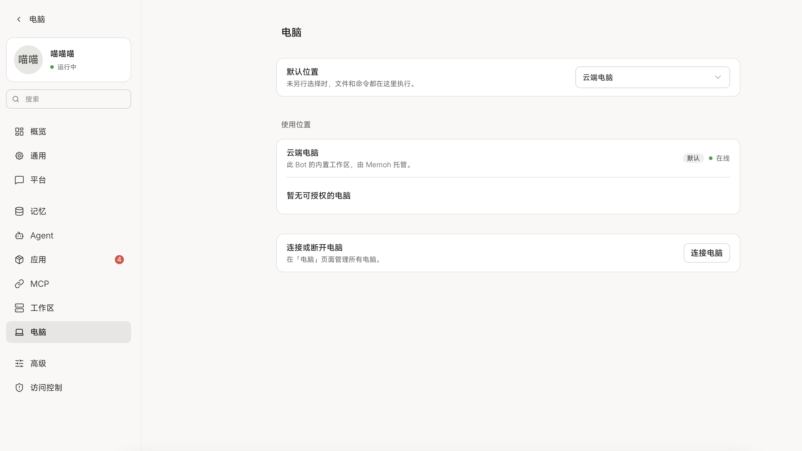

# Astral UI UX 规范

版本：1.22

更新日期：2026-10-26，Asia/Singapore

适用范围：Astral Web 与桌面端的全部产品界面，包括全局设置、Bot 设置、平台账号和聊天管理。

本规范规定 Astral 的界面组织、设计语言和交互行为。后续新增和修改 UI 必须遵循同一套规则；现有页面按此迁移，不能将旧代码或旧验收截图当作继续沿用旧设计的理由。本规范的建立不代表所有页面已经完成重构。

用户应该能从自己的任务出发，判断去哪里操作、控件会改变什么，以及操作是否生效。设计的目标是使用自然、结果可预测，而不是增加页面包装或减少表面上的控件数量。

## 1 规范关系与使用方式

- 本文是产品命名、信息架构、视觉组织和 UI 交互的统一依据。[系统规格](../SPEC.md)规定业务行为、权限和执行契约；[IM 契约](im.md)说明消息与账号行为。
- 当前用户的明确指令优先于文档。新的设计决定应同步更新本文及相关规格，避免产生两套互相冲突的规则。
- 信息架构或主要操作流程尚未明确时，先讨论问题与方案。不能把“感觉乱”“不自然”等反馈直接变成一轮局部控件修改。
- 实施重大重构前，说明用户要完成的任务、现有问题、目标页面关系和保持不变的业务边界；必要时提供 ASCII 草图。
- 文档、实现与浏览器验收是三件事。测试通过不能替代对完整操作流程和视觉一致性的检查。

## 2 元素存在的理由

每个信息和控件都应回答一个具体问题：它帮助用户辨认什么、作出什么判断，或者完成什么操作？无法说明用途的内容不应仅因后端提供了数据而展示。

1. 常用设置直接展示可操作控件。不要为了画面空一点，将普通选项搬入卡片入口、弹窗、折叠区或省略号菜单。
2. 有实际归属和独立配置的对象应保留层级。平台与账号不能因为当前只有一个实例而混为一层。
3. 导航行可以进入一个对象的详情；设置分组直接承载控件。两者必须在交互上容易区分。
4. 不为不存在的用户任务新增概览、统计、能力仪表盘或后台管理页。
5. 保留有意义的功能，不把“清理界面”理解为隐藏选项。减少重复解释、无效状态和多余操作步骤。

固定协议能力清单、无后续操作的消息归档入口、重复出现的账号状态和内部标识，不属于日常设置的默认内容。真实连接错误、资源不可用和会影响操作结果的限制必须在相关位置呈现。

## 3 产品名称与对象边界

| 对象 | 用户界面名称 | 含义与边界 |
| --- | --- | --- |
| 产品 Agent | Bot | 用户配置的长期身份，拥有模型选择、电脑权限、平台账号和多个会话。界面不交替使用 Agent 与 Bot 指同一对象。 |
| Computer | 中文为“电脑”，英文为 Computer | 已连接的执行端，可以是本机、容器或远程机器。 |
| Platform | 平台，如 Telegram、QQ、飞书 | 平台分类与适配能力，不等于一个已连接账号，也不拥有所有账号共用的 Token。 |
| Connection | 平台账号；必要时使用平台准确称呼，如飞书应用 | 属于一个 Bot 的独立连接，拥有自己的凭据、启停、连接状态、访问权限和聊天列表。 |
| Conversation | 聊天、群聊、私聊或话题 | 属于具体账号；不同账号下的同名聊天仍是不同对象。 |
| Session | 会话；与外部聊天同时出现时称“Astral 会话” | Bot 的持久工作上下文。已接入聊天与其会话保持一对一绑定。 |

产品名称与内部协议名分开处理。界面使用 Bot 和“电脑”不要求同时重命名 `Agent`、`agent_id`、`Computer` 等代码类型或 API 字段，也不能通过改名改变原有语义。

Bot 的通用图标使用机器人图标，不使用表示个人的人形图标；具体 Bot 仍可显示其已设置的头像。

Telegram 的 `Bot Token` 可以保留平台准确字段名；周围必须明确当前平台账号身份，避免与 Astral 的产品 Bot 混淆。

## 4 页面关系与入口

Bot 管理入口留在全局设置里。独立的是某个 Bot 的设置页面，不在主界面新增 Bot 一级功能区。

```text
主界面
  设置
    通用 / 外观 / 模型 / 搜索 / 电脑 / 存储 / 安全 / 关于
    Bot 列表
      当前 Bot 的独立设置
        基本设置
        电脑权限
        聊天平台（导航分组标题）
          Telegram
            账号列表
              具体账号的设置、聊天权限与聊天列表
          其他已接入平台
            账号列表
              具体账号的设置、聊天权限与聊天列表
          连接平台
```

进入具体 Bot 后，用它自己的导航替换全局设置导航，不在全局导航旁继续堆叠一套侧栏。返回“所有 Bot”时恢复全局设置中的 Bot 列表。主界面的聊天和未发送草稿应保留。

“聊天平台”只是导航分组，不增加中转页面。只显示实际接入的平台；添加时选择已经实现的适配器。当前提供 Telegram、QQ、微信和飞书。QQ 在账号创建时选择官方 Bot 或 NapCat 接入方式；同平台的不同接入方式仍是独立账号。平台真实能力与配置见 [接入指南](im-platforms.md)。

“选择平台”使用约 360px 宽的紧凑对话框，每行约 48px，只显示平台品牌图标、名称和进入箭头。选项不各自套卡片，不显示副标题；整行支持点击、悬停和键盘聚焦。平台图标统一来自共享图标层，导航、账号列表和选择器使用同一份品牌资源。连接表单只保留完成凭据配置、服务启用或扫码授权所必需的简短说明，不重复介绍平台用途。

平台页面先列出账号，再进入一个账号的详情。即使只有一个账号，也保留账号列表入口与明确的账号身份。不能自动跳过账号层，不能把一个 Token 当成多个 Telegram Bot 的凭据。

账号详情在同一页直接组织账号信息、连接配置、账号访问权限和聊天列表。只有实际内容规模妨碍主要任务时，才讨论是否增加子页签；不预先为每个平台加一层“聊天／设置”导航。

### Desktop 软件更新

“关于与诊断”在版本信息下提供软件更新行，沿用共享设置分组、说明和按钮。Desktop 启动后与运行期间自动检查新版本，后台下载并显示实际百分比；下载完成后直接提供“重启并更新”，说明重启会中断正在运行的任务。只有用户明确点击才安装，普通退出不隐式安装。

检查和重启沿用 300ms 延迟等待反馈；错误持续显示并提供重试，下载进度不冒充安装完成。Mac 官方签名包、Windows 用户态 NSIS 安装和 Linux AppImage 支持应用内更新；开发版本、Windows ZIP 和 Linux DEB 明确显示适用的手动安装入口。普通 Web 页面不显示 Desktop 原生更新操作。

## 5 统一设计语言

### 视觉参考

用户提供的 Memoh 电脑页面是设置界面的视觉组织参考：内容列稳定、相关内容成组、左侧名称与说明、右侧控件、动作位置明确。



采用其组织方式，不复制 Memoh 的产品功能、云端电脑选项、完整导航或品牌。同组独立设置项和资源列表使用与外框颜色接近的细分割线，并沿内容边缘内缩，保持稳定的行间留白。

### 页面与分组

| 部位 | 统一规则 |
| --- | --- |
| 内容列 | 同类页面共用最大宽度、响应式边距和水平位置。切换页面不因内容多少突然改变宽度或左右跳动。 |
| 页面标题 | 使用一致的字号、字重和间距；一个页面只保留必要的标题层级，不重复解释当前所在位置。 |
| 设置分组 | 相关设置共用一个轻量外框或统一的表面背景。允许一个设置单独成组，但必须有清楚的任务或作用域理由。 |
| 设置行 | 名称与必要说明在左，输入、选择、开关或按钮在右；同类控件宽度稳定，右边缘对齐。 |
| 列表 | 多个同类对象共用一个列表块；整行导航或行内操作明确，不把每个对象包装成独立悬浮卡片。 |
| 间距 | 组内紧凑、组间清楚留白。用统一间距和对齐表达归属，不靠不断增加边框和标题。 |
| 分割线 | 同组独立设置项、资源列表行之间使用与外框接近的 1px 细线，左右内缩与内容对齐；表格的表头和数据行使用通栏细线。不同分组之间用标题和留白区分，不额外画横线；同一项内部的名称、说明和控件不插线。 |
| 容器边界 | 可以保留轻外框和控件本身的边界。禁止卡片套卡片、重阴影、装饰性渐变和无意义的状态色块。 |

设置分组与聊天主工作区使用相同的基础表面色，不单独引入冷白或另一套灰白色。输入、下拉等控件采用共享的抬升表面色、清晰而克制的描边与轻阴影，在浅色与深色主题中都能与所在分组区分。组内细线和外框采用相同的边框颜色；控件保留自己的边界，行内名称、说明与控件通过留白组织。

当前共享尺寸为：内容容器最大宽度 768px，桌面水平内边距 24px，正文最大宽度 720px；分组水平内边距 16px，组间距 24px。普通设置行上下内边距各 12px、最小高度 60px；资源列表行上下各 10px、最小高度 56px；模型列表使用最小高度 52px 的紧凑行。多行说明、长名称和窄屏布局按内容自然增高，不用固定高度裁切。设置侧栏宽 240px，导航项最小高度 36px。输入与下拉的目标宽度为 300px，并随可用空间收缩；保留现有字号和约 36px 的常用控件高度。窄屏水平内边距统一改为 16px。尺寸来自共享 token，不在各页分别覆盖。分组末尾没有操作或说明时，不为潜在状态预留额外空白。

列表与表单采用不同密度。模型名称与模型 ID 相同时只显示一次；名称不同则保留 ID 以便辨认。设置名称和必要说明保持清楚的文字层级，不通过整体缩小字体降低页面尺寸。

字段行是否上下排列取决于设置正文容器的实际宽度，包含侧边导航占用的空间。平台连接的整体说明放在分组标题下，与其他设置说明对齐；分组外框从第一条设置行开始，保留统一的行内留白。

普通设置不采用字段名在一处、按钮在另一处的零散排法。长文本、代码或复杂模型参数可以使用适合内容的编辑区域，但必须沿用共享的边距、排版、控件和反馈规则。

### 字体、控件与状态

- 带文字的 Logo 使用 `packages/icons/assets/astral-lockup.svg` 和 `astral-lockup-inverse.svg`；由共享 `AstralLogo` 组件按主题切换，不用普通字体重排字标。关于页使用该图标与字标组合，版本号独立放在下方。保持原始比例，并在组件内统一校正画布留白，使可见图形与内容左边缘、同一行控件的垂直中心对齐。
- 字体、字号层级、间距、颜色、圆角、控件高度、输入与下拉宽度、动效统一从共享样式和 token 获取。不得为每个页面另定一套数值。
- 文案先判断是否必要，再考虑措辞。保留影响当前操作或结果预期的信息，省略实现机制、无需用户判断的默认规则与重复保证。清楚的字段名无需再配同义说明；占位示例仅在确实帮助填写时使用。
- 同类输入和下拉保持相同尺度；按钮、开关、状态在对应的操作区域对齐，不强迫所有类型控件具有同一宽度。
- 状态只表达真实且有用的事实。启用、正在连接、已连接、离线和失败不能混用；平台接受发送不等于对方已读。
- 使用中性的浅色、深色主题与有限的语义色。不靠颜色单独表达成功、错误、选中或权限。
- 动效短而克制，遵循减少动态效果偏好；刷新数据不得重播装饰动画、改变滚动位置或让已展开内容收起。

### 响应式与可访问性

窄屏下，名称和控件可以按相同顺序上下排列，保留明确标签和完整操作。列表可以在行内换行，不把桌面上的常用功能整体藏入更多菜单。

所有控件需有可访问名称、可见键盘焦点和合理的焦点顺序。对象列表、选项和弹窗可通过键盘完成操作；关闭弹窗恢复合理焦点。保存反馈与错误应通过适当的状态区域供读屏读取，不能每次输入一个字符都重复播报。

## 6 设置生效、局部提交与反馈

设置默认直接生效并自动持久化。独立选择和短文本编辑不要求额外保存；存在多字段一致性要求，或需要区分编辑草稿与生效内容时，在局部区域整体提交；创建、删除、授权和更换绑定等业务操作使用明确的动作名称。确认用于解释和接受实际后果，反馈用于说明执行状态，二者不由全局保存按钮代替。

判断依据是用户当前的动作是否已经表达完整、有效、可以执行的修改意图，而不是设置是否“重要”。统一设计语言要求布局、控件和反馈一致，不要求每种设置采用相同的提交方式。

### 三种生效方式

| 方式 | 适用条件 | 交互要求 |
| --- | --- | --- |
| 即时生效与自动保存 | 一次选择或一次短字段编辑已经表达完整意图 | 下拉、单选和普通开关在选择完成后提交；短文本在失焦、按 Enter 或输入稳定后提交有效值。连续输入合并处理，不逐字请求，不另加保存按钮。 |
| 局部显式提交 | 多个字段共同构成有效配置，或编辑草稿需要与生效内容分开 | 编辑过程中保留原有生效配置，完成后在对应区域使用“保存连接”“连接”或适用的“保存”按钮整体提交；校验通过不等于用户已经确认完成编辑。 |
| 独立业务操作 | 创建、删除、授权、移除或更换绑定等有明确业务含义的动作 | 使用“添加聊天”“授权”“更换 Session”等具体动作名称；需要确认时说明对象和实际后果，确认后直接执行，不再追加普通保存步骤。 |

### Astral 的具体约定

| 设置或操作 | 生效方式与范围 |
| --- | --- |
| 应用主题、语言 | 选择完成后自动保存，保持当前对象与编辑上下文。 |
| Bot、电脑、IM 账号的名称 | 普通单字段编辑；失焦或 Enter 自动保存，也可在输入稳定后合并提交有效值。 |
| 允许远程管理、访问地址 | 安全与访问页直接展示；开关选择后、地址失焦或 Enter 后独立自动保存。访问地址为有序列表，第一项用于默认配对，空列表表示自动发现；添加、移除地址直接可见。CLI 或环境变量覆盖时只读并说明控制来源。二者互不隐式修改。 |
| Bot 头像 | 选择完成后自动保存。 |
| Bot 人格 | 可选多行文本，编辑草稿与生效内容分开；点击局部“应用人格”后保存，同一 Bot 的所有会话从下一个模型请求立即使用。清空并应用即移除自定义人格。 |
| Bot 默认模型及推理级别、Probe 模型及推理级别、搜索服务 | 独立选择后自动保存；模型与对应推理级别属于同一保存范围，切换模型清除旧模型的推理覆盖值。 |
| Session 当前模型 | 选择后自动保存，作用于后续模型请求，不改变已经开始的 Attempt。 |
| 模型或搜索服务的连接参数 | Endpoint、API Key、协议、认证方式等相互关联的字段作为完整配置，在局部区域提交；新建与修改已有连接遵循相同边界。 |
| IM 账号的 Token、Bot API Endpoint 等连接参数 | 集中编辑并整体提交，执行必要校验或凭据验证；名称、启用状态和聊天设置不属于此提交范围。 |
| IM 账号启用状态、群聊主动参与 | 独立开关，选择后直接提交并反馈，不等待连接配置保存。 |
| IM 聊天接入方式 | 选择后作为一次原子操作提交；需要确认权限范围变化时，确认后直接生效，保留已有绑定和聊天设置。 |
| Bot 默认电脑 | 在已允许的电脑中选择后自动保存，可为空；只影响新建会话的初始选择。 |
| Bot 电脑权限 | 独立授权或撤销操作，明确对象和结果，按实际后果决定是否额外确认；撤销默认电脑权限时，同时清空默认选择。 |
| 添加、移除聊天，更换 Session，删除对象 | 使用各自的明确操作入口；选择或填写必要内容后，由对应动作提交，不纳入页面级保存。 |
| 需要完整编辑的长内容 | 按是否存在草稿与生效内容的区别决定。人格等会影响后续对话的长文本使用局部应用动作；普通备注仍可自动保存。 |

### 局部提交的边界

一个需要整体提交的配置对象必须有清楚的编辑范围。连接配置块中的按钮只负责该组参数，不负责同页的名称、启停、权限或聊天设置。连接验证明确失败后，用户修改草稿再点击重试应采用当前草稿；结果不确定时仍先核对实际状态。提交不得携带其他区域的陈旧值，也不得覆盖其他区域已生效或正在编辑的新值。保存单位是配置对象，不是整个 Settings 页面。

“保存连接”应位于连接配置块内部；使用一致的分组、留白和反馈位置说明归属。不在页面顶部或底部增加覆盖不同生效机制的统一保存按钮或“未保存”工具条。局部编辑区可以显示尚未应用的状态，并提供放弃该区域编辑的操作。连接配置可以直接编辑或在当前页内展开，不为提交机制额外增加不必要的导航和弹窗。

编辑中的连接参数不覆盖正在使用的配置。离开字段、切换页面或操作其他分组，不会隐式提交需要显式保存的草稿。保存草稿与将其投入使用必须可区分；只有生效提交成功后，才能显示配置已生效。连接提交可以包含明确告知的必要验证；独立“测试连接”不隐式保存或应用草稿。不得因为普通设置发生修改就自动启动连接测试、模型调用或消息发送。

### 确认与业务约束

需要确认不等于需要保存按钮。独立但有明显后果的开关可以采用“切换 → 后果确认 → 执行并反馈”；取消确认时保持原有生效状态。不能叠加“切换 → 保存 → 确认 → 生效”的重复步骤。

是否额外确认取决于权限范围、可撤销性和对正在运行任务的实际影响。明确的授权动作不机械追加一次确认；普通、可逆的设置不因“重要”而增加确认。更换 Session 等操作须说明相关会话的停止与路由变化，并保持既有业务契约。

多字段约束在一次提交内保持成立。默认电脑必须属于允许列表；撤销其权限与清空默认一起提交。全部与指定聊天模式切换保留已有绑定和设置，不通过移除聊天隐式改变整个账号的访问权限。

### 反馈状态

自动保存、局部显式提交和业务操作按用户实际等待和失败情况提供反馈。正常速度下直接生效，不额外显示成功提示或加载动画；明显等待和失败时，反馈位于发生修改的字段、设置组或动作附近，由共享组件提供统一、稳定的位置，不推动控件移动，也不打断连续设置。

快速提交、空闲和成功不显示额外状态行。共享等待反馈延迟 300ms 显示：请求在此之前完成则完全不出现动画，超过阈值后只显示小转圈，完成后立即消失；切换待加载会话或待提交字段时重新计时，不继承上一次请求的等待动画。转圈不撑高分组；持续错误可以按内容占据必要空间，以保证原因和重试入口完整可读。不得通过常驻空状态行造成分组下方莫名留白。

| 状态 | 用户看到什么 |
| --- | --- |
| 提交中 | 正常速度下不显示；等待超过 300ms 才显示小转圈，可访问名称使用“保存中”“验证中”“授权中”等准确状态。连续编辑合并更新，避免闪烁。 |
| 成功 | 确认成功后安静结束，移除等待转圈，不显示“已保存”“已授权”等短暂标签。保存草稿不显示为配置已生效。 |
| 明确失败 | 在相关字段或设置组内持续显示错误和适用的重试入口。文本和完整配置草稿保留输入；开关、单选、下拉恢复服务端已确认的状态，明确提示本次修改未生效，并保留本次意图供重试。 |
| 结果不确定 | 网络中断等情况下，不能直接宣告成功或失败；显示尚未确认并重新核对实际状态，避免已提交的操作被误判为失败或重复执行。 |
| 校验未通过 | 在对应字段说明需要修改的内容；不提交无效值，不显示成功，保留其他编辑内容。 |

不为每次成功弹 Toast、横幅或弹窗。不得静默吞掉失败，也不得清空文本、保留虚假的已开启状态或让用户误以为草稿已经生效。反馈需要区分当前编辑值、正在提交的修改与已经生效的值。

连续自动保存最终以用户最后一次有效选择为准。迟到的响应或失败回滚不能覆盖更新的输入与已成功的修改。切换页面应保留编辑上下文，不取消仍有意义的提交；只有离开后确实会丢失且无法保留的草稿，才针对实际后果提示。恢复草稿不等于自动将它投入使用。

## 7 各页面的内容契约

### 首次使用

首次启动自带一个名为 Astral 的 Bot；它与普通 Bot 相同，之后可以在设置中改名。首次引导只有“模型”和“电脑”两步，不要求用户先创建 Bot，也不增加 IM、搜索服务等必填步骤。

1. 模型：沿用模型设置中的服务目录、连接表单、模型导入与详细参数，保存连接后在本步骤选定要使用的模型。未配置可用模型时不能继续；仅保存服务连接不代表已经选定模型。
2. 电脑：列出已经接入的电脑及真实在线状态，保留本机、本机容器、其他机器的共享接入入口。用户选择一台在线电脑后，明确展示文件读写与命令执行授权，点击“开始使用”同时设置默认模型、授予所选电脑权限并将其设为默认电脑。

仅接入电脑不自动授权。离线、已撤销或尚在创建中的电脑不能用于完成引导；连接失败在本步骤提供错误和重试。最后一次提交在服务端校验两项资源并原子保存，失败不能留下半完成的 Bot 配置。完成后进入聊天首页，首个会话继承这些选择。

引导使用共享内容宽度、设置行、列表、控件和反馈；允许返回上一项修改，刷新保留同一浏览器内有效的步骤选择。服务端记录完成状态，重启不重建或重命名 Bot；已有 Bot 的部署不强制重新引导或改写默认资源。后续新增电脑仍需明确授权。

### 全局设置

| 页面 | 应当帮助用户完成的任务 | 内容与操作边界 |
| --- | --- | --- |
| 通用 | 调整当前部署实际可用的应用行为 | 只展示适用的偏好；浏览器里不堆放无法使用的桌面专属开关。运行中输入偏好说明实际作用范围。 |
| 外观 | 调整主题和语言 | 直接选择、自动保存，主题和语言切换保持当前对象与编辑内容。 |
| 模型 | 连接服务并管理可选择的模型 | 服务列表进入详情，连接配置与模型列表归属清楚；详细模型参数入口可正常打开。沿用已认可的模型页面组织；独立属性直接编辑，关联连接参数在局部区域整体提交，不共用页面级保存。 |
| 搜索 | 连接搜索服务并确认能否使用 | 关联连接参数整体提交，配置与测试的作用域清楚，不重复展示同一份服务目录和已配置对象。测试是主动动作，Bot 只选择已配置服务。 |
| 电脑 | 接入与维护执行端 | 添加、名称、连接状态、接入进度、撤销连接与删除已撤销记录。可显示受影响 Bot 并链接到其权限页，不再提供另一套 Bot 授权编辑表单。 |
| Bot | 找到或创建要配置的 Bot | 普通对象列表进入独立设置；不新增主界面一级入口、仪表盘或无任务的概览。 |
| 存储 | 恢复或永久删除已归档会话，查看数据用量与位置 | 仅列出已归档会话，提供搜索、恢复和永久删除，不显示未归档筛选或重复导出入口。恢复直接执行；永久删除在触发按钮旁确认对象、不可恢复的后果和删除范围。仍绑定平台聊天的会话须先更换绑定。删除会话记录不删除电脑工作文件或平台聊天消息。 |
| 安全与访问 | 配置网络入口、网页登录和登录保护，管理浏览器登录 | 网络访问、网页登录账户、TOTP、Passkey、免密登录和已登录设备在同页按任务分组；Desktop 本机身份不出现在浏览器设备列表中。 |
| 关于与诊断 | 确认版本并提供排障信息 | 版本、按需复制诊断、真实开发资源入口；不重复电脑管理列表和无处理动作的运行时资料。 |

电脑列表用名称、类型、系统与架构、连接状态辨认执行端；容器补充实际容器名。详情沿用共享设置行，直接展示类型、主机名、系统与架构、Shell、数据目录和用户目录；容器另列容器名、所在电脑、镜像、数据卷与挂载路径。路径和容器标识可复制。名称是用户可编辑的别名，与容器名、容器内主机名、所在电脑分开。缺失值显示“—”，不推断未上报的宿主机、容器状态或资源规格，不增加解释性副标题、能力清单或监控仪表盘。

未撤销的电脑提供“撤销连接”，已撤销的电脑在相同位置提供“删除电脑”。删除移除 Server 上的登记、接入凭据及 Bot 的授权和默认选择，保留会话历史与原电脑身份，不自动选择另一台电脑。确认复用资源依赖 Modal，说明工作文件与容器保留；不卸载 Daemon，不删除容器或数据卷。删除本机登记后，只有用户明确点击“使用本机”才创建新的连接身份，保留原目录且不继承旧权限；自动启动不恢复已删除的连接。

容器元信息在创建时记录，由容器内 Daemon 上报并持久保存，离线时仍可查看；这不增加宿主机控制或 Docker 管理接口。旧本机容器仅从已保存的创建记录恢复可确定的容器名、数据卷与挂载路径。

复制接入命令时直接选择“macOS / Linux · Shell”或“Windows · PowerShell”，切换只改变命令格式，复用同一条尚未过期的接入记录。使用容器时，选择的是容器所在电脑的系统。复制按钮必须复制当前展示的命令。

远程接入弹窗在生成命令前直接展示 Server 访问地址，可选择已发现的 Tailscale/局域网地址或填写完整 HTTP/HTTPS URL，不要求先跳到设置页。明确提示地址需要从目标电脑可达；不声称本机检测可以代替目标电脑验证。更换地址或容器模式后生成新的对应命令，单独切换 Shell/PowerShell 仍复用原接入记录。

“安全与访问”直接包含“允许远程管理”与“访问地址”，不增加空洞的“在其他设备上访问”中转页。关闭远程管理默认只限制直接远程管理请求，不影响电脑连接；开启后浏览器仍须使用网页登录账户认证。说明应准确指出用户自行配置的本地反向代理可以转发管理入口。访问地址变化不切换监听地址或远程管理，也不改写已接入电脑的地址。

### 网页登录与本机 Desktop

Desktop 打开后直接使用，不要求创建账户或输入密码。内部使用仅属于本次运行的专用身份，普通浏览器即使访问 localhost 也不能免登录。Desktop 不展示“退出当前浏览器”，不出现在已登录设备列表，Web 端不得撤销其身份。

未配置网页登录账户时，浏览器只说明尚未配置，并引导到 Desktop 或 Server 本机的 `astral auth setup`；不提供匿名网页注册入口。Desktop 在安全与访问页直接填写用户名、密码和确认密码，以“设置网页登录”局部提交。已有账户的用户名按短字段自动保存；修改密码在本区域展开新密码和确认密码，以“修改密码”局部提交。说明修改用户名或密码会撤销已有 Web 登录，Desktop 和电脑连接不受影响。用户输入密码不进入 URL、日志或前端持久存储。

HTTP 和 HTTPS 都允许用户名密码登录及 TOTP 验证，不增加“允许不安全登录”开关、不强制跳转 HTTPS。只有当前页面实际使用 HTTPS、浏览器支持 WebAuthn 且 Server 认可当前访问地址时，才允许添加或使用 Passkey。HTTP 页面应在相关操作处说明原因，不能因为 Passkey 不可用而跳过两步验证。Desktop 的内置 HTTP 页面提供打开已配置 HTTPS 地址的动作；没有该地址时指明需要先配置。

两步验证没有总开关：成功添加 TOTP 或 Passkey 任一种，即自动开启；尚未完成确认的 TOTP 不计入。密码验证成功后，TOTP、Passkey 可用时任选一种完成第二步，也可以使用一次性恢复码。账户只配置 Passkey 时，HTTP 密码登录必须转到可用的 HTTPS 地址或使用恢复码，不能降级为只验证密码。删除最后一种验证方式前明确确认两步验证将关闭。

“允许 Passkey 免密登录”是独立开关，默认关闭，只有添加 Passkey 后才能开启。开启后，可直接使用 Passkey 完成登录，不输入用户名或密码，不再要求 TOTP；选择密码路径时仍要完成第二步。Passkey 必须要求系统用户验证并支持可发现凭据。移除最后一个 Passkey 自动关闭免密；同时告知实际后果，若仍有 TOTP 则两步验证继续有效。

添加 TOTP 使用共享 Modal 显示二维码、可选中的设置密钥与动态码输入，只有验证码验证成功才完成添加。恢复码只展示一次，提供真实复制和明确的“我已保存恢复码”动作；生成新恢复码前说明旧码失效。Passkey 在同一个列表中显示名称、适用域名和真实使用时间，直接提供添加与删除。绑定、移除和修改登录保护需要近期完整认证；Web 端认证过期时打开统一身份验证 Modal，完整验证后继续原操作，取消或失败保留原有编辑内容。开启免密时允许用 Passkey 直接重新验证身份。

“已登录设备”实际列出仍有效的浏览器登录会话，包含离线浏览器。每行显示可辨认的浏览器与系统、登录时间和最近活动，当前会话标记“此设备”。删除后该会话立即失效，在线页面返回登录页、离线浏览器下次请求被拒绝；退出所有网页登录不影响 Desktop 和 Daemon。退出当前设备前说明会返回登录页。删除浏览器会话不删除 Passkey，Passkey 在其独立列表管理。认证过期与撤销由 Server 执行，不能只依靠 Cookie 到期或前端隐藏控件。

HTTP 浏览器也必须能够创建会话、发送消息和复制内容。复制失败不得假报成功；浏览器禁用自动复制时提供可选中的手动复制内容，保持当前任务与输入。

电脑详情的运行环境显示 Daemon 实际上报的版本，旧版本未上报时显示“尚未上报”。“Daemon 维护”在当前电脑的详情内直接提供“更新 Daemon”动作及备用更新命令；在线且具备管理更新能力时允许点击，以共享确认气泡说明任务中断，随后在本组显示检查、下载校验、重启等待重连及持续错误。只有预期版本和新进程重连才能确认完成；显示实际更新状态，不使用短暂 Toast。Daemon 比 Server 新时建议更新 Desktop 或 Server，但不禁用 Daemon 更新动作。命令只携带已记录的数据目录或容器名，不包含接入 Token 或长期凭据。更新沿用目标电脑已保存的 Server 地址与身份指纹。裸机命令在目标电脑执行，会重启当前用户服务；容器命令在宿主机执行，只替换 Daemon 并重启同一个容器，直接更新则由容器内 supervisor 重启子 Daemon，均保留原容器和环境。执行前应清楚说明运行任务会中断，身份与数据保留。本机 Daemon 随 Desktop 或 Server 升级，不提供独立更新命令。操作系统的服务管理入口仅作为本地检查指引，不展示推断的远端服务状态。

### Bot 基本设置

删除 Bot 会永久删除其全部会话（包括未归档、已归档、平台聊天会话及独立 Fork）、账号连接、凭据和所属 IM store 数据。使用 Modal 确认，仅显示“删除「名称」及其所有会话？此操作无法撤销。”以及“取消”“删除”，不展示依赖清单或逐项范围说明。提交期间阻止重复删除，失败保留对话框和重试入口；成功后回到所有 Bot，并清除该 Bot 的前端会话缓存及草稿。电脑工作文件和外部 IM 平台上的账号、聊天及消息保留。

直接显示名称、头像、默认模型、群聊判断模型、搜索服务。相关字段合成少量设置块，模型选择放在一起；这些独立属性自动保存。普通字段不再通过“编辑资料”“群聊设置”弹窗进入。

同页直接显示“人格（可选）”多行编辑区，允许用户填写人物身份、性格和说话方式。字段为空时不添加自定义人格；Host 不补 Agent、Bot、AI 等身份声明或默认人设。使用共享设置分组、文本控件和反馈，不新增页面或弹窗。局部“应用人格”只提交人格字段，不覆盖名称、头像、模型等区域的最新值。编辑和保存失败保留草稿；切换 Bot 后草稿按 Bot 隔离。快速保存不显示成功提示，等待超过 300ms 显示局部反馈，失败持续显示。

人格应用后，该 Bot 所有已有和新会话在各自下一次模型请求使用最新文本，包括运行中会话的下一轮请求；已经发出的请求不改变，无需重新开始会话。人格是 Bot 配置，不是会话消息，不展示为聊天通知。

模型和搜索服务的凭据、地址、模型限制在全局维护；当前 Bot 只选择资源。资源管理链接放在需要它的设置附近。

### Bot 电脑权限

页面由三个有明确用途的块组成：

1. 默认电脑：直接下拉选择，只包含允许使用的电脑，可以不指定。它影响新建会话的初始选择，不迁移已有会话。
2. 允许使用的电脑：一个列表块，每行左侧是机器身份与必要说明，右侧是实际状态和授权控件。授权与撤销各自直接执行并反馈，按实际后果决定是否确认，不等待页面保存。内部默认没有横线。
3. 管理电脑：说明添加与断开连接在全局电脑页完成，并提供直接入口。

连接新电脑不自动扩张任何 Bot 的权限。全局电脑管理和 Bot 电脑权限承担不同任务，不能把两份相似的连接或授权表单散落在两处。

### 平台账号与聊天

平台账号列表以名称、平台身份和必要状态辨认对象。具体账号详情按提交范围直接组织为账号信息、连接配置、聊天访问权限、聊天列表，沿用相同的分组与设置行样式；每个账号独立配置，不共享或隐式复用另一个账号的 Token。

微信账号通过当前页的扫码动作授权，显示二维码与真实状态；需要验证码时暂停自动轮询，由用户明确提交完整验证码，Enter 执行验证码验证。刷新二维码废弃旧的登录 UI 状态；切换 Bot、平台或关闭弹窗后，迟到响应不能覆盖新对象或改变路由。其他账号名称和启用状态自动保存。Token、Endpoint 等参数在连接配置块中整体编辑，使用块内的“保存连接”提交；该按钮不负责聊天访问权限、群聊主动参与或其他分组。需要“编辑连接”入口时优先在当前页展开，避免增加中转页面。

账号权限用清楚的选择表达，例如“机器人能访问的全部聊天”和“仅指定的聊天”。选择后按权限变化的实际后果决定是否确认，再原子提交，不等待连接配置保存。不得只用没有解释的“聊天范围”或“自动接收”代替其权限含义。

| 聊天列表内容 | 行为 |
| --- | --- |
| 名称 | 点击打开对应的 Astral 会话。 |
| 群聊回复方式 | 行内直接选择“被 @ 或被回复时”“允许主动参与”等准确文案，并自动保存。 |
| 私聊回复方式 | 显示固定行为，不增加无效或禁用的选择器。 |
| 更换会话 | 直接可见的操作，选择同 Bot 的可用会话，并说明对正在运行会话的实际影响。 |
| 移除聊天 | 在指定模式下提供；移除接入与删除历史是不同操作。 |
| 添加与查找 | 放在列表的统一操作位置。优先选择可辨认的已知聊天，必要时提供手工 ID 路径。 |

聊天列表沿用资源列表行：左侧图标、名称和类型，右侧将回复方式、更换会话、移除入口在一行内对齐。回复方式使用约 180px 的列表控件宽度，不套用普通表单的 300px 宽度；私聊固定回复说明占据同一列。移除使用有可访问名称的图标按钮及气泡确认。正文较窄时按名称、回复方式与操作的顺序自然换行，不把每条聊天排成两层独立表单，也不隐藏常用操作。

访问权限决定 Bot 能访问哪些聊天，回复方式决定接入后何时参与，两者不能混用。全部模式下的列表只是已经建立会话的聊天，不代表完整的可访问集合。

全部模式不能单独移除某个聊天，更不能因用户点“移除”就悄悄切换整个账号的模式。先明确切换为指定模式，保留已有绑定和聊天设置，再移除目标聊天。

添加聊天时可选择新建 Astral 会话或同 Bot 的已有未绑定会话。换绑、解绑、主动模式和账号启停均沿用业务契约，不因 UI 重构转移旧历史、扩张权限或改变已接受发送的目标。

### 聊天主界面

共享字体、颜色、控件、反馈和间距规则，不把设置页的分组外框机械套到消息和执行过程上。Transcript 仍是主工作区，执行详情沿用内联展开和透明表面，不恢复灰色容器、嵌套卡片、常驻 Inspector 或重复标题横幅。运行和停止按实际状态呈现；命令输出、退出码、工具错误和结果不确定性保留在可展开的执行详情中，由 Agent 接续处理。会话列表按正在进行、固定和最近组织，完成的调用使用同一套中性呈现。

聊天页首次获取应用数据，以及打开或切换会话等待首批消息时，共用相同的 300ms 延迟显示规则：快速加载直接显示内容，不闪现骨架；明显等待后才显示与实际侧栏、消息列和 Composer 对齐的骨架屏。新会话入口使用与欢迎区域对齐的占位。骨架使用共享中性色块与轻缓明暗变化，不显示可操作的假按钮，遵循减少动态效果偏好。已有消息在后台刷新或重连时保留，不切回骨架；补载历史也不插入骨架占位。真实加载错误显示原因与重试入口，首次连接未成功的重连仍明确显示连接状态，不能用无限骨架掩盖错误。

模型持续输出时，用户向上滚动立即停止跟随底部；继续输出、图片完成加载和侧边栏宽度变化都应保持当前阅读段落的位置。用户滚回底部或点击悬浮的“回到最新”按钮后恢复跟随。按钮仅在消息内容超过一屏且当前位置离开底部时显示，固定在消息视口底部，不占消息流高度。点击后平滑滚动到最新消息，用户滚动可打断动画；遵循减少动态效果偏好，首次进入和切换会话直接定位到最新消息。消息列表开头保留顶部间距（桌面 40px，窄屏 56px），间距属于滚动内容：位于列表最顶部时可见，往下滚动后随消息一起移出视口。滚动视口从聊天面板上沿开始，不保留永久空隙；侧边栏展开、收起沿用相同的内容间距，不额外推动消息或输入框。

模型与推理级别共用一个选择控件；聊天、Bot 默认模型与 Probe 模型复用同一实现。可选模型少于 20 个时直接展示列表；达到 20 个时显示顶部固定的搜索框，中间只有模型列表滚动，底部固定显示“推理／当前级别／右箭头”整行，悬停、点击或右方向键展开侧边子菜单，当前选项显示勾选；不在底部嵌入独立的表单下拉框。只提供当前模型支持的推理选项。外部只有一个触发按钮，可同时显示模型和推理级别。选择模型后菜单保持展开，便于继续调整推理级别；不支持推理的模型不显示无效控件。Bot 默认选择只影响新建会话；Probe 选择“跟随会话模型”时同时跟随会话推理设置，显式选择 Probe 模型后才独立设置其推理级别。

推理选项直接采用后端可执行控制定义，保留接口原生档位名称；预算在同一侧边子菜单中输入准确 Token 数。“默认”继承 Profile 的配置，“接口默认”不发送主动推理控制参数，“关闭”使用接口支持的关闭参数，不能合并。已保存但当前不可用的选项显示原值与“不可用”，保留切回有效选项的入口，不静默换成其他档位。

内置服务连接显示 API 协议选择并提供已经核对的默认值；Dialect、推理格式和手工参数映射由预置负责，不要求用户维护。自定义服务的上述高级配置可见于原有连接与模型参数区域。Codex、GitHub Copilot 使用明确的账号授权动作，界面不要求粘贴 API Key。公开模型目录只是推荐资料，不能标为账号已经可用或连接已经验证。

模型列表只显示当前连接实际拥有的模型；已配置连接的空库存不回退到公开推荐列表。“刷新模型目录”位于 Provider 的模型列表旁，统一同步这条连接的完整目录；单模型编辑不再提供联网刷新。用户修改过的模型只要仍列出就整份配置保留；未修改的模型更新目录资料；未列出的模型直接退出当前库存，手工删除后仍列出的模型会在刷新时重新加入。获取失败保留现有库存，错误持续显示在模型列表附近，快速刷新不显示动画或成功提示。单字段恢复推荐值保留在原字段旁。

模型候选、Provider 名称与不可用原因由后端统一派生，不由前端拼接库存和连接推测。连接或模型被删除、停用或配置无效时，不进入可选列表；当前已保存选择显示具体不可用原因，并保留换选入口。删除 Provider 时说明关联模型一并移除、受影响 Bot 与会话需要重新选择，历史保留；重新创建同名 Provider 不自动接管旧选择。不可用模型不阻止打开已有历史。

聊天中的电脑菜单保持简洁，只列出可切换的电脑、当前选择与离线状态。环境、路径和容器信息放在设置里的电脑详情页，不扩展聊天菜单。

向上接近已加载消息的顶部时，自动补载更早的消息，不要求点击加载按钮。补入的消息保持已有文字的可见位置，不插入加载占位或重播入场动画；补载失败保留当前内容并沿用会话错误反馈，后续向上滚动可重试。正文以实际排版高度定位，不能用屏外段落的估算占位高度破坏阅读锚点。

消息滚动区域的键盘焦点轮廓限制在区域内部，不能溢出并在输入框上方形成横线。Markdown 的美元金额保持普通文本，不跨金额配对为公式；显式数学公式保留 KaTeX 排版，并加载完整样式，避免可访问公式文本与视觉公式重复显示。

消息区与 Composer 的交界使用 32px 的渐变羽化，消息接近底边时逐渐融入当前主题的工作区背景，不增加占位高度。输入框、模型与电脑选择、悬浮的“回到最新”按钮保持清晰并可直接操作；羽化层不拦截鼠标、触摸或文字选择，强制颜色模式下关闭装饰层。滚到底部时保留末条消息及其操作所需的完整可读空间。

Assistant 回复底部的复制、更多操作右侧显示时间，时间与操作行共用显隐规则，不单独常驻或另起一行。采用该回复最后一条正文消息的真实记录时间，按设备本地日历显示：今天仅显示 `HH:mm`，昨天显示“昨天 HH:mm”，同年更早显示月、日与时间，跨年加上年份；英文界面采用相应的本地化日期。悬停可查看含年份、秒和时区的完整时间。页面跨过午夜后更新日期标签，缺少有效时间时不补造时间。

桌面端共用 44px 的紧凑标题栏。macOS 保留现有左侧系统窗口按钮、距左边 92px 的侧栏开关与原有窗口交互。Windows 和 Linux 使用右侧原生最小化、最大化／恢复和关闭按钮，侧栏开关在左侧 20px；原生控件布局发生变化时，通过系统提供的安全区域避让。这两个平台的应用菜单默认收起，仍可用 Alt 访问。窗口按钮配色跟随 Astral 当前的浅色或深色主题，不只跟随系统主题。

聊天面板上沿、设置、首次引导、登录页、窄屏侧栏和浮动详情面板均避开标题栏；系统窗口按钮与侧栏开关共用水平中心线。空白区域保留系统拖动、双击最大化／恢复和边缘缩放行为，不用网页事件模拟。拖拽区域不得覆盖侧栏开关、输入或其他可操作控件，安全区域不得覆盖原生窗口按钮。标题栏尺寸与消息列表开头的滚动留白分别管理，普通浏览器布局不受桌面避让规则影响。

会话操作入口位于侧栏每条会话的右侧，悬停、选中、键盘聚焦或菜单打开时显示三个点。入口与会话链接分别接收操作，打开菜单不切换当前会话；菜单直接列出紧凑的操作行，不重复会话标题、Bot 名称或说明。重命名、固定、导出、来源和归档均作用于所在行，保持绑定聊天不可手工改名等既有约束。归档当前会话后，侧栏保留其选中行以便取消归档，离开后按归档规则隐藏；聊天面板右上角不再重复提供会话菜单。

Markdown 中的 `astral-file://` 图片与文件链接共用会话授权的文件内容接口；图片直接显示，点击后进入现有文件预览和下载。不能让浏览器直接请求内部文件引用协议。

IM 发送作为普通工具调用呈现，成功或错误均在该次调用中返回，随后模型继续运行。各平台的参数、格式、附件和回复能力按其实际协议提供。

手动压缩弹窗只保留“压缩上下文”标题、“压缩要求（可选）”输入框和“压缩”按钮。不添加占位示例或底部说明，不在此解释提示词如何拼接、默认摘要规则与历史保留机制。

Fork 按钮从所选消息位置（包含该位置）复制出独立会话，拥有独立 Rollout；原会话与副本分别继续，界面不将它们组织为共享分支树。父会话与复制位置只表示来源。树状 Rollout 是未来 sub-agent 的内部能力，不是此按钮的交互语义。复制不包含原会话此后产生的历史、不复制 IM 入站绑定，也不创建独立工作文件副本。

## 8 弹窗与状态呈现

简单确认使用共享 `ConfirmPopover` 气泡确认框，锚定发起动作的按钮，不遮蔽整页。适用于永久删除归档会话、移除单个聊天、删除未使用的平台账号，以及扩大聊天访问范围等无需填写或选择的动作。明确对象与后果，提供取消和具体动作名称；默认聚焦取消，Esc 或点击外部可取消，提交期间防止重复操作，失败在气泡内保留错误与重试。恢复、归档等可撤销操作直接执行，不追加确认。

需要填写表单、选择对象、扫码授权或审阅资源依赖列表的操作继续使用 Modal；不把所有弹窗机械替换为气泡。气泡和 Modal 使用同一套字体、表面、边框和按钮。

弹窗用于一次独立选择或动作，例如添加聊天、选择已有会话、必要的删除确认；不能成为普通字段编辑的额外门槛。必要的对象详细编辑可以保留弹窗，但标题、焦点、关闭行为和状态反馈必须一致。弹窗中的提交方式仍遵守第 6 节；关闭弹窗不隐式提交需要显式保存的草稿。

空状态说明缺少什么，并给出下一步真实动作。加载状态不能暂时把已存在的内容变成“没有数据”；失败时保留仍可用的内容和用户输入。错误放在能够处理它的对象或字段附近，不把全部错误汇总到页面远处。

影响连接、权限、历史或运行的动作，要说明具体对象和实际后果。确认只用于确有后果需要用户决定的动作，不为普通设置自动保存增加确认步骤。

## 9 结构示例

以下 ASCII 表达布局和关系，不作为像素尺寸。同组独立行之间的内缩细线省略绘制。

```text
设置 > Bot 列表 > Astral

+----------------------+--------------------------------------------+
| < 所有 Bot           | 电脑权限                                   |
|                      |                                            |
| Astral               | +----------------------------------------+ |
|                      | | 默认电脑             [ 我的 Mac    v ] | |
| 基本设置             | | 新建会话时的默认选择。                 | |
| > 电脑权限           | +----------------------------------------+ |
|                      |                                            |
| 聊天平台             | 允许使用的电脑                             |
|   Telegram           | +----------------------------------------+ |
|   其他已接入平台     | | 我的 Mac                  在线  [ 开 ] | |
| + 连接平台           | | macOS                                  | |
|                      | |                                        | |
|                      | | 公司服务器                在线  [ 关 ] | |
|                      | | Linux                                  | |
|                      | +----------------------------------------+ |
|                      |                                            |
|                      | +----------------------------------------+ |
|                      | | 连接和管理电脑            [ 管理电脑 ] | |
|                      | | 在全局设置中添加或断开连接。           | |
|                      | +----------------------------------------+ |
+----------------------+--------------------------------------------+

默认电脑选择：直接生效；明显等待后才显示转圈，完成后消失
电脑授权操作：必要时确认 → 提交；明显等待后才显示转圈，完成后消失
明确失败：恢复已确认状态，保留错误与适用的重试入口
```

```text
设置 > Bot > Astral > Telegram
  账号列表
    @work_bot
      账号信息块：名称、启用状态；自动保存
      连接配置块：Token、Endpoint；块内 [保存连接]
      访问权限块：全部聊天 / 仅指定聊天；必要时确认后原子提交
      聊天列表块：名称（进入会话）、回复方式（自动保存）
                  [添加聊天] [更换会话] [移除聊天]（各自独立操作）
    @personal_bot
      另一份独立的设置与聊天
```

## 10 实现约束与验收

优先统一现有的 `packages/ui` 组件与 token，再让页面复用。现有 `SettingsSection`、`SettingsRow`、基础输入与选择控件应承担共同行为；资源列表、导航、自动保存、局部提交和操作反馈也应采用共享的稳定模式。共享组件不能强迫所有设置采用同一种提交机制。不要为每页追加一套互相覆盖的 CSS，或为了不同平台复制整套页面。

账号连接表单复用字段与分组组件；聊天选择器仅在适配器真实支持 Topic 时显示 Topic ID。创建、扫码、查找和绑定的异步结果须核对当前 Bot、账号与弹窗打开轮次。平台差异放在各自真正需要的配置字段中；平台归属使用现有连接信息。不得仅为了 UI 导航新增一套平台数据模型、虚假能力或后端功能。

完成 UI 变更前检查以下实际结果，并保留与本次改动相关的证据：

- 页面是否遵守相同的内容宽度、分组、设置行、控件尺度和反馈位置；同组行间细线是否与内容边缘对齐、颜色接近外框，是否避免同一项内部重复画线、嵌套卡片或散落控件。
- 名称是否统一为 Bot 和“电脑”；全局资源、Bot 权限、平台、账号与聊天是否仍可清楚区分。
- 是否能沿“设置 → Bot → 平台 → 账号”找到目标；只有一个账号时是否仍保留账号层；返回时是否恢复正确列表。
- 独立模型选择、短文本和普通开关是否自动保存；连接参数是否只在局部明确提交后整体生效；编辑中途、测试连接或离开字段是否没有误将配置草稿投入使用。
- 同页不同提交范围是否清楚；“保存连接”是否只负责连接参数，未覆盖其他区域的最新值；添加、授权、移除和更换绑定是否使用明确动作，未叠加多余保存或确认步骤。
- 是否真实区分提交中、成功、明确失败和结果不确定；失败后文本是否保留、选择控件是否恢复已确认状态；快速连续修改、迟到响应、校验失败、切页和草稿恢复是否保留正确结果。
- 两个不同账号的凭据、权限和聊天是否独立；更换会话或移除聊天是否没有隐式改变其他对象。
- 电脑的默认选择与允许列表是否始终一致；添加全局电脑是否没有自动授权给 Bot。
- 浅色、深色、窄屏、较长中文与英文、键盘操作是否仍可用；弹窗、选择菜单、反馈和错误是否不会遮挡主要操作。
- 进入设置并返回聊天后，草稿、会话和必要的编辑上下文是否保留。

采用与变更相称的类型检查、现有测试和实际浏览器验证。不要为了样式变化编写镜像实现的测试，也不要用构建通过代替视觉验收。仅修改文档时检查规则一致性、链接与引用即可。

后续改变本规范时，同时更新受影响的页面契约和验收方式。历史设计截图和验收记录不覆盖本文，也不证明新界面已经验收；公开的检查方式见 [验证指南](verification.md)。
