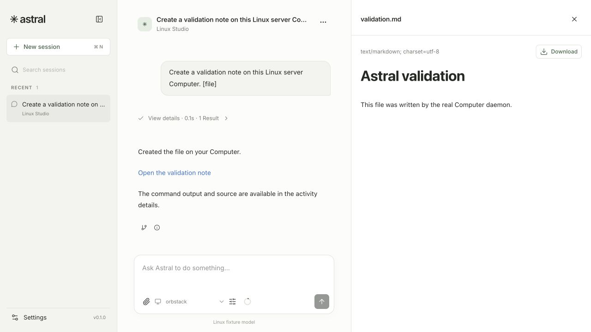
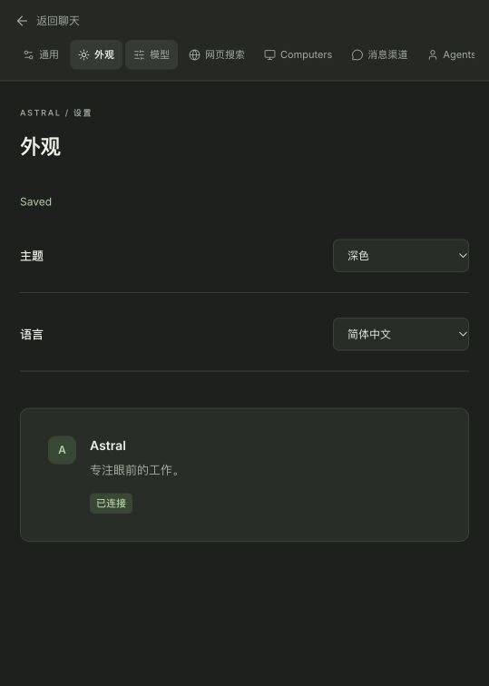

# Verification record

Baseline verification: **2026-10-21**; execution refactor, session titles, IM, settings and onboarding verification: **2026-10-22**, Asia/Singapore. The acceptance baseline is [SPEC.md §16](../SPEC.md#16-验收矩阵). This record distinguishes executable checks, actual browser/OS behavior, and checks that still need an external account or an unlocked desktop.

## Reproducible checks

```sh
pnpm install --frozen-lockfile
go test -race ./...
go vet ./...
pnpm lint:go
pnpm lint
pnpm typecheck
pnpm test
pnpm build:distribution
pnpm test:desktop-service
pnpm test:integration
pnpm --filter @astral/desktop package
```

The frontend suite covers event/commit reconciliation, discarded failed-attempt previews, stale callbacks after route changes, permanent EventSource failures, normal completion ordering and the desktop navigation/IPC boundary. The Go suite uses actual SQLite stores, HTTP/SSE adapters, authenticated WebSocket Daemons, shell processes and file streams. The Telegram and search servers in automated tests are deterministic local protocol fixtures.

Cross-module development uses a local Go workspace containing Astral, `../agent-core` and `../astral-models`. The current Core image, passive-maintenance and queued-input changes are published at `f508cdea9069` on `feat/model-contract`; Astral pins `v0.0.0-20261022092116-f508cdea9069` in `go.mod`. The final Astral race suite, vet, lint and distribution build run with `GOWORK=off`, using the published dependencies instead of local replacements.

The tagged platform integration tests require the distribution binaries and a running local Docker runtime. They download and execute the actual installer, connect a host Daemon, create Computers through both container entry points, perform real Linux command/file operations, check that retries reuse one container, and verify that registrations do not modify Agent allowlists. Test containers and volumes are removed by cleanup hooks.

`check-desktop-service.mjs` launches the real Go binary through the desktop service class, verifies private Owner handoff, graceful shutdown, shutdown after a killed parent process, release of the data lock, and preservation of Local Computer identity on restart.

## Selected wordmark and optical alignment, 2026-10-22

The shared lockup now uses exact copies of the selected `artifacts/wordmark-redesign/astral-lockup.svg` and `astral-lockup-inverse.svg`. Both retain their original aspect ratio and geometry; the shared component compensates for the artwork's canvas inset so its visible left edge aligns with page content and its visible vertical center aligns with adjacent controls.

Browser checks at 1280 × 720 verified light/dark resource switching with identical geometry. At 390 × 844, the logo and language control remained aligned without horizontal overflow. The login page's logo, heading and input also shared the same visible left edge. Web typecheck, component ESLint and the macOS/Linux distribution build passed; no backend behavior changed.

Evidence: [light onboarding](../artifacts/wordmark-ui-review/onboarding-light.png), [dark onboarding](../artifacts/wordmark-ui-review/onboarding-dark.png), [narrow dark layout](../artifacts/wordmark-ui-review/onboarding-dark-narrow.png), [login alignment](../artifacts/wordmark-ui-review/login-light.png).

## Default Bot and two-step onboarding, 2026-10-22

A fresh installation now creates one ordinary Bot named Astral and guides the Owner through model selection and Computer selection before opening the chat home. The final action grants the selected Computer access and saves both defaults together.

- `TestDefaultBotIsCreatedOnceAndRespectsRenamingAndDeletion` covers first creation, renaming, reopening, deletion and reopening without recreating the Bot. `TestExistingInstallationKeepsItsBotsAndResourceChoices` verifies an existing Bot and its resource selections remain unchanged and skip onboarding.
- `TestOnboardingRequiresBothResourcesAndStartsAWorkingSession` uses the Owner HTTP API, actual SQLite transactions and a connected Local Daemon. It rejects missing resources, an offline Computer and disabled models/providers without partial assignment; verifies atomic completion, idempotent retries and rejection of conflicting late submissions; then starts a real Session whose model tool call executes a command on the selected Computer.
- The browser replay started with a fresh data directory, saved a local model connection, imported two models and selected one. Computer access remained empty until the final action. Restarting the isolated server without its Local Daemon restored the selected step but showed the Computer offline and disabled completion. The shared Add Computer flow reconnected the same local identity; finishing opened chat with Astral and both chosen defaults. The first message ran `exec_command` and displayed the actual `onboarding-computer-ok` output.
- Renaming Astral to 小星 persisted after reload without reopening onboarding. The global Computer settings reused the same connection dialog and still led to explicit Bot permission management. A separate temporary Daemon connected after switching from the remote flow to the local flow: the dialog retained the local Computer, and the late Computer had no Bot access. That temporary Daemon was stopped and its registration revoked after the check.
- Desktop layouts and actual 390 × 844 viewports were inspected in Chinese/light and English/dark, including both steps and the fixed footer. Refresh and backward navigation retained the selections. The model server was a deterministic local protocol fixture, while the Computer connections and shell commands were real; this is not a claim of testing a paid model account. Container provisioning was not manually replayed for this change.
- `GOWORK=off go test -race ./...`, `go vet ./...`, Go lint, frontend lint/typechecks, all 37 frontend tests and the macOS/Linux distribution build passed. The final build includes the connection-mode guards and restored-selection validation. A fresh launch of the built macOS binary served its embedded onboarding UI with the default Astral Bot and no model configured. Existing large-chunk and mixed static/dynamic import warnings remain.

Browser evidence: [model step](../artifacts/onboarding-review/01-model-step.png), [offline gate](../artifacts/onboarding-review/02-offline-computer.png), [connection choices](../artifacts/onboarding-review/03-add-computer.png), [ready Computer](../artifacts/onboarding-review/04-computer-ready.png), [narrow Computer step](../artifacts/onboarding-review/05-computer-narrow.png), [narrow model step](../artifacts/onboarding-review/06-model-narrow.png), [dark English model step](../artifacts/onboarding-review/07-model-dark-en-narrow.png), [dark English Computer step](../artifacts/onboarding-review/08-computer-dark-en.png), [chat home](../artifacts/onboarding-review/09-ready-to-chat.png), [first real command](../artifacts/onboarding-review/10-first-task.png), [renamed Bot](../artifacts/onboarding-review/11-renamed-bot.png), [shared settings flow](../artifacts/onboarding-review/12-settings-computer-reuse.png), [late connection keeps the local selection](../artifacts/onboarding-review/13-late-connection.png), [fresh packaged launch](../artifacts/onboarding-review/14-clean-distribution.png).

## Search adapters and untruncated output, 2026-10-22

Search now supports the 11 retained Memoh providers plus DeepSeek Search. Bing is absent from the catalog. The model tool and Owner test endpoint share `query`, optional `domains`, `recency` and `limit`; see the [search contract and provider matrix](search.md).

- The adapter tests cover all 12 request formats and authentication mechanisms, omission of optional defaults, unchanged explicit count values, domain normalization, date mappings, unsupported-option errors, proxy/version/full-endpoint URL handling, provider error envelopes, nested Tencent JSON, DuckDuckGo HTML and Yandex Base64 XML. The routing test still proves that one selected provider is called once and another provider is never used as fallback.
- A real local HTTP search response contains 8 results and more than 4 MiB of summary text. The complete response survives the service boundary. A separate model/tool integration test invokes `web_search` with all optional parameters and verifies all 8 long summaries in the next model request, beyond the former result-count and text limits.
- Persistence checks cover legacy single-key records, partial Tencent credential replacement, cross-adapter credential isolation, stale revision rejection, rejecting secret fields in public configuration, and ignoring caller-supplied credential references. Owner HTTP tests cover the 12-entry catalog, new credential dictionaries, the legacy `api_key` input, invalid limits and the test endpoint's parameter forwarding.
- Browser checks at 1280 × 720 inspected all 12 choices, scrolled to and opened the final Yandex entry, and checked Google `cx`, Tencent SecretId/SecretKey and Yandex folder/region fields. Tencent and DeepSeek connections were created using clearly labeled local fixture credentials; each returned 8 visible results. Replacing only Tencent's SecretKey preserved its saved SecretId. Unsaved connection edits disabled testing; a successful save cleared the draft and restored testing. The temporary test connections were unassigned to Bots and removed afterwards. No existing Bot selection or connection was changed.
- `GOWORK=off go test -race ./...`, `go vet ./...`, Go lint, frontend typechecks, 37 frontend tests and the macOS/Linux distribution build passed. Existing large-chunk and mixed static/dynamic import build warnings remain. The browser reported no warnings or errors in the exercised flow.

Browser evidence: [service catalog](../artifacts/search-review/provider-catalog.png), [catalog after scrolling](../artifacts/search-review/provider-catalog-bottom.png), [Tencent settings](../artifacts/search-review/tencent-settings.png), [Tencent results](../artifacts/search-review/tencent-results.png), [DeepSeek settings](../artifacts/search-review/deepseek-settings.png), [DeepSeek results](../artifacts/search-review/deepseek-results.png).

These are local protocol and UI checks, not paid-account production certification for all 12 services. No real search API key was used. Google Custom Search is limited to existing customers until its announced retirement; DuckDuckGo's public HTML endpoint may require browser verification, and SearXNG must allow JSON output.

## Settings rework, 2026-10-22

The implementation follows [UI/UX specification v1.2](ui-ux-spec.md). Global settings retain the Bot entry; entering a Bot replaces the global navigation with that Bot's basic settings, Computer access and connected platforms. Each platform leads to an account list even when only one account exists. Account configuration, access scope and individual chat operations keep separate submission boundaries.

| Area | Change and observed result |
| --- | --- |
| Shared layout | General, Appearance, Models, Search, Computers, Bots, Storage, Security and About use the same content container, spacing and setting rows. Group surfaces use the chat area's base color; field borders remain visible. Idle save feedback occupies no space. |
| Bot settings | Name, avatar, default model, Probe override and search selection are visible directly. A fresh temporary Bot's name and avatar were edited with Enter and its default model selected; all three persisted after reload with no missing-action error. The temporary Bot had no Computer grants or Sessions and was removed after the check. |
| Computer access | Global settings manage connections and link to each Bot's permissions. The Bot page separately shows its default Computer, allowed Computers and the global management link. The reported permission-save error was repaired; readback showed the actual ungranted state without resubmitting an authorization. |
| Search connection | A modified name remained a draft after blur and returning to the list; reopening restored it. Saving normalized the field and cleared the dirty state. Testing the saved local connection returned one result. Testing never silently saves draft connection parameters. |
| Model connection | Full connection drafts are retained in memory across switching forms. Submission reads the current resource before applying the captured connection fields, preserving independent enabled-state changes. Saved response values update only fields not edited again during the request. |
| Telegram | The platform list, single-account list, account details, scope selection and chat rows were inspected. Group reply controls and change/remove-conversation actions remain directly visible; private chats show their fixed reply behavior. No live Telegram account was used. |
| Themes and language | Light Chinese, dark Chinese and dark English settings were inspected at the actual 1280 × 720 viewport. Theme and language save automatically and retain the current page. Original System/Chinese preferences were restored. The final browser check reported no warnings or errors. |
| Responsive limits | The browser accepted a requested 390 × 844 override but DOM measurements remained 1280 × 720, including a new test tab. The override was reset. Responsive CSS was reviewed, but this pass does not claim a successful narrow-screen browser verification. |

Final checks: `GOWORK=off go test -race ./...`, `GOWORK=off go vet ./...`, golangci-lint 2.15.0, frontend ESLint, Web/desktop type checks, all 37 frontend tests, the distribution build and desktop service lifecycle checks passed. The six added settings mutation tests cover serial edits, coalescing, stale responses, lost acknowledgements, uncertain-result readback and success-timer isolation. The offline account-metadata regression verifies that rename/access changes do not require a platform round trip, while changed connection parameters and re-enabling still validate. The shutdown regression exercises an already-closed remote WebSocket; the previously intermittent real-Daemon platform test passed 20 consecutive race-enabled runs.

Evidence: [Bot basic settings](../artifacts/settings-review/after/30-bot-settings-final.png), [Computer access](../artifacts/settings-review/after/14-bot-computer-access.png), [appearance spacing](../artifacts/settings-review/after/16-appearance.png), [Computer details](../artifacts/settings-review/after/22-computer-detail.png), [confirmed automatic save](../artifacts/settings-review/after/24-autosave-confirmed.png), [platform account list](../artifacts/settings-review/after/25-telegram-accounts.png), [account configuration](../artifacts/settings-review/after/26-telegram-account.png), [chat controls](../artifacts/settings-review/after/27-account-chats.png), [dark appearance](../artifacts/settings-review/after/28-appearance-dark.png), [dark English account](../artifacts/settings-review/after/29-account-dark-en.png). Screenshots in `settings-review/before` and `settings-review/intermediate` record earlier iterations, not current acceptance. Distribution build warnings about large chunks and mixed static/dynamic imports remain. Native desktop preferences and live external service accounts were not manually exercised in this settings pass.

## IM accounts, proactive mode and settings, 2026-10-22

The full Astral and Core Go suites passed. Core's full race suite and Astral's channel, gateway, harness, persistence and Computer race suites passed. Astral `go vet ./...`, golangci-lint 2.15.0, frontend ESLint, Web/desktop type checks, all 31 frontend tests and the Web production build passed. OpenAPI and the TypeScript SDK were regenerated. The build retains the existing large-chunk and mixed static/dynamic-import warnings. The earlier QF1001 finding in Core's ledger predicate was corrected before publishing `f508cdea9069`; Core lint with Astral's configuration then reported zero issues.

| Boundary | Regression evidence |
| --- | --- |
| Scope and binding | `TestAllChatActivationHasNoHistoryPrefillAndModesKeepBindings`, `TestRebindStopsOriginalAndTargetBeforeCommit` and `TestPrivateFirstMessageActivatesAndDirectMessagesBypassProbe` cover first activation without prefill, Agent ownership, existing Session selection, mode changes, preserved settings and stopping both Sessions before rebind |
| Passive context | Core `TestPassivePressureCompactsWithoutDriving`, `TestNaturalCompletionDrainsPassiveBacklog` and `TestPassiveReadmissionResumesAfterFailedCommit` cover compaction without main-model generation, a 150-input backlog and retry after a failed atomic commit |
| Probe decisions | `TestProbeDecisionUsesFirstValidBooleanWithoutExecutingAnything` covers true/false, missing/wrong tools, invalid JSON, non-boolean values, forbidden extra fields and first-valid ordering; projection tests exclude assistant text, reasoning and Web prompts |
| Probe lifecycle | `TestProactiveModeUsesLLMOnlyAndDoesNotRepeatCoveredInputs`, `TestStaleProbeCannotWakeAfterMentionOffOrRebind`, `TestProbeFailureCoversOnlySnapshotAndAllowsNewMessages` and `TestProbeFollowsSessionModelAndOverride` cover default-off behavior, one covered snapshot, stale results, new arrivals and model selection |
| Output and images | Telegram recovery tests cover explicit `send_message`, Web-only assistant text, self-echo deduplication, native frozen images and no received Computer files. Core image tests verify patch/payload limits, alpha preservation and EXIF orientation even below the resize threshold |
| Computer API | `TestAttachmentBytesAndFilteredPaginationThroughRealGateway` streams a 2.4 MB original through the real Daemon transport and verifies its hash, search-before-pagination and message lookup. Telegram operation tests scope target/source/nested references and Topic message identities, and allow all-mode API access without Session activation |

Real browser interaction used the current Vite source at port 5176, an isolated Go server at port 4596, local Telegram/model protocol fixtures at ports 4560/4561, actual Core/SQLite and the local Computer Daemon. Through the UI, the Agent's Probe override was saved and retained after reload; a specified-scope account started empty; its chat was bound to an existing Web Session. Ordinary group chatter while proactive mode was off made no model request. A normal Web prompt made no Telegram send; an explicit send tool made exactly one. A mention bypassed Probe. After enabling proactive mode, one ordinary message produced one Probe on the override model and one main-model run, without another send. Switching specified → all → specified preserved the binding and proactive setting.

The earlier settings iteration was visually checked against the then-existing General page. This paragraph and its linked screenshots are historical; the settings rework below supersedes that layout. Resource hover now fills the complete row. Chat title/type, the right-aligned proactive switch and footer actions use a single card with the existing settings spacing. Chinese linked-message parsing was corrected. The new layout was inspected in light and dark themes in the actual 774 × 756 browser viewport, then the original system-theme preference was restored. No new browser warnings or errors appeared during that final check. A requested 390 px emulation was not applied by the browser and is not counted as a mobile verification.

Evidence: [Web response and explicit send](../artifacts/im-integration/web-explicit-send.png), [explicit-send fixture state](../artifacts/im-integration/explicit-send-state.json), [proactive fixture state](../artifacts/im-integration/proactive-state.json), [resource hover](../artifacts/im-integration/ui-review/04-resource-hover-after.png), [chat settings layout](../artifacts/im-integration/ui-review/05-chat-layout-after.png), [dark chat settings](../artifacts/im-integration/ui-review/06-chat-dark.png).

Host schema 3 uses a new desktop data directory and retains the previous directory. There is no old-data migration. This pass did not use a live Telegram account. The Core dependency changes have since been published and pinned as described above.

## Automatic session titles, 2026-10-22

The current changes passed `go test -race ./...`, `go vet ./...`, golangci-lint 2.15.0, `pnpm lint`, Web/desktop type checks, all 31 frontend tests, and the Web production build. OpenAPI and the TypeScript SDK were regenerated. The Go title tests exercise an independent request on the Session's selected model, request cancellation, unchanged conversation history, concurrent model/pin edits, manual rename precedence, bounded Unicode input, and failure without retry after reopen. Animation tests cover graphemes, repeated snapshots, first-load history, newly created Sessions, manual renames, reduced motion and timer cleanup.

Browser verification used the current Vite source at `http://127.0.0.1:5175`, an isolated Go server at port 4595, and `scripts/dev-provider.mjs` at port 4559. The real provider adapter, Core, SQLite and SSE path produced the prompt fallback and then the generated title. The observed sidebar prefixes included `A`, `Ast`, `Astr`, and finally `Astral会话标题生成`; the caret disappeared on completion. A separate title request returned HTTP 503: chat still completed, a follow-up received another reply, and page reload preserved the fallback without another title call. Model output in this pass came from the local fixture.

Evidence: [typing in progress](../artifacts/session-titles/typing.png), [completed generated title](../artifacts/session-titles/generated-title.png), [failed title with successful follow-up after reload](../artifacts/session-titles/failed-title-fallback.png), [observed text sequence](../artifacts/session-titles/typewriter-samples.json).

## Execution refactor verification, 2026-10-22

The three repository Go suites, race checks, `go vet` and golangci-lint 2.15.0 checks passed with fresh SQLite databases and the shared Memory implementation. All six Core examples ran successfully. OpenAPI and the TypeScript SDK were regenerated; Web/desktop type checks, 19 frontend tests and ESLint passed. The four distribution binaries built successfully, and fresh-data installer/container integration plus desktop service lifecycle checks passed. The native macOS application was built and opened on a separate empty data directory.

| Boundary | Regression evidence |
| --- | --- |
| Input admission | Prompt Busy rejects admission; queues require explicit Continue; stable IDs detect content conflicts; indexed receipts retain frozen payloads and acceptance time after lost acknowledgement and reopen |
| Atomic preparation | Memory/SQLite tests combine summary, fresh environment, attached context, driver input and consumption in one commit; collector, final budget and write failures preserve the old context and pending inputs |
| Concurrent preparation | Clear during collection prevents delivery; later input waits for the next boundary; committed writes with lost acknowledgements are not repeated |
| Compaction | New input stays outside the old-history summary; default retention adapts to a small window; summary requests have their own budget; failed candidates cannot loop through compactions |
| Retry isolation | Generation and summaries retain frozen requests, three total default attempts, cancellable Retry-After, timeout/permanent-error behavior and one bounded protocol repair; failed fragments never enter subsequent model context |
| HTTP/SSE | `TestRetrySnapshotSurvivesEventStreamReconnectWithoutResubmission` restores the active retry from a new subscription, observes exactly two model calls and one admitted input |
| UI | Retry count/time survives snapshot reconnect; stale events cannot regress a newer view or mix Attempt output; reconnection does not send an input mutation |
| Business behavior | Web/IM attachments, passive observations, trigger groups, normal completion with queued independent work, Computer/CWD, original process targets, approvals, unknown results, image replay, Fork and read-only reopen remain covered |

Host schema 3 and Core format 9 are the only supported formats. These checks create new data; no old-data migration or compatibility reader is supplied. The browser evidence below records the earlier 2026-10-21 product pass; it is not presented as a new manual replay of every screen after this refactor.

## Browser and runtime evidence

The browser checks used isolated test data and the repository's loopback model fixture. Model output came through the real model adapter and Core. Commands and files used actual Daemons.

| Check | Observed result |
| --- | --- |
| Provider/Profile/Agent setup | Completed in the shared Web UI; catalog recommendations loaded, explicit overrides retained, tool call/replay verification succeeded |
| Non-streaming model | Linux Web setup selected streaming Off; a tool call executed and its result produced a file link |
| Local and container execution | Real Daemons wrote `validation.md`; the file was read through the source-bound file API and rendered as Markdown |
| Container provisioning | OrbStack created and connected a Linux Computer; the existing Mac Computer remained separate; Agent assignment was explicit |
| Provisioning retry | Repeating the same intent returned the same operation and Computer; only one matching container existed |
| Source binding | After the Session switched to the container, a previous file link still read the original Mac Computer |
| Image history and replay | A small PNG was uploaded, delivered as a native data image to the provider, and frozen in the rollout. Its original was made unavailable; reloaded history and a Fork retained the exact image payload |
| Stop and queued input | Stop reached a cancelled terminal state. The independently accepted follow-up remained Waiting until explicit Continue, then applied once |
| Failed stream/retry | The fixture emitted `UNCOMMITTED_GHOST` and broke the stream. The retry committed one reply; the failed text disappeared from the transcript |
| Service restart | The page showed Reconnecting while the server was down, recovered its subscription without a reload, and retained history without the failed-attempt text |
| Silent end | The earlier browser pass checked the former silent-end tool. That business tool has since been removed; normal completion and explicit sends are covered by the current IM checks. |
| Compaction | With sufficient recent context, the request estimate changed from 32,789 to 23,884 while earlier conversation entries and original image history remained accessible |
| Appearance and narrow layout | English/Chinese and dark/light state were persisted; a narrow viewport retained the composer and independent Stop control |
| Linux first use | The built Linux ARM64 server served the embedded UI. Provider, Profile and Agent were configured in the browser, and its Local Linux Computer executed the file-producing command |





## Acceptance matrix

The references below identify the implementation checks for each SPEC scenario. “Fixture” means the external service is locally simulated; it does not mean a live Telegram or search account was exercised.

| ID | Evidence |
| --- | --- |
| A01 | Packaged Electron startup plus `check-desktop-service.mjs`; shared browser setup/execution passed. Native window/menu/tray interactions require an unlocked macOS session; see limits below |
| A02 | Linux ARM64 binary ran inside a real Linux container, served the embedded shared UI, and completed first-use setup and file execution in the browser |
| A03 | Versioned global resources; `TestVersionedConfigurationAndCredentialReopen`; browser Agent setup selected global resources |
| A04 | `TestEnrollmentRetryAndAgentAllowlistRemainExplicit` and real container integration assert no implicit allowlist expansion |
| A05 | `TestLocalComputerReuseAndRemoteEnrollmentUseRealDaemonConnections`, `TestDistributionInstallerRegistersActualDaemon`, `TestContainerShortcutAndInstallerUseIndependentRealComputers` |
| A06 | New-session default selection in browser; `TestContextStatsStayOnFrozenRequestUntilRunFinishes`; Core model-selection/options integration tests |
| A07 | `TestPassiveObservationAndAtomicTriggerDoNotDuplicateOrInventActivation` rejects an active Owner Computer switch; running browser composer disables it |
| A08 | `TestSessionKeepsProcessOnOriginalComputerAndRetiresHandlesAcrossRestart`; browser switched an existing Session to the container |
| A09 | Same process-handle test, `TestProcessOriginalComputerAndBootCannotBeRebound`, and browser reading the Mac file after the switch |
| A10 | `TestTwoComputerFilesystemAndGatewayBindings`; stable per-Agent/Computer homes; browser Fork identifies shared Computer files |
| A11 | Real shell tests and browser file creation execute without per-command approval; unresolved outcomes have explicit Core records and UI |
| A12 | `TestTwoComputerFilesystemAndGatewayBindings` checks the injected gateway URL and rejects forged identity |
| A13 | `TestConcurrentLocalGatewaysKeepAgentSessionAndSourceIdentity` exercises simultaneous bound gateways |
| A14 | Channel binding uniqueness and distinct conversation/topic keys in `internal/channels/channels_test.go` |
| A15 | `TestAllChatActivationHasNoHistoryPrefillAndModesKeepBindings`, `TestPrivateFirstMessageActivatesAndDirectMessagesBypassProbe` and Telegram recovery tests cover owned accounts, scope and direct activation |
| A16 | Core passive-maintenance tests cover compaction without driving and draining 150 pending inputs; Telegram and harness tests assert no main-model request for passive context |
| A17 | Both tests assert the trigger body appears once, with its associated observation and earlier context |
| A18 | Durable delivery reconciliation plus Core context-injection tests for pending/application and cold reopen |
| A19 | `TestImageCarriesOriginalAttachmentURIAndNativeImage` and message rendering tests cover normalized source, escaped body and native attachment |
| A20 | Telegram edit/retry/echo checks and `TestObservationIdentityKeepsEditsAndIsScopedToConnection`; unsupported deletion events are declared unsupported |
| A21 | Bound Web Submit uses Steer; browser input into an existing bound Web Session completed normally and retained the binding |
| A22 | Telegram fixture and actual browser checks show Web-only assistant text and one explicit `send_message` with a persisted receipt |
| A23 | `TestOutboundUnknownIdempotencyRebindingAndRestart` and Telegram self-echo checks |
| A24 | Normal completion in the Telegram fixture and browser creates no automatic reply or placeholder |
| A25 | `TestProactiveModeUsesLLMOnlyAndDoesNotRepeatCoveredInputs` covers default-off behavior and covered inputs; actual browser/fixture flow observes the production quiet period and no self-send loop |
| A26 | `TestProbeDecisionUsesFirstValidBooleanWithoutExecutingAnything`, projection tests and `TestProbeFailureCoversOnlySnapshotAndAllowsNewMessages` |
| A27 | `TestStaleProbeCannotWakeAfterMentionOffOrRebind` and the failure/new-arrival test; the main-context assertion rejects Probe decision content |
| A28 | Browser Markdown file previews on Mac/container/Linux; `TestOwnerAuthAndIndependentHistoricalImageAndOriginalDownload` |
| A29 | `TestFileSendRetainsSourceAndTextFragmentsStayOrdered` streams the actual source file into the Telegram fixture and records the receipt |
| A30 | Native IM image recovery without Computer files, Core patch/alpha/EXIF tests, real Gateway original-byte streaming, existing image reopen/Fork tests and earlier browser upload/deletion/Fork checks |
| A31 | `TestFileReferencesSnapshotRangeAndSourceFailure`, HTTP historical-image/original-download test, transport cancellation tests |
| A32 | `TestVerificationRevisionAndImmutableCredentials`, `TestCatalogRefreshRetainsOverridesAndNativeEfforts`; browser verification and Linux non-streaming execution |
| A33 | `TestExactlyOneSelectedProviderAndNoFallbackOnFailure` |
| A34 | Actual browser tool-argument preparation and completed Activity Line; `session-state.test.ts` distinguishes preparation from execution |
| A35 | `TestStopPreservesQueuedInputUntilExplicitContinue` and browser Stop/Waiting/Continue sequence |
| A36 | Composer displays actual approval/unresolved records; Core authorization and unknown-effect tests; normal shell execution remains direct |
| A37 | `TestEventSubscriptionPrecedesSnapshotAndReconcilesCommit`, frontend reducer/connection tests, actual server-restart browser check |
| A38 | Process-handle cold-restart test, outbound unknown/restart test and desktop parent-death check |
| A39 | Core Fork/compaction suites; browser Fork and actual compaction preserve original history, with no copied IM binding |
| A40 | `TestOutboundUnknownIdempotencyRebindingAndRestart`; Conversation lifecycle retains previous Sessions and destinations |
| A41 | Frozen-request context test, immutable credential/profile tests, current allowlist validation, source-pinned process tests |
| A42 | Shared Vue application, generated SDK, frontend lint/typecheck/tests, four-binary build and Electron package build |
| A43 | Telegram group/private/Topic schemas, validation, polling and send routes have local protocol-fixture coverage; no live bot account was used |
| A44 | `TestDistributionInstallerRegistersActualDaemon` downloads the installer and waits for a real registered connection |
| A45 | `TestContainerShortcutAndInstallerUseIndependentRealComputers` also runs the remote-container installer |
| A46 | That test retains separate local, shortcut-container and installer-container Computer identities; browser retained Mac and container |
| A47 | `TestContainerFailureIsDurableAndRequestRetryDoesNotDuplicate`; successful integration checks explicit assignment |
| A48 | Local shortcut test checks repeated use and Server restart reuse; browser “Use this machine” returned the existing Mac |
| A49 | Real local-container integration plus unavailable-runtime failure test and same-intent retry |
| A50 | Bootstrap host assertion and Linux Web first-use show the Server's Linux Computer instead of the browser's Mac |
| A51 | Generic Connection/Conversation/Binding/Adapter interfaces, normalized observations and generic outbox; only Telegram implementation is offered |
| A52 | Adapter capability fields and unsupported-operation errors; webhook/privacy diagnostics tested without inventing platform events |

Core test names refer to [astral-core](https://github.com/oines/astral-core); the current IM additions are included in published revision `f508cdea9069`. Application test files are under `internal/`; browser reducer tests are under `apps/web/src/`. A successful local workflow is not a claim that hosted GitHub Actions has run.

## External and manual limits

- Live `deepseek-flash` checks were run on 2026-10-20 against both Chat Completions and Responses in `astral-models`: tool call/result replay, durable reopen, ordinary continuation, generic Core EndRun and a later activation passed. These checks did not establish every provider/model capability or live image compatibility.
- Telegram and Tavily/Exa checks here use local protocol fixtures. A live bot's permissions, group visibility, account limits and network behavior must be checked with that deployment's credentials.
- The macOS session was locked during native UI validation. Application/service startup and lifecycle were exercised, but native menu, tray, close-window preference, login-start and file-picker interaction are not marked manually verified.
- Generated macOS packages are unsigned and unnotarized. ARM64 is the local execution architecture; Intel artifacts are cross-packaged.
- Remote enrollment was exercised through real downloaded installers and authenticated connections on local test hosts/containers. No claim is made about a user's external DNS, reverse proxy, VPN or NAT configuration.
